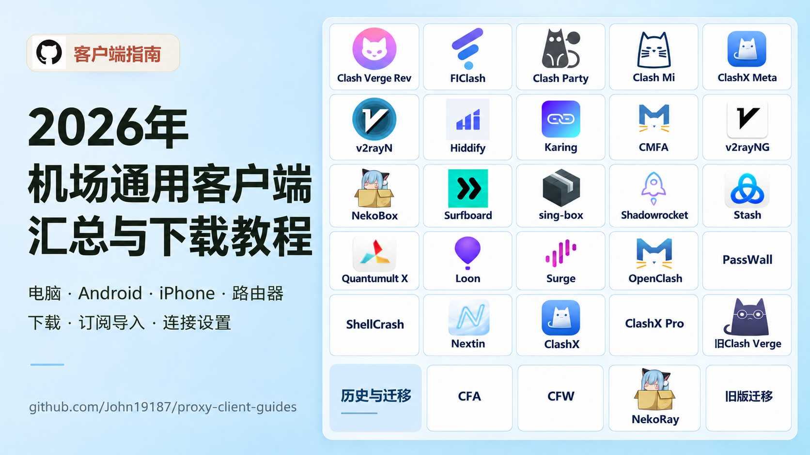
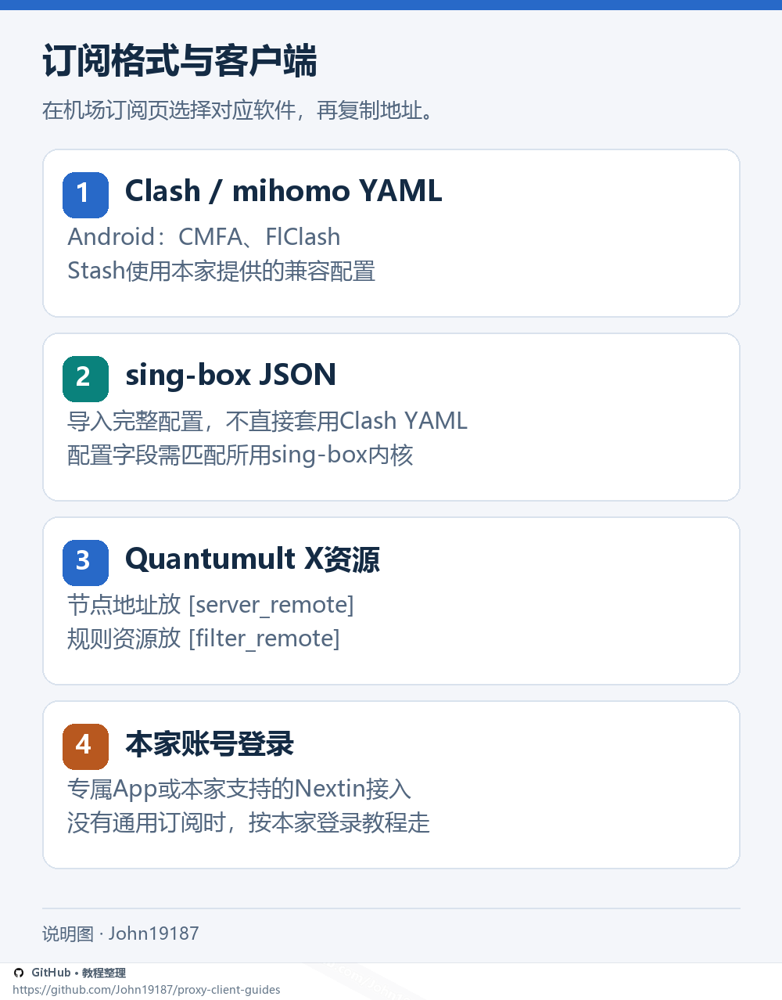
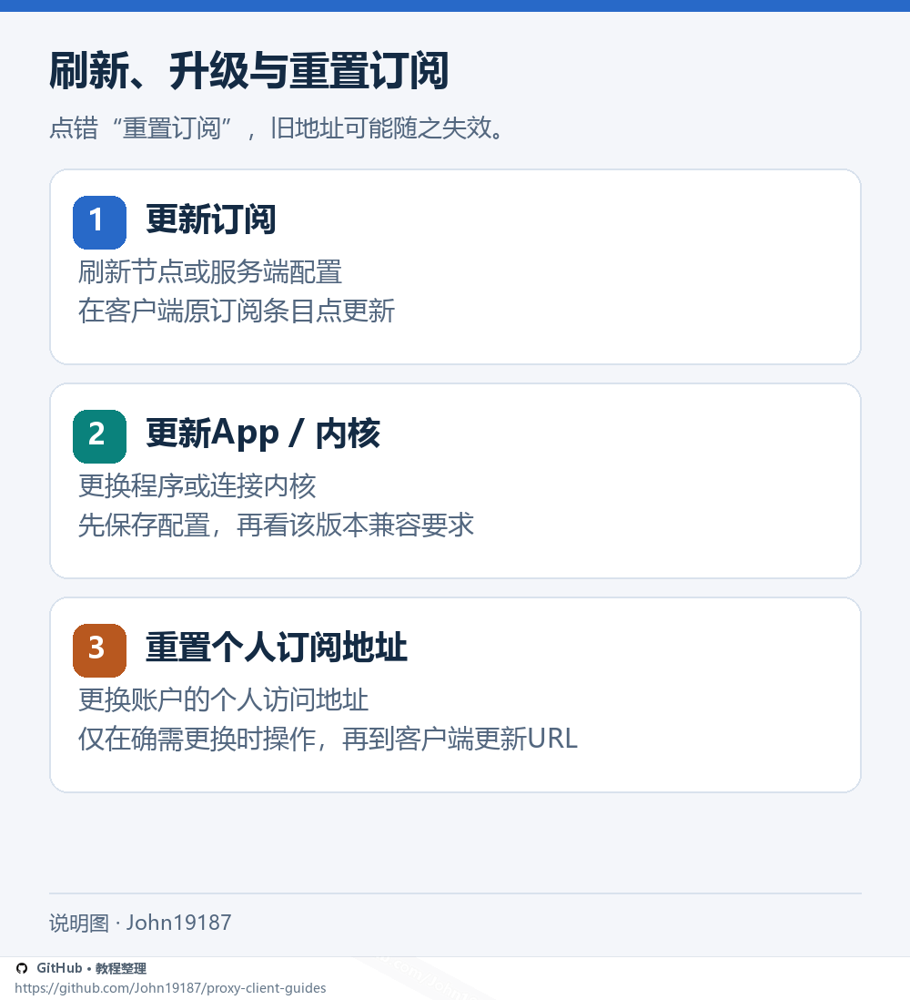
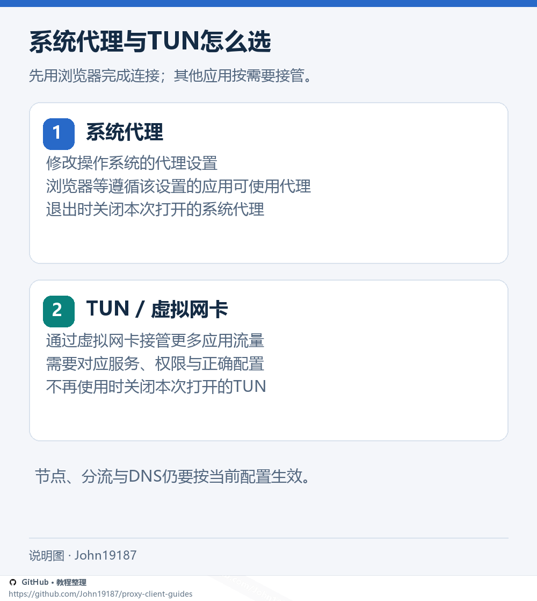

# 2026年机场通用客户端汇总与下载教程：Windows、macOS、Linux、Android、iPhone和路由器

先在服务账户看清支持的客户端，再按设备选软件：Clash／Mihomo配置可用Rev、FlClash等；安卓节点订阅可用v2rayNG；iPhone则选服务明确支持的小火箭、Stash或Loon。下面按设备给下载和操作入口，已有软件可直接跳到相应名称。

客户端负责连接，节点来自你购买的服务；安装客户端不会附送套餐。

**常用原包：** [Rev Windows x64安装版](https://github.com/clash-verge-rev/clash-verge-rev/releases/download/v2.5.10/Clash.Verge_2.5.10_x64-setup.exe) · [FlClash安卓ARM64](https://github.com/chen08209/FlClash/releases/download/v0.9.3/FlClash-0.9.3-android-arm64-v8a.apk) · [小火箭App Store](https://apps.apple.com/us/app/shadowrocket/id932747118?uo=4) · [其他软件与架构](#downloads)

**已有软件：** [电脑](#desktop) · [安卓](#android) · [iPhone／iPad](#ios) · [路由器](#router) · [更新订阅](#update) · [旧版迁移](#legacy) · [连接失败](#symptom-table)

按下面的平台和格式选择软件，点击名称进入该款的下载与完整操作教程。

### 网络环境和服务接入方式变了，客户端怎么选

2026年3月底至4月初，部分国内中转资源清退或迁移，一些服务随之更换线路、协议或专属App。10月底的连接异常在11月初已有改善反馈。平时留意你所用服务商的首页公告，节点域名、端口或线路有变化时，按说明更新订阅、换节点或调整客户端。相关背景见[近期网络变化与服务调整](https://github.com/John19187/ssr-v2ray-trojan-clash-guide#network-context)。

多个节点突然同时失败，先查账户、流量与你所用服务商的首页公告，再用同一配置比较另一条自己的网络。已经导入且有节点，却只有某个应用不通时，继续按[本机连接症状](#symptom-table)排查接管、规则与DNS；软件安装、服务调整和外部网络变化分别处理。

## 按设备和订阅格式选择机场客户端

先看服务账户提供哪种订阅，再选设备上的软件。电脑用着Clash配置，换手机时不一定要继续使用同名软件，但要取得手机App能读取的内容。只需要一个浏览器上网，与希望路由器统一接管多台设备，也是不同的安装任务。

| 使用设备与现有内容 | 可从这些客户端开始 | 选择时的区别 |
|---|---|---|
| Windows、Mac或Linux，服务提供Clash／Mihomo配置 | [Clash Verge Rev](#clash-verge-rev)、[FlClash](#flclash)、[Clash Party](#clash-party)、[Clash Mi](#clash-mi)；Mac菜单栏另看[ClashX Meta](#clashx-meta) | 先按系统门槛和CPU选包，导入后选中配置，再选择系统代理或需要的接管方式 |
| 电脑拿到节点订阅或单条协议链接 | [v2rayN](#v2rayn)、[Hiddify](#hiddify)、[Karing](#karing) | 先确认本款软件支持所用链接；导入节点后，仍需选择当前节点并开启连接 |
| Android手机或平板 | [CMFA](#cmfa)、[FlClash](#flclash)、[v2rayNG](#v2rayng)、[Hiddify](#hiddify)、[Karing](#karing)、[sing-box](#sing-box)、[Surfboard](#surfboard) | APK要匹配架构；完整YAML、节点订阅和JSON不能随意互换，首次连接需要VPN授权 |
| iPhone、iPad | [小火箭](#shadowrocket)、[Stash](#stash)、[Quantumult X](#quantumult-x)、[Loon](#loon)、[Surge](#surge)，以及有正式商店入口的跨平台客户端 | App授权与节点服务分别取得；节点资源和完整配置的导入效果不同 |
| OpenWrt路由器或Linux管理设备 | [OpenClash](#openclash)、[PassWall](#passwall)、[ShellCrash](#shellcrash) | 插件、内核、固件和脚本不是同一种包，需保留后台管理与恢复路径 |
| 已安装CFW、CFA、旧ClashX或NekoRay | [旧版与迁移](#legacy) | 保留个人订阅和自定义设置，关闭旧软件的系统代理或VPN，再在新客户端独立配置 |

### 订阅地址、节点和配置分别是什么

**订阅地址**是服务商提供的下载链接。客户端用它取得节点，日后也用同一个地址更新。节点是可选择的服务器记录，通常带有地区或用途名称。服务也可能交付一份**完整配置**，除了节点，还安排策略组、分流规则和DNS：策略组决定哪些节点可供选择，规则决定不同请求使用哪一组或直接连接。

两个地址都以`https://`开头，下载到的内容也可能不同，因此要复制账户中为目标软件准备的地址。**单节点链接**通常以`vless://`、`vmess://`、`trojan://`、`ss://`等开头，只保存一个连接对象，不能代替可更新的整份订阅。

格式说明图：Clash／Mihomo配置交给支持它的配置入口，sing-box用版本匹配的JSON，QX节点资源与整份配置分开，专属App按自己的账户方式登录。

账户有目标客户端按钮就优先复制那个入口。二维码与一键导入只负责传递内容，不自动完成格式转换；把文件后缀改掉也不会改变结构。电脑换手机、下载成功却解析失败等情况，见[订阅链接与格式图解](subscription-formats.md)。

个人地址、二维码及导出文件可能含访问凭据，只保存在自己的客户端和私有备份中。

**下载软件以后，节点从哪里来？** 各教程使用自己服务账户提供的订阅。只有账号密码时，先看服务支持通用客户端，还是要求在专属App登录；不要把密码填进订阅URL框。接入方式可在[多家VPN推荐与推广](https://github.com/John19187/The-40-Best-VPNs#翻墙客户端与使用方式怎么选)比较，需要通用订阅时再按[多家机场推荐与推广的格式与设备条件](https://github.com/John19187/ji-chang-tui-jian#airport-clients)选套餐。已有兼容地址，继续下载安装即可。

### 各客户端的下载与完整教程

软件名称进入本仓独立教程，下载章节保留开发者原文件或正式商店地址。Windows在“设置 → 系统 → 关于”查看x64或ARM64；Mac在“关于本机”查看芯片。`amd64`也是x64，Intel与AMD的64位PC都可能使用；`arm64／aarch64`用于对应ARM设备。DMG与PKG先看发行说明，不能一律理解为不同芯片。

- **电脑与跨平台：** [Clash Verge Rev](downloads/clash-verge-rev/README.md)、[FlClash](downloads/flclash/README.md)、[v2rayN](downloads/v2rayn/README.md)、[Clash Party](downloads/clash-party/README.md)、[ClashX Meta](downloads/clashx-meta/README.md)、[Clash Mi](downloads/clash-mi/README.md)、[Hiddify](downloads/hiddify/README.md)、[Karing](downloads/karing/README.md)。
- **Android：** [CMFA](downloads/cmfa/README.md)、[v2rayNG](downloads/v2rayng/README.md)、[sing-box](downloads/sing-box/README.md)、[Surfboard](downloads/surfboard/README.md)、[NekoBox for Android](downloads/nekobox/README.md)；FlClash、Hiddify、Karing和Clash Mi也有对应Android入口。
- **iPhone／iPad与Apple平台：** [Shadowrocket小火箭](downloads/shadowrocket/README.md)、[Stash](downloads/stash/README.md)、[Quantumult X](downloads/quantumult-x/README.md)、[Loon](downloads/loon/README.md)、[Surge](downloads/surge/README.md)、[Nextin](downloads/provider-app/README.md)。支持iOS的跨平台软件也在其独立页给出正式商店链接。
- **路由器与Linux部署：** [OpenClash](downloads/openclash/README.md)、[PassWall](downloads/passwall/README.md)、[ShellCrash](downloads/shellcrash/README.md)。
- **停更与旧版辨认：** [CFW](downloads/cfw/README.md)、[CFA](downloads/cfa/README.md)、[ClashX](downloads/clashx/README.md)、[ClashX Pro](downloads/clashx-pro/README.md)、[旧Clash Verge](downloads/old-clash-verge/README.md)、[NekoRay](downloads/nekoray/README.md)，不确定名称时先看[旧版总览](downloads/legacy/README.md)。

Android的APK、OpenWrt采用apk包管理器的插件包，以及桌面压缩包，各属于不同系统。`Source code`是源码，签名与校验文件也不是客户端。iOS由自己的App Store账户取得兼容版本，下载前查看地区供给与当前系统要求。

## 电脑与跨平台客户端

| 客户端与完整教程 | 选用条件 |
|---|---|
| [Clash Verge Rev](downloads/clash-verge-rev/README.md) | Windows、Mac、Linux；Clash／Mihomo配置，适合需要独立窗口管理订阅的人。 |
| [FlClash](downloads/flclash/README.md) | 电脑与Android共用一套界面；支持兼容订阅和本地YAML。 |
| [v2rayN](downloads/v2rayn/README.md) | 电脑端管理节点订阅或单条协议链接；下载时区分系统、CPU与界面包。 |
| [Clash Party](downloads/clash-party/README.md) | 原名Mihomo Party；桌面Clash／Mihomo客户端，有安装版和便携版。 |
| [ClashX Meta](downloads/clashx-meta/README.md) | Mac菜单栏客户端；与旧ClashX、ClashX Pro分别安装和管理数据。 |
| [Clash Mi](downloads/clash-mi/README.md) | 跨平台Clash配置客户端；普通换节点用“代理”，高级面板另有用途。 |
| [Hiddify](downloads/hiddify/README.md) | 电脑、手机均有版本；添加兼容配置后，从首页连接并选择代理。 |
| [Karing](downloads/karing/README.md) | 电脑、手机均有版本；先确认服务提供Karing支持的订阅格式。 |

## Android客户端

| 客户端与完整教程 | 选用条件 |
|---|---|
| [Clash Meta for Android（CMFA）](downloads/cmfa/README.md) | Clash／Mihomo完整配置；支持订阅URL和本地YAML，连接时需要Android VPN授权。 |
| [v2rayNG](downloads/v2rayng/README.md) | 节点订阅和单节点分别导入；不把完整Clash YAML填入节点订阅分组。 |
| [Surfboard](downloads/surfboard/README.md) | 使用本款支持的配置；已有Surge配置也要先核对协议与字段兼容。 |
| [NekoBox for Android](downloads/nekobox/README.md) | 原仓1.4.2历史APK及迁移说明；与桌面NekoRay独立。 |
| [sing-box](downloads/sing-box/README.md) | Android、Apple及桌面客户端使用版本匹配的JSON；下载内核压缩包不能代替安装图形客户端。 |

## iPhone、iPad与Apple客户端

| 客户端与完整教程 | 选用条件 |
|---|---|
| [Shadowrocket（小火箭）](downloads/shadowrocket/README.md) | 适合节点订阅与单节点；软件授权和节点服务分别取得。 |
| [Stash](downloads/stash/README.md) | 使用本款兼容的完整配置；导入文件后还要选中它，再选策略中的节点。 |
| [Quantumult X](downloads/quantumult-x/README.md) | 节点、规则和重写资源分别维护；先有完整可用配置，再增加需要的资源。 |
| [Loon](downloads/loon/README.md) | 首次使用优先取得完整Loon配置；只加节点的人需要已有策略组和规则。 |
| [Surge](downloads/surge/README.md) | iOS与Mac分为不同软件授权；完整托管与分段托管的更新范围不同。 |
| [Nextin](downloads/provider-app/README.md) | 仅用于明确支持Nextin的服务；教程给出大哥云、ByWave识别码接入实例。 |

换用另一款客户端、准备卸载旧App时，先确认旧App在自己的App Store购买记录中仍可重新下载。

## 路由器与Linux部署

| 客户端与完整教程 | 选用条件 |
|---|---|
| [OpenClash](downloads/openclash/README.md) | OpenWrt上的Clash／Mihomo插件；安装包、运行内核和完整配置分别准备。 |
| [PassWall](downloads/passwall/README.md) | OpenWrt节点与分流插件；协议决定依赖组件，可先用访问控制只接管一台终端。 |
| [ShellCrash](downloads/shellcrash/README.md) | 在受支持的路由器或Linux上通过命令行部署；脚本在线安装和固定归档用途分开。 |

路由器能访问目标网站后，还要让手机或电脑实际经过它。首次启用先按对应教程设置一台终端的IP或MAC范围，再启动接管；保留有线后台入口，出错时可停止插件并恢复本次网关或DNS改动。

## 旧版与迁移

| 客户端与完整教程 | 选用条件 |
|---|---|
| [Clash for Windows（CFW）](downloads/cfw/README.md) | 保存Profiles里的订阅、本地配置及个人设置，关闭旧接管后迁到Rev。 |
| [Clash for Android（CFA）](downloads/cfa/README.md) | 与CMFA是不同项目；保留原资料，在新App重新导入兼容配置。 |
| [ClashX](downloads/clashx/README.md) | 先取消旧系统代理，再迁到支持当前Mac的客户端。 |
| [ClashX Pro](downloads/clashx-pro/README.md) | 退出前另关增强模式；迁移时不将Pro数据整套覆盖Meta或Rev。 |
| [旧Clash Verge](downloads/old-clash-verge/README.md) | 旧仓1.3.8与Rev独立；保留完整旧数据，先迁兼容订阅，再处理必要覆写。 |
| [NekoRay／NekoBox For PC](downloads/nekoray/README.md) | Windows、Linux旧客户端；保存节点、订阅和个人路由，按目标软件重建。 |

不确定旧软件名称时，先看[旧客户端迁移目录](downloads/legacy/README.md)。订阅、节点和个人设置分别保存；新客户端能完成日常访问以后，再处理旧软件。

## 更新节点、升级软件和备份配置有什么区别

服务商新增节点或调整服务器时，在客户端找到已经添加的那条订阅，执行更新。这个动作重新下载节点或配置，不会安装新版软件。

升级客户端是安装软件的新版本；内核是它实际处理代理连接的程序，部分客户端允许单独更新。需要新功能或遇到配置版本不兼容时，按对应项目的发行说明处理。账户中的“重置订阅”则会更换个人访问地址：地址改变后，各设备保存的旧URL也要替换，不能拿它代替普通更新。

说明图用于区分更新对象。远程配置刷新可能覆盖直接写进下载文件的修改；需要保留的规则使用客户端支持的独立覆写，或先另存副本。本地JSON／YAML没有远程源，需要取得新文件，再选择它。

### 升级前保存能配套恢复的程序与资料

升级前保存程序资料和个人修改。各款具体入口见[Rev备份](downloads/clash-verge-rev/README.md#update)、[FlClash备份](downloads/flclash/README.md#update)和[v2rayN数据目录](downloads/v2rayn/README.md#update)；备份含个人订阅，放在自己的存储中。

下载同一项目支持当前系统、架构和渠道的正式包。停止本次系统代理、TUN与连接，从托盘完整退出后安装；新版本用原兼容配置访问目标。回退时匹配旧程序与升级前数据，单换旧EXE可能仍读到新版已经迁移的数据。iOS由App Store更新，不采用桌面方式随意覆盖旧包。

下载订阅被拒绝，与旧节点能否连接分开看。有些服务要求在账户里临时开启订阅下载，窗口时长以本人账户当前提示为准。保留可用配置，开启所需窗口后更新原条目，不先删除全部节点。

### 系统代理、TUN与规则模式各管什么

系统代理把操作系统的代理地址指向客户端，遵循它的应用才会使用。TUN通过虚拟网卡接入流量，还依赖权限、路由和DNS。规则、全局和直连处理的是已进入软件的请求去向。

浏览器正常、某个应用失败，在连接记录找这个应用。已进入却命中直连或拒绝，查看策略；没有进入，再看应用代理或TUN。不能靠切“全局”自动修好未接管的应用。

Rev的服务安装、TUN权限及Sidecar错误，见[系统代理与TUN专题](clash-verge-rev-network.md)。其他客户端按各自教程处理接管方式。

## 订阅导入失败或网页打不开，分别怎样处理

### 订阅下载失败，或保存后没有节点

一键导入没反应，手动复制目标客户端格式到远程配置或订阅分组。401／403先查套餐、下载开关和新旧URL；解析失败先看拿到的是完整配置、节点资源还是账户网页。配置存在但列表为空，检查选中项和更新结果。对应菜单见[订阅导入图解](subscription-formats.md#import-errors)。

### 节点已经出现，实际目标仍失败

检查当前节点、接管方式和请求记录。握手、认证与路由错误需要看完整信息；`x509`、TLS或证书过期，核对设备时间、证书与服务公告，不长期关闭校验。v2rayN本页记录的7.25.6已移除`allowInsecure`，旧教程里的跳过校验做法不能继续套用。

所有节点都超时，可以在同一设备保留配置与节点，换自己的热点访问同一目标，比较两条网络的表现。只在一条网络失败时，检查该网络的认证、运营商路径或限制；多个网络都失败，再查看服务账户、节点状态和你所用服务商的首页公告。需要理解入口、出口与故障环节，可看[科普中的连接判断](https://github.com/John19187/ssr-v2ray-trojan-clash-guide#diagnosis)。更新以后才报未知字段或协议，按[程序与内核更新](#update)核对支持范围，必要时使用升级前备份。

### Ping、TCP和客户端延迟分别测试什么

说明图：系统ping通常使用ICMP，TCP测试看指定端口是否建立连接，客户端延迟可能是HTTP或URL探测。端口连上以后，仍有代理协议、认证和目标访问；ping无回应，也可能只是目标不响应ICMP。

UDP由节点、客户端、当前网络与服务端共同决定。QUIC使用UDP。TCP、UDP与实际应用访问分别测试，围绕要使用的网页或应用查看结果。

### 校园网与DNS：定位当前改变的那一层

先完成学校要求的网络认证。认证页、租约或校内DNS条件未满足，启动代理不能代替网络接入。

DNS问题可以发生在系统、客户端配置、节点域名解析或路由器。保留原设置，按实际失败域名与日志里的`lookup`、`timeout`定位。同一设备和节点在热点下正常时，再检查原网络对应的DNS与路由设置，每次只调整一处并保留原值。

Mihomo的`dns.enable: false`是不启用该内核DNS模块、改用系统DNS；其他App按各自的DNS设置处理。TUN、DNS劫持、Fake-IP与服务方配置可能配套；服务要求保留其下发DNS时，避免自行覆盖。改动前看当前配置需要什么，不照搬别家关闭某模块的做法。

确实需要网络指定DNS，在对应系统或接口填写规定值；客户端是否覆盖它，还看当前配置。路由器主路由、旁路由角色不同，先辨认哪个接口上联、哪个发放地址，再按固件说明修改。一处无改善就恢复该处原值，不把整机重启和重置当作每次排障的固定步骤。

### 客户端退出以后，恢复普通网络

先从App关闭连接和本次代理接管，再退出托盘或菜单栏。程序异常停止、系统仍指向已经关闭的本地代理时，普通网站也会失败。

- **Windows：** “设置 → 网络和Internet → 代理”，恢复本次设置的手动代理或自动脚本。原工作代理和管理策略保留，不一律清空所有项目。
- **Mac：** “系统设置 → 网络 → 当前网络 → 详细信息 → 代理”，恢复这次开启的HTTP、HTTPS、SOCKS或自动代理。旧系统路径在“系统偏好设置 → 网络 → 高级”。
- **Android：** 在客户端停止VPN。若本次为它开启了“始终开启的VPN”或“无VPN时阻止连接”，在系统VPN设置恢复对应项。
- **iPhone／iPad：** 先在原App停止，再查看系统VPN状态；按需连接又自动启动时，回原App撤回本次自动连接设置。
- **OpenWrt：** 用保留的有线管理路线停止插件和接管规则。另改过网关、DHCP或DNS，只恢复对应值；管理电脑自己的代理单独处理。

恢复平常直连可用的网站以后，再决定是否启动一款客户端继续查问题。求助保留系统与软件全名、版本、时间、网络类型、失败步骤和完整错误，遮住URL、二维码、账号与访问凭据，不发送完整私人配置。

来源注释与开发者资料

软件与原包资料整理至2026年11月14日，截图的具体版本和对象在邻近图注区分。

- [Clash Verge Rev开发者仓库](https://github.com/clash-verge-rev/clash-verge-rev)
- [Clash Verge Rev：订阅管理](https://www.clashverge.dev/guide/profile.html)
- [Clash Verge Rev：术语与Windows帮助](https://www.clashverge.dev/faq/windows.html)
- [FlClash开发者仓库](https://github.com/chen08209/FlClash)
- [v2rayN：订阅协议](https://github.com/2dust/v2rayN/wiki/Description-of-subscription)
- [v2rayN：系统代理与路由](https://github.com/2dust/v2rayN/wiki/Description-of-system-proxy-routing)
- [Hiddify开发者仓库](https://github.com/hiddify/hiddify-app)
- [Karing开发者仓库](https://github.com/KaringX/karing)
- [Clash Mi开发者手册](https://clashmi.app/guide/)
- [ClashX Meta项目说明](https://github.com/MetaCubeX/ClashX.Meta)
- [Clash Party开发者仓库](https://github.com/mihomo-party-org/clash-party)
- [CMFA开发者仓库](https://github.com/MetaCubeX/ClashMetaForAndroid)
- [v2rayNG开发者仓库](https://github.com/2dust/v2rayNG)
- [sing-box客户端文档](https://sing-box.sagernet.org/clients/)
- [Stash快速上手](https://stash.wiki/get-started)
- [Quantumult X配置示例](https://github.com/crossutility/Quantumult-X/blob/master/sample.conf)
- [Quantumult X一键导入接口](https://github.com/crossutility/Quantumult-X/blob/master/url-scheme.md)
- [Surge开发者手册](https://manual.nssurge.com/)
- [Surfboard开发者仓库](https://github.com/getsurfboard/surfboard)
- [OpenClash开发者仓库](https://github.com/vernesong/OpenClash)
- [PassWall开发者仓库](https://github.com/Openwrt-Passwall/openwrt-passwall)
- [ShellCrash开发者仓库](https://github.com/juewuy/ShellCrash)
- [Mihomo DNS说明](https://wiki.metacubex.one/config/dns/)
- [旧Clash Verge历史仓库](https://github.com/zzzgydi/clash-verge)
- [桌面NekoRay历史仓库](https://github.com/MatsuriDayo/nekoray)
- [Android NekoBox开发者仓库](https://github.com/MatsuriDayo/NekoBoxForAndroid)
- [Loon开发者订阅文档](https://nsloon.app/docs/Node/subscription/)

## 文档更新记录

展开文档更新记录

- 2026-11-16　折叠更新记录，收起许可说明，撤下不必要的维护数据与贡献提示入口。

- 2026-11-16　补充客户端与免费节点目录、文档维护说明，整理下载包展示与服务通用操作说明；特色图按客户端身份收录图标，缺少合格图标的条目用名称识别。

## 客户端与相关资源目录

按设备和配置类型进入对应教程；旧版条目用于识别与迁移。软件之间的订阅、配置和备份条件仍以各篇说明为准。

展开客户端目录（含旧版与迁移说明）

| 客户端 | 设备或范围 | 教程用途 |
|---|---|---|
| [Clash Verge Rev](downloads/clash-verge-rev/README.md) | Windows／macOS／Linux | Clash／Mihomo配置与系统代理 |
| [FlClash](downloads/flclash/README.md) | 电脑／Android | 跨平台下载、导入与连接 |
| [Clash Party](downloads/clash-party/README.md) | Windows／macOS／Linux | 安装版、便携版与订阅管理 |
| [Clash Mi](downloads/clash-mi/README.md) | 跨平台 | 按本款入口导入Clash配置 |
| [ClashX Meta](downloads/clashx-meta/README.md) | macOS | 菜单栏客户端与Mihomo配置 |
| [v2rayN](downloads/v2rayn/README.md) | 电脑 | 节点订阅与系统代理 |
| [Hiddify](downloads/hiddify/README.md) | 电脑／手机 | 跨平台导入与连接 |
| [Karing](downloads/karing/README.md) | 电脑／手机 | 配置、规则与备份 |
| [Clash Meta for Android](downloads/cmfa/README.md) | Android | Clash配置与VPN授权 |
| [v2rayNG](downloads/v2rayng/README.md) | Android | 节点订阅与VPN连接 |
| [NekoBox for Android](downloads/nekobox/README.md) | Android历史版本 | 1.4.2旧版订阅与迁移 |
| [Surfboard](downloads/surfboard/README.md) | Android | 兼容配置与启动连接 |
| [sing-box](downloads/sing-box/README.md) | 多平台 | 版本匹配的JSON配置 |
| [Shadowrocket](downloads/shadowrocket/README.md) | iPhone／iPad | 节点、订阅与VPN连接 |
| [Stash](downloads/stash/README.md) | Apple设备 | 按本款条件导入Clash类配置 |
| [Quantumult X](downloads/quantumult-x/README.md) | iPhone／iPad | 节点资源与完整配置的区别 |
| [Loon](downloads/loon/README.md) | iPhone／iPad | 订阅、策略与分流 |
| [Surge](downloads/surge/README.md) | iOS／macOS | 按平台配置与接管流量 |
| [OpenClash](downloads/openclash/README.md) | OpenWrt | 固件条件、配置与插件 |
| [PassWall](downloads/passwall/README.md) | OpenWrt | 订阅节点与主开关 |
| [ShellCrash](downloads/shellcrash/README.md) | Linux／路由器 | 安装脚本与运行条件 |
| [Nextin](downloads/provider-app/README.md) | 按服务公开支持范围 | 服务指定Nextin时的安装与连接 |
| [Clash for Windows](downloads/cfw/README.md) | 旧版／迁移 | 识别旧配置并迁移 |
| [Clash for Android](downloads/cfa/README.md) | Android旧版／迁移 | 原版CFA与CMFA分开 |
| [ClashX](downloads/clashx/README.md) | macOS旧版 | 普通ClashX身份与迁移 |
| [ClashX Pro](downloads/clashx-pro/README.md) | macOS历史版本 | Pro托管配置与增强模式 |
| [旧Clash Verge](downloads/old-clash-verge/README.md) | 旧版／迁移 | 与Rev区分及迁移 |
| [NekoRay](downloads/nekoray/README.md) | 电脑旧版／迁移 | 旧资料与替代客户端 |
| [旧客户端迁移目录](downloads/legacy/README.md) | 旧版资料 | 按原客户端寻找迁移说明 |

| 相关文档 | 内容 |
|---|---|
| [VPN推荐与使用方式](https://github.com/John19187/The-40-Best-VPNs) | 比较服务的平台、接入方式与客户端 |
| [机场推荐与套餐比较](https://github.com/John19187/ji-chang-tui-jian) | 比较月付、按量与套餐条件 |
| **2026年机场通用客户端汇总与下载教程（本文档仓）** | 按设备选软件并进入具体教程 |
| [机场与代理工具科普指南](https://github.com/John19187/ssr-v2ray-trojan-clash-guide) | 理解机场、协议、客户端、订阅与线路 |
| [免费节点与订阅资源](https://github.com/John19187/v2ray-SSR-Clash-Verge-Shadowrocke) | 查看公开资源与导入说明，不承诺持续可用 |

开源维护与许可

本文由John19187统一整理维护，实际修改记录见本页更新日志。原创文档采用[MIT许可](./LICENSE)；软件、商标及第三方材料的权利与使用范围见[素材说明](./NOTICE)。

本仓整理客户端下载与使用文档，不是客户端官方项目；软件是否开源、收费及其许可由各开发者分别决定。

