# 2026年机场通用客户端汇总与下载教程：电脑、Android、iPhone和路由器

先在服务账户看清支持的客户端，再按设备选软件：Clash／Mihomo配置可用Rev、FlClash等；安卓节点订阅可用v2rayNG；iPhone则选服务明确支持的小火箭、Stash或Loon。下面按设备给下载和操作入口，已有软件可直接跳到相应名称。

已有软件就从下方名称进入下载或操作章节；还没选软件，先看设备与输入格式表。安装软件、取得服务配置、选择节点和启动连接是连续步骤，软件本身不附送套餐。

**常用原包：** [Rev Windows x64安装版](https://github.com/clash-verge-rev/clash-verge-rev/releases/download/v2.5.10/Clash.Verge_2.5.10_x64-setup.exe) · [FlClash安卓ARM64](https://github.com/chen08209/FlClash/releases/download/v0.9.3/FlClash-0.9.3-android-arm64-v8a.apk) · [小火箭App Store](https://apps.apple.com/us/app/shadowrocket/id932747118?uo=4) · [其他软件与架构](#downloads)

**已有软件：** [电脑](#desktop) · [安卓](#android) · [iPhone／iPad](#ios) · [路由器](#router) · [更新订阅](#update) · [旧版迁移](#legacy) · [连接失败](#symptom-table)

特色图用于识别本仓收录的客户端与迁移目录；没有合格图标的条目保留名称，具体平台、版本和输入格式见下表及独立教程。

### 网络环境和服务接入方式变了，客户端怎么选

2026年3月底至4月初的部分资源通知涉及入口迁移和清退，部分服务也更换协议，或改为仅支持自家App。10月底至11月初的公开记录仍有TCP连接异常及部分恢复反馈。按[环境变化与恢复进展摘要](https://github.com/John19187/ssr-v2ray-trojan-clash-guide#network-context)核对时段与适用范围，再看自己的服务现在给哪种配置；旧订阅无法导入新软件时，先确认格式和交付方式。

多个节点突然同时失败，先查账户、流量与本家公告，再用同一配置比较另一条自己的网络。已经导入且有节点，却只有某个应用不通时，继续按[本机连接症状](#symptom-table)排查接管、规则与DNS；软件安装、服务调整和外部网络变化分别处理。

## 按设备和订阅格式选择机场客户端

先看服务账户提供哪种订阅，再选设备上的软件。电脑用着Clash配置，换手机时不一定要继续使用同名软件，但要取得手机App能读取的内容。只需要一个浏览器上网，与希望路由器统一接管多台设备，也是不同的安装任务。

| 使用设备与现有内容 | 可从这些客户端开始 | 选择时的区别 |
|---|---|---|
| Windows、Mac或Linux，服务提供Clash／Mihomo配置 | [Clash Verge Rev](#clash-verge-rev)、[FlClash](#flclash)、[Clash Party](#clash-party)、[Clash Mi](#clash-mi)；Mac菜单栏另看[ClashX Meta](#clashx-meta) | 先按系统门槛和CPU选包，导入后选中配置，再选择系统代理或需要的接管方式 |
| 电脑拿到节点订阅或单条协议链接 | [v2rayN](#v2rayn)、[Hiddify](#hiddify)、[Karing](#karing) | 先确认本款软件支持所用链接；导入节点后，仍需选择当前节点并开启连接 |
| Android手机或平板 | [CMFA](#cmfa)、[FlClash](#flclash)、[v2rayNG](#v2rayng)、[Hiddify](#hiddify)、[Karing](#karing)、[sing-box](#sing-box)、[Surfboard](#surfboard) | APK要匹配架构；完整YAML、节点订阅和JSON不能随意互换，首次连接需要VPN授权 |
| iPhone、iPad | [小火箭](#shadowrocket)、[Stash](#stash)、[Quantumult X](#quantumult-x)、[Loon](#loon)、[Surge](#surge)，以及有正式商店入口的跨平台客户端 | App授权与节点服务分别取得；节点资源和完整配置的导入效果不同 |
| OpenWrt路由器或Linux管理设备 | [OpenClash](#openclash)、[PassWall](#passwall)、[ShellCrash](#shellcrash) | 插件、内核、固件和脚本不是同一种包，需保留后台管理与恢复路径 |
| 已安装CFW、CFA、旧ClashX或NekoRay | [旧版与迁移](#legacy) | 保留个人订阅和自定义设置，关闭旧软件的系统代理或VPN，再在新客户端独立配置 |

### 订阅地址、节点和配置分别是什么

**订阅地址**是服务商提供的下载链接。客户端用它取得节点，日后也用同一个地址更新。节点是可选择的服务器记录，通常带有地区或用途名称。服务也可能交付一份**完整配置**，除了节点，还安排策略组、分流规则和DNS：策略组决定哪些节点可供选择，规则决定不同请求使用哪一组或直接连接。

两个地址都以`https://`开头，下载到的内容也可能不同，因此要复制账户中为目标软件准备的地址。**单节点链接**通常以`vless://`、`vmess://`、`trojan://`、`ss://`等开头，只保存一个连接对象，不能代替可更新的整份订阅。

格式说明图：Clash／Mihomo配置交给支持它的配置入口，sing-box用版本匹配的JSON，QX节点资源与整份配置分开，专属App按自己的账户方式登录。

账户有目标客户端按钮就优先复制那个入口。二维码与一键导入只负责传递内容，不自动完成格式转换；把文件后缀改掉也不会改变结构。电脑换手机、下载成功却解析失败等情况，见[订阅链接与格式图解](subscription-formats.md)。

个人地址、二维码及导出文件可能含访问凭据，只保存在自己的客户端和私有备份中。

**下载软件以后，节点从哪里来？** 本页的导入步骤使用自己服务账户提供的订阅。只有账号密码时，先看服务支持通用客户端，还是要求在专属App登录；不要把密码填进订阅URL框。接入方式可在[VPN推荐帖](https://github.com/John19187/The-40-Best-VPNs#翻墙客户端与使用方式怎么选)比较，需要通用订阅时再按[机场推荐帖的格式与设备条件](https://github.com/John19187/ji-chang-tui-jian#airport-clients)选套餐。已有兼容地址，继续下载安装即可。

### 各客户端的下载与完整教程

软件名称进入本仓独立教程，下载章节保留开发者原文件或正式商店地址。Windows在“设置 → 系统 → 关于”查看x64或ARM64；Mac在“关于本机”查看芯片。`amd64`也是x64，Intel与AMD的64位PC都可能使用；`arm64／aarch64`用于对应ARM设备。DMG与PKG先看发行说明，不能一律理解为不同芯片。

- **电脑与跨平台：** [Clash Verge Rev](downloads/clash-verge-rev/README.md)、[FlClash](downloads/flclash/README.md)、[v2rayN](downloads/v2rayn/README.md)、[Clash Party](downloads/clash-party/README.md)、[ClashX Meta](downloads/clashx-meta/README.md)、[Clash Mi](downloads/clash-mi/README.md)、[Hiddify](downloads/hiddify/README.md)、[Karing](downloads/karing/README.md)。
- **Android：** [CMFA](downloads/cmfa/README.md)、[v2rayNG](downloads/v2rayng/README.md)、[sing-box](downloads/sing-box/README.md)、[Surfboard](downloads/surfboard/README.md)、[NekoBox for Android](downloads/nekobox/README.md)；FlClash、Hiddify、Karing和Clash Mi也有对应Android入口。
- **iPhone／iPad与Apple平台：** [Shadowrocket小火箭](downloads/shadowrocket/README.md)、[Stash](downloads/stash/README.md)、[Quantumult X](downloads/quantumult-x/README.md)、[Loon](downloads/loon/README.md)、[Surge](downloads/surge/README.md)、[Nextin](downloads/provider-app/README.md)。支持iOS的跨平台软件也在其独立页给出正式商店链接。
- **路由器与Linux部署：** [OpenClash](downloads/openclash/README.md)、[PassWall](downloads/passwall/README.md)、[ShellCrash](downloads/shellcrash/README.md)。
- **停更与旧版辨认：** [CFW](downloads/cfw/README.md)、[CFA](downloads/cfa/README.md)、[ClashX](downloads/clashx/README.md)、[ClashX Pro](downloads/clashx-pro/README.md)、[旧Clash Verge](downloads/old-clash-verge/README.md)、[NekoRay](downloads/nekoray/README.md)，不确定名称时先看[旧版总览](downloads/legacy/README.md)。

Android的APK、OpenWrt采用apk包管理器的插件包，以及桌面压缩包，各属于不同系统。`Source code`是源码，签名与校验文件也不是客户端。iOS由自己的App Store账户取得兼容版本，下载前查看地区供给与当前系统要求。

## 电脑客户端怎样导入订阅、选节点并连接

同一台电脑开始时只让一款个人代理接管。旧软件停止系统代理、TUN并退出托盘后，再配置新软件；企业VPN和工作代理按网络管理要求保留。下面按各软件入口操作，不把一个客户端的菜单名套给另一款。

### [Clash Verge Rev：导入订阅，选择节点并开启系统代理](downloads/clash-verge-rev/README.md)

1. 在服务账户复制Clash／Mihomo订阅。打开Rev“订阅”，在“订阅文件链接”粘贴地址，点击“导入”。
2. 卡片出现后，点选这份配置。打开“代理”，展开需要使用的策略组，选择节点。
3. 到“设置”开启“系统代理”，在浏览器打开实际目标网页。

[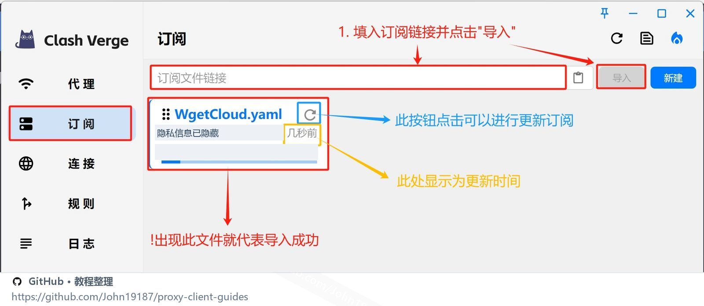](assets/images/verge-import-subscription.webp)

顶部输入URL后点“导入”，卡片右上角圆形箭头用于以后刷新。配置下载完成后，点击它的名称或卡片区域选中，再去代理页。

[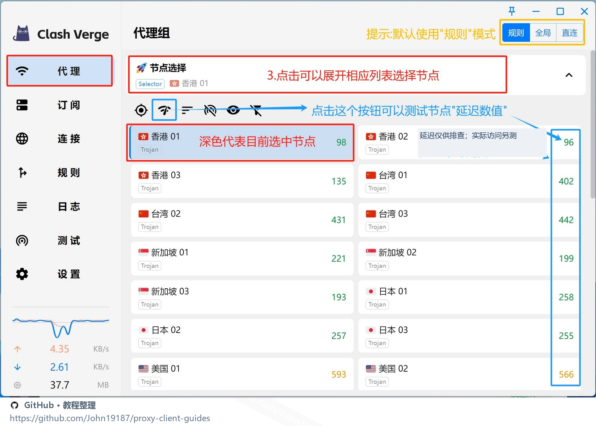](assets/images/verge-select-node.webp)

点击组名右侧的箭头展开节点，深色项为当前选择。组名由配置提供；流量和到期说明可能也占一行，应选择实际服务器。一键导入唤起旧CFW时取消，回Rev手动粘贴。

[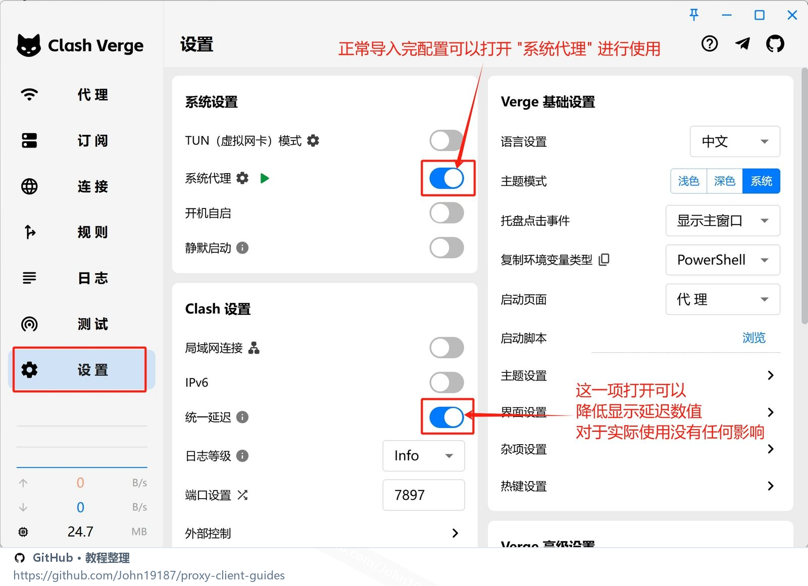](assets/images/verge-system-proxy.webp)

红框中的“系统代理”让遵循系统设置的应用通过Rev连接，“统一延迟”只改变延迟显示。浏览器正常、某应用失败时，到[Rev网络设置专题](clash-verge-rev-network.md)查看该应用的请求。以后服务新增或更换节点，在“订阅”页点击对应订阅右上角的刷新按钮，重新下载即可。

### [FlClash：电脑和安卓的配置导入图解](downloads/flclash/README.md)

1. 打开“Profiles／配置”，点“+ → URL”，填入完整Clash／Mihomo订阅并提交。下载后点击新配置，使它成为当前配置。
2. 回“Dashboard／仪表盘”，按配置使用Rule／规则模式，点击连接按钮。电脑供浏览器使用时开启System proxy／系统代理；安卓按首次提示允许VPN连接。
3. 打开“Proxies／代理”，在配置给出的策略组中选择实际节点，再访问目标网页。

[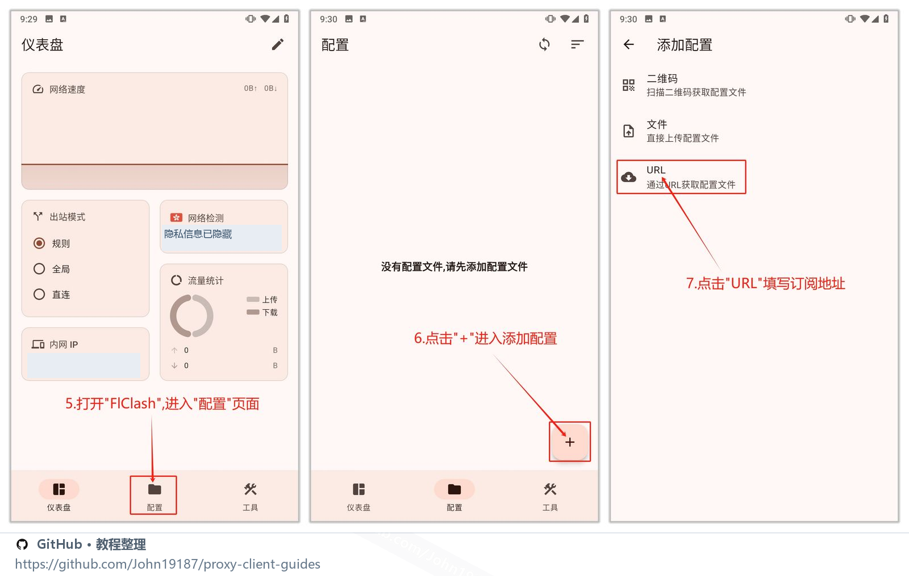](assets/images/flclash-android-add-url.webp)

[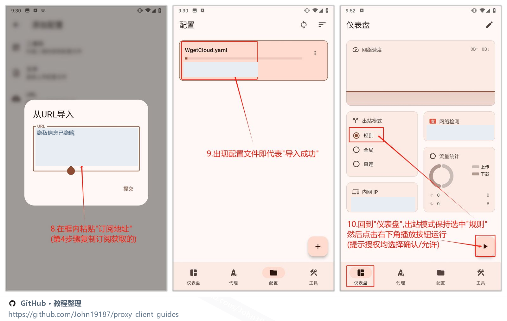](assets/images/flclash-android-import-start.webp)

安卓图中，从底部“配置”进入，点右下角加号再选URL；第二图从左到右依次是提交、选配置和仪表盘启动。电脑与新版布局见[FlClash完整教程](downloads/flclash/README.md#import)。

选择Global／全局时，全局组仍要选择可用节点；`DIRECT`表示直连，`REJECT`表示拒绝。服务调整节点后，在配置页更新已经添加的订阅；升级软件前，用本地或WebDAV备份保存设置。完全退出前关闭这次开启的系统代理、TUN或手机VPN。

### [v2rayN：订阅分组更新以后，再设活动节点](downloads/v2rayn/README.md)

1. 打开“订阅分组 → 订阅分组设置”，添加分组，填写别名与v2rayN订阅URL，点击“确定”。
2. 回“订阅分组”更新当前分组。首次还没有可用代理，选不通过代理的路线；已有代理且下载需要它时，再用对应方式。
3. 节点出现后，双击或按回车设为活动，也可用右键“设为活动”。
4. 右键托盘图标，在“系统代理”选择“自动配置系统代理”，选需要的路由方案，再访问目标网页。

[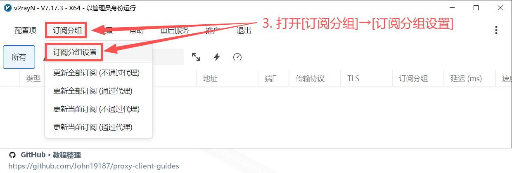](assets/images/v2rayn-subscription-menu.webp)

[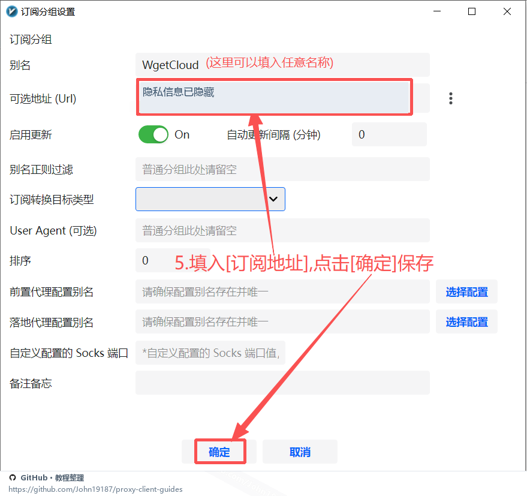](assets/images/v2rayn-subscription-url.webp)

别名用于本机辨认，URL填写订阅地址，点“确定”保存。接着回“订阅分组”执行更新，才会下载节点。只有单条协议链接时，用剪贴板导入节点，不填进远程订阅框。

[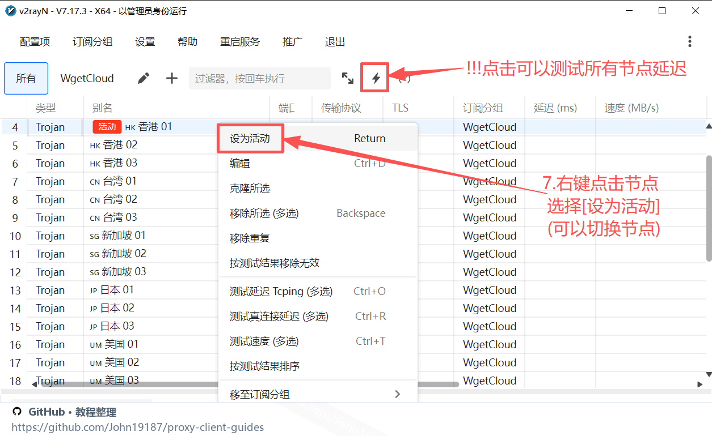](assets/images/v2rayn-activate-node.webp)

“不改变系统代理”会保留当前值。停用时清除本次代理，原工作代理按原设置恢复。便携版升级备份完整目录，安装版另保存数据；不要只把一个旧EXE覆盖回新目录。

### [ClashX Meta：在Mac添加订阅并开启系统代理](downloads/clashx-meta/README.md)

下载原仓ZIP，将解压得到的App放到“应用程序”后启动。它主要通过Mac顶部菜单栏操作，不必等待普通主窗口。

1. 点击小猫菜单，进入“配置”的托管或远程管理入口，新增一条订阅。
2. `Url`填写个人Clash／Mihomo地址，`Config Name`填写未使用的名称，提交并等待下载。
3. 回“配置”菜单选择刚填写的名称，再到节点或策略组选择实际节点。
4. 勾选“设置为系统代理”，用浏览器打开目标网页。

程序名与图标相近，下载和菜单说明要对应ClashX Meta；ClashX Pro的增强模式和旧系统门槛不直接套用。换服务时另建兼容配置，旧DNS、规则单独保存和迁入。

### [Clash Party：选对安装包，再导入订阅连接](downloads/clash-party/README.md)

Windows先分常规包和Win7／8兼容分支，再按CPU选文件；Mac按芯片与系统选包，Catalina兼容文件名不表示Apple芯片能够运行10.15。原Mihomo Party名称可能仍出现在同项目历史资料中。

安装后的主要步骤是：

1. 在标准模式点击左侧订阅卡片进入“订阅管理”，在上方URL框粘贴Mihomo兼容地址并点“导入”。下载后点击目标卡片主体，主题色高亮表示当前配置。
2. 打开左侧“代理组”，展开配置中的组，选择实际节点。
3. 选“规则”模式并开启左侧“系统代理”，用浏览器访问目标网页。具体模式入口与旧名界面范围见[Clash Party图文](downloads/clash-party/README.md#import)。

全局模式改变已经进入软件的请求去向。某应用绕过系统代理时，才按[Party连接与TUN说明](downloads/clash-party/README.md#connect)处理；完全退出前关闭本次开启的接管。

### [Hiddify：添加订阅后，从首页启动连接](downloads/hiddify/README.md)

从服务取得Hiddify兼容HTTPS订阅，打开Home顶部“+”。已经复制地址选Clipboard；需填写名称与URL选Manually，填好点Add。两条方式按手里资料任选一条，不自行把HTTP前缀改为HTTPS。

[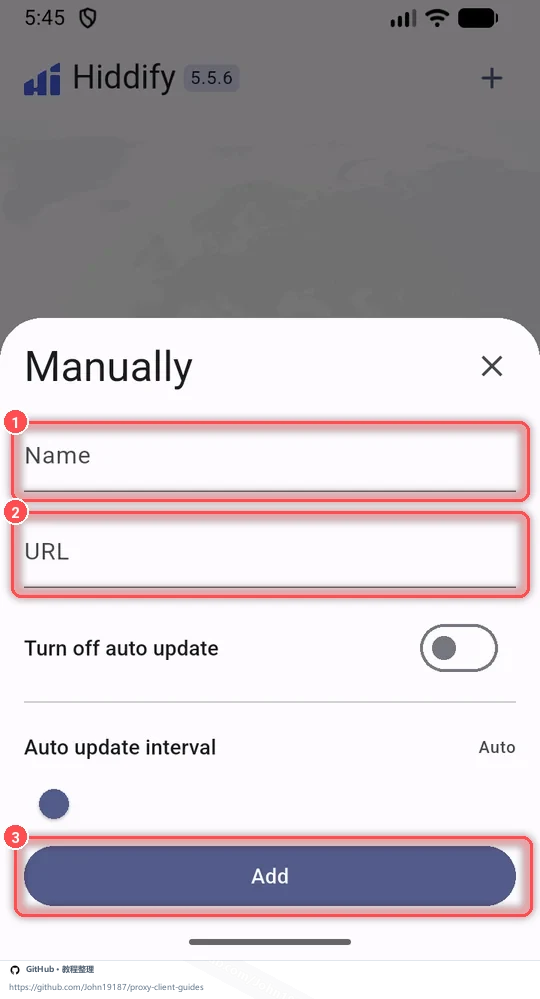](assets/images/hiddify-manual-profile.webp)

手动窗口的Name填辨认名称，URL填兼容订阅，Add保存。添加完成后，按下面的顺序连接：

1. 在首页选择刚添加的配置名称；多份订阅时，先确认选的是这次要用的那份。
2. 点击中央“Tap to connect”。手机首次连接时允许系统VPN请求。电脑先按需要选择Use system proxy，让遵循系统代理的应用接入；需要VPN模式的权限与分支见[Hiddify连接说明](downloads/hiddify/README.md#connect)。
3. 想手选服务器，点击连接按钮下显示当前代理的区域，打开Proxies，选择实际节点。这里更换的是同一配置里的服务器；上一步选择配置则会更换整份订阅。

Auto是自动选择项，不是独立节点。状态显示Connected后完成目标访问；流量、剩余天数和延迟分别查看，连接后用目标网页确认访问。更新点原配置卡片的双箭头，停止再点中央连接按钮。

### [Karing：添加订阅后，在哪里选节点和连接](downloads/karing/README.md)

1. 打开设置中的“添加配置 → 添加配置链接”，把兼容地址填入Profile Link/Content，点右上角添加或对勾提交。
2. 到“我的配置”查看下载好的内容，再回主页点击服务器名称，进入Select Server选择实际节点。
3. 回主页打开连接开关，处理本平台要求的VPN或代理权限，再打开目标应用。

[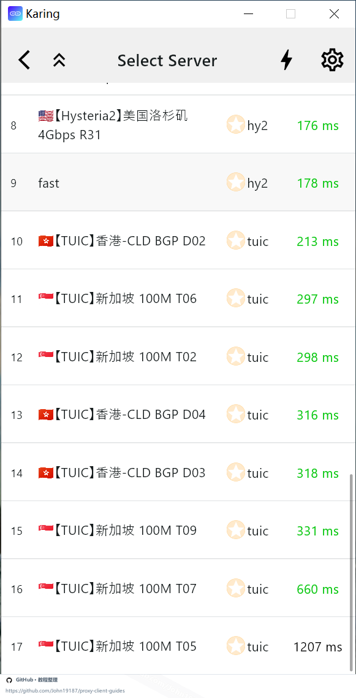](assets/images/karing-select-server.png)

第一图的大输入框填写兼容链接，第二图是服务器列表。下载成功却没有服务器，查看Filter是否排除了全部节点；UserAgent和Download Channel按服务明确要求设置，普通导入保留默认。电脑主屏系统代理开关与总连接开关分别处理，见[Karing连接步骤](downloads/karing/README.md#connect)。

“我的配置”点击相应更新时间刷新远程内容。本地文件没有远程源，要取得新文件；自动删除延迟失败节点在初次排错时可以保持关闭，避免一次探测异常丢掉记录。

### [Clash Mi：导入Clash配置，启动后选择节点](downloads/clash-mi/README.md)

1. 从首页菜单进入“我的配置”，点“+ → 添加配置链接”，填入完整Clash／Mihomo URL并保存。
2. 在列表选中下载好的配置，回首页滑动连接按钮；手机首次启动时确认VPN请求。
3. 需要手选节点，从菜单进入“面板”，展开配置中的策略组并选节点，再访问实际目标。

面板要求`secret`时，在“核心设置”查自己的面板密钥，不填服务账户密码或订阅URL。配置只含固定出口时，不一定有多节点选择器。Clash Mi与Karing分别管理输入，不直接互相覆盖格式和数据目录。

### [Surge：Mac与iPhone分别安装托管配置](downloads/surge/README.md)

Mac从“更多（More）→ 配置（Profile）”打开配置列表，选“从URL安装配置”，粘贴个人Surge兼容地址并完成；选中新文件再点“应用”。到Policy选择节点，按需“设置为系统代理”，见[Surge Mac具体操作](downloads/surge/README.md#import)。

[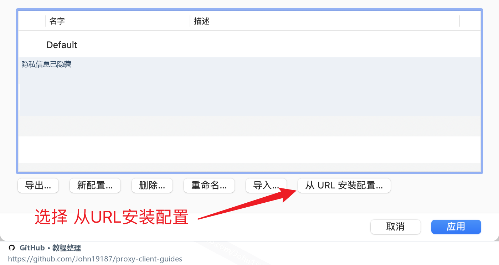](assets/images/surge-mac-install-url.webp)

[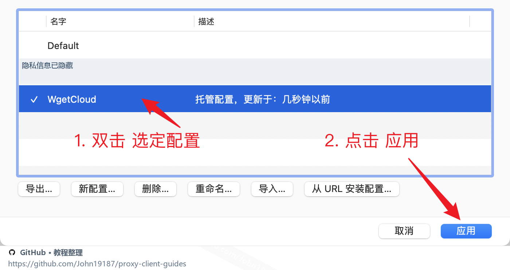](assets/images/surge-mac-apply-profile.webp)

Mac配置列表中选中新文件，点击右下角“应用”。iPhone／iPad的入口不同：在首页点配置名称，从URL下载配置，选中后再启动并允许系统VPN。Surge软件授权与网络服务订阅分别取得；这里需要Surge兼容格式。

日常更新原托管配置，自定义修改先保存；停止时关闭本次系统接管。Mac、iOS安装与授权分别看[Surge独立教程](downloads/surge/README.md)。

## 安卓和iPhone怎样导入订阅并连接

Android从对应项目正式APK安装，CPU与分发渠道分别核对；iPhone和iPad从自己的App Store账户取得软件。换客户端时，先断开另一款正在运行的个人VPN，再确认新App的系统请求。仅仅出现节点列表，还没有完成手机流量接管。

### [CMFA：在配置页导入Clash订阅](downloads/cmfa/README.md)

Clash Meta for Android与原Clash for Android属于不同项目，安装包不能按同一App升级处理。CMFA打开“配置”，点“+ → URL”，填写名称和完整Clash／Mihomo地址，保存下载后点选新配置。

[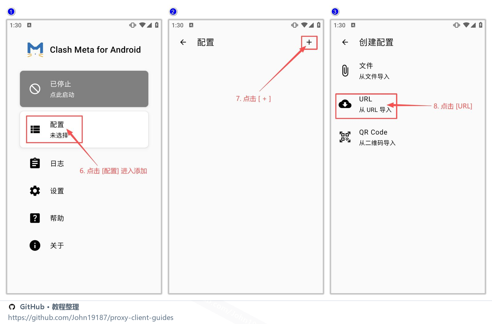](assets/images/android-import-from-url.webp)

图中依次进入“配置”、加号和URL。填写并保存后，先点选下载好的配置，再回首页点击启动区域；首次允许Android VPN，到“代理”展开策略组选择节点，最后访问目标网页。

节点列表里的流量或到期说明可能不是服务器。代理页为空，先看选中的配置与下载结果；连接被另一款VPN顶掉，停止那一款后再启动CMFA。线路变化刷新原配置，APK升级保留原渠道和资料。

### [v2rayNG：远程订阅进分组，单节点从剪贴板导入](downloads/v2rayng/README.md)

整份订阅打开“订阅分组”，新增记录，填备注与URL，保存后执行“更新订阅”。分组中的“启用更新”控制它是否参加刷新，仅保存地址不会自动生成节点。

只有一条受支持的VMess、VLESS、Trojan或SS等分享链接，复制后在“添加配置”用“从剪贴板导入”。列表出现节点，点选它并启动服务，首次允许Android VPN，随后打开目标应用。

这是参照2.3.15菜单的路径说明图，不是软件截图。远程订阅以后在原分组更新；临时节点没有远程来源时，需要重新取得参数。升级APK保留原ABI与渠道，普通包与fdroid变体不能只按文件名相近就互相覆盖。

停止可用App按钮或通知栏的停止入口。一直后台断开时，分别看另一款VPN与手机电池管理；一次延迟失败不适合用“删除无效配置”清空列表。

### [sing-box：Remote下载远程JSON，Local导入本地文件](downloads/sing-box/README.md)

按平台下载带界面的图形客户端。Android SFA 1.14.4在仪表配置卡点“+ → 手动创建”，名称填本机识别名，远程URL选Remote并填URL，点“创建”；本地JSON选Local／导入文件。返回配置列表选中记录，再启动服务并允许Android VPN。电脑和Apple入口按各自界面，见[sing-box版本对应的配置步骤](downloads/sing-box/README.md#import)。

完整JSON需要匹配所用内核版本。Clash YAML不能改后缀直接导入；升级后报某字段废弃，按开发者配置迁移说明处理，不连续删字段尝试运行。配置未定义选择组时，面板不一定有可手选节点。

运行后在Dashboard查看出口并访问目标应用。远程配置从原地址更新，本地文件另取新内容；新版无法载入，保留错误和升级前文件，恢复相配程序与资料。具体SFA、SFM、SFW、SFL分发与版本条件见[sing-box独立教程](downloads/sing-box/README.md#packages)。

### [Surfboard：导入兼容配置，再从仪表盘启动](downloads/surfboard/README.md)

Surfboard使用它支持的Surge风格配置，优先从账户复制Surfboard对应入口。打开“配置”，点“+ → 从URL导入”，保存后选中新配置；回“仪表盘”启动，确认Android VPN，再进入“代理”选择节点。

[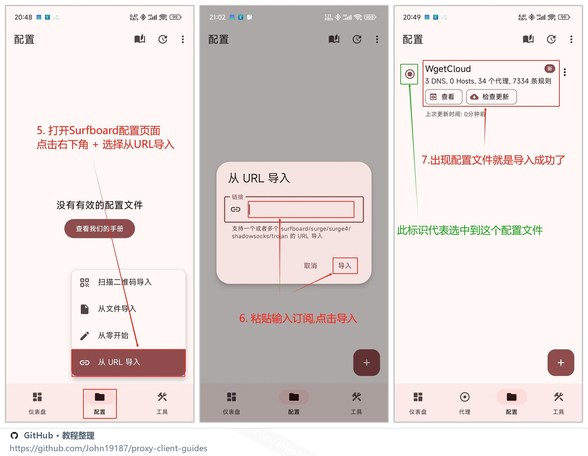](assets/images/surfboard-url-import.webp)

第一图最后一屏的绿色圆点表示配置已选中；第二图依次展示仪表盘启动和代理页选节点。解析失败时，回账户取得Surfboard兼容内容。服务调整节点后，在配置页刷新原订阅；安装新版APK则是升级软件。

### [NekoBox for Android：订阅分组与单节点](downloads/nekobox/README.md)

Android NekoBox与桌面NekoRay是不同项目。整份订阅在分组中选择“订阅”类型，填URL并更新；只有单条分享链接，用剪贴板导入。选择节点后启动VPN，再用目标应用完成访问。

迁移节点后，原有规则与DNS按新客户端格式分别处理。升级前保存分组、个人URL与路由设置，保留同名软件身份和分发来源，分别查看桌面NekoRay与Android项目的发行记录。下载与维护说明见[Android NekoBox原包页](downloads/nekobox/README.md#packages)。

### [Shadowrocket小火箭：新增窗口里选择Subscribe](downloads/shadowrocket/README.md)

1. 在首页点右上角“+”，把“类型”改为**Subscribe**。
2. URL填自己的Shadowrocket兼容订阅，备注填便于辨认的名称，点右上角“保存”。
3. 回首页展开订阅，选择实际节点，打开顶部连接开关。
4. 首次允许添加VPN配置，在自己设备完成验证，再用Safari访问目标网页。

右侧窗口虽然叫“添加节点”，Subscribe类型填写的是远程订阅。单节点则用对应分享链接入口。购买小火箭和购买服务是两件事；首次普通连接不要求安装陌生根证书或开启HTTPS解密。

线路变化刷新原订阅，App本身在自己的商店账户更新。商店无法获取时按账号地区、系统和页面提示处理，不用同名Android APK或来历不明的IPA代替。停止使用关闭同一顶部开关。

### [Stash：配置文件选中以后，到策略选择节点](downloads/stash/README.md)

打开“设置 → 配置文件 → 从URL下载”，粘贴Stash兼容地址并下载，回列表点选新文件。原来选着Default或旧文件的人，先切到新配置，再回首页启动，完成iOS VPN请求。

底部“策略”打开选择页，对勾表示当前节点，组名随配置改变。点选实际节点后，打开目标网页；保留配置中原有的直连用途。

本地文件可从“文件”App分享或打开到Stash，导入后同样要选中。本地文件没有远程源，线路变化另取新文件；托管配置更新可能覆盖直接写在文件里的修改，先保存副本。撤回尝试先停止，再选回旧配置，不必重置全部设置。

### [Quantumult X：节点资源与整份配置分别导入](downloads/quantumult-x/README.md)

从账户选择QX入口唤起软件，读确认框正在添加什么。提示“引用资源·节点”才是新增节点资源；显示将替换完整配置、而原文件未保存时，取消后先备份。

[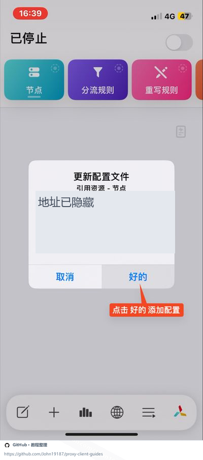](assets/images/quantumult-import-confirm.webp)

图中的大标题是“更新配置文件”，下一行对象为“引用资源·节点”。确认这里处理的正是要添加的节点资源，再点“好的”；需要退出就点“取消”。一键导入也可能替换整份配置，每次都要读对象和替换范围，不能只看窗口大标题。

已有配置只拿到节点资源URL，在`[server_remote]`使用，规则资源属于`[filter_remote]`；不能用几行节点资源替换整份配置。节点还要被当前策略使用。选节点并打开连接开关，按iOS提示授权后访问目标；普通代理不要求启用MitM。

后续更新原节点资源，不反复覆盖整份配置。导入只停在Safari，回QX查实际资源列表；浏览器打开并不表示软件已收到。具体编辑与恢复见[QX图文教程](downloads/quantumult-x/README.md#import)。

### [Nextin：先确认服务支持，再安装和连接](downloads/provider-app/README.md)

先确认服务是否明确支持Nextin，再从正式商店安装。服务提供的站点识别码或订阅链接用于接入本家服务，填写位置按该服务的Nextin说明操作。已经在App加载好服务的人，进入其主页选择节点并连接；安装与兼容条件见[Nextin教程](downloads/provider-app/README.md)。

Nextin的App Store条目与其他客户端分开，安装前确认开发者与设备要求。没有兼容订阅的账户，不向Clash或其他客户端配置框填写账号密码。Nextin的适用条件、输入与连接见上方独立教程。

想保留已有Clash规则或路由器配置时，购买前要确认服务仍提供相应订阅；只想在专属App登录，则比较它覆盖的设备和账户条件。[VPN推荐帖的接入方式比较](https://github.com/John19187/The-40-Best-VPNs#翻墙客户端与使用方式怎么选)说明了这两条路线的区别。软件授权和服务套餐也分别计算。

### [Loon：添加订阅后，怎样选择当前节点](downloads/loon/README.md#import)

Loon从正式App Store安装，取得Loon兼容节点订阅或完整配置。节点订阅先下载服务器记录，已有配置中的手动策略组再选择需要的节点；订阅结果列表不能代替当前策略选择。规则、策略与节点各有职责，完整Clash YAML也不是Loon配置。

打开Policy／策略，在手动组中选择节点；旧版首页对应Strategy模块。规则还要指向这个组，才会使用选中的节点。已有完整配置沿用其分流，选好节点后回首页启动Loon，处理iOS VPN授权，再访问实际目标。线路变化更新原订阅；两种输入的添加步骤见[Loon下载与使用](downloads/loon/README.md)。

## 路由器怎样安装代理插件并让设备使用

OpenClash、PassWall是OpenWrt插件，ShellCrash通过Shell管理代理内核；三者都不是刷机固件。安装前确认自己管理的是哪台设备，保存固件配置、DNS、网关与分流原值，并给管理电脑保留有线访问后台的路线。

插件与内核分别选：采用`opkg`的固件取IPK，采用`apk`的固件取APK，内核还要匹配CPU和运行环境。这里的APK不是Android安装包。第一次只接入一台测试设备，能访问目标和局域网后再扩大范围。

### [OpenClash：完整配置、内核与配置订阅](downloads/openclash/README.md)

按当前固件的依赖与防火墙分支安装插件，从“服务 → OpenClash”管理内核。iptables与Firewall4／nftables的透明代理依赖分别看待，不把两个分支的组件随意混装。

1. 从服务取得Clash／Mihomo完整配置URL，打开“配置订阅”添加记录，保存并更新。
2. 到“配置管理”选择下载好的文件；已有本地YAML则上传后选择。
3. 启动OpenClash，在配置提供的面板或策略组选择节点。
4. 用接入范围内的一台设备访问实际目标，并确认后台与局域网仍可访问。

程序显示运行中但终端直连，查看该设备是否在接管范围、请求命中了什么策略。核心首次下载失败看路由器自己的联网、CPU与存储，不用电脑能下载代替路由器结果。停用时关闭服务并撤回本次接管或DNS改动，保留可用配置。

### [PassWall：订阅出节点，再选TCP节点和主开关](downloads/passwall/README.md)

按固件和包管理器安装对应插件、语言包及运行依赖。PassWall主要处理兼容节点订阅，Clash配置里的策略组与规则不会随节点自动全部带入。

1. 打开“服务 → PassWall → 节点订阅”，添加个人订阅，保存并应用。
2. 在该记录执行“手动订阅”，等待节点出现。
3. 回“基本设置”选择TCP节点，启用主开关并保存应用。
4. 用一台测试终端完成目标访问。

[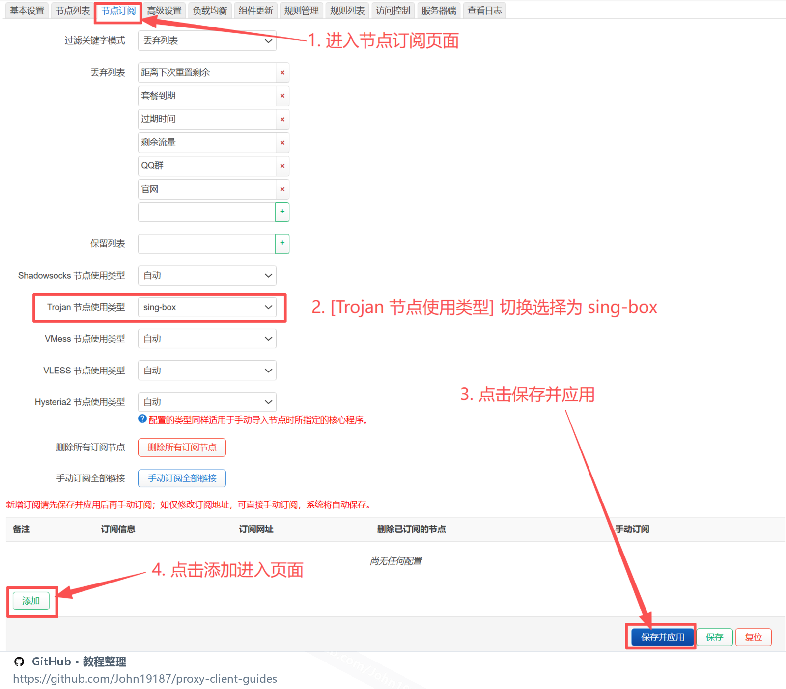](assets/images/passwall-subscribe-add.webp)

[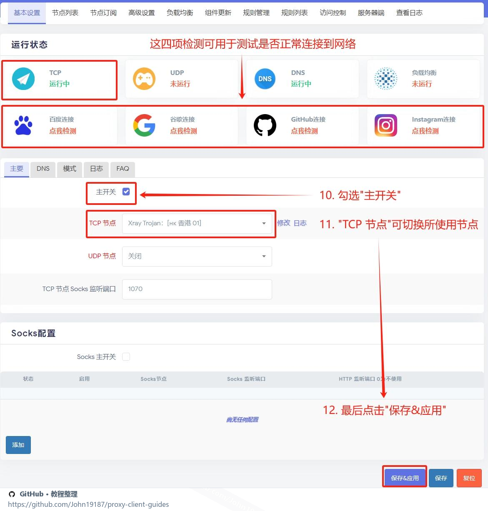](assets/images/passwall-main-tcp.webp)

第一图在“节点订阅”页安排节点类型、保存应用并添加记录；第二图在“基本设置”选择TCP节点并勾选主开关。订阅更新后节点名称可能变化，需要重新选择。停用取消主开关并保存应用；另改过网关或DNS时只恢复对应改动。

### [ShellCrash：通过crash菜单管理配置与内核](downloads/shellcrash/README.md)

需要SSH和设备管理权限。按原项目说明安装后，运行`crash`进入菜单，`crash -h`查帮助。选择Mihomo时准备Clash YAML，选择sing-box时准备匹配版本的JSON，随后在配置导入／更新功能载入地址或本地文件，再启动。

路由器统一接管与Linux主机本机使用分别按实际模式配置。先用一台设备访问目标和局域网，失败回菜单停止服务，查看下载、配置字段或连接错误。配置、内核和ShellCrash脚本分别更新；删除安装目录前，先让服务与网络接管规则正常退出。

### 路由器连通后，检查手机的代理接管

[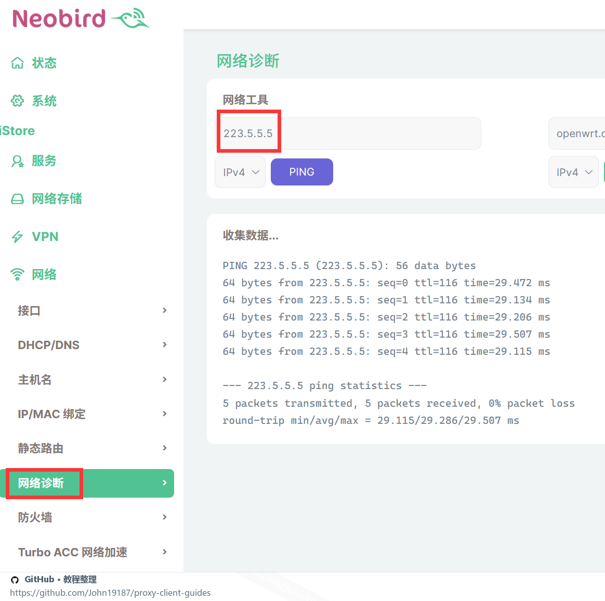](assets/images/openwrt-diagnostic-ip.webp)

[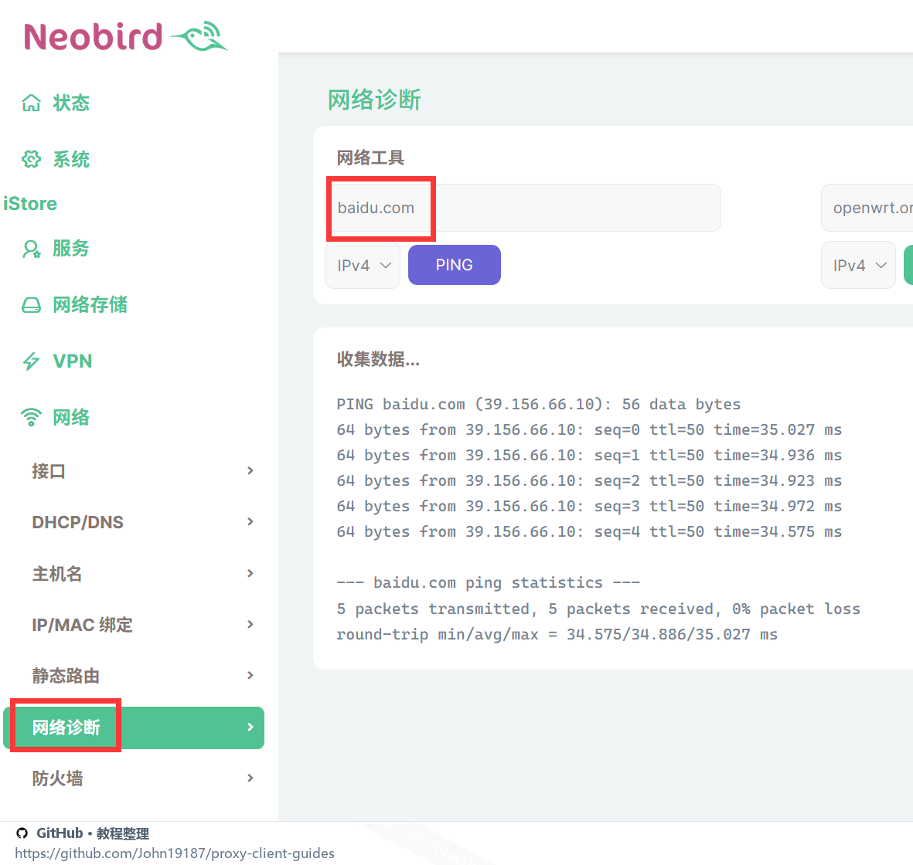](assets/images/openwrt-diagnostic-domain.webp)

两图在“网络诊断”中分别ping IP地址和域名。IP测试不需要域名解析；IP有回应、域名报`bad address`时，再看域名拼写和路由器名称解析。它们都测试路由器自身。

说明图区分两个访问对象。手机失败还需看Wi-Fi、网关与插件访问控制，访客网络或另一台网关可能让它绕过插件。实际目标访问和一条ping结果各说明不同环节，不能互相替代。

## 旧Clash和NekoRay怎样迁移到其他客户端

“Clash”可以指内核，也可以是不同作者的图形客户端。先打开软件“关于”看全名与版号，再按项目迁移。下表状态整理至2026年11月14日。

| 旧软件 | 项目与状态区别 | 对应迁移 |
|---|---|---|
| Clash for Windows／CFW | 历史版本0.20.39；原`Fndroid/clash_for_windows_pkg`仓本次核对不可访问 | [保存Profiles并迁到Rev等](downloads/cfw/README.md) |
| Clash for Android／CFA | 原`Kr328/ClashForAndroid`仓本次核对不可访问；CMFA是不同发行项目 | [保存旧配置后迁入CMFA或FlClash](downloads/cfa/README.md) |
| ClashX、ClashX Pro | 原ClashX仓本次核对不可访问，Pro为历史增强分支；Meta另有项目 | [ClashX](downloads/clashx/README.md)、[ClashX Pro](downloads/clashx-pro/README.md)分别恢复与迁移 |
| 旧Clash Verge | `zzzgydi/clash-verge`已归档，历史发行1.3.8；Rev是另一维护项目 | [备份后新建Rev配置](downloads/old-clash-verge/README.md) |
| 桌面NekoRay | 原仓已归档并说明不再维护；Android NekoBox属于另一仓 | [保留节点、路由后更换客户端](downloads/nekoray/README.md) |

### [CFW：从Profiles保留当前配置](downloads/cfw/README.md)

旧CFW的Profiles中，带色边的配置卡表示选中项。迁移前记下这条记录及个人地址；教程页面最近更新，不表示旧程序又发布新版。

记下正在使用的配置名称，保存个人订阅地址、本地文件与自定义规则。关闭CFW的系统代理、TUN／Service Mode接管，从托盘退出；在新软件按兼容格式重新导入。新客户端能够访问目标网站后，再停用旧软件的开机启动。不同项目的数据目录不直接互相覆盖。

### [CFA：新App与旧App分开保留](downloads/cfa/README.md)

在旧App中保存个人URL及本地配置，断开其VPN，再启动CMFA或FlClash导入兼容地址。签名或应用身份不同、不能覆盖安装时，先取消，保留旧数据；新客户端可以使用后再处理卸载。手机同一时刻由另一款VPN接管，可能让刚启动的客户端立即停止。

### [ClashX](downloads/clashx/README.md)与[ClashX Pro](downloads/clashx-pro/README.md)：先关闭旧系统代理和增强模式

旧安装图虽然显示ClashX.app，原文实际属于ClashX Pro，不能靠这一名称认成普通ClashX或Meta。辨认时查看“关于”的完整名称与版本，分别进入对应迁移教程。

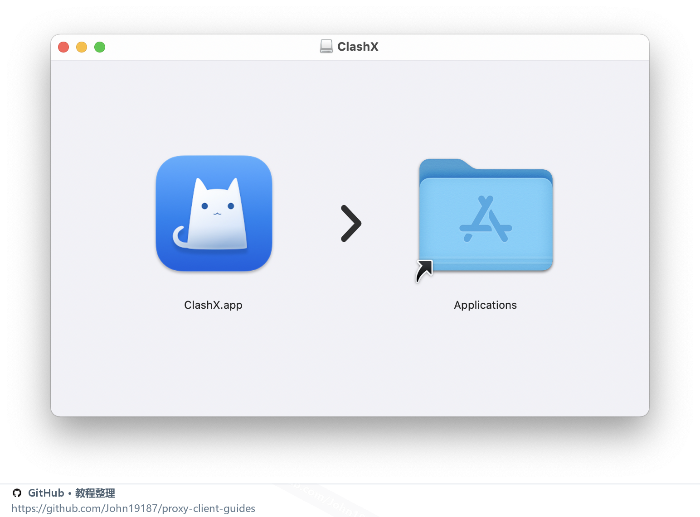

保留旧配置管理里的远程地址和当前选中项，本地DNS、脚本与规则另外保存。取消“设置为系统代理”和自己开启的增强模式后退出，再到Meta、Rev等新软件重新添加兼容配置。旧Pro教程中的macOS 10.14与历史包条件，不是Meta或Rev当前门槛。老Mac先确认目标程序支持系统，再决定是否更换。

### [旧Clash Verge：在Rev新建配置，不直接覆盖数据](downloads/old-clash-verge/README.md)

旧仓1.3.8和Rev 2.x属于不同项目。保存配置与订阅，停掉旧系统代理、TUN和开机接管，在Rev“订阅”重新导入。默认配置可用以后，再迁必要的覆写、脚本和DNS；一次搬入全部旧修改，出错时难以分清是哪项造成。

### [NekoRay与Android NekoBox：按平台与协议迁移](downloads/nekoray/README.md)

桌面NekoRay与Android NekoBox分别发行。Android项目有本次已核的[分ABI原仓APK](downloads/nekobox/README.md#packages)。迁移保存节点协议、传输、TLS／Reality参数和路由，从服务取得新软件支持的订阅；只有单节点链接时，使用节点入口，不粘到完整Clash配置框。

说明图按保资料、停旧接管、新软件导入和目标访问组织迁移。新客户端失败，先关闭它的系统代理、TUN或VPN；旧客户端原来仍可用时，再回旧端恢复。iOS卸载后能否重新取得App，取决于自己的账户、地区与商店供给，卸载前先查购买记录。

## 更新节点、升级软件和备份配置有什么区别

服务商新增节点或调整服务器时，在客户端找到已经添加的那条订阅，执行更新。这个动作重新下载节点或配置，不会安装新版软件。

升级客户端是安装软件的新版本；内核是它实际处理代理连接的程序，部分客户端允许单独更新。需要新功能或遇到配置版本不兼容时，按对应项目的发行说明处理。账户中的“重置订阅”则会更换个人访问地址：地址改变后，各设备保存的旧URL也要替换，不能拿它代替普通更新。

说明图用于区分更新对象。远程配置刷新可能覆盖直接写进下载文件的修改；需要保留的规则使用客户端支持的独立覆写，或先另存副本。本地JSON／YAML没有远程源，需要取得新文件，再选择它。

### 升级前保存能配套恢复的程序与资料

Rev可在“设置 → Verge高级设置 → 备份设置”保存，FlClash使用本地或WebDAV备份。v2rayN便携版退出后复制完整程序与数据目录，安装版按其数据位置保存。备份包含个人订阅，放在自己的存储中。

下载同一项目支持当前系统、架构和渠道的正式包。停止本次系统代理、TUN与连接，从托盘完整退出后安装；新版本用原兼容配置访问目标。回退时匹配旧程序与升级前数据，单换旧EXE可能仍读到新版已经迁移的数据。iOS由App Store更新，不采用桌面方式随意覆盖旧包。

下载订阅被拒绝，与旧节点能否连接分开看。有些服务要求在账户里临时开启订阅下载，窗口时长以本人账户当前提示为准。保留可用配置，开启所需窗口后更新原条目，不先删除全部节点。

### 系统代理、TUN与规则模式各管什么

系统代理把操作系统的代理地址指向客户端，遵循它的应用才会使用。TUN通过虚拟网卡接入流量，还依赖权限、路由和DNS。规则、全局和直连处理的是已进入软件的请求去向。

浏览器正常、某个应用失败，在连接记录找这个应用。已进入却命中直连或拒绝，查看策略；没有进入，再看应用代理或TUN。不能靠切“全局”自动修好未接管的应用。

Windows Rev需要TUN时，从自己的服务入口完成所需授权；Mac按服务安装入口操作，Linux按对应版本要求处理。记录原状后试需要的模式，新故障出现就关闭本次TUN并恢复原系统代理。

[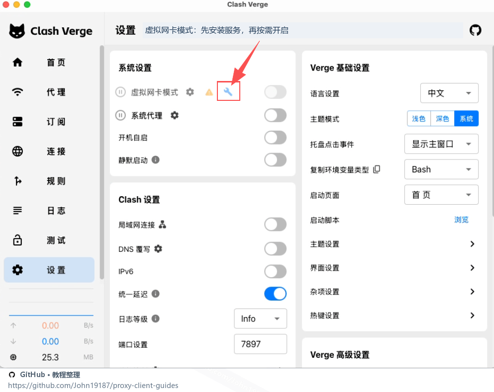](assets/images/verge-mac-tun-service.webp)

蓝色扳手属于虚拟网卡服务入口，系统代理在下一行。Sidecar或服务错误保留完整通知和路径，具体UWP、Windows与Mac恢复见[Rev网络专题](clash-verge-rev-network.md)，按实际错误处理权限。

## 订阅导入失败或网页打不开，分别怎样处理

### 订阅下载失败，或保存后没有节点

一键导入没反应，手动复制目标客户端格式到远程配置或订阅分组。401／403先查套餐、下载开关和新旧URL；解析失败先看拿到的是完整配置、节点资源还是账户网页。配置存在但列表为空，检查选中项和更新结果。对应菜单见[订阅导入图解](subscription-formats.md#import-errors)。

### 节点已经出现，实际目标仍失败

检查当前节点、接管方式和请求记录。握手、认证与路由错误需要看完整信息；`x509`、TLS或证书过期，核对设备时间、证书与服务公告，不长期关闭校验。v2rayN本页记录的7.25.6已移除`allowInsecure`，旧教程里的跳过校验做法不能继续套用。

所有节点都超时，可以在同一设备保留配置与节点，换自己的热点访问同一目标，比较两条网络的表现。只在一条网络失败时，检查该网络的认证、运营商路径或限制；多个网络都失败，再查看服务账户、节点状态和本家公告。需要理解入口、出口与故障环节，可看[科普中的连接判断](https://github.com/John19187/ssr-v2ray-trojan-clash-guide#diagnosis)。更新以后才报未知字段或协议，按[程序与内核更新](#update)核对支持范围，必要时使用升级前备份。

### Ping、TCP和客户端延迟分别测试什么

[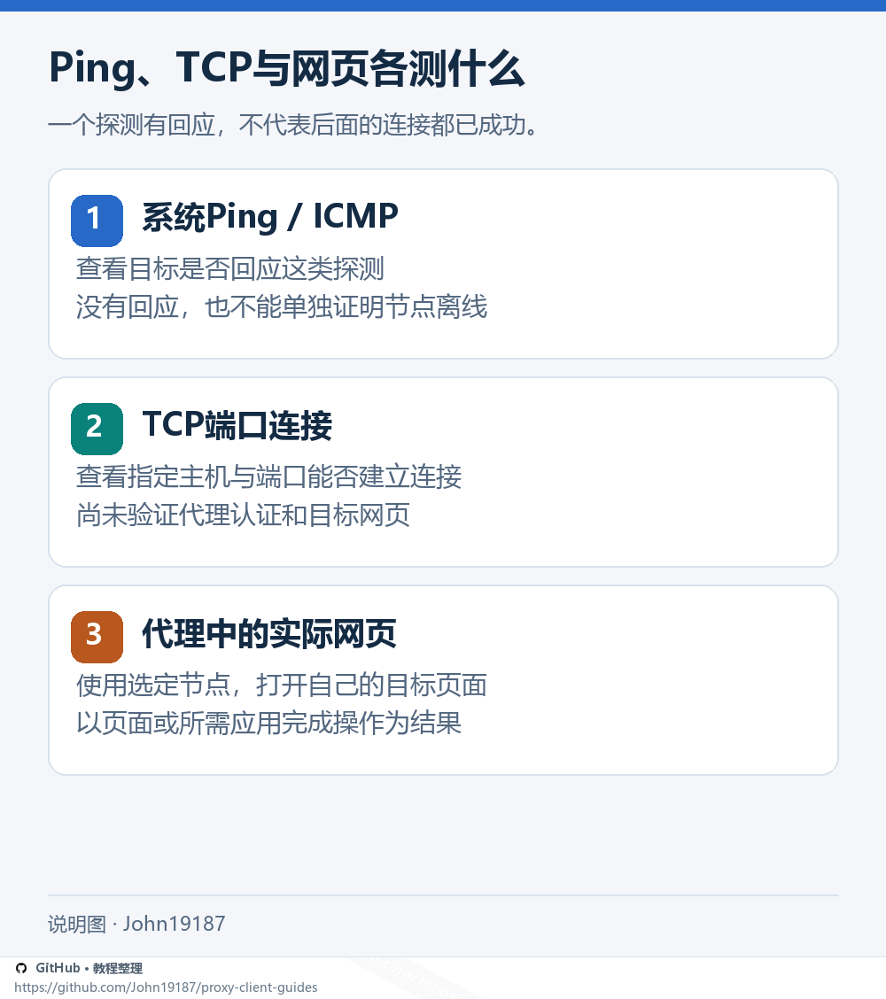](assets/images/ping-tcp-web-checks.webp)

说明图：系统ping通常使用ICMP，TCP测试看指定端口是否建立连接，客户端延迟可能是HTTP或URL探测。端口连上以后，仍有代理协议、认证和目标访问；ping无回应，也可能只是目标不响应ICMP。

UDP由节点、客户端、当前网络与服务端共同决定。QUIC使用UDP。TCP、UDP与实际应用访问分别测试，围绕要使用的网页或应用查看结果。

### 校园网与DNS：定位当前改变的那一层

先完成学校要求的网络认证。认证页、租约或校内DNS条件未满足，启动代理不能代替网络接入。

DNS问题可以发生在系统、客户端配置、节点域名解析或路由器。保留原设置，按实际失败域名与日志里的`lookup`、`timeout`定位。同一设备和节点在热点下正常时，再检查原网络对应的DNS与路由设置，每次只调整一处并保留原值。

Mihomo的`dns.enable: false`是不启用该内核DNS模块、改用系统DNS；其他App按各自的DNS设置处理。TUN、DNS劫持、Fake-IP与服务方配置可能配套；服务要求保留其下发DNS时，避免自行覆盖。改动前看当前配置需要什么，不照搬别家关闭某模块的做法。

确实需要网络指定DNS，在对应系统或接口填写规定值；客户端是否覆盖它，还看当前配置。路由器主路由、旁路由角色不同，先辨认哪个接口上联、哪个发放地址，再按固件说明修改。一处无改善就恢复该处原值，不把整机重启和重置当作每次排障的固定步骤。

### 客户端退出以后，恢复普通网络

先从App关闭连接和本次代理接管，再退出托盘或菜单栏。程序异常停止、系统仍指向已经关闭的本地代理时，普通网站也会失败。

- **Windows：** “设置 → 网络和Internet → 代理”，恢复本次设置的手动代理或自动脚本。原工作代理和管理策略保留，不一律清空所有项目。
- **Mac：** “系统设置 → 网络 → 当前网络 → 详细信息 → 代理”，恢复这次开启的HTTP、HTTPS、SOCKS或自动代理。旧系统路径在“系统偏好设置 → 网络 → 高级”。
- **Android：** 在客户端停止VPN。若本次为它开启了“始终开启的VPN”或“无VPN时阻止连接”，在系统VPN设置恢复对应项。
- **iPhone／iPad：** 先在原App停止，再查看系统VPN状态；按需连接又自动启动时，回原App撤回本次自动连接设置。
- **OpenWrt：** 用保留的有线管理路线停止插件和接管规则。另改过网关、DHCP或DNS，只恢复对应值；管理电脑自己的代理单独处理。

恢复平常直连可用的网站以后，再决定是否启动一款客户端继续查问题。求助保留系统与软件全名、版本、时间、网络类型、失败步骤和完整错误，遮住URL、二维码、账号与访问凭据，不发送完整私人配置。

第一次使用，按自己的设备和订阅格式选客户端，完成导入、节点选择和目标访问。日常线路变化更新原订阅；换软件或升级前保存资料，停止时撤回本次接管。需要更细的平台、版本或菜单说明，从上方软件名称进入对应教程，使用的是同一份个人服务，而不是重新开始一套购买流程。

来源注释与开发者资料

软件与原包资料整理至2026年11月14日，截图的具体版本和对象在邻近图注区分。

- [Clash Verge Rev开发者仓库](https://github.com/clash-verge-rev/clash-verge-rev)
- [Clash Verge Rev：订阅管理](https://www.clashverge.dev/guide/profile.html)
- [Clash Verge Rev：术语与Windows帮助](https://www.clashverge.dev/faq/windows.html)
- [FlClash开发者仓库](https://github.com/chen08209/FlClash)
- [v2rayN：订阅协议](https://github.com/2dust/v2rayN/wiki/Description-of-subscription)
- [v2rayN：系统代理与路由](https://github.com/2dust/v2rayN/wiki/Description-of-system-proxy-routing)
- [Hiddify开发者仓库](https://github.com/hiddify/hiddify-app)
- [Karing开发者仓库](https://github.com/KaringX/karing)
- [Clash Mi开发者手册](https://clashmi.app/guide/)
- [ClashX Meta项目说明](https://github.com/MetaCubeX/ClashX.Meta)
- [Clash Party开发者仓库](https://github.com/mihomo-party-org/clash-party)
- [CMFA开发者仓库](https://github.com/MetaCubeX/ClashMetaForAndroid)
- [v2rayNG开发者仓库](https://github.com/2dust/v2rayNG)
- [sing-box客户端文档](https://sing-box.sagernet.org/clients/)
- [Stash快速上手](https://stash.wiki/get-started)
- [Quantumult X配置示例](https://github.com/crossutility/Quantumult-X/blob/master/sample.conf)
- [Quantumult X一键导入接口](https://github.com/crossutility/Quantumult-X/blob/master/url-scheme.md)
- [Surge开发者手册](https://manual.nssurge.com/)
- [Surfboard开发者仓库](https://github.com/getsurfboard/surfboard)
- [OpenClash开发者仓库](https://github.com/vernesong/OpenClash)
- [PassWall开发者仓库](https://github.com/Openwrt-Passwall/openwrt-passwall)
- [ShellCrash开发者仓库](https://github.com/juewuy/ShellCrash)
- [Mihomo DNS说明](https://wiki.metacubex.one/config/dns/)
- [旧Clash Verge历史仓库](https://github.com/zzzgydi/clash-verge)
- [桌面NekoRay历史仓库](https://github.com/MatsuriDayo/nekoray)
- [Android NekoBox开发者仓库](https://github.com/MatsuriDayo/NekoBoxForAndroid)
- [Loon开发者订阅文档](https://nsloon.app/docs/Node/subscription/)

## 文档更新记录

展开文档更新记录

- 2026-11-16　折叠更新记录，收起许可说明，撤下不必要的维护数据与贡献提示入口。

- 2026-11-16　补充客户端与免费节点目录、文档维护说明，整理下载包展示与服务通用操作说明；特色图按客户端身份收录图标，缺少合格图标的条目用名称识别。

## 客户端与相关资源目录

按设备和配置类型进入对应教程；旧版条目用于识别与迁移。软件之间的订阅、配置和备份条件仍以各篇说明为准。

展开客户端目录（含旧版与迁移说明）

| 客户端 | 设备或范围 | 教程用途 |
|---|---|---|
| [Clash Verge Rev](downloads/clash-verge-rev/README.md) | Windows／macOS／Linux | Clash／Mihomo配置与系统代理 |
| [FlClash](downloads/flclash/README.md) | 电脑／Android | 跨平台下载、导入与连接 |
| [Clash Party](downloads/clash-party/README.md) | Windows／macOS／Linux | 安装版、便携版与订阅管理 |
| [Clash Mi](downloads/clash-mi/README.md) | 跨平台 | 按本款入口导入Clash配置 |
| [ClashX Meta](downloads/clashx-meta/README.md) | macOS | 菜单栏客户端与Mihomo配置 |
| [v2rayN](downloads/v2rayn/README.md) | 电脑 | 节点订阅与系统代理 |
| [Hiddify](downloads/hiddify/README.md) | 电脑／手机 | 跨平台导入与连接 |
| [Karing](downloads/karing/README.md) | 电脑／手机 | 配置、规则与备份 |
| [Clash Meta for Android](downloads/cmfa/README.md) | Android | Clash配置与VPN授权 |
| [v2rayNG](downloads/v2rayng/README.md) | Android | 节点订阅与VPN连接 |
| [NekoBox for Android](downloads/nekobox/README.md) | Android历史版本 | 1.4.2旧版订阅与迁移 |
| [Surfboard](downloads/surfboard/README.md) | Android | 兼容配置与启动连接 |
| [sing-box](downloads/sing-box/README.md) | 多平台 | 版本匹配的JSON配置 |
| [Shadowrocket](downloads/shadowrocket/README.md) | iPhone／iPad | 节点、订阅与VPN连接 |
| [Stash](downloads/stash/README.md) | Apple设备 | 按本款条件导入Clash类配置 |
| [Quantumult X](downloads/quantumult-x/README.md) | iPhone／iPad | 节点资源与完整配置的区别 |
| [Loon](downloads/loon/README.md) | iPhone／iPad | 订阅、策略与分流 |
| [Surge](downloads/surge/README.md) | iOS／macOS | 按平台配置与接管流量 |
| [OpenClash](downloads/openclash/README.md) | OpenWrt | 固件条件、配置与插件 |
| [PassWall](downloads/passwall/README.md) | OpenWrt | 订阅节点与主开关 |
| [ShellCrash](downloads/shellcrash/README.md) | Linux／路由器 | 安装脚本与运行条件 |
| [Nextin专用客户端](downloads/provider-app/README.md) | 按服务公开支持范围 | 仅适用于已证实的服务条件 |
| [Clash for Windows](downloads/cfw/README.md) | 旧版／迁移 | 识别旧配置并迁移 |
| [Clash for Android](downloads/cfa/README.md) | Android旧版／迁移 | 原版CFA与CMFA分开 |
| [ClashX](downloads/clashx/README.md) | macOS旧版 | 普通ClashX身份与迁移 |
| [ClashX Pro](downloads/clashx-pro/README.md) | macOS历史版本 | Pro托管配置与增强模式 |
| [旧Clash Verge](downloads/old-clash-verge/README.md) | 旧版／迁移 | 与Rev区分及迁移 |
| [NekoRay](downloads/nekoray/README.md) | 电脑旧版／迁移 | 旧资料与替代客户端 |
| [旧客户端迁移目录](downloads/legacy/README.md) | 旧版资料 | 按原客户端寻找迁移说明 |

| 相关文档 | 内容 |
|---|---|
| [VPN推荐与使用方式](https://github.com/John19187/The-40-Best-VPNs) | 比较服务的平台、接入方式与客户端 |
| [机场推荐与套餐比较](https://github.com/John19187/ji-chang-tui-jian) | 比较月付、按量与套餐条件 |
| **2026年机场通用客户端汇总与下载教程（本文档仓）** | 按设备选软件并进入具体教程 |
| [机场与代理工具科普指南](https://github.com/John19187/ssr-v2ray-trojan-clash-guide) | 理解机场、协议、客户端、订阅与线路 |
| [免费节点与订阅资源](https://github.com/John19187/v2ray-SSR-Clash-Verge-Shadowrocke) | 查看公开资源与导入说明，不承诺持续可用 |

开源维护与许可

本文由John19187统一整理维护，实际修改记录见本页更新日志。原创文档采用[MIT许可](./LICENSE)；软件、商标及第三方材料的权利与使用范围见[素材说明](./NOTICE)。

本仓整理客户端下载与使用文档，不是客户端官方项目；软件是否开源、收费及其许可由各开发者分别决定。

