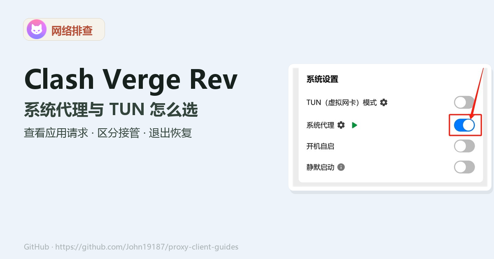
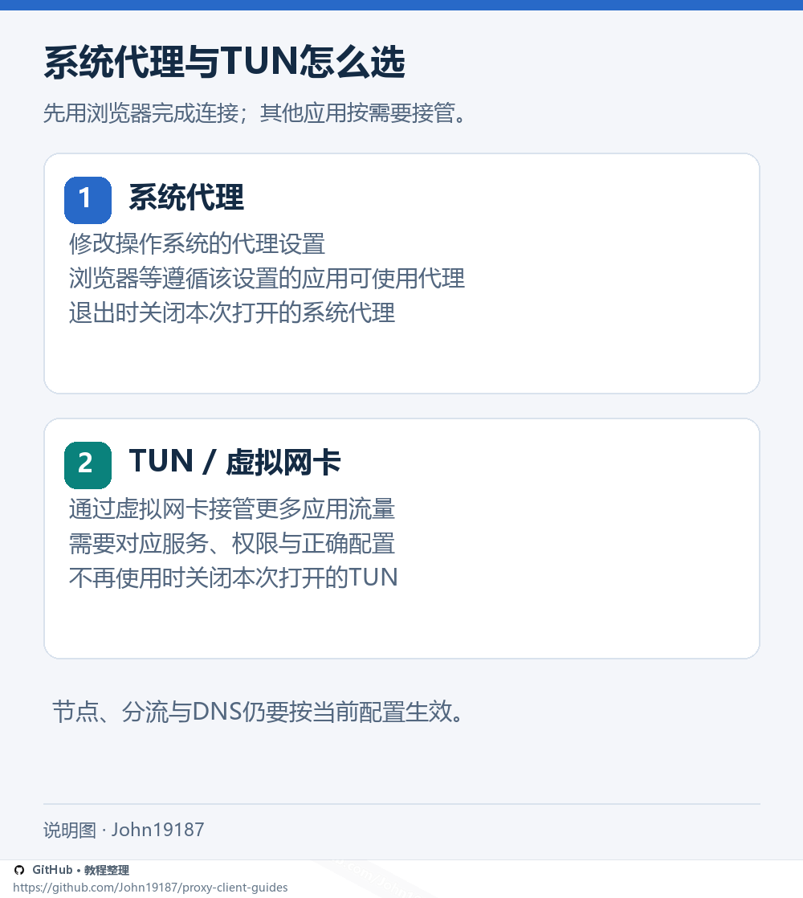
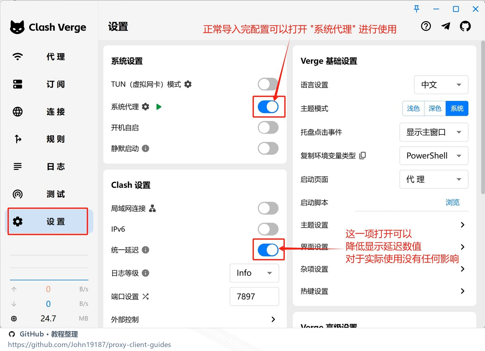
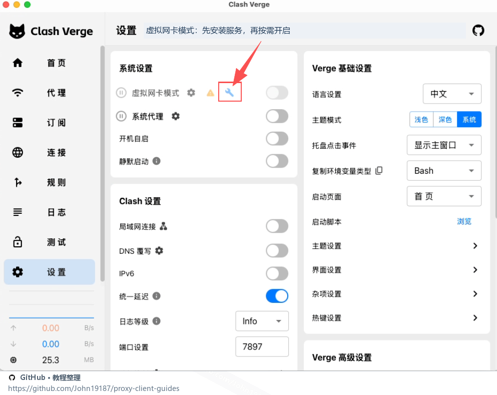

# Clash Verge Rev浏览器能用、其他应用连不上怎么办？排查与修复教程（2026）

浏览器能打开目标网页，其他应用仍超时，先打开Rev的“连接”，再让失败应用重试原功能。能找到它的请求就查规则和节点；看不到请求，则查看应用自己的代理入口，必要时再启用TUN。已有能用的配置先保留。

这条路线从桌面已有可用配置开始。尚未安装或导入，先完成[Clash Verge Rev下载与连接](downloads/clash-verge-rev/README.md#import)；已经能用的配置继续保留。其他软件选择见[2026年机场通用客户端汇总与下载教程](README.md#choose)。

[查看应用请求](#one-app) · [Windows／Mac 设置TUN](#tun-test) · [退出后的网络恢复](#restore)

## 浏览器可用时，怎样找到失败应用的请求

系统代理把一个本地代理地址告诉支持它的软件；TUN 通过虚拟网卡接入流量。流量进入 Rev 后，规则、全局或直连模式才决定它从哪里出去。把“规则”改成“全局”，不能让一个根本没有进入 Rev 的应用自动使用代理。

说明图区分请求怎样进入客户端，以及进入后怎样分流。两类设置解决的问题不同。

### 连接页里找得到这个应用

1. 在 Rev 打开“连接”，清除搜索过滤。让失败的应用重新执行原来的操作。
2. 按目标域名、IP 或进程找到新连接，展开详情，查看命中的规则、出站策略与错误。请求结束太快时，在日志中找同一时刻的记录。
3. 需要代理的目标却走到 `DIRECT`，检查它命中的策略；已经交给代理节点但握手失败，可以在同一策略组换一个节点，重试原功能。

`DIRECT` 是直连，`REJECT` 是拒绝。记录中出现这些条目时，应用请求已经进入Rev，接着查看命中的规则。此时打开 TUN 可能仍命中同一条规则，先处理已看到的分流或节点问题更有针对性。

### 连接页里只有浏览器，没有失败应用

先看这个应用有没有独立的 HTTP／SOCKS 代理设置。有该设置时，按 Rev 实际监听的地址和端口填写；不要照抄别人的端口。应用既不跟随系统代理，也没有可用的独立入口，再进入下文的 TUN 分支。

红框中的“系统代理”与上方TUN分开控制；“统一延迟”只关系到延迟显示，处理应用接管无需调整它。

**只有Microsoft Store等UWP应用失败时**，还可能是Windows应用隔离不允许它访问本机代理。在Rev“设置”的Clash设置中打开“UWP工具”，只勾选受影响的应用，点**Save Changes**保存，再打开该应用重试。撤回时取消本次勾选并保存，无需一次放开所有应用。

## Windows和Mac怎样开启TUN

TUN 会改变本机流量的接管方式。开始前记下当前系统代理和虚拟网卡开关状态，保留能用的配置。工作电脑有企业 VPN、固定代理或受管网络时，按其管理要求使用；另一款个人代理正在接管时，先停止它，避免两个程序同时改路由。

### Windows：安装所需服务，再开虚拟网卡

1. 在Rev“设置”开启“TUN模式”。若弹出“TUN模式需要系统服务”，点“安装服务”，允许本次Windows管理员请求。安装完成后，软件会重启内核并继续开启TUN；若安装报错，先处理服务错误。
2. 确认TUN开关已开启。为了比较接管变化，可以先关闭本次开启的系统代理，再试TUN；两者原状都应事先记下。
3. 重新打开原来失败的应用，执行同一个功能。需要查看去向时，在“连接”页找它的新请求。

应用恢复以后，继续使用原有规则和节点。若同时出现新的普通网络或局域网故障，关闭本次 TUN，恢复之前可用的系统代理设置；有线局域网、打印机或路由器后台的访问也属于原来的使用范围，不能用一个网页能打开代替这些需求。

**TUN一开就断网时**，先撤回开关，保留错误再查服务与 DNS。浏览器已经能通过系统代理完成任务，可以暂时继续用这条路线，无需连带重置订阅、删除配置或改变全局模式。

### Windows提示Sidecar安全检查失败怎么办

右键通知复制完整错误，确认被拒绝的是哪个内核文件或目录。便携版目录、旧服务和新安装版不能只按程序名称相近就互相覆盖。

如果原来将便携程序解压在下载目录，先到“设置 → Verge 高级设置 → 备份设置”保存配置，再按维护者 Windows 说明安装正式包，使用说明要求的安装位置。权限处理对准报错指向的文件，不为通过检查关闭系统防护或使用来源不明的替换内核。正文之外的详细条件见文末开发者 Windows FAQ。

### Mac：虚拟网卡开关灰色时看服务入口

红箭头指向“虚拟网卡模式”一行的蓝色扳手，下一行才是系统代理。需要TUN且开关不可用时，点击服务安装入口，按系统提示授予所需权限，再开启虚拟网卡。

Mac 的服务安装和 Windows 的管理员授权不是同一个界面。只是让遵循系统代理的浏览器上网，可以保留虚拟网卡关闭，使用系统代理；无需为了让界面所有开关都亮起而安装额外服务。

## 退出Rev后断网，怎样恢复原来的网络

客户端停止了，本机应用仍连接它留下的本地代理地址，普通网页也会打不开。恢复的是代理接管和系统设置，不是先重置网络适配器或清空所有配置。

### Rev还能打开

回“设置”关闭本次启用的 TUN 与系统代理，再从托盘完整退出。打开平时直连可用的网站；正常后，退出恢复这件事就完成了。原来另有公司代理的设备，恢复公司要求的设置，不一律关掉它。

### Rev打不开，Windows还留着手动代理

打开 Windows“设置 → 网络和 Internet → 代理 → 手动设置代理”。家用网络原先不用手动代理、现在却仍指向已停止的本机客户端时，关闭“使用代理服务器”。原本依赖工作代理的电脑，恢复原地址与开关，不能套用家用网络的关闭操作。

Mac也应先在客户端关闭接管。程序无法运行时，打开“系统设置 → 网络 → 当前使用的网络 → 详细信息 → 代理”，恢复本次改动；旧版macOS对应“系统偏好设置 → 网络 → 高级 → 代理”。原本已有的工作代理按原值保留。

### 换热点能用，校园网或家中Wi-Fi不通怎么办

校园网需要网页认证时，先完成网络登录。换到热点能用，说明两条网络表现不同；继续按学校要求核对DNS、网关和认证状态。多个节点在原网络同时失败时，记录发生时间和网络，查看你所用服务商的首页公告是否列出相同范围的故障。涉及Mihomo DNS覆写时，用[校园网与DNS说明](README.md#campus-dns)定位本次改变的位置，不同时重置系统、路由器和配置文件。

需要提供错误时，写清 Rev 与系统版本、失败应用、当前接管方式，以及那次请求对应的错误。比如“系统代理下浏览器正常，TUN下应用恢复，但打印机失联”，能直接指出改变后影响了什么。分享前遮住订阅、账号、IP 身份与日志中的访问凭据。

浏览器和其他应用是否经过同一路线，决定系统代理与TUN的取舍。保留满足日常用途的方式，停用时撤回本次接管即可。确需改用其他桌面客户端，可按[Clash Party导入与连接](downloads/clash-party/README.md#import)重新添加兼容配置，先保存Rev资料并停止接管，不覆盖两款的数据目录。

来源注释与开发者资料

资料整理至 2026 年 11 月 14 日；不同 Rev 版本的服务入口按实际界面区分。

- [Clash Verge Rev：系统代理、TUN与规则模式](https://www.clashverge.dev/guide/term.html)
- [Clash Verge Rev：Windows常见问题、UWP与Sidecar](https://www.clashverge.dev/faq/windows.html)
- [Clash Verge Rev 开发者仓库](https://github.com/clash-verge-rev/clash-verge-rev)
- [Clash Verge Rev 正式发行记录](https://github.com/clash-verge-rev/clash-verge-rev/releases)
- [Mihomo：TUN配置](https://wiki.metacubex.one/config/inbound/tun/)

## 文档更新记录

展开文档更新记录

- 2026-11-16　折叠更新记录，收起许可说明，撤下不必要的维护数据与贡献提示入口。

- 2026-11-16　补充客户端与免费节点目录、文档维护入口，保留专题的独立问题与操作说明。

## 客户端与相关资源目录

按设备和配置类型进入对应教程；旧版条目用于识别与迁移。软件之间的订阅、配置和备份条件仍以各篇说明为准。

展开客户端目录（含旧版与迁移说明）

| 客户端 | 设备或范围 | 教程用途 |
|---|---|---|
| [Clash Verge Rev](downloads/clash-verge-rev/README.md) | Windows／macOS／Linux | Clash／Mihomo配置与系统代理 |
| [FlClash](downloads/flclash/README.md) | 电脑／Android | 跨平台下载、导入与连接 |
| [Clash Party](downloads/clash-party/README.md) | Windows／macOS／Linux | 安装版、便携版与订阅管理 |
| [Clash Mi](downloads/clash-mi/README.md) | 跨平台 | 按本款入口导入Clash配置 |
| [ClashX Meta](downloads/clashx-meta/README.md) | macOS | 菜单栏客户端与Mihomo配置 |
| [v2rayN](downloads/v2rayn/README.md) | 电脑 | 节点订阅与系统代理 |
| [Hiddify](downloads/hiddify/README.md) | 电脑／手机 | 跨平台导入与连接 |
| [Karing](downloads/karing/README.md) | 电脑／手机 | 配置、规则与备份 |
| [Clash Meta for Android](downloads/cmfa/README.md) | Android | Clash配置与VPN授权 |
| [v2rayNG](downloads/v2rayng/README.md) | Android | 节点订阅与VPN连接 |
| [NekoBox for Android](downloads/nekobox/README.md) | Android历史版本 | 1.4.2旧版订阅与迁移 |
| [Surfboard](downloads/surfboard/README.md) | Android | 兼容配置与启动连接 |
| [sing-box](downloads/sing-box/README.md) | 多平台 | 版本匹配的JSON配置 |
| [Shadowrocket](downloads/shadowrocket/README.md) | iPhone／iPad | 节点、订阅与VPN连接 |
| [Stash](downloads/stash/README.md) | Apple设备 | 按本款条件导入Clash类配置 |
| [Quantumult X](downloads/quantumult-x/README.md) | iPhone／iPad | 节点资源与完整配置的区别 |
| [Loon](downloads/loon/README.md) | iPhone／iPad | 订阅、策略与分流 |
| [Surge](downloads/surge/README.md) | iOS／macOS | 按平台配置与接管流量 |
| [OpenClash](downloads/openclash/README.md) | OpenWrt | 固件条件、配置与插件 |
| [PassWall](downloads/passwall/README.md) | OpenWrt | 订阅节点与主开关 |
| [ShellCrash](downloads/shellcrash/README.md) | Linux／路由器 | 安装脚本与运行条件 |
| [Nextin](downloads/provider-app/README.md) | 按服务公开支持范围 | 服务指定Nextin时的安装与连接 |
| [Clash for Windows](downloads/cfw/README.md) | 旧版／迁移 | 识别旧配置并迁移 |
| [Clash for Android](downloads/cfa/README.md) | Android旧版／迁移 | 原版CFA与CMFA分开 |
| [ClashX](downloads/clashx/README.md) | macOS旧版 | 普通ClashX身份与迁移 |
| [ClashX Pro](downloads/clashx-pro/README.md) | macOS历史版本 | Pro托管配置与增强模式 |
| [旧Clash Verge](downloads/old-clash-verge/README.md) | 旧版／迁移 | 与Rev区分及迁移 |
| [NekoRay](downloads/nekoray/README.md) | 电脑旧版／迁移 | 旧资料与替代客户端 |
| [旧客户端迁移目录](downloads/legacy/README.md) | 旧版资料 | 按原客户端寻找迁移说明 |

| 相关文档 | 内容 |
|---|---|
| [VPN推荐与使用方式](https://github.com/John19187/The-40-Best-VPNs) | 比较服务的平台、接入方式与客户端 |
| [机场推荐与套餐比较](https://github.com/John19187/ji-chang-tui-jian) | 比较月付、按量与套餐条件 |
| [2026年机场通用客户端汇总与下载教程](README.md#choose) | 按设备选软件并进入具体教程 |
| [机场与代理工具科普指南](https://github.com/John19187/ssr-v2ray-trojan-clash-guide) | 理解机场、协议、客户端、订阅与线路 |
| [免费节点与订阅资源](https://github.com/John19187/v2ray-SSR-Clash-Verge-Shadowrocke) | 查看公开资源与导入说明，不承诺持续可用 |

开源维护与许可

本文由John19187统一整理维护，实际修改记录见本页更新日志。原创文档采用[MIT许可](./LICENSE)；软件、商标及第三方材料的权利与使用范围见[素材说明](./NOTICE)。

本仓整理客户端下载与使用文档，不是客户端官方项目；软件是否开源、收费及其许可由各开发者分别决定。

