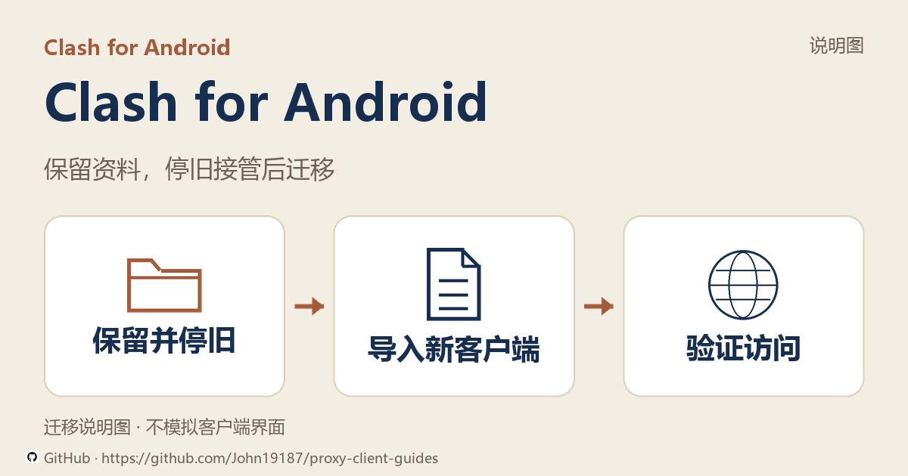

# 2026年 Clash for Android迁移教程：把旧CFA订阅转到CMFA或FlClash

手机里还装着原版Clash for Android（CFA），可以保留原服务，把兼容的订阅重新导入CMFA或FlClash。先保存订阅和个人修改，再停止旧VPN、启动新客户端；新软件能完成日常访问以后，再决定是否卸载CFA。

原CFA仓库在2026-11-14的公开地址核验中已无法访问。本页提供迁移办法，安装新客户端可直接去[CMFA下载与配置教程](../cmfa/README.md#packages)或[FlClash下载与首次连接教程](../flclash/README.md#packages)。想比较其他手机、电脑软件，可看[2026年机场通用客户端汇总与下载教程](../../README.md#choose)。

## 选好新客户端，保存旧配置

CMFA沿用接近CFA的配置、代理组操作；FlClash使用另一套界面。两者都要按各自下载页的Android版本和CPU条件选包。CMFA是独立项目，不能因为名字相近就期待它覆盖CFA后自动接走全部资料。

迁移使用的是自己的服务订阅。原账户仍有效、提供目标客户端支持的格式，就继续用原账户；订阅不能导入时，先看[格式与解析错误的区别](../../subscription-formats.md#import-errors)。

1. 打开旧CFA的配置列表，记下正在使用的配置名称。
2. 远程配置保存原订阅URL；找不到URL时，从自己的服务账户重新复制Clash／Mihomo订阅。本地配置保留实际YAML文件，文件无法导出时先保存仍能查看的必要内容。
3. 单独保存自己修改过的规则、DNS等内容及原文件副本。远程订阅再次下载后，未必保留本机改动。

订阅URL是以后更新的来源，YAML文件是当前内容；两者能同时保留就一起保存，放在自己控制的位置。手机已打不开旧CFA时，保留手里的文件，从原服务账户取回订阅，不必先装一个同名旧APK。

这张图说明迁移顺序。回旧软件恢复只适用于旧连接原本仍可用的情况。

## 停止CFA的VPN连接

新软件已经安装、资料也已保存后，再把Android的VPN连接交给新软件。

1. 在旧CFA首页停止运行。
2. 以前在Android中给CFA设置过“始终开启的VPN”或“无VPN时阻止连接”，到系统的VPN设置中打开这份CFA连接，撤回不再使用的旧关联。各手机的设置入口不同，可在系统设置中搜索“VPN”定位。
3. 打开新客户端，进入它的订阅或配置导入页。

只安装新App不会自动完成迁移。系统仍要求CFA始终连接时，新App可能无法接管，普通联网也可能受旧限制影响；处理的是CFA这一份关联，无需改其他网络设置。

## 在新客户端导入自己的订阅

选择的客户端不同，导入入口也不同，按对应图文继续：

- **CMFA**：在“配置”中新建URL配置，填写并下载自己的Clash／Mihomo订阅，再选中它。具体界面见[CMFA创建配置和导入订阅](../cmfa/README.md#import)。
- **FlClash**：从配置页添加URL订阅，导入后选中这份配置，见[FlClash导入订阅](../flclash/README.md#import)。

只有本地YAML文件时，用所选客户端的文件导入入口。新内核按自身支持的字段解析YAML；报解析错误时保留原文件，按错误行核对兼容性，或从原服务取得适配配置，不靠改后缀转换。

配置出现在列表中，说明添加完成；还要选中它，才能继续使用其中的节点与规则。

## 启动新VPN，完成实际访问

1. 按[CMFA启动与选择节点](../cmfa/README.md#connect)或[FlClash首次连接](../flclash/README.md#connect)，在新端启动连接并选择需要的节点。
2. Android弹出VPN连接请求时，确认请求来自刚安装的新App，再允许连接。
3. 打开原来需要使用的网页和应用，完成实际访问。服务配置中的直连、自动选择等策略先保持原意。

如果系统VPN仍显示由CFA连接，先回旧端停止，再由新App发起连接；其他正在运行的VPN也需按实际占用处理。配置列表、VPN图标和节点延迟分别表示不同环节，实际应用能用才是这次迁移的结果。

新端连接失败，先停止新App并保留具体错误。旧端原来仍可用，可以回CFA选择原配置临时恢复；旧端本来就已失效，保留资料，继续处理订阅或连接错误。只想恢复普通联网时，停止新旧VPN，并核对CFA的始终开启限制是否已撤回。

若多款客户端在同一网络、同一时段都出现问题，保留原配置，用同一节点换自己的热点作对照，并查看本家公告是否列出对应地区和网络的故障。

## 以后在新客户端更新订阅

迁移完成后，服务更新节点就到新客户端更新这份远程配置；本地YAML没有远程来源，需要取得新文件再导入。软件升级也使用新项目的正式渠道，原CFA安装包不再承担新端更新。

确认日常应用和所需规则都已接续，再决定是否卸载旧CFA，备份留到不再需要时处理。想改用服务自带App，可比较[VPN推荐中的App与设备支持](https://github.com/John19187/The-40-Best-VPNs#翻墙客户端与使用方式怎么选)；需要比较提供通用订阅的服务，可看[机场推荐的套餐和客户端条件](https://github.com/John19187/ji-chang-tui-jian#airport-clients)。两篇均为多家服务的推荐与推广，已有兼容服务可以直接继续使用。

项目身份与资料来源

- [CMFA项目](https://github.com/MetaCubeX/ClashMetaForAndroid)、[FlClash项目](https://github.com/chen08209/FlClash)：新客户端的身份及正式下载渠道。
- 界面与版本说明：原文更新于2026-05-25，本地观察时间为2026-11-06；展示CMFA配置与VPN操作。
- 原CFA仓库无法公开访问的状态采用2026-11-14冻结核验；本页未用同名镜像替代原发行。
- 迁移顺序图为本仓整理说明图，封面为本仓制作；新端截图及各自来源见对应教程。

## 文档更新记录

展开文档更新记录

- 2026-11-16　折叠更新记录，收起许可说明，撤下不必要的维护数据与贡献提示入口。

- 2026-11-16　补充文末客户端与免费节点目录、文档维护入口；整理图源与版本说明，保留原安装包和操作内容。

## 客户端与相关资源目录

按设备和配置类型进入对应教程；旧版条目用于识别与迁移。软件之间的订阅、配置和备份条件仍以各篇说明为准。

展开客户端目录（含旧版与迁移说明）

| 客户端 | 设备或范围 | 教程用途 |
|---|---|---|
| **Clash for Android（本篇）** | Android旧版／迁移 | 原版CFA与CMFA分开 |
| [Clash Verge Rev](../clash-verge-rev/README.md) | Windows／macOS／Linux | Clash／Mihomo配置与系统代理 |
| [FlClash](../flclash/README.md) | 电脑／Android | 跨平台下载、导入与连接 |
| [Clash Party](../clash-party/README.md) | Windows／macOS／Linux | 安装版、便携版与订阅管理 |
| [Clash Mi](../clash-mi/README.md) | 跨平台 | 按本款入口导入Clash配置 |
| [ClashX Meta](../clashx-meta/README.md) | macOS | 菜单栏客户端与Mihomo配置 |
| [v2rayN](../v2rayn/README.md) | 电脑 | 节点订阅与系统代理 |
| [Hiddify](../hiddify/README.md) | 电脑／手机 | 跨平台导入与连接 |
| [Karing](../karing/README.md) | 电脑／手机 | 配置、规则与备份 |
| [Clash Meta for Android](../cmfa/README.md) | Android | Clash配置与VPN授权 |
| [v2rayNG](../v2rayng/README.md) | Android | 节点订阅与VPN连接 |
| [NekoBox for Android](../nekobox/README.md) | Android历史版本 | 1.4.2旧版订阅与迁移 |
| [Surfboard](../surfboard/README.md) | Android | 兼容配置与启动连接 |
| [sing-box](../sing-box/README.md) | 多平台 | 版本匹配的JSON配置 |
| [Shadowrocket](../shadowrocket/README.md) | iPhone／iPad | 节点、订阅与VPN连接 |
| [Stash](../stash/README.md) | Apple设备 | 按本款条件导入Clash类配置 |
| [Quantumult X](../quantumult-x/README.md) | iPhone／iPad | 节点资源与完整配置的区别 |
| [Loon](../loon/README.md) | iPhone／iPad | 订阅、策略与分流 |
| [Surge](../surge/README.md) | iOS／macOS | 按平台配置与接管流量 |
| [OpenClash](../openclash/README.md) | OpenWrt | 固件条件、配置与插件 |
| [PassWall](../passwall/README.md) | OpenWrt | 订阅节点与主开关 |
| [ShellCrash](../shellcrash/README.md) | Linux／路由器 | 安装脚本与运行条件 |
| [Nextin专用客户端](../provider-app/README.md) | 按服务公开支持范围 | 仅适用于已证实的服务条件 |
| [Clash for Windows](../cfw/README.md) | 旧版／迁移 | 识别旧配置并迁移 |
| [ClashX](../clashx/README.md) | macOS旧版 | 普通ClashX身份与迁移 |
| [ClashX Pro](../clashx-pro/README.md) | macOS历史版本 | Pro托管配置与增强模式 |
| [旧Clash Verge](../old-clash-verge/README.md) | 旧版／迁移 | 与Rev区分及迁移 |
| [NekoRay](../nekoray/README.md) | 电脑旧版／迁移 | 旧资料与替代客户端 |
| [旧客户端迁移目录](../legacy/README.md) | 旧版资料 | 按原客户端寻找迁移说明 |

| 相关文档 | 内容 |
|---|---|
| [VPN推荐与使用方式](https://github.com/John19187/The-40-Best-VPNs) | 比较服务的平台、接入方式与客户端 |
| [机场推荐与套餐比较](https://github.com/John19187/ji-chang-tui-jian) | 比较月付、按量与套餐条件 |
| **2026年机场通用客户端汇总与下载教程（本文档仓）** | 按设备选软件并进入具体教程 |
| [机场与代理工具科普指南](https://github.com/John19187/ssr-v2ray-trojan-clash-guide) | 理解机场、协议、客户端、订阅与线路 |
| [免费节点与订阅资源](https://github.com/John19187/v2ray-SSR-Clash-Verge-Shadowrocke) | 查看公开资源与导入说明，不承诺持续可用 |

开源维护与许可

本文由John19187统一整理维护，实际修改记录见本页更新日志。原创文档采用[MIT许可](../../LICENSE)；软件、商标及第三方材料的权利与使用范围见[素材说明](../../NOTICE)。

本仓整理客户端下载与使用文档，不是客户端官方项目；软件是否开源、收费及其许可由各开发者分别决定。

