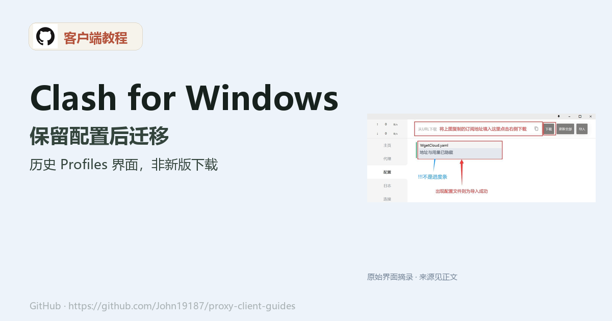
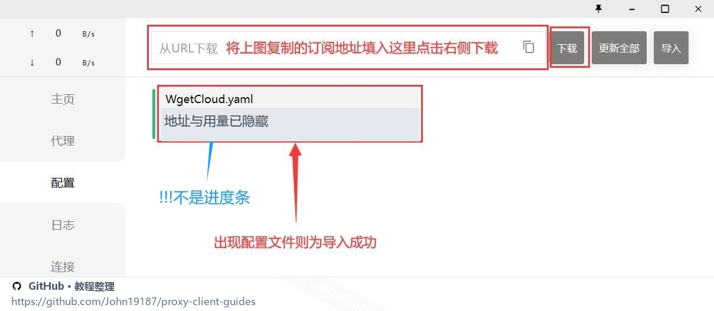

# 2026年 Clash for Windows迁移教程：保存CFW配置，转用Clash Verge Rev

Clash for Windows（CFW）旧用户，先在Profiles配置页保存订阅URL、本地YAML和自己改过的规则，再关闭CFW的系统代理与TUN、从托盘退出。接着在Clash Verge Rev重新导入兼容配置。服务账户仍有效且支持对应格式时，换软件不必重新买套餐。

这篇适合仍保留CFW程序或数据的人。旧程序已经打不开，也先保存手里的目录和文件；不要用不明同名安装包覆盖唯一资料，再寻找自己的订阅。

安装新软件直接去[Clash Verge Rev下载与系统要求](../clash-verge-rev/README.md#packages)。正在找CFW历史版本的人，可先看[旧版客户端与迁移去向](../legacy/README.md)；需要按系统比较软件，则看[2026年机场通用客户端汇总与下载教程](../../README.md#choose)。

## 从CFW配置页保存订阅和个人修改

保存正在用的配置及其来源，迁入Rev后才能继续更新，并找回自己加过的规则。

1. 打开CFW左侧**Profiles**，中文界面可能显示“配置”，记下正在使用的配置名称。

   左侧“配置”就是Profiles页，下方条目显示已保存的配置名称。

2. 使用远程订阅时，从自己的服务账户重新复制Clash／Mihomo订阅URL；使用本地配置时，复制实际YAML文件。旧程序能打开配置所在目录，就从该入口定位文件，不要只记列表名称。
3. 另存自己写的规则、DNS和脚本，记录本机端口及代理开关状态。CFW解析器等功能可能在下载配置之后再改内容，这些软件设置不一定包含在YAML里。

URL保留以后更新的来源，本地YAML保留当前内容，两者用途不同。订阅URL应放在自己控制的位置，不能用账户登录页的网址代替。

旧程序已经打不开，先复制仍在手里的完整数据目录和配置文件，再从服务账户取兼容订阅。为了找到URL，不需要先重装或覆盖旧目录。

## 关闭CFW代理以后安装Clash Verge Rev

资料已保存以后，再停旧CFW：

1. 进入CFW的General／常规页，关闭**System Proxy**。这个开关控制浏览器等应用是否使用CFW的系统代理。
2. 启用过TUN虚拟网卡时，也关闭本次TUN；取消CFW开机启动。
3. 从系统托盘菜单完整退出CFW。仅关闭主窗口可能仍留后台运行，原程序和资料暂时保留。

到[Clash Verge Rev原包和系统选择](../clash-verge-rev/README.md#packages)按当前CPU与系统安装。CFW名称里虽有Windows，历史也有其他桌面包；迁移时按实际设备选Rev，不能只沿旧文件名判断平台。当前系统达不到Rev门槛，先到[客户端目录](../../README.md#choose)选择兼容目标，保留旧资料，不强装不适用的包。

## 在Rev重建订阅，不覆盖整个数据目录

在Rev重新添加已保存的订阅，原CFW目录留作恢复和查找个人修改。两款软件各用自己的数据目录，不要整套相互覆盖。

1. 打开Rev“订阅”，粘贴自己的Mihomo兼容URL并点击“导入”。只有本地YAML时，按[Rev本地配置导入说明](../clash-verge-rev/README.md#local-file)添加该文件。
2. 选中新配置卡片，到“代理”展开策略组，选择要用的节点。
3. 在“设置”开启系统代理。先使用服务默认配置，旧解析器和覆写留在备份中。

完整画面见[Rev订阅与节点选择](../clash-verge-rev/README.md#import)。导入报错时，先按[格式与解析错误](../../subscription-formats.md#import-errors)核对输入。账户有效时，下载、格式或字段错误需要分别处理。

在浏览器完成原来需要的网页访问以后，再恢复自己需要的规则、DNS或覆写。覆写就是在服务提供的配置之外增加或修改设置；某项加入后才失败，就先撤回这项改动，保留已经能工作的默认配置，不必重新迁移全部内容。

## 迁移后浏览器仍指向旧端口

先确认CFW已从托盘退出，在Rev中关闭、再重新开启系统代理，让它写入自己的当前端口。仍失败时，查看系统代理设置是否留着旧CFW的本地地址或自动配置脚本；只撤回旧客户端留下的项目，原有公司代理按原值保留。Windows和Mac的恢复位置见[退出后恢复网络](../../README.md#restore-and-report)。

浏览器可用、特定应用仍失败，进入[Rev应用接管与TUN专题](../../clash-verge-rev-network.md)。不要为了接住一个应用，重新同时开启CFW与Rev。

如果CFW和Rev分别单独运行时，多个节点都失败，继续检查账户有效期、剩余流量和你所用服务商的首页公告；保留两款软件的具体错误，用同一节点比较另一条自己的网络。

## 迁移完成以后，在Rev更新订阅

Rev不能用而需要暂时回退时，先关闭Rev系统代理与TUN并退出，再恢复CFW及它匹配的数据，只让一个客户端处理流量。

更希望用账号直接登录服务App，可比较[VPN推荐中的App和设备支持](https://github.com/John19187/The-40-Best-VPNs#翻墙客户端与使用方式怎么选)；需要通用客户端订阅，可看[机场推荐中的Clash支持和套餐条件](https://github.com/John19187/ji-chang-tui-jian#airport-clients)。两篇是多家服务的推荐与推广文章，不是每个VPN账号都能导入Rev；已有兼容订阅就继续使用。

以后服务调整节点，在Rev“订阅”里更新对应配置即可。CFW备份继续用于找回没有包含在订阅里的个人修改；确认资料都已迁出后，再决定是否卸载旧程序。

历史身份与迁移目标来源

- 原CFW项目：`Fndroid/clash_for_windows_pkg`，2026-11-14公开地址返回404。
- [Clash Verge Rev开发者原仓](https://github.com/clash-verge-rev/clash-verge-rev)
- [Rev订阅管理](https://www.clashverge.dev/guide/profile.html)
- 配置页操作图为旧CFW界面，用于辨认迁移前的Profiles配置页。

## 文档更新记录

展开文档更新记录

- 2026-11-16　折叠更新记录，收起许可说明，撤下不必要的维护数据与贡献提示入口。

- 2026-11-16　补充文末客户端与免费节点目录、文档维护入口；整理图源与版本说明，保留原安装包和操作内容。

## 客户端与相关资源目录

按设备和配置类型进入对应教程；旧版条目用于识别与迁移。软件之间的订阅、配置和备份条件仍以各篇说明为准。

展开客户端目录（含旧版与迁移说明）

| 客户端 | 设备或范围 | 教程用途 |
|---|---|---|
| **Clash for Windows（本篇）** | 旧版／迁移 | 识别旧配置并迁移 |
| [Clash Verge Rev](../clash-verge-rev/README.md) | Windows／macOS／Linux | Clash／Mihomo配置与系统代理 |
| [FlClash](../flclash/README.md) | 电脑／Android | 跨平台下载、导入与连接 |
| [Clash Party](../clash-party/README.md) | Windows／macOS／Linux | 安装版、便携版与订阅管理 |
| [Clash Mi](../clash-mi/README.md) | 跨平台 | 按本款入口导入Clash配置 |
| [ClashX Meta](../clashx-meta/README.md) | macOS | 菜单栏客户端与Mihomo配置 |
| [v2rayN](../v2rayn/README.md) | 电脑 | 节点订阅与系统代理 |
| [Hiddify](../hiddify/README.md) | 电脑／手机 | 跨平台导入与连接 |
| [Karing](../karing/README.md) | 电脑／手机 | 配置、规则与备份 |
| [Clash Meta for Android](../cmfa/README.md) | Android | Clash配置与VPN授权 |
| [v2rayNG](../v2rayng/README.md) | Android | 节点订阅与VPN连接 |
| [NekoBox for Android](../nekobox/README.md) | Android历史版本 | 1.4.2旧版订阅与迁移 |
| [Surfboard](../surfboard/README.md) | Android | 兼容配置与启动连接 |
| [sing-box](../sing-box/README.md) | 多平台 | 版本匹配的JSON配置 |
| [Shadowrocket](../shadowrocket/README.md) | iPhone／iPad | 节点、订阅与VPN连接 |
| [Stash](../stash/README.md) | Apple设备 | 按本款条件导入Clash类配置 |
| [Quantumult X](../quantumult-x/README.md) | iPhone／iPad | 节点资源与完整配置的区别 |
| [Loon](../loon/README.md) | iPhone／iPad | 订阅、策略与分流 |
| [Surge](../surge/README.md) | iOS／macOS | 按平台配置与接管流量 |
| [OpenClash](../openclash/README.md) | OpenWrt | 固件条件、配置与插件 |
| [PassWall](../passwall/README.md) | OpenWrt | 订阅节点与主开关 |
| [ShellCrash](../shellcrash/README.md) | Linux／路由器 | 安装脚本与运行条件 |
| [Nextin](../provider-app/README.md) | 按服务公开支持范围 | 服务指定Nextin时的安装与连接 |
| [Clash for Android](../cfa/README.md) | Android旧版／迁移 | 原版CFA与CMFA分开 |
| [ClashX](../clashx/README.md) | macOS旧版 | 普通ClashX身份与迁移 |
| [ClashX Pro](../clashx-pro/README.md) | macOS历史版本 | Pro托管配置与增强模式 |
| [旧Clash Verge](../old-clash-verge/README.md) | 旧版／迁移 | 与Rev区分及迁移 |
| [NekoRay](../nekoray/README.md) | 电脑旧版／迁移 | 旧资料与替代客户端 |
| [旧客户端迁移目录](../legacy/README.md) | 旧版资料 | 按原客户端寻找迁移说明 |

| 相关文档 | 内容 |
|---|---|
| [VPN推荐与使用方式](https://github.com/John19187/The-40-Best-VPNs) | 比较服务的平台、接入方式与客户端 |
| [机场推荐与套餐比较](https://github.com/John19187/ji-chang-tui-jian) | 比较月付、按量与套餐条件 |
| [2026年机场通用客户端汇总与下载教程](../../README.md#choose) | 按设备选软件并进入具体教程 |
| [机场与代理工具科普指南](https://github.com/John19187/ssr-v2ray-trojan-clash-guide) | 理解机场、协议、客户端、订阅与线路 |
| [免费节点与订阅资源](https://github.com/John19187/v2ray-SSR-Clash-Verge-Shadowrocke) | 查看公开资源与导入说明，不承诺持续可用 |

开源维护与许可

本文由John19187统一整理维护，实际修改记录见本页更新日志。原创文档采用[MIT许可](../../LICENSE)；软件、商标及第三方材料的权利与使用范围见[素材说明](../../NOTICE)。

本仓整理客户端下载与使用文档，不是客户端官方项目；软件是否开源、收费及其许可由各开发者分别决定。

