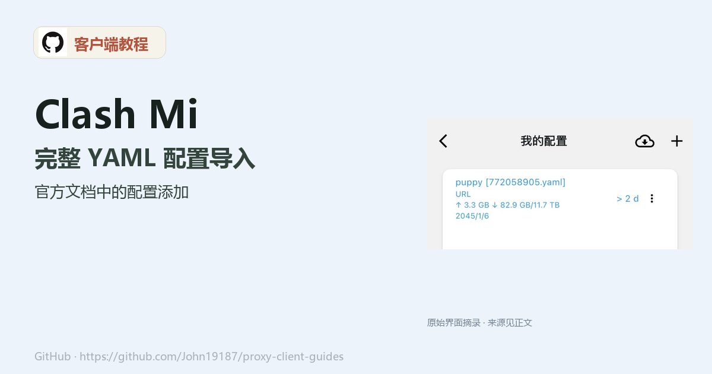
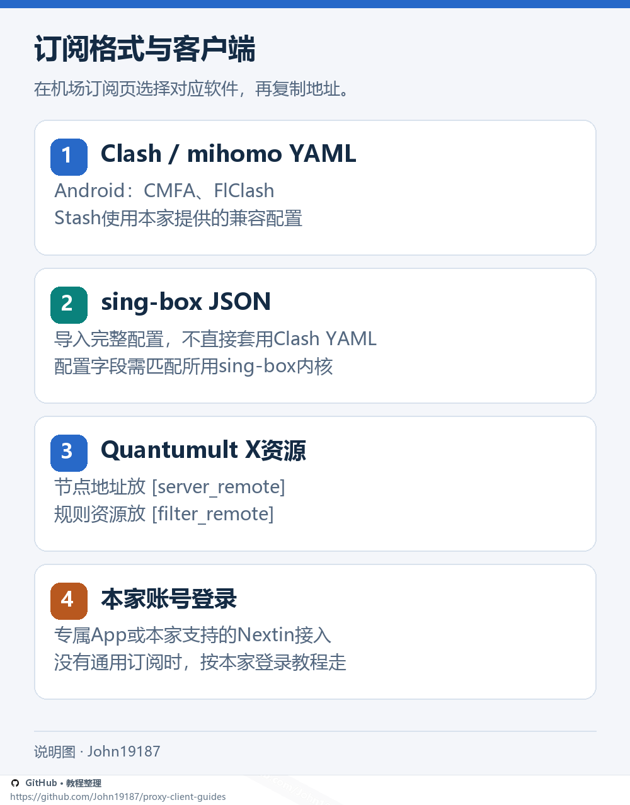
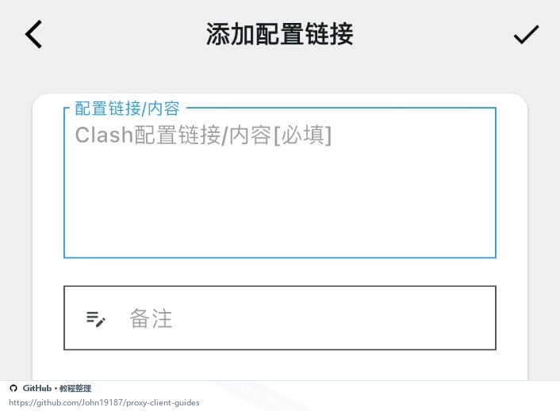
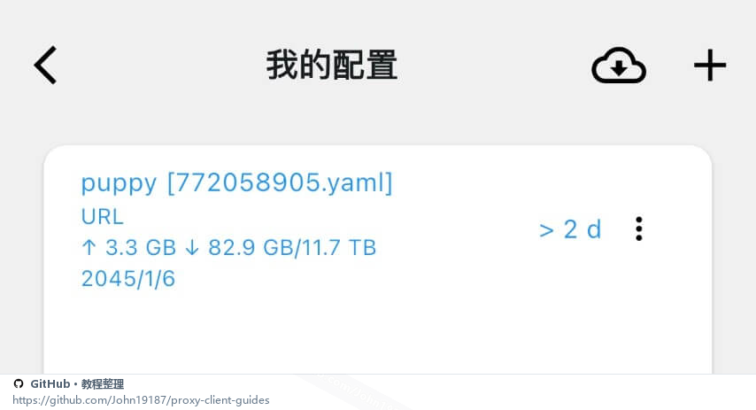
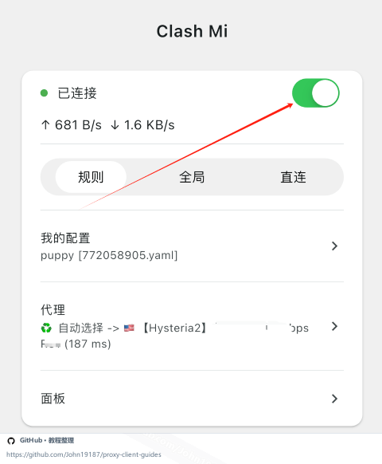
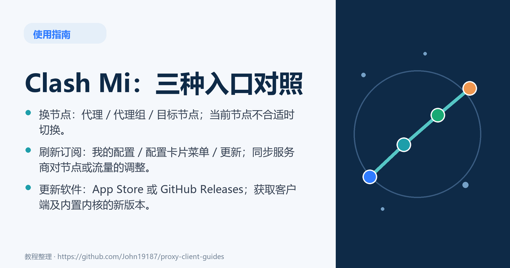

# 2026年 Clash Mi 下载与使用：添加订阅、开启连接和更换节点

Clash Mi 是免费、开源的代理客户端，内置 Mihomo 内核。普通用户用服务商提供的 Clash / Mihomo 订阅即可配置：安装对应系统的版本，在“我的配置”中添加订阅并选中，再回首页开启连接。已经装好软件的读者可以直接从[添加现有订阅](#import)开始。

软件本身不附带可用的付费服务。你已有机场或 VPN 服务时，先到原服务商的订阅页找 Clash / Mihomo 入口；如果服务只提供自有 App 和账号登录，就按它的客户端方式使用。需要比较服务时，可看[多家 VPN 推荐与推广：客户端与使用方式](https://github.com/John19187/The-40-Best-VPNs#翻墙客户端与使用方式怎么选)和[多家机场推荐与推广：支持的客户端](https://github.com/John19187/ji-chang-tui-jian#airport-clients)，其中部分服务有自有 App。已有能用的服务可直接继续配置。

## Clash Mi下载：GitHub v1.0.32.1803与App Store渠道

下表的 **GitHub 安装包固定为 v1.0.32.1803**，对应[官方发行页](https://github.com/KaringX/clashmi/releases/tag/v1.0.32.1803)；App Store 是独立渠道，2026 年 11 月 14 日的资料记录中美区商店显示 **1.0.31.1703**，以你自己商店的实际显示为准，不必为追齐版本号改装测试版。GitHub 后续新版本另从[官方 Releases](https://github.com/KaringX/clashmi/releases/latest)取得。[官方手册](https://clashmi.app/guide/)列出的系统要求为 iOS 15、macOS 12、Android 8、Windows 10 及以上；Linux 则按发行版和包型选择下列 amd64 文件。

| 你的设备 | 对应下载 | 安装时怎样选 |
|---|---|---|
| iPhone / iPad | [App Store](https://apps.apple.com/us/app/clash-mi/id6744321968?uo=4) | 使用商店安装，先确认账号所在地区能获取该应用 |
| Windows x64 | [EXE 安装版](https://github.com/KaringX/clashmi/releases/download/v1.0.32.1803/clashmi_1.0.32.1803_windows_x64.exe) [ZIP 压缩包](https://github.com/KaringX/clashmi/releases/download/v1.0.32.1803/clashmi_1.0.32.1803_windows_x64.zip) | 官方建议 EXE；ZIP 先完整解压，再运行其中的程序 |
| macOS，Intel / Apple Silicon | [Universal DMG](https://github.com/KaringX/clashmi/releases/download/v1.0.32.1803/clashmi_1.0.32.1803_macos_universal.dmg) [Universal PKG](https://github.com/KaringX/clashmi/releases/download/v1.0.32.1803/clashmi_1.0.32.1803_macos_universal.pkg) | DMG 按窗口指引安装应用；PKG 按安装器步骤安装，两者选一种 |
| Android | [通用 ARM APK](https://github.com/KaringX/clashmi/releases/download/v1.0.32.1803/clashmi_1.0.32.1803_android_arm.apk) | 官方建议先选这一包，下载完成后打开 APK 安装 |
| Android，已知 CPU 架构 | [arm64-v8a](https://github.com/KaringX/clashmi/releases/download/v1.0.32.1803/clashmi_1.0.32.1803_android_arm64-v8a.apk) [armeabi-v7a](https://github.com/KaringX/clashmi/releases/download/v1.0.32.1803/clashmi_1.0.32.1803_android_armeabi-v7a.apk) | 分别用于相应的 64 位和 32 位 ARM 环境；不清楚架构时选上一行 |
| Linux amd64 | [AppImage](https://github.com/KaringX/clashmi/releases/download/v1.0.32.1803/clashmi_1.0.32.1803_linux_amd64.AppImage) [DEB](https://github.com/KaringX/clashmi/releases/download/v1.0.32.1803/clashmi_1.0.32.1803_linux_amd64.deb) [RPM](https://github.com/KaringX/clashmi/releases/download/v1.0.32.1803/clashmi_1.0.32.1803_linux_amd64.rpm) | AppImage 授予执行权限后运行；DEB 用于 Debian / Ubuntu 系，RPM 用于对应发行版 |

该发行页没有列出原生 Windows ARM64 或 Linux ARM 包，也未给出 Linux 统一最低发行版版本。“Source code”是源码，不是上表的安装包。Linux 包曾在 2026 年 11 月 12 日重新上传，发行说明要求已经安装其所述旧包的用户重新下载、安装。

Windows 下载 EXE 后打开安装器，按提示完成安装，再启动 Clash Mi；Android 若询问是否允许当前浏览器或文件管理器安装应用，权限对象就是你用来打开 APK 的那个应用。安装后先能打开 Clash Mi 首页，接下来才是添加服务商订阅。

Android 安装完成后可恢复安装来源的原权限；只能运行原生鸿蒙应用、不能安装 Android APK 的设备不适用这条安装路径。

苹果商店中找不到应用时，官方手册建议使用港区、美区等非中国大陆地区账号获取。商店版与 TestFlight 测试版会相互覆盖，不能同时安装；日常使用可直接选商店版，不必为了本教程再换测试版。

Windows 用户若希望采用另一款桌面界面，官方手册也推荐同用 Mihomo 内核的 Mihomo Party，可直接看 [Clash Party 下载与配置教程](../clash-party/README.md)。其他设备或客户端选择见[2026年机场通用客户端汇总与下载教程](../../README.md)。

## 把服务商订阅设为当前配置

### 复制适合 Clash Mi 的订阅地址

登录服务商后台，打开它的“订阅”“客户端”或“使用教程”页面，找到 **Clash / Mihomo** 对应的订阅入口并复制链接。服务商给出的完整地址要保留；网页登录地址、账号密码和套餐购买页都不能代替订阅链接。链接常包含个人令牌，不要贴到公开评论、截图或第三方转换网站。

Clash Mi 需要包含节点、代理组和规则等内容的完整 YAML 配置，单个节点分享链接不能代替它；订阅URL可以不带`.yaml`后缀，导入时按实际下载的配置内容识别。下图把常见格式及入口放在一起，作用是帮助你在服务商页面拿对内容：本篇走第一类 Clash / Mihomo 路径，其他几类应使用服务商对应的客户端方式。

如果后台同时提供几种格式，选择 Clash / Mihomo 对应地址即可。若只有别的客户端专用配置，先问服务商有无适合 Clash Mi 的订阅；不要把文件扩展名改成 `.yaml` 后导入，改名字不会转换配置内容。

### 添加链接，再点选配置卡片

1. 在 Clash Mi 首页点击“我的配置”，进入配置列表。
2. 点击右上角“＋”，选择“添加配置链接”。
3. 把刚才复制的订阅地址粘贴到“配置链接/内容”输入框；“备注”可填便于辨认的服务名称。点击右上角对勾保存。

上图要填的是上方大输入框。保存时如果出现下载或解析错误，先回服务商页面核对复制的是 Clash / Mihomo 订阅，且没有漏掉地址后半段；若拿到的是登录网页或其他格式，继续重试同一地址不会把它变成可用配置。地址正确仍报错时，把错误文字和所选格式交给服务商排查，保留令牌不外传。

若订阅地址在浏览器中也无法获取，核对账户、订阅是否有效；部分订阅域名在当前网络可能无法访问，已有另一条可用连接时，可先通过它取得订阅。仅当服务商给出具体 UserAgent 值时，才按其要求调整“应用设置 → UserAgent”，再更新订阅。

4. 返回“我的配置”后，找到新出现的配置卡片，**点击卡片主体**将它设为当前配置；此操作随后返回上一层。这里不用打开右侧三点菜单，也没有另外一轮“应用配置”操作。

图中的配置名、流量和日期是官方示例。此时真正需要辨认的是两处：点卡片主体用于选择配置，右侧竖向三点用于这份配置的更多操作。以后添加第二份订阅，也在这里点选想用的卡片。

## 用当前配置打开网页，并选定代理出口

1. 回到首页，在“我的配置”一行确认显示的是刚才选择的配置名称。
2. 日常使用先选“规则”模式，再打开首页顶部连接开关。首次启用时，若系统询问是否允许添加 VPN 配置或建立 VPN 连接，按系统提示授权给 Clash Mi。

图中开关及“已连接”是官方界面示例，用于辨认位置。你自己的开关打开后，继续用浏览器打开实际需要访问的网页，或打开目标 App 完成原本要做的操作；状态文字和延迟数字各自只能说明相应状态，不能代替这一步的使用结果。

如果开启连接时直接失败，按具体症状处理：

- Windows 报 `configure tun interface: Access is denied`：退出 Clash Mi，以管理员身份重新启动后再连接；不需要删除网卡或重置系统网络。
- iOS 一开启就自动断开：官方指出，大型规则配置可能超过 VPN 扩展的内存限制。把症状和日志交服务商，请它提供更精简、适合 iOS 的配置或规则集。
- 报错包含 `yaml:line`：保留完整错误与行号，先[更新订阅](#update)；仍报同样错误时，把脱敏错误交配置提供方修正。

以上处理参考[官方 FAQ](https://clashmi.app/guide/faq)。

首页三个模式决定流量按什么方式处理，选择它们时可以按下表判断：

| 模式 | 它的用途 | 本篇怎样使用 |
|---|---|---|
| 规则 | 按当前配置中的规则决定直连或代理 | 日常先用服务商配置提供的规则 |
| 全局 | 交给全局代理组处理 | 有明确需要时使用，并留意全局组实际选中的出口 |
| 直连 | 直接连接目标 | 需要代理访问的目标不应停在此模式 |

需要临时停用时，将首页顶部连接开关滑回关闭；选择“直连”与关闭连接是两件事。

### 想换地区或当前出口不好用，去“代理”选节点

1. 在首页点击“代理”。
2. 点击当前配置中用于选择出口的代理组，进入它的可选节点列表。代理组名称由配置决定，不要求每家服务商都叫“节点选择”。
3. 点击想用的节点，再回到目标网页或 App 重试。

节点是具体出口，代理组则是配置提供的选择入口；一份订阅可能有多个用途不同的组。先改与你当前用途相应的组，不必逐组随意改动。首页“代理”就能完成普通换节点，习惯 Web 操作的人也可用“面板”；若面板要求 `secret`，在“核心设置”中查找。

组当前指向“自动选择”时，会按该组配置挑选节点；需要固定地区时，在允许手动选择的组里点具体节点。面板的 `secret` 是访问密钥，不是服务商登录密码，也不应公开。

### 开关已打开，目标仍打不开时

先看自己停在哪个状态：若首页显示的不是想用的配置，回“我的配置”点选正确卡片；若用了“直连”，回到“规则”再试。已经在正确配置和规则模式下，进入“代理”换同组中的其他节点，然后重试原目标，这样能知道改变出口后该任务是否恢复。

**已连接但实际请求没有流量**时，确认配置和代理组无误后，官方给出的办法是到“核心设置 → TUN”启用覆写并启用 TUN，再重连；Windows 需管理员启动。改前记住原开关状态，无改善就恢复；若服务商明确要求由订阅管理 TUN，请它修正配置，避免本地覆写覆盖其设置。目标应用已经正常使用、只有延迟测试失败时，先保留可用配置。

**如果问题恰好发生在“全局”模式**，官方 FAQ 提醒全局默认出口可能是直连。按[官方全局模式说明](https://clashmi.app/guide/faq#gloabl-link)，进入“代理 → GLOBAL”，将其选择改为“节点选择”或“自动选择”。这是全局模式的专门分支，不要求所有规则模式用户都去找 GLOBAL。

其他错误保留原文，再到[官方 FAQ](https://clashmi.app/guide/faq)查对应情况，或到[官方 Issues](https://github.com/KaringX/clashmi/issues)反馈客户端问题。提交截图或日志前去掉订阅地址中的令牌和个人信息。某个节点或套餐相关的问题交给服务商，客户端入口或程序错误则向项目反馈；不用为了排障先清空所有配置。

## 服务商调整后，更新哪一项

以后使用时，先判断变化发生在哪里。只想换一个出口，就沿前面的“代理 → 代理组 → 节点”操作；服务商增加节点、调整配置后，更新订阅；要获取 Clash Mi 新功能或客户端修复，再升级软件。三者的入口如下图，它们是并列选择，不是每次必须依次执行的流程。

**更新一份远程订阅：** 打开“我的配置”，在目标配置卡片右侧点击竖向三点，选择“更新”。操作对象是这张卡片对应的订阅；它重新获取服务商提供的配置，适合服务商已经发布节点或规则调整后同步。没有远程地址的本地文件不按这条路径更新。

流量、到期日能否显示，取决于服务商是否在订阅响应中提供相关信息；本地文件要从原渠道取得新版配置后重新导入。

**更新多份配置：** “我的配置”右上角的云朵向下箭头是更新全部配置的入口，旁边的“＋”才是添加入口。只有一份订阅需要刷新时，直接用该卡片菜单即可。如果服务商已更换订阅地址，原地址失效后反复点更新仍会请求原地址，应回服务商后台取得它现在提供的订阅。

**升级 Clash Mi：** 经 App Store 安装的版本从商店更新；使用 GitHub 安装包的版本从[官方新版发行页](https://github.com/KaringX/clashmi/releases/latest)选择与设备匹配的包。刷新配置不会把软件升级到新版本，升级软件也不能代替服务商更新订阅内容。

正常升级不需要先卸载应用；保留能重新取得订阅的方式，有自定义配置时另存必要内容。macOS 自动更新后打不开，先从官方重新下载 DMG 安装；若出现扩展读取自身配置的权限提示，再按具体提示及官方 FAQ 处理，不必预先开启完全磁盘访问权限。

内置 Mihomo 内核和本地面板随 App 更新。官方已禁用面板里的“更新核心”“重启核心”“重载配置”“更新 GEO”等入口，这些功能由App管理，日常订阅更新按配置页操作。

若多个节点同期异常，记录发生时间、地区及所用网络，核对本家公告的影响范围；连接机制与故障环节可查[科普中的连接判断](https://github.com/John19187/ssr-v2ray-trojan-clash-guide#diagnosis)，具体操作仍按本篇对应症状处理。

本文操作依据为 [Clash Mi 官方用户手册](https://clashmi.app/guide/)及 [KaringX/clashmi 官方项目](https://github.com/KaringX/clashmi)对应版本资料，界面截图来自官方手册，说明图由本教程仓库整理。资料整理日期为 2026-11-14。

## 文档更新记录

展开文档更新记录

- 2026-11-16　折叠更新记录，收起许可说明，撤下不必要的维护数据与贡献提示入口。 下载区标题标明本文固定版本或独立商店渠道，保原下载文件与旧锚。

- 2026-11-16　补充文末客户端与免费节点目录、文档维护入口；整理图源与版本说明，保留原安装包和操作内容。

## 客户端与相关资源目录

按设备和配置类型进入对应教程；旧版条目用于识别与迁移。软件之间的订阅、配置和备份条件仍以各篇说明为准。

展开客户端目录（含旧版与迁移说明）

| 客户端 | 设备或范围 | 教程用途 |
|---|---|---|
| **Clash Mi（本篇）** | 跨平台 | 按本款入口导入Clash配置 |
| [Clash Verge Rev](../clash-verge-rev/README.md) | Windows／macOS／Linux | Clash／Mihomo配置与系统代理 |
| [FlClash](../flclash/README.md) | 电脑／Android | 跨平台下载、导入与连接 |
| [Clash Party](../clash-party/README.md) | Windows／macOS／Linux | 安装版、便携版与订阅管理 |
| [ClashX Meta](../clashx-meta/README.md) | macOS | 菜单栏客户端与Mihomo配置 |
| [v2rayN](../v2rayn/README.md) | 电脑 | 节点订阅与系统代理 |
| [Hiddify](../hiddify/README.md) | 电脑／手机 | 跨平台导入与连接 |
| [Karing](../karing/README.md) | 电脑／手机 | 配置、规则与备份 |
| [Clash Meta for Android](../cmfa/README.md) | Android | Clash配置与VPN授权 |
| [v2rayNG](../v2rayng/README.md) | Android | 节点订阅与VPN连接 |
| [NekoBox for Android](../nekobox/README.md) | Android历史版本 | 1.4.2旧版订阅与迁移 |
| [Surfboard](../surfboard/README.md) | Android | 兼容配置与启动连接 |
| [sing-box](../sing-box/README.md) | 多平台 | 版本匹配的JSON配置 |
| [Shadowrocket](../shadowrocket/README.md) | iPhone／iPad | 节点、订阅与VPN连接 |
| [Stash](../stash/README.md) | Apple设备 | 按本款条件导入Clash类配置 |
| [Quantumult X](../quantumult-x/README.md) | iPhone／iPad | 节点资源与完整配置的区别 |
| [Loon](../loon/README.md) | iPhone／iPad | 订阅、策略与分流 |
| [Surge](../surge/README.md) | iOS／macOS | 按平台配置与接管流量 |
| [OpenClash](../openclash/README.md) | OpenWrt | 固件条件、配置与插件 |
| [PassWall](../passwall/README.md) | OpenWrt | 订阅节点与主开关 |
| [ShellCrash](../shellcrash/README.md) | Linux／路由器 | 安装脚本与运行条件 |
| [Nextin专用客户端](../provider-app/README.md) | 按服务公开支持范围 | 仅适用于已证实的服务条件 |
| [Clash for Windows](../cfw/README.md) | 旧版／迁移 | 识别旧配置并迁移 |
| [Clash for Android](../cfa/README.md) | Android旧版／迁移 | 原版CFA与CMFA分开 |
| [ClashX](../clashx/README.md) | macOS旧版 | 普通ClashX身份与迁移 |
| [ClashX Pro](../clashx-pro/README.md) | macOS历史版本 | Pro托管配置与增强模式 |
| [旧Clash Verge](../old-clash-verge/README.md) | 旧版／迁移 | 与Rev区分及迁移 |
| [NekoRay](../nekoray/README.md) | 电脑旧版／迁移 | 旧资料与替代客户端 |
| [旧客户端迁移目录](../legacy/README.md) | 旧版资料 | 按原客户端寻找迁移说明 |

| 相关文档 | 内容 |
|---|---|
| [VPN推荐与使用方式](https://github.com/John19187/The-40-Best-VPNs) | 比较服务的平台、接入方式与客户端 |
| [机场推荐与套餐比较](https://github.com/John19187/ji-chang-tui-jian) | 比较月付、按量与套餐条件 |
| **2026年机场通用客户端汇总与下载教程（本文档仓）** | 按设备选软件并进入具体教程 |
| [机场与代理工具科普指南](https://github.com/John19187/ssr-v2ray-trojan-clash-guide) | 理解机场、协议、客户端、订阅与线路 |
| [免费节点与订阅资源](https://github.com/John19187/v2ray-SSR-Clash-Verge-Shadowrocke) | 查看公开资源与导入说明，不承诺持续可用 |

开源维护与许可

本文由John19187统一整理维护，实际修改记录见本页更新日志。原创文档采用[MIT许可](../../LICENSE)；软件、商标及第三方材料的权利与使用范围见[素材说明](../../NOTICE)。

本仓整理客户端下载与使用文档，不是客户端官方项目；软件是否开源、收费及其许可由各开发者分别决定。

