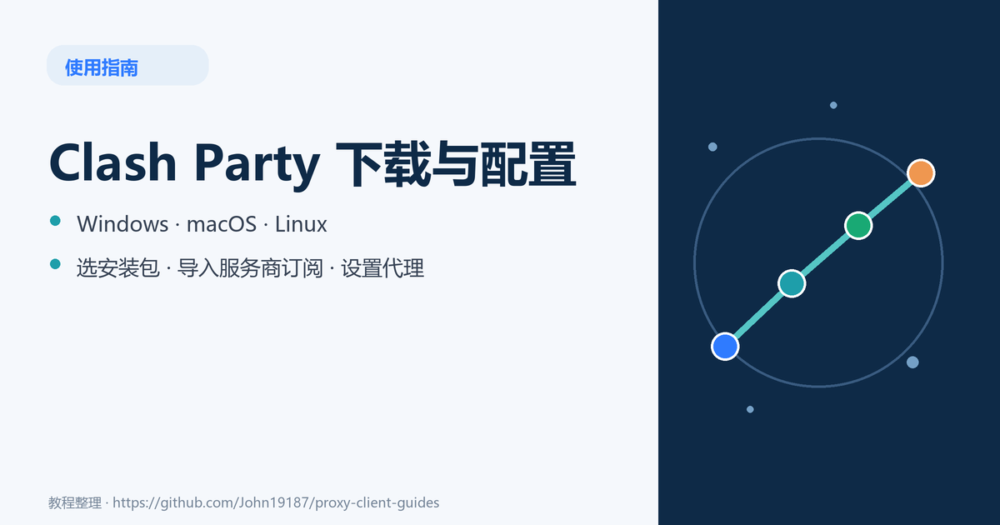
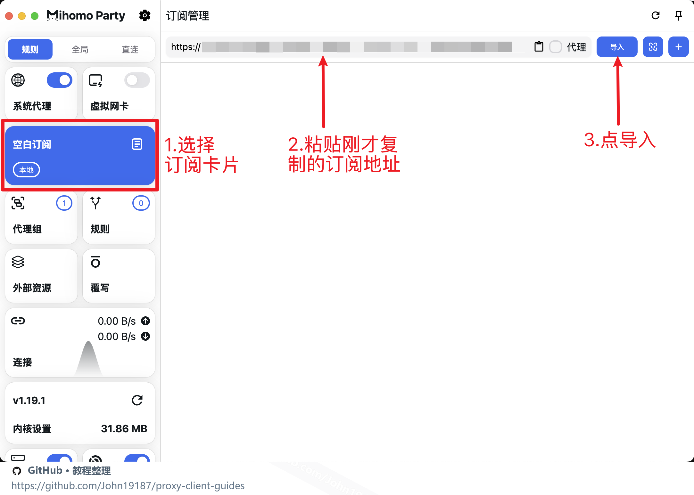
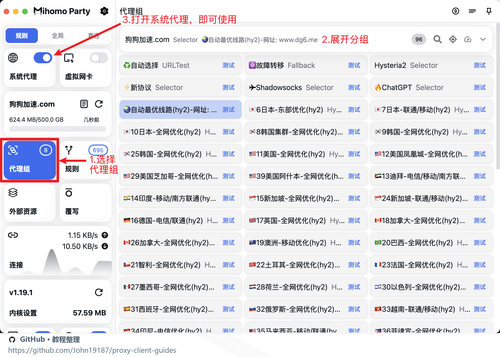

# 2026年 Clash Party 下载与配置教程：Windows、Mac、Linux

已有机场订阅时，下载与你电脑系统匹配的Clash Party，在“订阅管理”中粘贴Clash／Mihomo兼容订阅链接，导入并选中这份配置，再到“代理组”选择节点、开启“系统代理”。

本文安装包版本为 **v2.0.4**，资料整理于2026年11月14日。Clash Party原名Mihomo Party，是同一客户端项目；下文沿用项目官网的旧名界面图，说明订阅卡片、导入框、代理组和系统代理入口。

## Clash Party v2.0.4下载：按系统和CPU选择安装包

Windows 10／11多数Intel、AMD电脑选第一行的x64安装版；ARM电脑选arm64，32位系统选ia32。Windows 7／8使用文件名带`win7`的兼容包。还不能确定时，先看下面的系统类型说明。

| 平台／CPU | v2.0.4直接下载 |
|---|---|
| Windows 10/11 x64 | **安装版：** [clash-party-windows-2.0.4-x64-setup.exe](https://github.com/mihomo-party-org/clash-party/releases/download/v2.0.4/clash-party-windows-2.0.4-x64-setup.exe) **便携版：** [clash-party-windows-2.0.4-x64-portable.7z](https://github.com/mihomo-party-org/clash-party/releases/download/v2.0.4/clash-party-windows-2.0.4-x64-portable.7z) |
| Windows 10/11 arm64 | **安装版：** [clash-party-windows-2.0.4-arm64-setup.exe](https://github.com/mihomo-party-org/clash-party/releases/download/v2.0.4/clash-party-windows-2.0.4-arm64-setup.exe) **便携版：** [clash-party-windows-2.0.4-arm64-portable.7z](https://github.com/mihomo-party-org/clash-party/releases/download/v2.0.4/clash-party-windows-2.0.4-arm64-portable.7z) |
| Windows 10/11 ia32 | **安装版：** [clash-party-windows-2.0.4-ia32-setup.exe](https://github.com/mihomo-party-org/clash-party/releases/download/v2.0.4/clash-party-windows-2.0.4-ia32-setup.exe) **便携版：** [clash-party-windows-2.0.4-ia32-portable.7z](https://github.com/mihomo-party-org/clash-party/releases/download/v2.0.4/clash-party-windows-2.0.4-ia32-portable.7z) |
| Windows 7/8 x64 | **安装版：** [clash-party-win7-2.0.4-x64-setup.exe](https://github.com/mihomo-party-org/clash-party/releases/download/v2.0.4/clash-party-win7-2.0.4-x64-setup.exe) **便携版：** [clash-party-win7-2.0.4-x64-portable.7z](https://github.com/mihomo-party-org/clash-party/releases/download/v2.0.4/clash-party-win7-2.0.4-x64-portable.7z) |
| Windows 7/8 ia32 | **安装版：** [clash-party-win7-2.0.4-ia32-setup.exe](https://github.com/mihomo-party-org/clash-party/releases/download/v2.0.4/clash-party-win7-2.0.4-ia32-setup.exe) **便携版：** [clash-party-win7-2.0.4-ia32-portable.7z](https://github.com/mihomo-party-org/clash-party/releases/download/v2.0.4/clash-party-win7-2.0.4-ia32-portable.7z) |
| Mac Intel | macOS 11及以上：[clash-party-macos-2.0.4-x64.pkg](https://github.com/mihomo-party-org/clash-party/releases/download/v2.0.4/clash-party-macos-2.0.4-x64.pkg)；macOS 10.15及以上兼容包：[clash-party-catalina-2.0.4-x64.pkg](https://github.com/mihomo-party-org/clash-party/releases/download/v2.0.4/clash-party-catalina-2.0.4-x64.pkg) |
| Mac Apple Silicon（macOS 11及以上） | 常规包：**PKG包：** [clash-party-macos-2.0.4-arm64.pkg](https://github.com/mihomo-party-org/clash-party/releases/download/v2.0.4/clash-party-macos-2.0.4-arm64.pkg) **PKG包：** [clash-party-catalina-2.0.4-arm64.pkg](https://github.com/mihomo-party-org/clash-party/releases/download/v2.0.4/clash-party-catalina-2.0.4-arm64.pkg)（此文件名不表示支持macOS 10.15） |
| Linux x64 | **DEB包：** [clash-party-linux-2.0.4-amd64.deb](https://github.com/mihomo-party-org/clash-party/releases/download/v2.0.4/clash-party-linux-2.0.4-amd64.deb) **RPM包：** [clash-party-linux-2.0.4-x86_64.rpm](https://github.com/mihomo-party-org/clash-party/releases/download/v2.0.4/clash-party-linux-2.0.4-x86_64.rpm) **Arch包：** [clash-party-linux-2.0.4-x64.pkg.tar.zst](https://github.com/mihomo-party-org/clash-party/releases/download/v2.0.4/clash-party-linux-2.0.4-x64.pkg.tar.zst) |
| Linux ARM64 | **DEB包：** [clash-party-linux-2.0.4-arm64.deb](https://github.com/mihomo-party-org/clash-party/releases/download/v2.0.4/clash-party-linux-2.0.4-arm64.deb) **RPM包：** [clash-party-linux-2.0.4-aarch64.rpm](https://github.com/mihomo-party-org/clash-party/releases/download/v2.0.4/clash-party-linux-2.0.4-aarch64.rpm) **Arch包：** [clash-party-linux-2.0.4-aarch64.pkg.tar.zst](https://github.com/mihomo-party-org/clash-party/releases/download/v2.0.4/clash-party-linux-2.0.4-aarch64.pkg.tar.zst) |

### 安装并打开软件

Windows 10／11在“设置 → 系统 → 关于”查看“系统类型”；Windows旧系统可打开“计算机／这台电脑”的属性查看。x64对应64位Intel／AMD系统，ia32对应32位系统，arm64对应ARM系统。

- **Windows安装版**：运行`setup.exe`，按向导完成安装，再启动Clash Party。
- **Windows便携版**：完整解压`portable.7z`，从解压后的文件夹启动主程序。保留同目录其他文件，不要只拿出一个EXE运行。
- **Mac**：在“关于本机”查看系统版本和Intel或Apple芯片。macOS 10.15的Intel Mac选`catalina-x64`兼容包；macOS 11及以上按芯片选常规`macos-x64`或`macos-arm64`包，运行PKG并按向导安装。
- **Linux**：在下载的安装包所在文件夹打开终端，按发行版执行对应命令。下面是x64安装包示例；文件名里的amd64、x86_64与x64指同一架构类别。
    - Debian／Ubuntu：`sudo apt install ./clash-party-linux-2.0.4-amd64.deb`。ARM64把文件名替换为`clash-party-linux-2.0.4-arm64.deb`。
    - Fedora等使用DNF的发行版：`sudo dnf install ./clash-party-linux-2.0.4-x86_64.rpm`。ARM64把文件名替换为`clash-party-linux-2.0.4-aarch64.rpm`。
    - Arch：`sudo pacman -U ./clash-party-linux-2.0.4-x64.pkg.tar.zst`。ARM64把文件名替换为`clash-party-linux-2.0.4-aarch64.pkg.tar.zst`。

    使用与你的CPU相符、已实际下载的文件名。安装完成后从应用列表启动Clash Party，继续下面的订阅配置。

如果程序不能安装或启动，先核对系统版本、架构和安装包是否匹配。若提示端口占用，查看原来的代理软件是否还在托盘运行。

1. 关闭旧代理软件的系统代理和TUN。
2. 从托盘完整退出旧代理程序。仅关闭代理开关通常不会释放内核监听的端口；旧程序以后台服务运行时，按该程序说明停止代理服务，不要随意结束不明进程。
3. 重新启动Clash Party。

若不再需要旧软件开机接管，再关闭它对应的开机设置。换节点无法解决安装兼容或本机端口占用。

## 把订阅链接导入Clash Party

需要的是服务后台提供的**Clash／Mihomo兼容订阅链接**，Clash Party通过它下载完整配置文件，其中可以包含节点、代理组和分流规则。账户登录网页的地址、账号密码或单条节点链接不能代替这种订阅链接。订阅链接通常带个人凭据，复制到Clash Party即可，不要公开贴到评论、截图或求助帖。

本节使用**标准模式**，直接沿用完整订阅中的节点和规则。首次启动若出现“选择配置模式”，选“标准模式”；已经使用简易模式的，在“设置 → 配置模式”中改为“标准模式”。当前已是标准模式的，直接继续。

1. 登录你已有的服务后台，找到Clash Party、Mihomo或Clash对应的订阅链接，复制完整地址。
2. 打开Clash Party，点左侧显示订阅名称的卡片进入“订阅管理”。初次打开时，卡片可能显示“空白订阅”。
3. 把订阅链接粘贴到页面上方的输入框，点右侧“导入”，等待这份订阅出现在列表里。

图中①是订阅管理入口，②是订阅链接输入位置，③是“导入”；遮挡部分为个人订阅链接。

4. 在订阅管理中，点击刚导入的**目标订阅卡片主体**，避开右侧刷新和三点按钮。卡片以主题色高亮后，它就是当前配置，Clash Party会使用其中的节点和规则。保存了多份订阅时，也用这个操作切换当前配置。

如果一键导入打开了别的软件，取消后在Clash Party中手动粘贴订阅链接。导入时提示下载或解析错误，或者只见订阅名称、代理组里没有可用节点，先确认复制的是Clash／Mihomo兼容订阅链接，再更新这份订阅查看报错；不同地址类型的区别见[订阅格式与导入方式](../../subscription-formats.md#format-table)。反复切换系统代理开关不能修复配置解析错误。

服务只提供专属App登录时，先查看它是否另外提供通用订阅链接。需要比较服务使用方式，可看[多家VPN推荐与推广中的客户端和设备支持](https://github.com/John19187/The-40-Best-VPNs#翻墙客户端与使用方式怎么选)，或[多家机场推荐与推广中的套餐、流量及客户端说明](https://github.com/John19187/ji-chang-tui-jian#airport-clients)。这些推荐包含推广，部分服务有自有App；**已有服务并拿到兼容订阅链接的人直接继续，不需要重复购买**，专属App的账号也不能填进Clash Party的订阅链接输入框。

## 在代理组中选择节点并开启系统代理

选中订阅后，Clash Party会使用这份配置。节点是实际连接的服务器，代理组把多个节点组织成可选择或自动切换的集合。

1. 点左侧“代理组”，展开可手动选择的组，点你要使用的节点。代理组和节点名称来自服务配置，不必与截图相同。
2. 在左侧点“规则”模式，再打开“系统代理”开关，让读取系统代理设置的应用通过Clash Party访问网络。

图中①打开代理组，②展开组内选项，③打开系统代理。服务、代理组、节点名称及数值均为示例，以你自己的配置和运行状态为准。

3. 用浏览器打开你需要的网站，完成原来的访问任务。节点显示延迟或开关亮起，只能说明相应环节，不能代替网页或应用实际可用。

左侧的“规则／全局／直连”是Clash Party处理请求的模式按钮。**规则**模式按当前订阅的分流规则选择出口；**全局**模式把请求交给全局代理组，该组也需要选到可用节点；**直连**模式不经代理服务器。打不开一个网站时，不必直接把所有流量长期改成全局，可以查看这次请求的规则和代理链：

1. 点左侧“连接”，在搜索框输入该网站的域名。
2. 点击对应请求，查看详情中的“规则”和“代理链”，确认请求命中的规则及实际经过的代理。请求已结束时，到“已关闭”页签查找。

### 浏览器能用，另一个应用仍连不上

先到Clash Party的连接记录查看有没有该应用的请求。请求已出现却走直连，检查命中的规则及对应代理组；请求没有出现，应用可能没有读取系统代理。应用有自己的代理设置时，先按其说明配置；没有相应入口时，再考虑启用Clash Party的**虚拟网卡／TUN**并按提示授予系统权限。

TUN通过虚拟网卡接收流量，与节点选择是两项设置。启用TUN后才出现新的普通网络故障，就关闭本次启用的TUN，回到先前可用的系统代理状态。

### 订阅导入成功，更新后提示字段错误或节点超时

报错指向某个不支持的配置字段时，记下字段与错误原文，对照当前程序和内核支持情况。服务调整了配置能力，旧版本不一定能解析；可向服务方索取兼容配置，或按项目说明升级。不要连续删字段尝试启动。自己的脚本、DNS和覆写另行保存，避免与服务默认配置混在一起。

如果是原来能用的多个节点同时超时，先看账户流量、有效期和你所用服务商的首页公告，记录发生时间及所用网络，再用同一节点换自己的热点作对照。配置解析错误、服务节点故障和网络差异需要分别处理。

## 更新订阅、升级Clash Party与退出软件

**更新订阅中的节点**：点当前订阅卡片右侧的圆形刷新箭头，更新正在使用的订阅；要更新其他已保存的订阅，在订阅管理中找到对应订阅再更新。Clash Party会通过已保存的订阅链接重新下载配置文件，服务新增或调整的节点才会随之进入列表。只有个人订阅链接发生变化时，才需要编辑链接地址；节点列表变化通常不需要重装Clash Party。

**升级Clash Party**

1. 进入“设置 → 备份与恢复”，点“导出备份”，选择保存位置并保存。
2. 看到“导出成功”通知后，关闭本次启用的TUN与系统代理。
3. 从托盘或菜单栏完整退出Clash Party。
4. 打开[Clash Party官方发行页](https://github.com/mihomo-party-org/clash-party/releases/latest)，按本页前面的系统、CPU和包型选择方法下载并安装新版本。

5. 升级后先用原配置连接。若有兼容问题，再用服务默认配置排查。

从早期Mihomo Party或另一款客户端迁入时，保留旧资料，在Clash Party重新添加兼容订阅；不要用另一款软件的数据目录覆盖Clash Party。默认配置可用后，再迁入必要的本地修改。

某项修改加入后才失败，就恢复那一项。订阅更新和软件升级各有用途，不必为一个本地设置问题重建账户或重置订阅地址。

**退出软件**：关闭窗口后，Clash Party可能仍留在托盘运行。需要完全停用时：

1. 关闭Clash Party本次启用的系统代理与TUN。
2. 从托盘或菜单栏退出Clash Party。

退出后配置可以保留，下次启动后继续使用。

要把同一份服务订阅迁到另一款桌面软件，可接着看[Clash Verge Rev下载与配置教程](../clash-verge-rev/README.md)，按新软件的入口重新导入，不直接复制Clash Party的设置目录。要为另一台设备选软件，查看[2026年机场通用客户端汇总与下载教程](../../README.md)，其中按平台给出客户端和独立教程入口。

官方来源与版本范围

原图来源：Clash Party项目官网。两张操作图沿用项目旧名Mihomo Party界面。

- [Clash Party项目仓库](https://github.com/mihomo-party-org/clash-party)：项目与软件资料。
- [v2.0.4发行记录](https://github.com/mihomo-party-org/clash-party/releases/tag/v2.0.4)：本文固定版本的安装包来源；后续版本请查看[官方发行页](https://github.com/mihomo-party-org/clash-party/releases/latest)。
- [Clash Party官方快速上手](https://clashparty.org/docs/handson)：下载、导入订阅、选择节点开启代理和模式选择的操作依据。
- [v2.0.4本地备份组件](https://github.com/mihomo-party-org/clash-party/blob/v2.0.4/src/renderer/src/components/settings/local-backup-config.tsx)与[简体中文界面文本](https://github.com/mihomo-party-org/clash-party/blob/v2.0.4/src/renderer/src/locales/zh-CN.json)：备份入口、导出按钮及成功通知。
- [v2.0.4配置模式设置](https://github.com/mihomo-party-org/clash-party/blob/v2.0.4/src/renderer/src/components/settings/general-config.tsx)、[订阅管理页](https://github.com/mihomo-party-org/clash-party/blob/v2.0.4/src/renderer/src/pages/profiles.tsx)与[订阅卡片组件](https://github.com/mihomo-party-org/clash-party/blob/v2.0.4/src/renderer/src/components/profiles/profile-item.tsx)：标准模式、点击卡片切换配置及当前项高亮。
- [v2.0.4连接页](https://github.com/mihomo-party-org/clash-party/blob/v2.0.4/src/renderer/src/pages/connections.tsx)、[连接条目](https://github.com/mihomo-party-org/clash-party/blob/v2.0.4/src/renderer/src/components/connections/connection-item.tsx)与[请求详情](https://github.com/mihomo-party-org/clash-party/blob/v2.0.4/src/renderer/src/components/connections/connection-detail-modal.tsx)：连接搜索、已关闭请求、规则及代理链。
- Linux本地安装包命令：[Debian Handbook](https://www.debian.org/doc/manuals/debian-handbook/sect.apt-get.en.html)、[DNF文档](https://dnf.readthedocs.io/en/latest/command_ref.html#install-examples)、[ArchWiki](https://wiki.archlinux.org/title/Pacman#Additional_commands)。

官网文档页标注GPL-3.0；截图中的第三方商标归各自权利方。

## 文档更新记录

展开文档更新记录

- 2026-11-16　折叠更新记录，收起许可说明，撤下不必要的维护数据与贡献提示入口。 下载区标题标明本文固定版本或独立商店渠道，保原下载文件与旧锚。

- 2026-11-16　分行标注安装版、便携版和Linux包型；图源改为文末纯文本说明，补充客户端与免费节点目录。

## 客户端与相关资源目录

按设备和配置类型进入对应教程；旧版条目用于识别与迁移。软件之间的订阅、配置和备份条件仍以各篇说明为准。

展开客户端目录（含旧版与迁移说明）

| 客户端 | 设备或范围 | 教程用途 |
|---|---|---|
| **Clash Party（本篇）** | Windows／macOS／Linux | 安装版、便携版与订阅管理 |
| [Clash Verge Rev](../clash-verge-rev/README.md) | Windows／macOS／Linux | Clash／Mihomo配置与系统代理 |
| [FlClash](../flclash/README.md) | 电脑／Android | 跨平台下载、导入与连接 |
| [Clash Mi](../clash-mi/README.md) | 跨平台 | 按本款入口导入Clash配置 |
| [ClashX Meta](../clashx-meta/README.md) | macOS | 菜单栏客户端与Mihomo配置 |
| [v2rayN](../v2rayn/README.md) | 电脑 | 节点订阅与系统代理 |
| [Hiddify](../hiddify/README.md) | 电脑／手机 | 跨平台导入与连接 |
| [Karing](../karing/README.md) | 电脑／手机 | 配置、规则与备份 |
| [Clash Meta for Android](../cmfa/README.md) | Android | Clash配置与VPN授权 |
| [v2rayNG](../v2rayng/README.md) | Android | 节点订阅与VPN连接 |
| [NekoBox for Android](../nekobox/README.md) | Android历史版本 | 1.4.2旧版订阅与迁移 |
| [Surfboard](../surfboard/README.md) | Android | 兼容配置与启动连接 |
| [sing-box](../sing-box/README.md) | 多平台 | 版本匹配的JSON配置 |
| [Shadowrocket](../shadowrocket/README.md) | iPhone／iPad | 节点、订阅与VPN连接 |
| [Stash](../stash/README.md) | Apple设备 | 按本款条件导入Clash类配置 |
| [Quantumult X](../quantumult-x/README.md) | iPhone／iPad | 节点资源与完整配置的区别 |
| [Loon](../loon/README.md) | iPhone／iPad | 订阅、策略与分流 |
| [Surge](../surge/README.md) | iOS／macOS | 按平台配置与接管流量 |
| [OpenClash](../openclash/README.md) | OpenWrt | 固件条件、配置与插件 |
| [PassWall](../passwall/README.md) | OpenWrt | 订阅节点与主开关 |
| [ShellCrash](../shellcrash/README.md) | Linux／路由器 | 安装脚本与运行条件 |
| [Nextin](../provider-app/README.md) | 按服务公开支持范围 | 服务指定Nextin时的安装与连接 |
| [Clash for Windows](../cfw/README.md) | 旧版／迁移 | 识别旧配置并迁移 |
| [Clash for Android](../cfa/README.md) | Android旧版／迁移 | 原版CFA与CMFA分开 |
| [ClashX](../clashx/README.md) | macOS旧版 | 普通ClashX身份与迁移 |
| [ClashX Pro](../clashx-pro/README.md) | macOS历史版本 | Pro托管配置与增强模式 |
| [旧Clash Verge](../old-clash-verge/README.md) | 旧版／迁移 | 与Rev区分及迁移 |
| [NekoRay](../nekoray/README.md) | 电脑旧版／迁移 | 旧资料与替代客户端 |
| [旧客户端迁移目录](../legacy/README.md) | 旧版资料 | 按原客户端寻找迁移说明 |

| 相关文档 | 内容 |
|---|---|
| [VPN推荐与使用方式](https://github.com/John19187/The-40-Best-VPNs) | 比较服务的平台、接入方式与客户端 |
| [机场推荐与套餐比较](https://github.com/John19187/ji-chang-tui-jian) | 比较月付、按量与套餐条件 |
| [2026年机场通用客户端汇总与下载教程](../../README.md#choose) | 按设备选软件并进入具体教程 |
| [机场与代理工具科普指南](https://github.com/John19187/ssr-v2ray-trojan-clash-guide) | 理解机场、协议、客户端、订阅与线路 |
| [免费节点与订阅资源](https://github.com/John19187/v2ray-SSR-Clash-Verge-Shadowrocke) | 查看公开资源与导入说明，不承诺持续可用 |

开源维护与许可

本文由John19187统一整理维护，实际修改记录见本页更新日志。原创文档采用[MIT许可](../../LICENSE)；软件、商标及第三方材料的权利与使用范围见[素材说明](../../NOTICE)。

本仓整理客户端下载与使用文档，不是客户端官方项目；软件是否开源、收费及其许可由各开发者分别决定。

