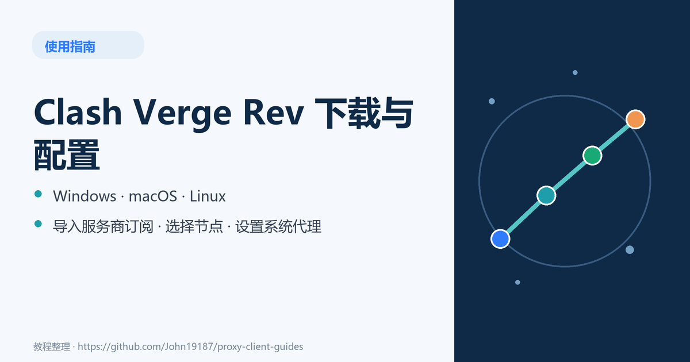
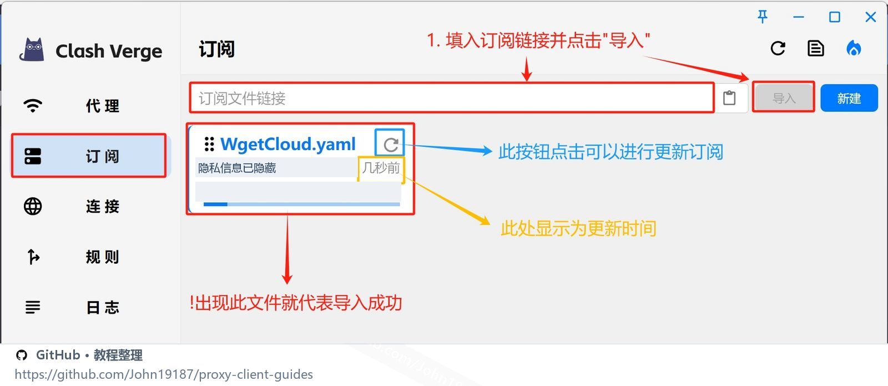
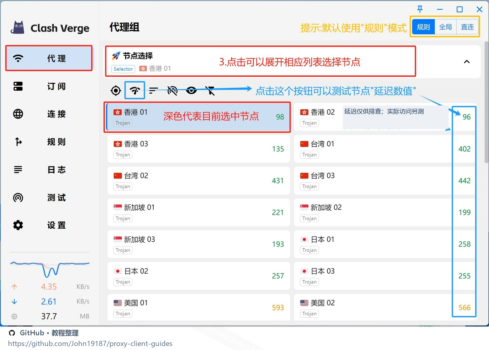

# 2026年 Clash Verge Rev 下载与配置教程：Windows、Mac、Linux

Clash Verge Rev安装后，需要导入服务商提供的**Clash／Mihomo兼容订阅链接**，启用这份配置、选择节点，再开启系统代理。已有兼容订阅可以继续用，软件本身不附节点，也不需要因为换了客户端重新购买服务。

Windows多数Intel、AMD电脑下载x64安装包，ARM电脑下载ARM64；Mac按Intel或Apple芯片选择DMG，Linux按CPU和发行版选择DEB或RPM。下面提供 **v2.5.10** 原安装包，资料整理于2026年11月14日。

## Clash Verge Rev v2.5.10下载地址

Windows使用Windows 10／11，当前版本不支持Windows 7；Mac要求macOS 12或更高。点击文件名即可从项目GitHub发行记录下载，右键或长按链接可复制原地址。

| 平台／CPU | 正式版直接下载 |
|---|---|
| Windows x64 | **安装版：** [Clash.Verge_2.5.10_x64-setup.exe](https://github.com/clash-verge-rev/clash-verge-rev/releases/download/v2.5.10/Clash.Verge_2.5.10_x64-setup.exe) **安装版：** [Clash.Verge_2.5.10_x64_fixed_webview2-setup.exe](https://github.com/clash-verge-rev/clash-verge-rev/releases/download/v2.5.10/Clash.Verge_2.5.10_x64_fixed_webview2-setup.exe) |
| Windows ARM64 | **安装版：** [Clash.Verge_2.5.10_arm64-setup.exe](https://github.com/clash-verge-rev/clash-verge-rev/releases/download/v2.5.10/Clash.Verge_2.5.10_arm64-setup.exe) **安装版：** [Clash.Verge_2.5.10_arm64_fixed_webview2-setup.exe](https://github.com/clash-verge-rev/clash-verge-rev/releases/download/v2.5.10/Clash.Verge_2.5.10_arm64_fixed_webview2-setup.exe) |
| Mac Intel | [Clash.Verge_2.5.10_x64.dmg](https://github.com/clash-verge-rev/clash-verge-rev/releases/download/v2.5.10/Clash.Verge_2.5.10_x64.dmg) |
| Mac Apple Silicon | [Clash.Verge_2.5.10_aarch64.dmg](https://github.com/clash-verge-rev/clash-verge-rev/releases/download/v2.5.10/Clash.Verge_2.5.10_aarch64.dmg) |
| Linux x64 | **DEB包：** [Clash.Verge_2.5.10_amd64.deb](https://github.com/clash-verge-rev/clash-verge-rev/releases/download/v2.5.10/Clash.Verge_2.5.10_amd64.deb) **RPM包：** [Clash.Verge-2.5.10-1.x86_64.rpm](https://github.com/clash-verge-rev/clash-verge-rev/releases/download/v2.5.10/Clash.Verge-2.5.10-1.x86_64.rpm) |
| Linux ARM64 | **DEB包：** [Clash.Verge_2.5.10_arm64.deb](https://github.com/clash-verge-rev/clash-verge-rev/releases/download/v2.5.10/Clash.Verge_2.5.10_arm64.deb) **RPM包：** [Clash.Verge-2.5.10-1.aarch64.rpm](https://github.com/clash-verge-rev/clash-verge-rev/releases/download/v2.5.10/Clash.Verge-2.5.10-1.aarch64.rpm) |
| Linux ARMv7／armhf | **DEB包：** [Clash.Verge_2.5.10_armhf.deb](https://github.com/clash-verge-rev/clash-verge-rev/releases/download/v2.5.10/Clash.Verge_2.5.10_armhf.deb) **RPM包：** [Clash.Verge-2.5.10-1.armhfp.rpm](https://github.com/clash-verge-rev/clash-verge-rev/releases/download/v2.5.10/Clash.Verge-2.5.10-1.armhfp.rpm) |

### Windows选普通版还是fixed_webview2版

第一次安装通常选普通`setup.exe`。文件名含`fixed_webview2`的包附带固定WebView2运行环境；缺少WebView2、无法安装该运行环境或因此打不开程序面板时，再按开发者说明使用。两种包都必须匹配CPU。

不确定电脑架构时，打开“设置 → 系统 → 关于”，查看“系统类型”：Intel、AMD的64位PC通常选x64，采用ARM处理器的Windows设备选ARM64。Linux文件名里的`amd64`、`x86_64`也属于x64这一架构类别，不按Intel或AMD品牌分别选。

## 安装并打开Clash Verge Rev

下载完成后，按自己的系统安装。已经运行其他代理客户端的，先关闭旧客户端的系统代理和TUN，再从托盘完整退出，避免两个程序同时接管网络或占用端口。

- **Windows**：双击对应的`setup.exe`，按安装向导完成后启动Clash Verge Rev。
- **Mac**：在“关于本机”查看Intel或Apple芯片，打开对应DMG，把App拖到“应用程序”，再从“应用程序”启动。
- **Linux**：在安装包所在目录打开终端，DEB包用`sudo apt install ./Clash.Verge_2.5.10_amd64.deb`，采用DNF的发行版用`sudo dnf install ./Clash.Verge-2.5.10-1.x86_64.rpm`。这些是x64示例，ARM设备换成表中实际下载的文件名；ARMv7／armhf与ARM64不能互换。安装完成后从应用列表启动。

能打开主界面后，继续导入订阅。源码压缩包和签名文件用于开发或校验，不是可以直接安装的客户端。

## 把订阅链接导入Clash Verge Rev

订阅链接让Clash Verge Rev下载一份配置，其中可以包含节点、代理组和分流规则。需要复制服务后台的Clash／Mihomo订阅地址，账户首页网址、账号密码和单条节点链接都不能代替它。个人订阅地址通常带凭据，不要把它放进公开截图或求助帖。

1. 登录你已有的机场或服务后台，找到Clash、Mihomo或Clash Verge Rev对应的订阅入口，复制完整链接。服务要求先开启订阅下载窗口时，按后台提示开启。
2. 打开Clash Verge Rev左侧“订阅”，把链接粘贴到“订阅文件链接”输入框，点击“导入”，等待配置卡片出现在列表中。

图中是旧名Clash Verge界面，未显示版本号。上方输入链接后点“导入”，卡片右上角的圆形箭头用于更新订阅。下载后选中配置，再选择节点并开启系统代理。

3. **单击目标订阅卡片主体**启用这份配置，避开刷新按钮。v2.5.10中，当前卡片左侧出现主题色边条，标题也显示主题色。保存了多份订阅时，也用这个操作切换配置；切换会改变后面的节点、代理组和规则。

**一键导入打开了旧CFW或别的软件**，取消唤起，回Clash Verge Rev手动粘贴链接。**返回401／403或没有生成卡片**，回服务后台检查账户状态、订阅下载开关和个人链接。已有配置仍可用时保留它，不必先删除。

**出现配置解析错误**，重新取得Clash／Mihomo兼容格式，保留报错里的字段和错误原文。服务配置使用了当前内核不支持的字段时，需要兼容配置或匹配的软件版本；地址类型与常见错误见[订阅格式与导入错误](../../subscription-formats.md#import-errors)。系统代理开关不能修复下载或解析错误。

还没有服务时，可比较[多家VPN推荐与推广中的客户端、设备支持](https://github.com/John19187/The-40-Best-VPNs#翻墙客户端与使用方式怎么选)，或[多家机场推荐与推广中的套餐、流量和Clash订阅支持](https://github.com/John19187/ji-chang-tui-jian#airport-clients)。这些内容包含推广，部分服务有自有App；选择时核对服务是否提供Clash订阅，已有兼容订阅的人直接继续即可。

## 选择节点，开启系统代理

当前配置决定节点和规则，节点才是实际连接的服务器。代理组把多个节点组织在一起，组名和可选项以服务提供的配置为准。

1. 打开左侧“代理”，展开可以手动选择的代理组，点击要使用的服务器名称。组名可能叫“节点选择”，也可能由服务商自定义。
2. 使用“规则”模式，让Clash Verge Rev按订阅配置的规则选择出口。

图中是旧名Clash Verge界面，未显示版本号。点击组标题展开列表，深色项表示所选节点，右上角可见“规则／全局／直连”。图中服务名、节点名和延迟数值都是示例，以自己的配置和运行状态为准。

3. 打开“设置”，开启“系统代理”。读取操作系统代理设置的应用会把请求交给Clash Verge Rev。
4. 用浏览器打开你实际需要的网站，完成原来的访问任务。网页可用后，即可按这套配置继续使用。

“规则”模式按配置分流；“全局”模式把进入Clash Verge Rev的请求交给全局代理组，该组也需要选择可用节点；“直连”模式不经代理服务器。延迟数字、模式按钮和代理开关分别反映自己的环节，不能代替网页或应用实际可用。

### 浏览器能用，另一个应用仍超时

先打开“连接”，查看失败应用的请求。请求已经出现却走`DIRECT`或`REJECT`，分别表示直连或拒绝，应检查命中的规则和代理组。完全看不到请求时，继续查看应用是否读取系统代理；应用有独立代理设置的，按该应用说明配置。

### 应用需要TUN，或Windows提示Sidecar错误

TUN通过虚拟网卡接收流量，适合处理不跟随系统代理的应用。浏览器已经能用时，可以保留当前系统代理；确有应用接管需要，再设置TUN。

1. Windows在Clash Verge Rev的设置中处理服务安装及所需管理员授权；Mac按其服务安装提示操作。
2. 记下原来的开关状态，开启TUN，重新尝试原先失败的应用。
3. 若本次启用后才出现普通网络或局域网故障，关闭本次TUN，恢复先前可用的系统代理状态。

遇到Sidecar安全检查提示，保留错误原文和被拒绝的文件路径，按[开发者Windows说明](https://www.clashverge.dev/faq/windows.html)处理对应安装目录，不要关闭安全防护绕过。服务、UWP应用接管及系统恢复的具体问题，可接着看[Clash Verge Rev系统代理与TUN专题](../../clash-verge-rev-network.md)。

如果原来能用，后来多个节点同时失败，先查看服务账户、流量和公告，核对故障时间及受影响的地区、网络；再保留同一配置，用自己的热点作一次对照。

## 服务调整节点后，更新已保存的订阅

更新订阅会通过已保存的URL重新下载配置。服务新增或调整节点时，更新对应订阅即可，不需要重新安装Clash Verge Rev。

1. 打开“订阅”，找到需要更新的服务配置。
2. 若服务要求先开启账户的订阅下载窗口，先去后台完成这项操作。
3. 点击该配置卡片右上角的圆形刷新箭头，等待更新完成，再到“代理”查看新配置里的节点。

只有个人订阅地址真正变化时，才需要修改保存的URL。后台的“重置订阅”通常会改变个人地址，与刷新节点不同；重置后，其他设备保存的旧URL也需要更换。

## 升级、迁移和退出时怎样保留配置

升级的是客户端程序，更新订阅则是下载服务配置。准备升级Clash Verge Rev时，先保存当前配置，再安装对应系统和CPU的新版本。

1. 打开“设置 → Verge高级设置 → 备份设置”。
2. 在“手动备份”的“本地备份”中点击“备份”。看到“本地备份创建成功”后，可点“查看记录”找到这份备份。
3. 关闭本次启用的系统代理和TUN，从托盘完整退出Clash Verge Rev。
4. 从[官方发行页](https://github.com/clash-verge-rev/clash-verge-rev/releases/latest)下载适配的正式版并安装，先用服务默认配置恢复访问，再迁回确实需要的本地规则、DNS或覆写。

需要回退时，保留相配的旧程序和升级前数据，不能只拿一个旧EXE覆盖新目录。从[旧Clash Verge](../old-clash-verge/README.md)或[CFW迁移](../cfw/README.md)过来，也先重新导入兼容订阅；相近名称或相同内核不代表可以覆盖数据目录。

要把已有订阅换到另一款桌面客户端，可看[Clash Party下载与配置教程](../clash-party/README.md)，在目标软件里重新导入。为另一台设备选客户端时，查看[2026年机场通用客户端汇总与下载教程](../../README.md)，其中按平台给出软件和独立教程入口。

关闭主窗口后，Clash Verge Rev可能仍在托盘运行。完全停用时，先关闭本次系统代理和TUN，再从托盘退出。若异常退出后普通网页无法访问，重新启动程序并关闭这两项；程序无法启动时，按[当前系统的代理恢复步骤](../../README.md#restore-and-report)撤回本次修改，保留原有公司代理设置。

完成配置后，日常在“代理”里换节点，服务调整内容时在“订阅”里刷新。需要的网站和应用已经可用，就可以保留当前配置继续使用。

官方资料与图片来源

- [Clash Verge Rev项目仓库](https://github.com/clash-verge-rev/clash-verge-rev)：项目与维护资料。
- [v2.5.10发行记录](https://github.com/clash-verge-rev/clash-verge-rev/releases/tag/v2.5.10)：本页固定安装包来源。
- [官方安装说明](https://www.clashverge.dev/install.html)：系统条件与安装方式。
- [官方订阅管理](https://www.clashverge.dev/guide/profile.html)：订阅导入、切换和更新。
- [官方Windows常见问题](https://www.clashverge.dev/faq/windows.html)：服务、UWP与Sidecar问题。
- v2.5.10[订阅卡片](https://github.com/clash-verge-rev/clash-verge-rev/blob/v2.5.10/src/components/profile/profile-item.tsx)、[订阅页面](https://github.com/clash-verge-rev/clash-verge-rev/blob/v2.5.10/src/pages/profiles.tsx)和[卡片样式](https://github.com/clash-verge-rev/clash-verge-rev/blob/v2.5.10/src/components/profile/profile-box.tsx)：单击启用订阅及当前项标记。
- v2.5.10[高级设置](https://github.com/clash-verge-rev/clash-verge-rev/blob/v2.5.10/src/components/setting/setting-verge-advanced.tsx)、[备份窗口](https://github.com/clash-verge-rev/clash-verge-rev/blob/v2.5.10/src/components/setting/mods/backup-viewer.tsx)与[中文界面文本](https://github.com/clash-verge-rev/clash-verge-rev/blob/v2.5.10/src/locales/zh/settings.json)：备份入口、按钮及成功提示。
- 界面与版本说明：两张旧名界面图的原出处，2026年11月7日取得；图中为未标版号的旧名Clash Verge界面。截图中第三方商标归各自权利方，展示副本已遮盖个人信息。

## 文档更新记录

展开文档更新记录

- 2026-11-16　折叠更新记录，收起许可说明，撤下不必要的维护数据与贡献提示入口。 下载区标题标明本文固定版本或独立商店渠道，保原下载文件与旧锚。

- 2026-11-16　补充文末客户端与免费节点目录、文档维护入口；整理图源与版本说明，保留原安装包和操作内容。

## 客户端与相关资源目录

按设备和配置类型进入对应教程；旧版条目用于识别与迁移。软件之间的订阅、配置和备份条件仍以各篇说明为准。

展开客户端目录（含旧版与迁移说明）

| 客户端 | 设备或范围 | 教程用途 |
|---|---|---|
| **Clash Verge Rev（本篇）** | Windows／macOS／Linux | Clash／Mihomo配置与系统代理 |
| [FlClash](../flclash/README.md) | 电脑／Android | 跨平台下载、导入与连接 |
| [Clash Party](../clash-party/README.md) | Windows／macOS／Linux | 安装版、便携版与订阅管理 |
| [Clash Mi](../clash-mi/README.md) | 跨平台 | 按本款入口导入Clash配置 |
| [ClashX Meta](../clashx-meta/README.md) | macOS | 菜单栏客户端与Mihomo配置 |
| [v2rayN](../v2rayn/README.md) | 电脑 | 节点订阅与系统代理 |
| [Hiddify](../hiddify/README.md) | 电脑／手机 | 跨平台导入与连接 |
| [Karing](../karing/README.md) | 电脑／手机 | 配置、规则与备份 |
| [Clash Meta for Android](../cmfa/README.md) | Android | Clash配置与VPN授权 |
| [v2rayNG](../v2rayng/README.md) | Android | 节点订阅与VPN连接 |
| [NekoBox for Android](../nekobox/README.md) | Android历史版本 | 1.4.2旧版订阅与迁移 |
| [Surfboard](../surfboard/README.md) | Android | 兼容配置与启动连接 |
| [sing-box](../sing-box/README.md) | 多平台 | 版本匹配的JSON配置 |
| [Shadowrocket](../shadowrocket/README.md) | iPhone／iPad | 节点、订阅与VPN连接 |
| [Stash](../stash/README.md) | Apple设备 | 按本款条件导入Clash类配置 |
| [Quantumult X](../quantumult-x/README.md) | iPhone／iPad | 节点资源与完整配置的区别 |
| [Loon](../loon/README.md) | iPhone／iPad | 订阅、策略与分流 |
| [Surge](../surge/README.md) | iOS／macOS | 按平台配置与接管流量 |
| [OpenClash](../openclash/README.md) | OpenWrt | 固件条件、配置与插件 |
| [PassWall](../passwall/README.md) | OpenWrt | 订阅节点与主开关 |
| [ShellCrash](../shellcrash/README.md) | Linux／路由器 | 安装脚本与运行条件 |
| [Nextin专用客户端](../provider-app/README.md) | 按服务公开支持范围 | 仅适用于已证实的服务条件 |
| [Clash for Windows](../cfw/README.md) | 旧版／迁移 | 识别旧配置并迁移 |
| [Clash for Android](../cfa/README.md) | Android旧版／迁移 | 原版CFA与CMFA分开 |
| [ClashX](../clashx/README.md) | macOS旧版 | 普通ClashX身份与迁移 |
| [ClashX Pro](../clashx-pro/README.md) | macOS历史版本 | Pro托管配置与增强模式 |
| [旧Clash Verge](../old-clash-verge/README.md) | 旧版／迁移 | 与Rev区分及迁移 |
| [NekoRay](../nekoray/README.md) | 电脑旧版／迁移 | 旧资料与替代客户端 |
| [旧客户端迁移目录](../legacy/README.md) | 旧版资料 | 按原客户端寻找迁移说明 |

| 相关文档 | 内容 |
|---|---|
| [VPN推荐与使用方式](https://github.com/John19187/The-40-Best-VPNs) | 比较服务的平台、接入方式与客户端 |
| [机场推荐与套餐比较](https://github.com/John19187/ji-chang-tui-jian) | 比较月付、按量与套餐条件 |
| **2026年机场通用客户端汇总与下载教程（本文档仓）** | 按设备选软件并进入具体教程 |
| [机场与代理工具科普指南](https://github.com/John19187/ssr-v2ray-trojan-clash-guide) | 理解机场、协议、客户端、订阅与线路 |
| [免费节点与订阅资源](https://github.com/John19187/v2ray-SSR-Clash-Verge-Shadowrocke) | 查看公开资源与导入说明，不承诺持续可用 |

开源维护与许可

本文由John19187统一整理维护，实际修改记录见本页更新日志。原创文档采用[MIT许可](../../LICENSE)；软件、商标及第三方材料的权利与使用范围见[素材说明](../../NOTICE)。

本仓整理客户端下载与使用文档，不是客户端官方项目；软件是否开源、收费及其许可由各开发者分别决定。

