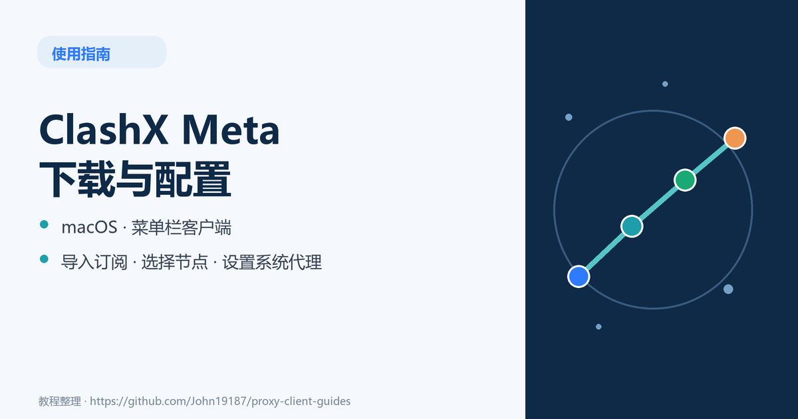

# 2026年 ClashX Meta 下载与配置教程：Mac导入订阅和设置系统代理

ClashX Meta在Mac顶部菜单栏提供配置、节点和代理开关。下载并安装后，把服务商提供的**Clash／Mihomo兼容订阅链接**添加为“托管配置”，选择这份配置和节点，再勾选“设置为系统代理”，即可用浏览器尝试访问。软件本身不提供节点，已有兼容订阅可以继续使用。

## ClashX Meta v1.4.48下载地址

下面是 **v1.4.48** 的原仓安装包，发布于2026年11月13日。该版本的应用要求 **macOS 13或更高**，发行记录提供一个ZIP，没有按Intel与Apple芯片分列下载项。

| 平台 | 安装包直接下载 |
|---|---|
| macOS | [ClashX.Meta.zip](https://github.com/MetaCubeX/ClashX.Meta/releases/download/v1.4.48/ClashX.Meta.zip) |

在苹果菜单“关于本机”查看macOS版本。按ClashX Meta当前版本的系统要求选包；系统低于macOS 13时，不要反复安装这个包，可从[2026年机场通用客户端汇总与下载教程](../../README.md)查看其他Mac客户端及各自系统条件。

1. 下载`ClashX.Meta.zip`，双击解压，把解压得到的ClashX Meta App移到“应用程序”。
2. 已运行其他代理客户端的，先关闭旧程序的系统代理和已启用的接管模式，再完整退出。旧ClashX Pro用过增强模式时，可按[关闭Pro增强模式和系统代理](../clashx-pro/README.md#stop-old)处理。
3. 从“应用程序”打开ClashX Meta，在屏幕顶部找到小猫图标，点击展开菜单。
4. 如果程序提示安装或更新用于配置系统代理的辅助工具，按提示完成所需管理员授权。macOS要求允许后台项目时，按程序提示进入系统设置处理。

能打开小猫菜单后，继续添加订阅。没有弹出主窗口时也可以从这里操作；若macOS直接拒绝启动，保留完整提示，先核对系统版本和安装包来源，再按对应提示处理。

## 把订阅链接导入ClashX Meta

“托管配置”会保存订阅URL，并从这个地址下载包含节点、代理组和分流规则的配置。请复制服务后台提供的Clash／Mihomo兼容地址；账户首页网址、登录密码和单条节点链接不能代替它。个人订阅链接通常带凭据，不要公开分享或放进截图。

1. 登录已有的机场或服务账户，复制Clash、Mihomo或ClashX Meta对应的完整订阅链接。后台要求先开启订阅下载窗口时，按其提示开启。
2. 点菜单栏小猫，进入“配置 → 托管配置 → 管理”，点击“添加”。
3. 在`Url`中粘贴完整地址，在`Config Name`中填写便于辨认、未重复的名称，例如“我的订阅”。普通未加密订阅无需填写可选的`Age Secret Key`；服务明确提供加密配置和密钥时才按其说明填写。
4. 点击“确定”，等待下载。成功后，管理列表会出现这条记录及更新时间。
5. 回到“配置”菜单，找到刚添加的配置名称。新添加的配置下载成功后会尝试自动加载；若当前勾选的是其他配置，点击新名称切换，看到勾选标记在目标名称旁再继续。

`Config Name`只用于区分本机记录，不必等于机场名称，真正决定下载来源的是`Url`。切换配置也会改变后面看到的代理组、节点和规则。

**提示“下载失败”**，先回服务账户检查个人地址、订阅下载开关和账户状态，再重新复制完整链接。一键导入唤起了另一款客户端时，取消后回ClashX Meta手动添加，不必删除原来可用的配置。

**提示“托管配置文件格式不正确”或“配置文件加载失败”**，保留后面的具体错误，向服务方取得适配当前客户端的完整配置。下载到了登录网页、单条节点或不兼容字段时，系统代理开关不能修复格式问题；可结合[订阅格式与导入错误](../../subscription-formats.md#import-errors)辨认地址类型。

还没有服务时，可比较[多家VPN推荐与推广中的Mac客户端与设备支持](https://github.com/John19187/The-40-Best-VPNs#翻墙客户端与使用方式怎么选)，或[多家机场推荐与推广中的套餐、流量和Clash订阅支持](https://github.com/John19187/ji-chang-tui-jian#airport-clients)。两帖包含推广，部分服务有自有App；自有App能用账号登录，并不表示会提供通用订阅。已有兼容链接的人直接继续配置即可。

## 在菜单栏选节点，开启系统代理

代理组把多个服务器组织在一起，组名和可选项由自己的订阅决定。先在当前配置中选择出口，再让浏览器等应用使用它。

1. 点击小猫菜单，在代理模式中选择“规则判断”。它会按当前配置的规则分流。
2. 展开允许手动选择的代理组，点击要使用的服务器名称。所选项旁会出现勾选标记；自动选择或负载均衡组按配置工作，无需强行改成手选。
3. 在小猫菜单勾选“设置为系统代理”。读取macOS系统代理设置的应用会把请求交给ClashX Meta。
4. 用浏览器打开你实际需要的网站，完成原来的访问任务。网页可用后，就可以保留当前配置继续使用。

“全局连接”模式把进入客户端的请求交给全局代理组，这个组也需要选择可用节点；“直接连接”使用直连。“规则判断”适合按服务提供的规则使用。节点延迟和勾选标记分别表示测试结果及当前选择，实际网站或应用能用才完成了本次配置。

### 开关已勾选，浏览器仍不能访问

重新展开小猫菜单，确认目标配置和节点仍被选中，“设置为系统代理”也保持勾选。另一个代理程序或系统工具改写网络设置时，系统代理可能不再指向ClashX Meta；关闭冲突程序的接管，再由当前客户端设置。不要让两款软件同时反复争用代理。

只有某个节点失败，可在同一代理组换一个节点再访问。多个节点相近时间一起失效时，查看账户、流量和本家公告，核对时间及受影响网络；保留本机错误，再用同一节点换自己的热点比较。

### 浏览器能用，某个应用仍超时

先查看该应用是否读取系统代理，或是否有独立的代理设置。ClashX Meta的菜单另有“Tun 模式”，用于需要通过虚拟网络接口接管流量的场景；浏览器已经能用时，无需为了完成本教程额外开启。

确需使用时，记下原开关状态，在小猫菜单开启“Tun 模式”，按辅助工具及系统授权提示完成后重试原应用。若本次开启后才出现普通网络或局域网异常，关闭本次Tun模式，回到原来可用的系统代理状态。需要改用带独立面板的桌面客户端，也可按[Clash Verge Rev下载与配置教程](../clash-verge-rev/README.md)重新导入兼容订阅，不直接覆盖两款程序的数据目录。

## 更新订阅里的节点和地址

服务调整节点后，更新已保存的托管配置即可，不需要重装ClashX Meta。

1. 打开“配置 → 托管配置 → 管理”，单击需要更新的记录。
2. 服务要求开启订阅下载窗口时，先去账户后台开启，再回到这里点击“更新”。
3. 等待列表中的更新时间变化，再从当前配置的代理组查看和选择节点。正在使用的配置更新成功后会重新加载。

只有个人订阅URL真正变化时，才需要双击管理列表中的对应记录，修改`Url`并点击“确定”。保持原地址时，直接更新原记录即可，不必再添加同名项。服务后台的“重置订阅”通常会更换个人地址，其他设备保存的旧URL也要相应更换。

托管配置保存了远程来源，本地YAML文件则只是手上的一份内容。使用本地文件的人需要取得新文件后再替换，不能靠更新另一条托管记录改变它。

## 升级、迁移与暂时停用

升级客户端程序和更新订阅是两件事。准备从旧ClashX迁入，或升级ClashX Meta时，先保留个人订阅地址、本地配置文件及自己改过的规则。

先关闭旧程序的系统代理及已启用的Tun或增强模式，再完整退出。在ClashX Meta里重新导入服务提供的兼容订阅，完成实际访问后，再逐项迁回确有需要的DNS、兼容脚本和自定义规则。ClashX、ClashX Pro与ClashX Meta名称接近，也不应直接相互覆盖数据目录。

升级ClashX Meta可从“帮助 → 检查更新”或[项目发行页](https://github.com/MetaCubeX/ClashX.Meta/releases/latest)查看版本。保留升级前程序与资料；新版本或新配置失败时，先选回此前可用的配置，确需回退再恢复相配的旧程序和数据。

暂时停用时，在小猫菜单取消“设置为系统代理”，本次开过Tun模式的也一并关闭，然后再退出。若程序异常退出后普通网页也打不开，重新打开它撤回这两项设置。程序无法启动时，在“系统设置 → 网络 → 当前网络 → 详细信息 → 代理”恢复本次改动；旧系统入口为“系统偏好设置 → 网络 → 高级 → 代理”，工作网络原有代理需要保留。

配置完成后，日常从小猫菜单换节点，服务调整内容时更新托管配置。为另一台设备选软件，可回到[2026年机场通用客户端汇总与下载教程](../../README.md)，按平台进入相应教程。

官方资料与图片来源

- [MetaCubeX/ClashX.Meta项目仓库](https://github.com/MetaCubeX/ClashX.Meta)：开发与维护资料。仓库README仍保留旧ClashX名称，本文按ClashX Meta v1.4.48的对应实现说明操作。
- [v1.4.48发行记录](https://github.com/MetaCubeX/ClashX.Meta/releases/tag/v1.4.48)：2026年11月13日发布，本页固定安装包来源；资料整理于2026年11月14日。
- v1.4.48[应用构建设置](https://github.com/MetaCubeX/ClashX.Meta/blob/v1.4.48/ClashX.xcodeproj/project.pbxproj)：应用及辅助工具的macOS 13部署要求。
- v1.4.48[主菜单与管理窗口](https://github.com/MetaCubeX/ClashX.Meta/blob/v1.4.48/ClashX/Base.lproj/Main.storyboard)、[中文菜单文本](https://github.com/MetaCubeX/ClashX.Meta/blob/v1.4.48/ClashX/mul.lproj/Main.xcstrings)和[添加配置窗口](https://github.com/MetaCubeX/ClashX.Meta/blob/v1.4.48/ClashX/Views/Base.lproj/RemoteConfigAddView.xib)：本文菜单、按钮与字段。
- v1.4.48[托管配置管理](https://github.com/MetaCubeX/ClashX.Meta/blob/v1.4.48/ClashX/ViewControllers/RemoteConfigViewController.swift)、[下载与校验](https://github.com/MetaCubeX/ClashX.Meta/blob/v1.4.48/ClashX/General/Managers/RemoteConfigManager.swift)、[配置切换和节点菜单](https://github.com/MetaCubeX/ClashX.Meta/blob/v1.4.48/ClashX/General/Managers/MenuItemFactory.swift)：添加后加载、双击编辑、更新、错误提示及当前项标记。
- 封面与迁移顺序图为本仓库整理的说明图，分别用于识别主题和说明迁移关系。

## 文档更新记录

展开文档更新记录

- 2026-11-16　折叠更新记录，收起许可说明，撤下不必要的维护数据与贡献提示入口。 下载区标题标明本文固定版本或独立商店渠道，保原下载文件与旧锚。

- 2026-11-16　补充文末客户端与免费节点目录、文档维护入口；整理图源与版本说明，保留原安装包和操作内容。

## 客户端与相关资源目录

按设备和配置类型进入对应教程；旧版条目用于识别与迁移。软件之间的订阅、配置和备份条件仍以各篇说明为准。

展开客户端目录（含旧版与迁移说明）

| 客户端 | 设备或范围 | 教程用途 |
|---|---|---|
| **ClashX Meta（本篇）** | macOS | 菜单栏客户端与Mihomo配置 |
| [Clash Verge Rev](../clash-verge-rev/README.md) | Windows／macOS／Linux | Clash／Mihomo配置与系统代理 |
| [FlClash](../flclash/README.md) | 电脑／Android | 跨平台下载、导入与连接 |
| [Clash Party](../clash-party/README.md) | Windows／macOS／Linux | 安装版、便携版与订阅管理 |
| [Clash Mi](../clash-mi/README.md) | 跨平台 | 按本款入口导入Clash配置 |
| [v2rayN](../v2rayn/README.md) | 电脑 | 节点订阅与系统代理 |
| [Hiddify](../hiddify/README.md) | 电脑／手机 | 跨平台导入与连接 |
| [Karing](../karing/README.md) | 电脑／手机 | 配置、规则与备份 |
| [Clash Meta for Android](../cmfa/README.md) | Android | Clash配置与VPN授权 |
| [v2rayNG](../v2rayng/README.md) | Android | 节点订阅与VPN连接 |
| [NekoBox for Android](../nekobox/README.md) | Android历史版本 | 1.4.2旧版订阅与迁移 |
| [Surfboard](../surfboard/README.md) | Android | 兼容配置与启动连接 |
| [sing-box](../sing-box/README.md) | 多平台 | 版本匹配的JSON配置 |
| [Shadowrocket](../shadowrocket/README.md) | iPhone／iPad | 节点、订阅与VPN连接 |
| [Stash](../stash/README.md) | Apple设备 | 按本款条件导入Clash类配置 |
| [Quantumult X](../quantumult-x/README.md) | iPhone／iPad | 节点资源与完整配置的区别 |
| [Loon](../loon/README.md) | iPhone／iPad | 订阅、策略与分流 |
| [Surge](../surge/README.md) | iOS／macOS | 按平台配置与接管流量 |
| [OpenClash](../openclash/README.md) | OpenWrt | 固件条件、配置与插件 |
| [PassWall](../passwall/README.md) | OpenWrt | 订阅节点与主开关 |
| [ShellCrash](../shellcrash/README.md) | Linux／路由器 | 安装脚本与运行条件 |
| [Nextin专用客户端](../provider-app/README.md) | 按服务公开支持范围 | 仅适用于已证实的服务条件 |
| [Clash for Windows](../cfw/README.md) | 旧版／迁移 | 识别旧配置并迁移 |
| [Clash for Android](../cfa/README.md) | Android旧版／迁移 | 原版CFA与CMFA分开 |
| [ClashX](../clashx/README.md) | macOS旧版 | 普通ClashX身份与迁移 |
| [ClashX Pro](../clashx-pro/README.md) | macOS历史版本 | Pro托管配置与增强模式 |
| [旧Clash Verge](../old-clash-verge/README.md) | 旧版／迁移 | 与Rev区分及迁移 |
| [NekoRay](../nekoray/README.md) | 电脑旧版／迁移 | 旧资料与替代客户端 |
| [旧客户端迁移目录](../legacy/README.md) | 旧版资料 | 按原客户端寻找迁移说明 |

| 相关文档 | 内容 |
|---|---|
| [VPN推荐与使用方式](https://github.com/John19187/The-40-Best-VPNs) | 比较服务的平台、接入方式与客户端 |
| [机场推荐与套餐比较](https://github.com/John19187/ji-chang-tui-jian) | 比较月付、按量与套餐条件 |
| **2026年机场通用客户端汇总与下载教程（本文档仓）** | 按设备选软件并进入具体教程 |
| [机场与代理工具科普指南](https://github.com/John19187/ssr-v2ray-trojan-clash-guide) | 理解机场、协议、客户端、订阅与线路 |
| [免费节点与订阅资源](https://github.com/John19187/v2ray-SSR-Clash-Verge-Shadowrocke) | 查看公开资源与导入说明，不承诺持续可用 |

开源维护与许可

本文由John19187统一整理维护，实际修改记录见本页更新日志。原创文档采用[MIT许可](../../LICENSE)；软件、商标及第三方材料的权利与使用范围见[素材说明](../../NOTICE)。

本仓整理客户端下载与使用文档，不是客户端官方项目；软件是否开源、收费及其许可由各开发者分别决定。

