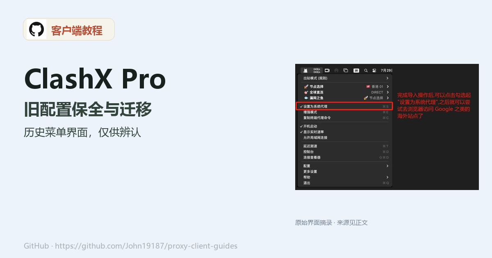

# 2026年 ClashX Pro迁移教程：退出增强模式，换到Meta或Rev

ClashX Pro开过增强模式时，迁移前先保存配置，再关闭增强模式、取消系统代理并退出。普通联网恢复以后，再安装ClashX Meta或Clash Verge Rev、导入兼容订阅。原服务能提供所需格式，就可以继续使用。

只在“关于”中确认是Pro的Mac使用本篇。普通ClashX用户见[ClashX迁移到Meta](../clashx/README.md#migration)；已经用Meta的人按[Meta更新与备份](../clashx-meta/README.md#update)处理。

## 保存托管配置和个人修改

把新软件需要的来源与自己的改动分别保存，避免只带走节点、漏掉本机规则。

1. 在Pro“配置”菜单找到当前使用的名称，保存对应托管URL；没有原URL时，从个人服务账户取回Clash／Mihomo兼容订阅。
2. 使用本地YAML的，复制实际文件；另存自己修改的规则、DNS和本机端口。
3. 记下增强模式、系统代理原来是否开启。旧程序和资料暂时保留。

订阅地址用于以后下载新内容，本地文件保留当时配置。个人URL、控制密钥及含这些内容的备份不公开分享。资料已保存，就不必为迁移再找一个同名Pro安装包。

## 先关闭增强模式，再退出旧程序

系统代理与增强模式分别影响流量，开过哪项就撤回哪项。

1. 从Pro菜单关闭已开启的“增强模式”。出现权限确认时，核对请求来自本次使用的Pro，等待接管停止。
2. 取消“设置为系统代理”，关闭登录时启动，再从菜单栏退出。
3. 打开普通网页，确认Mac恢复到此前的联网状态。仍打不开，先按下面的恢复办法处理。

### 退出后普通网页仍打不开

Pro还能打开，回原菜单确认增强模式与系统代理已关闭，再退出。程序不能启动，到“系统设置 → 网络 → 当前网络服务 → 详细信息 → 代理”恢复本次旧客户端修改的项目；旧macOS入口为“系统偏好设置 → 网络 → 高级 → 代理”。单位或校园网络原有代理按原值保留。

代理设置恢复后仍异常，核对登录项是否再次启动Pro；另改过DNS或自动代理脚本，就对照备份恢复该项。仍未恢复时，保留错误、原增强模式状态和已改项目，交网络管理者继续定位。普通网络尚未恢复，不叠加新客户端TUN，也不按不明命令批量删除网络配置。

## 按当前Mac选择迁移目标

| 需要的操作界面 | 安装与系统条件 |
|---|---|
| 从Mac菜单栏管理配置、节点和代理 | [ClashX Meta下载与配置](../clashx-meta/README.md#packages) |
| 用独立窗口管理订阅与连接 | [Clash Verge Rev的Mac安装包与教程](../clash-verge-rev/README.md#packages) |

两款按自己的macOS要求与CPU条件选包。在新软件中重新添加配置，旧Pro目录保留作恢复资料。

## 在新客户端添加兼容订阅

选择一款目标继续，不需要同时安装、运行两条路线。

**选ClashX Meta：**

1. 点小猫菜单，进入“配置 → 托管配置 → 管理”，点击“添加”。
2. `Url`填个人订阅，`Config Name`填未重复的本机名称，确认后等待下载。
3. 回配置菜单确认新名称已勾选，再从代理组选择节点，见[Meta导入图文](../clashx-meta/README.md#import)。

**选Clash Verge Rev：**

1. 打开“订阅”，粘贴个人URL，点击“导入”。
2. 点选新配置卡片，再到“代理”展开组、选择服务器，见[Rev订阅与节点图文](../clash-verge-rev/README.md#import)。

只有本地YAML文件时，可选择[Rev本地配置导入](../clash-verge-rev/README.md#local-file)。出现下载或解析错误，可看[订阅格式与导入错误](../../subscription-formats.md#import-errors)，保留具体错误和原配置。

在所选新软件开启系统代理，用浏览器完成目标访问。默认配置能用以后，再加入必要的自写规则。接管流量的方式按新客户端自身选项重新设置。

浏览器能用而某个应用不跟随，Rev用户可看[系统代理与TUN接管专题](../../clash-verge-rev-network.md)；Meta用户可看[连接与Tun设置](../clashx-meta/README.md#connect)。

普通联网正常，但新旧软件单独运行均出现多个节点故障时，先核对账户、流量和你所用服务商的首页公告，再用同一节点换自己的热点比较；增强模式残留仍按本篇的系统设置检查。

## 新软件承担日常使用后，保留旧资料作恢复依据

以后节点变化，在Meta更新托管记录，或在Rev更新对应订阅。Pro目录继续用于找回未迁入的规则；确需回退，先关闭新软件系统代理及本次TUN、退出，再恢复Pro及相配资料。

想按设备比较更多软件，可读[2026年机场通用客户端汇总与下载教程](../../README.md#choose)。服务选择见[多家VPN推荐与推广中的App和Mac支持](https://github.com/John19187/The-40-Best-VPNs#翻墙客户端与使用方式怎么选)，以及[多家机场推荐与推广中的Clash订阅和套餐条件](https://github.com/John19187/ji-chang-tui-jian#airport-clients)。部分服务只有自有App，需按实际接入方式选择；已有兼容订阅可以直接继续用。

迁移完成后保留一款日常使用的新客户端，旧Pro不再自动启动。所需个人修改已迁出，再决定是否卸载旧程序。

迁移与恢复资料

- [ClashX Meta项目](https://github.com/MetaCubeX/ClashX.Meta)
- [Clash Verge Rev项目](https://github.com/clash-verge-rev/clash-verge-rev)、[安装说明](https://www.clashverge.dev/install.html)
- 旧Pro最后维护日期未确认，不套用普通ClashX版号；封面和迁移顺序图为本仓整理说明图。

## 文档更新记录

展开文档更新记录

- 2026-11-16　折叠更新记录，收起许可说明，撤下不必要的维护数据与贡献提示入口。

- 2026-11-16　补充文末客户端与免费节点目录、文档维护入口；整理图源与版本说明，保留原安装包和操作内容。

## 客户端与相关资源目录

按设备和配置类型进入对应教程；旧版条目用于识别与迁移。软件之间的订阅、配置和备份条件仍以各篇说明为准。

展开客户端目录（含旧版与迁移说明）

| 客户端 | 设备或范围 | 教程用途 |
|---|---|---|
| **ClashX Pro（本篇）** | macOS历史版本 | Pro托管配置与增强模式 |
| [Clash Verge Rev](../clash-verge-rev/README.md) | Windows／macOS／Linux | Clash／Mihomo配置与系统代理 |
| [FlClash](../flclash/README.md) | 电脑／Android | 跨平台下载、导入与连接 |
| [Clash Party](../clash-party/README.md) | Windows／macOS／Linux | 安装版、便携版与订阅管理 |
| [Clash Mi](../clash-mi/README.md) | 跨平台 | 按本款入口导入Clash配置 |
| [ClashX Meta](../clashx-meta/README.md) | macOS | 菜单栏客户端与Mihomo配置 |
| [v2rayN](../v2rayn/README.md) | 电脑 | 节点订阅与系统代理 |
| [Hiddify](../hiddify/README.md) | 电脑／手机 | 跨平台导入与连接 |
| [Karing](../karing/README.md) | 电脑／手机 | 配置、规则与备份 |
| [Clash Meta for Android](../cmfa/README.md) | Android | Clash配置与VPN授权 |
| [v2rayNG](../v2rayng/README.md) | Android | 节点订阅与VPN连接 |
| [NekoBox for Android](../nekobox/README.md) | Android历史版本 | 1.4.2旧版订阅与迁移 |
| [Surfboard](../surfboard/README.md) | Android | 兼容配置与启动连接 |
| [sing-box](../sing-box/README.md) | 多平台 | 版本匹配的JSON配置 |
| [Shadowrocket](../shadowrocket/README.md) | iPhone／iPad | 节点、订阅与VPN连接 |
| [Stash](../stash/README.md) | Apple设备 | 按本款条件导入Clash类配置 |
| [Quantumult X](../quantumult-x/README.md) | iPhone／iPad | 节点资源与完整配置的区别 |
| [Loon](../loon/README.md) | iPhone／iPad | 订阅、策略与分流 |
| [Surge](../surge/README.md) | iOS／macOS | 按平台配置与接管流量 |
| [OpenClash](../openclash/README.md) | OpenWrt | 固件条件、配置与插件 |
| [PassWall](../passwall/README.md) | OpenWrt | 订阅节点与主开关 |
| [ShellCrash](../shellcrash/README.md) | Linux／路由器 | 安装脚本与运行条件 |
| [Nextin](../provider-app/README.md) | 按服务公开支持范围 | 服务指定Nextin时的安装与连接 |
| [Clash for Windows](../cfw/README.md) | 旧版／迁移 | 识别旧配置并迁移 |
| [Clash for Android](../cfa/README.md) | Android旧版／迁移 | 原版CFA与CMFA分开 |
| [ClashX](../clashx/README.md) | macOS旧版 | 普通ClashX身份与迁移 |
| [旧Clash Verge](../old-clash-verge/README.md) | 旧版／迁移 | 与Rev区分及迁移 |
| [NekoRay](../nekoray/README.md) | 电脑旧版／迁移 | 旧资料与替代客户端 |
| [旧客户端迁移目录](../legacy/README.md) | 旧版资料 | 按原客户端寻找迁移说明 |

| 相关文档 | 内容 |
|---|---|
| [VPN推荐与使用方式](https://github.com/John19187/The-40-Best-VPNs) | 比较服务的平台、接入方式与客户端 |
| [机场推荐与套餐比较](https://github.com/John19187/ji-chang-tui-jian) | 比较月付、按量与套餐条件 |
| [2026年机场通用客户端汇总与下载教程](../../README.md#choose) | 按设备选软件并进入具体教程 |
| [机场与代理工具科普指南](https://github.com/John19187/ssr-v2ray-trojan-clash-guide) | 理解机场、协议、客户端、订阅与线路 |
| [免费节点与订阅资源](https://github.com/John19187/v2ray-SSR-Clash-Verge-Shadowrocke) | 查看公开资源与导入说明，不承诺持续可用 |

开源维护与许可

本文由John19187统一整理维护，实际修改记录见本页更新日志。原创文档采用[MIT许可](../../LICENSE)；软件、商标及第三方材料的权利与使用范围见[素材说明](../../NOTICE)。

本仓整理客户端下载与使用文档，不是客户端官方项目；软件是否开源、收费及其许可由各开发者分别决定。

