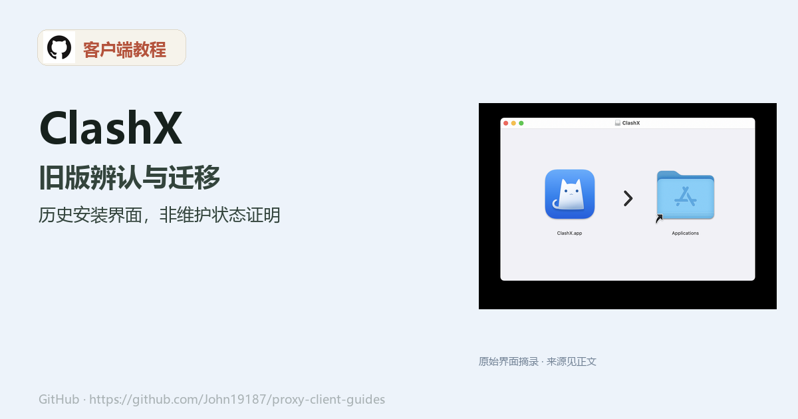
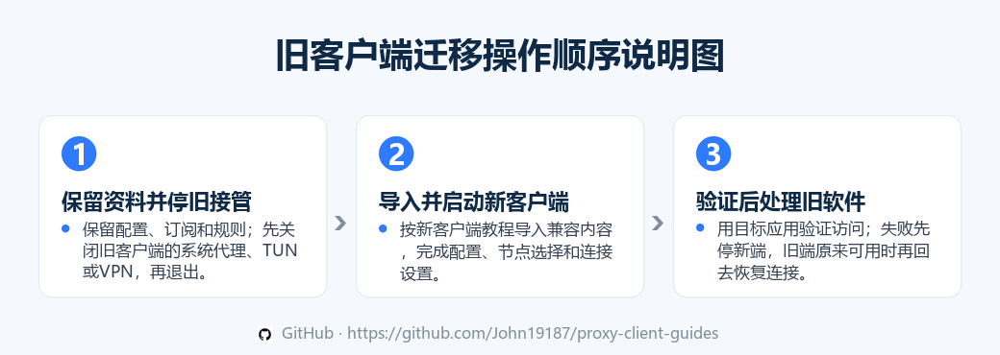

# 2026年 ClashX迁移到ClashX Meta：保存Mac订阅与本地规则

原ClashX用户可以保留自己的服务，把兼容订阅重新添加到ClashX Meta。先保存托管配置URL和个人规则，再取消旧系统代理、退出ClashX；Meta完成实际访问以后，再整理旧程序。

新软件下载见[ClashX Meta安装包与macOS要求](../clashx-meta/README.md#packages)。名字里有“Pro”的用户，先看[ClashX Pro关闭增强模式的迁移办法](../clashx-pro/README.md#stop-old)；已经使用Meta的人无需再迁移，可直接[更新托管配置](../clashx-meta/README.md#update)。

## 认清ClashX、Pro和Meta

1. 点Mac顶部菜单栏的小猫图标，打开“关于”，查看完整名称和版本。
2. 名称只有ClashX，继续本篇；明确是ClashX Pro，转到Pro迁移页；名称是ClashX Meta，则按Meta自身教程操作。

按应用完整名称、版本和安装来源区分三款软件。应用打不开时，先保留原目录和已有配置，再结合已安装应用的名称及来源辨认。安装Meta前核对它的macOS要求。

## 保存正在使用的配置和来源

托管配置有远程URL，可以继续下载服务的新内容；本地YAML只保留文件里的当前配置。迁移前把手里的资料保存好，新端才能接着使用。

1. 在ClashX“配置”菜单记下当前选中的名称。
2. 打开托管配置管理窗口，保存对应URL；找不到地址时，从自己的服务账户重取Clash／Mihomo兼容订阅。
3. 本地配置复制实际YAML文件，自己增加的规则、DNS也另存。文件和订阅地址放在自己控制的位置。

只有YAML也可以尝试本地导入，但没有远程来源就不能靠它自动取得新节点。需要分清输入类型时，可读[订阅链接、完整配置和单节点的区别](../../subscription-formats.md#format-table)。

## 退出旧ClashX，安装Meta

1. 从旧ClashX菜单取消“设置为系统代理”，关闭登录时启动，再选择退出。
2. 按[Meta下载与安装说明](../clashx-meta/README.md#packages)，核对macOS要求，安装并打开Meta。
3. 点Meta菜单栏图标，打开配置菜单。旧目录继续留作备份，不覆盖到Meta的数据目录。

系统代理会让读取这项设置的应用把请求交给客户端。工作网络原有代理按原值保留；本次要停止的是旧ClashX写入的接管。

## 添加托管订阅，选择配置与节点

1. 在Meta进入“配置 → 托管配置 → 管理”，点“添加”。
2. 在`Url`填个人兼容订阅，`Config Name`填一个未重复的本机名称，点“确定”并等待下载。
3. 回“配置”菜单查看当前勾选项。新配置已自动加载就继续；仍勾选其他名称，点击新名称切换。
4. 在代理组中选择需要的节点，自动选择组按服务配置工作。

字段、更新记录与错误提示见[Meta导入订阅图文](../clashx-meta/README.md#import)。下载失败时先核对个人地址、账户及服务的订阅下载开关；格式不正确时，保留具体错误，取得适配新端的完整配置。开系统代理不能修复下载到登录页或字段不兼容的问题。

在Meta菜单勾选“设置为系统代理”，用浏览器完成目标访问。能用以后，再迁必要的个人规则；某项规则加入后才失败，就撤回这项改动，保留已经能用的配置。

## 切换以后时通时断，先看是否仍在双开

菜单栏还有旧ClashX，或重启后它又出现，就先取消旧接管并退出，再检查登录项。只让日常使用的新客户端写系统代理，不反复刷新同一份订阅来处理双开问题。

Meta也退出后普通网页仍失败，到macOS当前网络服务的“代理”设置，撤回本次旧客户端遗留的本地地址或脚本，保留单位网络原有项目。入口见[退出客户端后恢复网络](../../README.md#restore-and-report)。

浏览器能用而某个应用失败，先看该应用是否读取系统代理；需要别的接管方式，可按Meta教程的对应分支处理。新旧客户端单独运行都出现多个节点故障时，检查账户和本家公告，记录发生时间及网络，再用同一节点比较自己的热点。

## 日常更新转到Meta

服务调整节点，在Meta更新原托管记录；升级软件则使用Meta自己的发行渠道，并保留升级前程序及配置。需要暂时回旧ClashX，先取消Meta系统代理、关闭本次启用的Tun并退出，再恢复旧程序及相配资料。

如果当前Mac不适合Meta，可到[2026年机场通用客户端汇总与下载教程](../../README.md#choose)比较其他Mac软件。要比较服务自带App和设备支持，可看[多家VPN推荐与推广](https://github.com/John19187/The-40-Best-VPNs#翻墙客户端与使用方式怎么选)；要比较Clash订阅、套餐和设备数，可看[多家机场推荐与推广](https://github.com/John19187/ji-chang-tui-jian#airport-clients)。已有兼容服务可以继续使用。

确认需要的规则都已接续后，旧ClashX不再随登录启动，原资料留作备份；日常选择节点与更新订阅都在Meta完成。

项目与图片来源

- 原ClashX身份：`yichengchen/clashX`，2026-11-14公开地址返回404。
- [ClashX Meta项目](https://github.com/MetaCubeX/ClashX.Meta)及其v1.4.48托管配置、菜单实现，字段和适用系统详见Meta教程。
- 历史安装图中的“ClashX.app”来自Pro界面，不能作为普通ClashX或Meta的操作图。
- 本页封面与迁移顺序图为本仓整理说明图。

## 文档更新记录

展开文档更新记录

- 2026-11-16　折叠更新记录，收起许可说明，撤下不必要的维护数据与贡献提示入口。

- 2026-11-16　补充文末客户端与免费节点目录、文档维护入口；整理图源与版本说明，保留原安装包和操作内容。

## 客户端与相关资源目录

按设备和配置类型进入对应教程；旧版条目用于识别与迁移。软件之间的订阅、配置和备份条件仍以各篇说明为准。

展开客户端目录（含旧版与迁移说明）

| 客户端 | 设备或范围 | 教程用途 |
|---|---|---|
| **ClashX（本篇）** | macOS旧版 | 普通ClashX身份与迁移 |
| [Clash Verge Rev](../clash-verge-rev/README.md) | Windows／macOS／Linux | Clash／Mihomo配置与系统代理 |
| [FlClash](../flclash/README.md) | 电脑／Android | 跨平台下载、导入与连接 |
| [Clash Party](../clash-party/README.md) | Windows／macOS／Linux | 安装版、便携版与订阅管理 |
| [Clash Mi](../clash-mi/README.md) | 跨平台 | 按本款入口导入Clash配置 |
| [ClashX Meta](../clashx-meta/README.md) | macOS | 菜单栏客户端与Mihomo配置 |
| [v2rayN](../v2rayn/README.md) | 电脑 | 节点订阅与系统代理 |
| [Hiddify](../hiddify/README.md) | 电脑／手机 | 跨平台导入与连接 |
| [Karing](../karing/README.md) | 电脑／手机 | 配置、规则与备份 |
| [Clash Meta for Android](../cmfa/README.md) | Android | Clash配置与VPN授权 |
| [v2rayNG](../v2rayng/README.md) | Android | 节点订阅与VPN连接 |
| [NekoBox for Android](../nekobox/README.md) | Android历史版本 | 1.4.2旧版订阅与迁移 |
| [Surfboard](../surfboard/README.md) | Android | 兼容配置与启动连接 |
| [sing-box](../sing-box/README.md) | 多平台 | 版本匹配的JSON配置 |
| [Shadowrocket](../shadowrocket/README.md) | iPhone／iPad | 节点、订阅与VPN连接 |
| [Stash](../stash/README.md) | Apple设备 | 按本款条件导入Clash类配置 |
| [Quantumult X](../quantumult-x/README.md) | iPhone／iPad | 节点资源与完整配置的区别 |
| [Loon](../loon/README.md) | iPhone／iPad | 订阅、策略与分流 |
| [Surge](../surge/README.md) | iOS／macOS | 按平台配置与接管流量 |
| [OpenClash](../openclash/README.md) | OpenWrt | 固件条件、配置与插件 |
| [PassWall](../passwall/README.md) | OpenWrt | 订阅节点与主开关 |
| [ShellCrash](../shellcrash/README.md) | Linux／路由器 | 安装脚本与运行条件 |
| [Nextin专用客户端](../provider-app/README.md) | 按服务公开支持范围 | 仅适用于已证实的服务条件 |
| [Clash for Windows](../cfw/README.md) | 旧版／迁移 | 识别旧配置并迁移 |
| [Clash for Android](../cfa/README.md) | Android旧版／迁移 | 原版CFA与CMFA分开 |
| [ClashX Pro](../clashx-pro/README.md) | macOS历史版本 | Pro托管配置与增强模式 |
| [旧Clash Verge](../old-clash-verge/README.md) | 旧版／迁移 | 与Rev区分及迁移 |
| [NekoRay](../nekoray/README.md) | 电脑旧版／迁移 | 旧资料与替代客户端 |
| [旧客户端迁移目录](../legacy/README.md) | 旧版资料 | 按原客户端寻找迁移说明 |

| 相关文档 | 内容 |
|---|---|
| [VPN推荐与使用方式](https://github.com/John19187/The-40-Best-VPNs) | 比较服务的平台、接入方式与客户端 |
| [机场推荐与套餐比较](https://github.com/John19187/ji-chang-tui-jian) | 比较月付、按量与套餐条件 |
| **2026年机场通用客户端汇总与下载教程（本文档仓）** | 按设备选软件并进入具体教程 |
| [机场与代理工具科普指南](https://github.com/John19187/ssr-v2ray-trojan-clash-guide) | 理解机场、协议、客户端、订阅与线路 |
| [免费节点与订阅资源](https://github.com/John19187/v2ray-SSR-Clash-Verge-Shadowrocke) | 查看公开资源与导入说明，不承诺持续可用 |

开源维护与许可

本文由John19187统一整理维护，实际修改记录见本页更新日志。原创文档采用[MIT许可](../../LICENSE)；软件、商标及第三方材料的权利与使用范围见[素材说明](../../NOTICE)。

本仓整理客户端下载与使用文档，不是客户端官方项目；软件是否开源、收费及其许可由各开发者分别决定。

