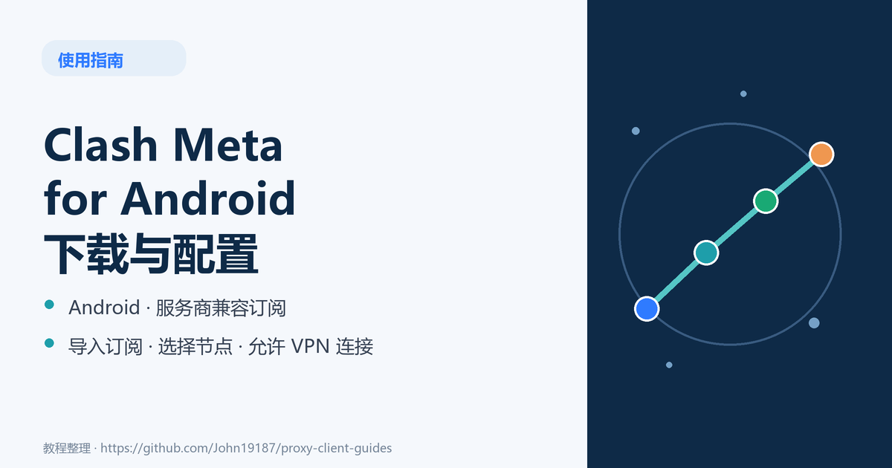
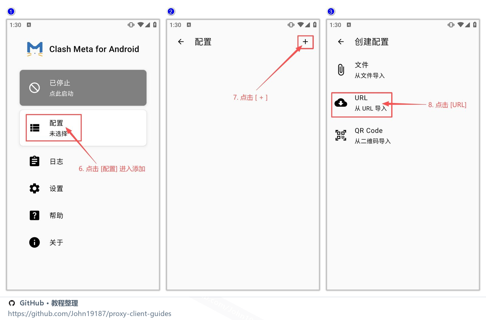
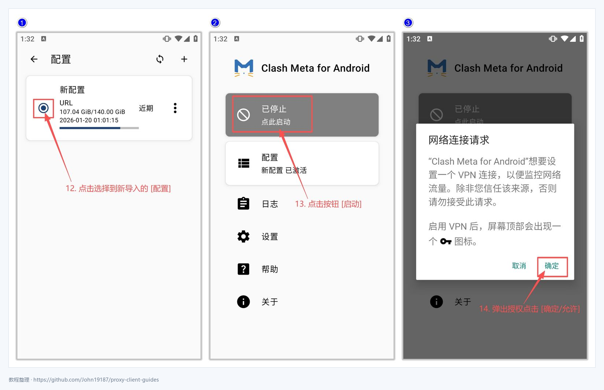
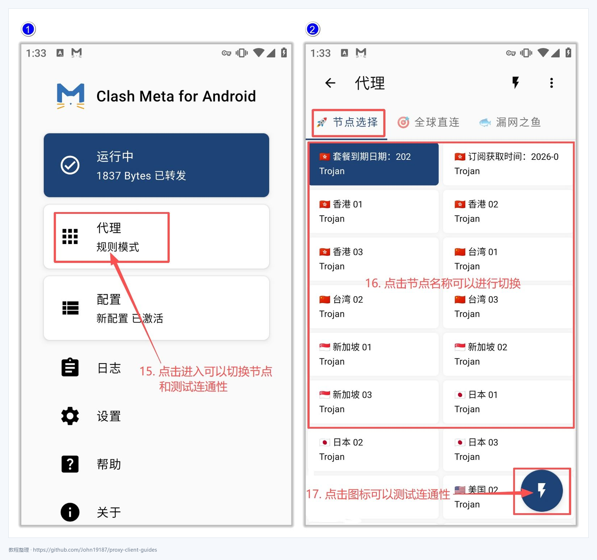
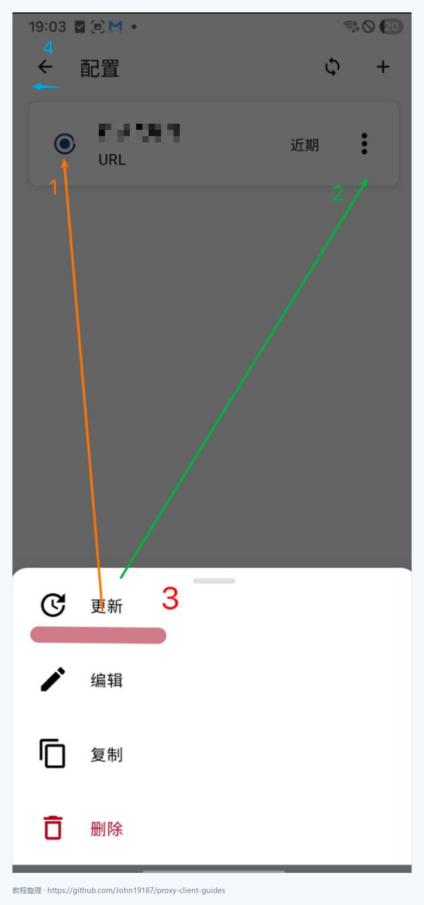

# 2026年 Clash Meta for Android 下载与配置教程：安卓订阅导入、连接及更新

Clash Meta for Android（简称CMFA）装好后，需要导入已有服务商提供的**Clash／Mihomo兼容订阅**，选中这份配置，再启动VPN并选择节点。软件本身不附节点，已有兼容订阅可以继续使用，不需要因为换客户端重新购买服务。

普通64位Android手机选`arm64-v8a`安装包；不清楚手机架构时，可以下载体积较大的`universal`通用包。下面提供 **v2.11.37** 官方APK直链，资料整理于2026年11月14日。

## Clash Meta for Android v2.11.37下载地址

项目列出的最低系统为Android 5.0，推荐Android 7.0及以上；安装时仍以所选APK与设备的兼容结果为准。按设备CPU选择一项，点击文件名直接下载。

| Android设备架构 | 官方APK下载 |
|---|---|
| ARM64，常见64位手机 | [cmfa-2.11.37-meta-arm64-v8a-release.apk](https://github.com/MetaCubeX/ClashMetaForAndroid/releases/download/v2.11.37/cmfa-2.11.37-meta-arm64-v8a-release.apk) |
| 32位ARM | [cmfa-2.11.37-meta-armeabi-v7a-release.apk](https://github.com/MetaCubeX/ClashMetaForAndroid/releases/download/v2.11.37/cmfa-2.11.37-meta-armeabi-v7a-release.apk) |
| x86设备或对应模拟器 | [cmfa-2.11.37-meta-x86-release.apk](https://github.com/MetaCubeX/ClashMetaForAndroid/releases/download/v2.11.37/cmfa-2.11.37-meta-x86-release.apk) |
| x86_64设备或对应模拟器 | [cmfa-2.11.37-meta-x86_64-release.apk](https://github.com/MetaCubeX/ClashMetaForAndroid/releases/download/v2.11.37/cmfa-2.11.37-meta-x86_64-release.apk) |
| 不确定架构，或需要通用包 | [cmfa-2.11.37-meta-universal-release.apk](https://github.com/MetaCubeX/ClashMetaForAndroid/releases/download/v2.11.37/cmfa-2.11.37-meta-universal-release.apk) |

下载完成后，在浏览器下载列表或文件管理器中打开APK，按Android安装器提示完成安装。如果系统要求允许“安装未知应用”，只给本次使用的浏览器或文件管理器授权，安装后可收回。

已经安装Clash Meta for Android的，使用同签名渠道覆盖升级。出现签名冲突时，先保留旧App和配置，核对两个安装包的来源，不要直接卸载旧版丢失资料。

**原版Clash for Android能直接覆盖安装吗？** Clash for Android与Clash Meta for Android是不同项目。仍在使用原版的人，先按[Clash for Android迁移说明](../cfa/README.md#migration)保存订阅和必要文件，再安装Clash Meta for Android。

## 把已有订阅导入Clash Meta for Android

从已有机场或服务后台复制Clash／Mihomo订阅地址，用它下载包含节点、代理组和分流规则的配置。账户首页网址、账号密码和单条节点链接不能代替完整配置地址；个人订阅通常带凭据，不要放进公开截图或求助帖。

1. 登录你已有的服务后台，找到Clash、Mihomo或Clash Meta for Android对应的订阅入口，复制完整链接。部分服务有订阅下载开关或下载窗口，按该服务的提示开启即可。
2. 打开Clash Meta for Android，在首页点“配置”，再点右上角“+”，选择“URL”。

图中①进入“配置”，②点“+”，③选择“URL”。截图未显示版本号，用于辨认这些入口。

3. 在配置编辑页点“名称”，填写便于辨认的名称；点“URL”一行，粘贴完整订阅地址，在弹窗点“确认”。
4. 点编辑页右上角的**软盘图标**保存，等待配置下载完成并出现在列表中。
5. 点这份配置左侧的圆点，让它成为当前配置。返回首页，“配置”一栏应显示该名称和“已激活”。

配置卡片出现只表示文件已下载，圆点选中后才会使用它。保存了多份配置时，也在这里切换；切换配置会改变后续可选节点、代理组和规则。

### 只有本地YAML文件时

1. 打开“配置”，点“+ → 文件”，填写名称，再点“浏览文件”。
2. 在文件列表找到`config.yaml`，点右侧“⋮ → 导入”，从系统文件选择器选中已保存的YAML。
3. 返回配置属性页，点右上角软盘保存；回配置列表点左侧圆点激活这份文件。

本地文件不会自动取得服务的新节点。之后需要更新时，重新取得兼容文件，或改用服务提供的订阅URL。

**下载失败或返回401／403**，先查看完整错误，再回服务后台检查账号状态、订阅下载开关和个人URL是否完整。**出现配置解析错误**，重新取得Clash／Mihomo兼容格式，保留报错中的字段和原文；配置用到当前内核不支持的字段时，需要服务方提供兼容配置或匹配的软件版本。地址类型与错误说明可看[订阅格式与导入错误](../../subscription-formats.md#import-errors)。已有配置仍能用时保留它，不必先删除。

还没有服务时，可比较[多家VPN推荐与推广中的客户端和设备支持](https://github.com/John19187/The-40-Best-VPNs#翻墙客户端与使用方式怎么选)，或[多家机场推荐与推广中的套餐、流量和Clash订阅支持](https://github.com/John19187/ji-chang-tui-jian#airport-clients)。这两篇包含推广，部分服务有自有App；选择时核对服务是否提供通用订阅，已有兼容地址的人直接继续即可。

## 启动VPN，选择要使用的节点

选中配置后，启动Clash Meta for Android的VPN服务，再从该配置的代理组中选择出口。Android出现的VPN请求是系统接管网络所需的授权。

1. 如果另一款VPN正在运行，先断开它。回Clash Meta for Android首页，确认“配置”显示刚才激活的文件。
2. 点顶部“已停止／点此启动”卡片。系统弹出“网络连接请求”时，点“确定”或当前系统对应的允许按钮。

左图的圆点表示当前配置，中图是启动位置，右图是Android的VPN授权。图中流量和日期属于示例配置，不是你的账户数据。

3. 首页显示“运行中”后，点“代理”。保留服务配置的“规则模式”，进入可以手动选择节点的代理组，点一个实际服务器，例如自己列表里的“香港01”。组名和节点名以自己的订阅为准。

图中“节点选择”是这份配置的组名，点服务器卡片可更换出口；“套餐到期日期”“订阅获取时间”等信息条目不作为出口。闪电图标用于测试延迟，数字只反映测试结果。

4. 用浏览器打开你实际需要的网站，再试需要使用的应用。网站和应用能够完成原来的访问任务，即可按当前配置继续使用。

“规则”模式按订阅中的规则分流，首次连接通常保持它即可。“全球直连”“漏网之鱼”是图中配置的分组名，其他服务可能采用不同名称。

**节点有延迟，网页仍失败**，先在当前手动组中换另一个实际节点；仍失败时，保留错误并切换Wi-Fi／移动网络比较，按[连接症状与处理](../../README.md#symptom-table)继续判断。代理页为空或仍显示旧节点，先回“配置”检查当前选中项，再确认下载的是完整兼容配置。

如果原来能用，后来多个节点同时失败，先查看服务账户、剩余流量和你所用服务商的首页公告，核对发生时间及受影响网络，再保留配置换自己的热点作对照。

要断开，回首页点击“运行中”卡片。需要换回原来的配置时，先停止连接，在“配置”中选择原文件，再回首页启动。

## 服务调整节点后，更新原订阅

更新订阅会从已保存的URL重新下载配置。服务新增或调整节点时，更新原文件即可，不需要重新安装软件，也不必再导入一份相同地址。

1. 如服务要求先开启订阅下载窗口，先在服务后台开启。
2. 打开Clash Meta for Android的“配置”，找到要更新的文件，点它右侧的“⋮”。
3. 在弹出的菜单点“更新”，等待下载结束；继续选用这份配置，到“代理”查看更新后的节点。

图中左侧圆点用于激活配置，右侧“⋮”打开操作菜单，底部“更新”重新下载该订阅。截图未显示版本号。

托管配置更新可能替换文件中的本地修改，自定义过规则的人先另存必要内容。只有个人订阅URL真正变化时，才需要编辑保存的地址；后台“重置订阅”与刷新节点不同，重置后，其他设备保存的旧URL也需要更换。

## 升级软件、迁移设备和日常使用

升级Clash Meta for Android是安装新版App，更新订阅是重新下载服务配置，两者分开处理。升级前保存个人URL、必要配置文件和自定义内容，停止服务，再从同渠道下载匹配架构的正式APK。软件升级不会续期服务账户；出现不支持的配置字段时，需要同时核对配置与内核的兼容要求。

给Windows、Mac或Linux电脑使用同一服务时，可以按[Clash Verge Rev下载与配置教程](../clash-verge-rev/README.md)在电脑端重新导入兼容订阅；能否同时使用仍取决于服务的设备和并发条件。要为其他设备选软件，查看[2026年机场通用客户端汇总与下载教程](../../README.md)，其中按平台提供独立教程入口。另选Android客户端后，也先完成目标软件的导入和连接，再整理旧App。

官方资料与图片来源

- [MetaCubeX/ClashMetaForAndroid项目](https://github.com/MetaCubeX/ClashMetaForAndroid)与[系统要求](https://github.com/MetaCubeX/ClashMetaForAndroid#requirement)：产品身份、最低Android 5.0和推荐Android 7.0。
- [v2.11.37发行记录](https://github.com/MetaCubeX/ClashMetaForAndroid/releases/tag/v2.11.37)：本页五种APK的固定下载来源。
- 界面与版本说明：URL导入、选择配置、启动与节点选择原图，原始观察时间为2026年11月7日。原教程下载版本为v2.11.21，截图未显示版本号。服务专属的订阅中心、开关及策略组名称仅在对应条件下适用。
- [极客云Android使用教程](https://jkbest001.net/user/tutorial?os=android&client=flclash)：所配CMFA界面的配置圆点、更多菜单及“更新”操作图；页面取得于2026年11月6日。
- 截图中的第三方商标归各自权利方；原图保留在项目素材记录，本文使用教程整理展示副本。特色图为本仓库制作。

## 文档更新记录

展开文档更新记录

- 2026-11-16　折叠更新记录，收起许可说明，撤下不必要的维护数据与贡献提示入口。 下载区标题标明本文固定版本或独立商店渠道，保原下载文件与旧锚。

- 2026-11-16　补充文末客户端与免费节点目录、文档维护入口；整理图源与版本说明，保留原安装包和操作内容。

## 客户端与相关资源目录

按设备和配置类型进入对应教程；旧版条目用于识别与迁移。软件之间的订阅、配置和备份条件仍以各篇说明为准。

展开客户端目录（含旧版与迁移说明）

| 客户端 | 设备或范围 | 教程用途 |
|---|---|---|
| **Clash Meta for Android（本篇）** | Android | Clash配置与VPN授权 |
| [Clash Verge Rev](../clash-verge-rev/README.md) | Windows／macOS／Linux | Clash／Mihomo配置与系统代理 |
| [FlClash](../flclash/README.md) | 电脑／Android | 跨平台下载、导入与连接 |
| [Clash Party](../clash-party/README.md) | Windows／macOS／Linux | 安装版、便携版与订阅管理 |
| [Clash Mi](../clash-mi/README.md) | 跨平台 | 按本款入口导入Clash配置 |
| [ClashX Meta](../clashx-meta/README.md) | macOS | 菜单栏客户端与Mihomo配置 |
| [v2rayN](../v2rayn/README.md) | 电脑 | 节点订阅与系统代理 |
| [Hiddify](../hiddify/README.md) | 电脑／手机 | 跨平台导入与连接 |
| [Karing](../karing/README.md) | 电脑／手机 | 配置、规则与备份 |
| [v2rayNG](../v2rayng/README.md) | Android | 节点订阅与VPN连接 |
| [NekoBox for Android](../nekobox/README.md) | Android历史版本 | 1.4.2旧版订阅与迁移 |
| [Surfboard](../surfboard/README.md) | Android | 兼容配置与启动连接 |
| [sing-box](../sing-box/README.md) | 多平台 | 版本匹配的JSON配置 |
| [Shadowrocket](../shadowrocket/README.md) | iPhone／iPad | 节点、订阅与VPN连接 |
| [Stash](../stash/README.md) | Apple设备 | 按本款条件导入Clash类配置 |
| [Quantumult X](../quantumult-x/README.md) | iPhone／iPad | 节点资源与完整配置的区别 |
| [Loon](../loon/README.md) | iPhone／iPad | 订阅、策略与分流 |
| [Surge](../surge/README.md) | iOS／macOS | 按平台配置与接管流量 |
| [OpenClash](../openclash/README.md) | OpenWrt | 固件条件、配置与插件 |
| [PassWall](../passwall/README.md) | OpenWrt | 订阅节点与主开关 |
| [ShellCrash](../shellcrash/README.md) | Linux／路由器 | 安装脚本与运行条件 |
| [Nextin](../provider-app/README.md) | 按服务公开支持范围 | 服务指定Nextin时的安装与连接 |
| [Clash for Windows](../cfw/README.md) | 旧版／迁移 | 识别旧配置并迁移 |
| [Clash for Android](../cfa/README.md) | Android旧版／迁移 | 原版CFA与CMFA分开 |
| [ClashX](../clashx/README.md) | macOS旧版 | 普通ClashX身份与迁移 |
| [ClashX Pro](../clashx-pro/README.md) | macOS历史版本 | Pro托管配置与增强模式 |
| [旧Clash Verge](../old-clash-verge/README.md) | 旧版／迁移 | 与Rev区分及迁移 |
| [NekoRay](../nekoray/README.md) | 电脑旧版／迁移 | 旧资料与替代客户端 |
| [旧客户端迁移目录](../legacy/README.md) | 旧版资料 | 按原客户端寻找迁移说明 |

| 相关文档 | 内容 |
|---|---|
| [VPN推荐与使用方式](https://github.com/John19187/The-40-Best-VPNs) | 比较服务的平台、接入方式与客户端 |
| [机场推荐与套餐比较](https://github.com/John19187/ji-chang-tui-jian) | 比较月付、按量与套餐条件 |
| [2026年机场通用客户端汇总与下载教程](../../README.md#choose) | 按设备选软件并进入具体教程 |
| [机场与代理工具科普指南](https://github.com/John19187/ssr-v2ray-trojan-clash-guide) | 理解机场、协议、客户端、订阅与线路 |
| [免费节点与订阅资源](https://github.com/John19187/v2ray-SSR-Clash-Verge-Shadowrocke) | 查看公开资源与导入说明，不承诺持续可用 |

开源维护与许可

本文由John19187统一整理维护，实际修改记录见本页更新日志。原创文档采用[MIT许可](../../LICENSE)；软件、商标及第三方材料的权利与使用范围见[素材说明](../../NOTICE)。

本仓整理客户端下载与使用文档，不是客户端官方项目；软件是否开源、收费及其许可由各开发者分别决定。

