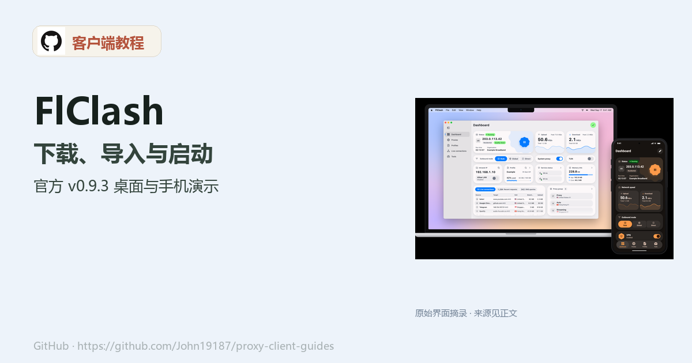
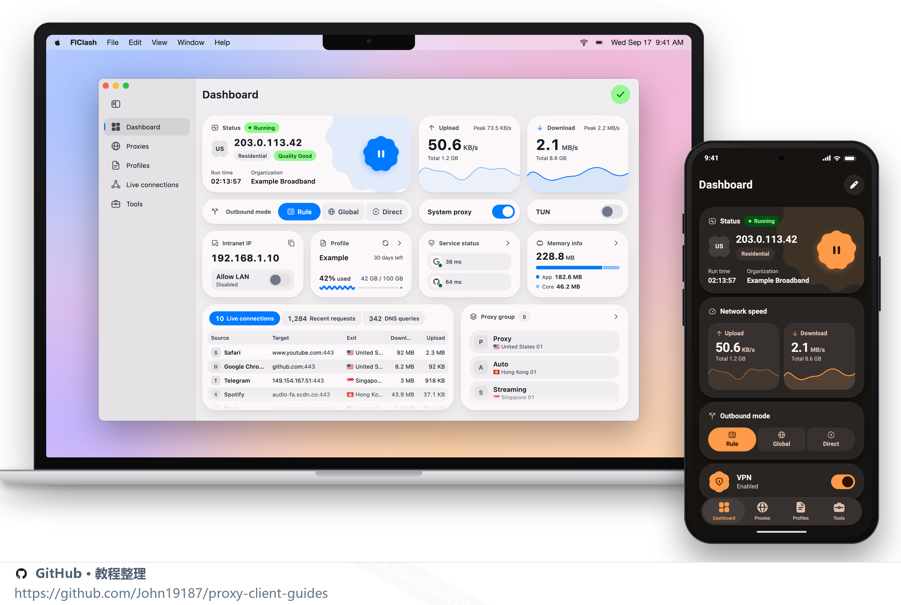
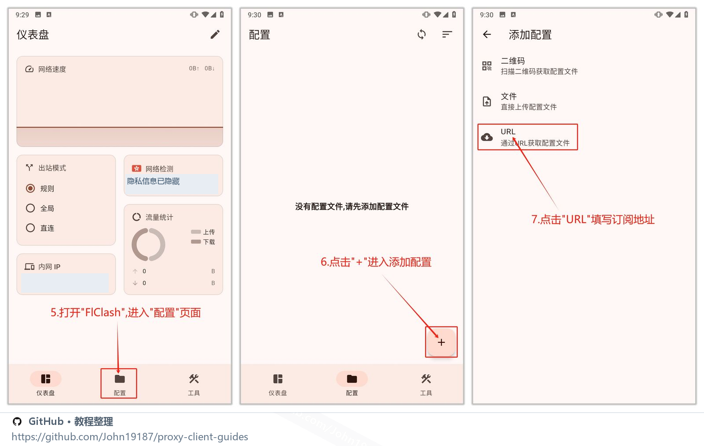
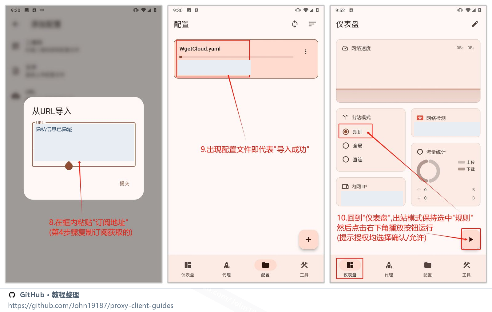

# 2026年FlClash下载与使用教程：电脑、安卓安装及订阅导入图解

Windows x64电脑选EXE安装版，常见安卓手机选ARM64 APK；其他处理器按下表核对。安装后，从服务账户复制Clash／Mihomo订阅，在FlClash“配置”页通过URL添加，选中配置后再开启连接。

**常用下载：** [Windows x64 安装版](https://github.com/chen08209/FlClash/releases/download/v0.9.3/FlClash-0.9.3-windows-amd64-setup.exe) · [安卓 ARM64 APK](https://github.com/chen08209/FlClash/releases/download/v0.9.3/FlClash-0.9.3-android-arm64-v8a.apk) · [Mac、Linux 与其他架构](#packages)

**已经装好：** [导入订阅](#import) · [开启连接](#connect) · [更新订阅](#update) · [连不上怎么办](#troubleshooting)

## FlClash节点订阅从哪里获取

FlClash 通过订阅获取节点。已有 Clash／Mihomo 订阅，可以直接看[导入步骤](#import)。还没有订阅，[机场推荐帖](https://github.com/John19187/ji-chang-tui-jian#airport-clients)可按第三方订阅、设备限制、流量与付款周期比较套餐；购买前确认提供适用于 FlClash 的 Clash／Mihomo 格式。

服务只允许专属 App 登录时，按本家的方式使用，账号密码不能填进 FlClash 的配置URL。要区分两种接入路线，可看[VPN推荐帖的客户端使用方式](https://github.com/John19187/The-40-Best-VPNs#翻墙客户端与使用方式怎么选)。取得兼容订阅后，在自己的账户中复制完整地址，再回本页添加配置。

**本帖目录**

1. [按设备下载并安装 FlClash](#packages)：原包、架构与各系统安装方法
2. [用自己的订阅完成第一次连接](#import)：添加配置、选节点与异常处理
3. [更新订阅、升级FlClash或换设备](#update)：节点和软件分别更新，迁移前保留配置

其他软件见[2026年机场通用客户端汇总与下载教程](../../README.md#choose)。已有订阅可直接进入导入章节；还没有节点时，先看上面的[订阅选择说明](#nodes)。

## FlClash v0.9.3下载与安装：按设备选包

资料更新于 2026 年 11 月 14 日，以下文件对应 FlClash v0.9.3。Windows 需要 10 或更高版本，Mac 需要 macOS 12 或更高版本。

常用下载为 [Windows x64 安装版](https://github.com/chen08209/FlClash/releases/download/v0.9.3/FlClash-0.9.3-windows-amd64-setup.exe)和[安卓 ARM64 APK](https://github.com/chen08209/FlClash/releases/download/v0.9.3/FlClash-0.9.3-android-arm64-v8a.apk)。Windows 的 x64 对应文件名中的 `amd64`，Intel 和 AMD 的 x64 电脑都适用；使用骁龙等 ARM 处理器的电脑，选择 Windows ARM64。

需要便携版、其他系统或其他处理器的安装包，按下表选择。每个文件名都链接到开发者发布的原始文件，右键或长按可复制下载地址。

| 平台／CPU | 正式版直接下载 |
|---|---|
| Windows x64 | **安装版：** [FlClash-0.9.3-windows-amd64-setup.exe](https://github.com/chen08209/FlClash/releases/download/v0.9.3/FlClash-0.9.3-windows-amd64-setup.exe) [FlClash-0.9.3-windows-amd64.zip](https://github.com/chen08209/FlClash/releases/download/v0.9.3/FlClash-0.9.3-windows-amd64.zip) |
| Windows ARM64 | **安装版：** [FlClash-0.9.3-windows-arm64-setup.exe](https://github.com/chen08209/FlClash/releases/download/v0.9.3/FlClash-0.9.3-windows-arm64-setup.exe) [FlClash-0.9.3-windows-arm64.zip](https://github.com/chen08209/FlClash/releases/download/v0.9.3/FlClash-0.9.3-windows-arm64.zip) |
| Mac Intel | [FlClash-0.9.3-macos-amd64.dmg](https://github.com/chen08209/FlClash/releases/download/v0.9.3/FlClash-0.9.3-macos-amd64.dmg) |
| Mac Apple Silicon | [FlClash-0.9.3-macos-arm64.dmg](https://github.com/chen08209/FlClash/releases/download/v0.9.3/FlClash-0.9.3-macos-arm64.dmg) |
| Linux x64 | [FlClash-0.9.3-linux-amd64.AppImage](https://github.com/chen08209/FlClash/releases/download/v0.9.3/FlClash-0.9.3-linux-amd64.AppImage) **DEB包：** [FlClash-0.9.3-linux-amd64.deb](https://github.com/chen08209/FlClash/releases/download/v0.9.3/FlClash-0.9.3-linux-amd64.deb) **RPM包：** [FlClash-0.9.3-linux-amd64.rpm](https://github.com/chen08209/FlClash/releases/download/v0.9.3/FlClash-0.9.3-linux-amd64.rpm) |
| Linux ARM64 | [FlClash-0.9.3-linux-arm64.AppImage](https://github.com/chen08209/FlClash/releases/download/v0.9.3/FlClash-0.9.3-linux-arm64.AppImage) **DEB包：** [FlClash-0.9.3-linux-arm64.deb](https://github.com/chen08209/FlClash/releases/download/v0.9.3/FlClash-0.9.3-linux-arm64.deb) **RPM包：** [FlClash-0.9.3-linux-arm64.rpm](https://github.com/chen08209/FlClash/releases/download/v0.9.3/FlClash-0.9.3-linux-arm64.rpm) |
| Android | **APK：** [FlClash-0.9.3-android-arm64-v8a.apk](https://github.com/chen08209/FlClash/releases/download/v0.9.3/FlClash-0.9.3-android-arm64-v8a.apk) **APK：** [FlClash-0.9.3-android-armeabi-v7a.apk](https://github.com/chen08209/FlClash/releases/download/v0.9.3/FlClash-0.9.3-android-armeabi-v7a.apk) **APK：** [FlClash-0.9.3-android-x86_64.apk](https://github.com/chen08209/FlClash/releases/download/v0.9.3/FlClash-0.9.3-android-x86_64.apk) |

这里的FlClash发布面向Windows、macOS、Linux和安卓，没有对应的iPhone安装包。同一服务要在iPhone使用，可先确认是否提供[Shadowrocket订阅](../shadowrocket/README.md#import)或[Stash完整配置](../stash/README.md#import)，再按目标软件导入；其他iOS选择见[通用客户端汇总](../../README.md#ios)。

### Windows：先看系统类型，再选安装版或便携版

1. 打开 Windows“设置 → 系统 → 关于”，查看“系统类型”。显示 x64 处理器的电脑选 Windows x64，显示 ARM 处理器的电脑选 Windows ARM64。
2. 下载对应的 `setup.exe`，双击后按安装向导完成。想使用 ZIP 便携版，则把整个压缩包解压到一个固定文件夹，再运行里面的程序。
3. 启动 FlClash，进入配置页面。此时还需要导入自己的订阅，安装完成本身不会产生节点。

文件名里的 `amd64` 是 x64 的另一种写法。选择依据是 Windows 显示的系统类型，和电脑是否使用 AMD 品牌无关。这个版本的表中没有 Windows 32 位包。

### 安卓：下载 APK 并允许本次安装

常见安卓手机可选 `arm64-v8a`，旧 ARM 设备看是否需要 `armeabi-v7a`，x86_64 设备使用对应包。APK 的架构要与手机兼容。

打开下载的 APK。系统要求安装权限时，给当前使用的浏览器或文件管理器授权，安装后可关闭这项权限。遇到“应用未安装”或签名冲突，先保留原 App 及数据，核对是否用了其他发行渠道，再处理更新。

### Mac 和 Linux

Mac 在苹果菜单的“关于本机”查看芯片。Intel Mac 选 `macos-amd64.dmg`，Apple M 系列选 `macos-arm64.dmg`。打开 DMG，把 FlClash 拖到“应用程序”，再从那里启动。

Linux 的 Debian／Ubuntu 系选 DEB，对应 RPM 发行版选 RPM，也可用允许执行后的 AppImage。AppImage 或 RPM 的托盘图标未显示时，检查发行版是否安装了 AyatanaAppIndicator 库，具体依赖见文末项目说明。

桌面左侧的 Profiles 是配置页，Proxies 是代理节点页。Dashboard 中可以看到连接状态、System proxy 和 TUN 开关。图为开发者提供的 v0.9.3 界面预览。

## 导入订阅，完成第一次连接

### 在配置页添加订阅 URL

在服务账户的订阅页面，复制标为 FlClash、Clash 或 Mihomo 的完整订阅链接。下面通过 URL 下载整份配置，账户首页、注册页和单条 `vless://` 节点链接不适用于这个表单。几种格式的区别可查[订阅与客户端对照](../../subscription-formats.md)。

1. 打开“Profiles／配置”，点击添加按钮“+”，选择“URL”。
2. 粘贴自己的完整订阅链接。如果表单有名称栏，填写一个方便辨认的名称，然后提交。
3. 等配置下载完成，返回配置列表，点击刚添加的配置卡片，使它成为当前配置。

安卓图中依次点击底部“配置”、右下角“+”、菜单中的“URL”。桌面左侧的Profiles是同一配置入口；两种布局都在这里添加兼容地址。

从左到右依次填写地址并提交、点击下载好的配置、回仪表盘启动。示例中的配置名称用于辨认位置，实际选择自己的那份配置。

订阅地址通常包含个人访问凭据，只粘贴到自己的客户端。分享截图或请求帮助时，遮住地址和二维码。

**提交后没有生成配置：** 读配置下载错误。地址指向登录页时，重新复制个人订阅；服务要求开启下载开关时，先在账户开启，再更新。保留原来可用的配置。

**配置已经出现，代理页没有节点：** 先点击需要使用的配置卡片，再更新。提示格式错误或下载到 HTML 时，回账户取 Clash／Mihomo 配置。

### 从仪表盘启动，再选择节点

选好配置后回“Dashboard／仪表盘”，按配置使用Rule／规则模式。手机和电脑让应用接入的方法不同，执行自己设备对应的一段即可。

**安卓手机：** 点击仪表盘的启动按钮。上方旧界面图在右下角显示三角形启动键；v0.9.3预览在状态区域显示连接控制。首次弹出VPN连接请求时允许。另一款个人VPN正在运行时，先停止那一款，再启动FlClash。

**Windows、Mac或Linux：** 点击仪表盘的连接控制启动内核，为遵循系统代理的浏览器开启System proxy／系统代理。若按钮已显示暂停图标，表示程序已经运行，不要为了继续步骤再把它暂停。工作设备原有企业代理按管理要求保留。

接着选择实际使用的节点：

1. 打开“Proxies／代理”，展开配置中需要使用的策略组，点击一个实际节点。组名由订阅配置安排，保留其他组和规则的用途。
2. 打开实际需要访问的网页或应用，确认能完成原来的任务。后续换节点，仍在这个组中选择，无需重新导入订阅。

Global／全局模式会把已经进入FlClash的流量交给全局组处理，选中的应当是可用节点。`DIRECT` 表示直连，`REJECT` 表示拒绝。面板有延迟数字只能说明测试得到了响应，实际网页能否打开仍取决于节点、规则和网络。

### 安卓 VPN 未启动、应用不通与退出后断网

**安卓没有建立 VPN：** 处理系统弹出的 VPN 请求。如果另一款 VPN 正在连接，先停止它，再启动 FlClash。

**换了多个节点都超时：** 先保留配置，比较同一节点在Wi-Fi和自己的蜂窝网络下的表现。再查账户流量、有效期和本家公告；将发生时间、所用网络与具体错误一起交给服务支持，继续定位失败环节。

**浏览器能用，某个桌面应用不通：** 查看 FlClash 的连接或请求记录。应用不遵循系统代理时，可按 TUN 的权限提示设置接管；若请求已经进入软件，则检查对应规则和节点。浏览器已经可用时可以继续使用系统代理，两种方式的区别见[系统代理与 TUN 对照](../../README.md#proxy-tun)。

**退出 FlClash 后普通网站也打不开：** 重新打开软件，关闭本次开启的 TUN 和系统代理，再退出。仍失败时，按[系统代理恢复步骤](../../README.md#restore-and-report)检查系统留下的代理设置。

## 更新订阅、升级FlClash或换设备

### 更新订阅里的节点

服务商新增或调整节点时，打开“Profiles／配置”，找到此前添加的那条订阅，从它的更多菜单执行更新。软件会从保存的地址重新下载配置，不必重复添加同名订阅。服务商要求先在账户开启订阅下载时，先开启，再回软件更新。

远程配置重新下载后会以远端内容为准。升级或刷新前保存本地自定义内容，使用软件提供的独立覆写方式；不要只在下载来的原文件里改完就期待下次更新永久保留。

### 升级 FlClash，先保存程序数据与自定义设置

升级 App 会更换 FlClash 程序。先用本地文件或 WebDAV 备份功能保存配置和自定义设置，再下载同一分发渠道的新安装包。桌面端停止连接、关闭本次开启的系统代理和 TUN，退出后再安装。回退时保留升级前的备份，新版数据未必能被旧程序读取。

### 换设备或从旧客户端迁来

订阅仍在有效期且服务允许新设备使用时，可在新手机重新导入。先安装适合新手机的 APK，再添加原订阅或恢复备份，并处理新设备的 VPN 授权。设备数量和同时在线限制看套餐条件。

从 CFW 或 CFA 换到 FlClash 时，重新导入兼容订阅，先用默认配置完成连接，再迁入旧覆写、DNS 和规则。停用旧客户端的代理接管，让新客户端单独测试，确认可用后再处理旧 App 的自启或卸载。

首次导入完成后，日常在“代理”页选择节点，在“配置”页更新已经添加的订阅。换手机或电脑时，可以继续使用兼容的个人订阅，按新设备的系统重新安装；退出桌面客户端时关闭本次开启的系统代理和TUN，让普通网络恢复原来的设置。

来源注释与开发者资料

- [chen08209/FlClash](https://github.com/chen08209/FlClash)
- [chen08209/FlClash 正式发行记录](https://github.com/chen08209/FlClash/releases/latest)

## 文档更新记录

展开文档更新记录

- 2026-11-16　折叠更新记录，收起许可说明，撤下不必要的维护数据与贡献提示入口。 下载区标题标明本文固定版本或独立商店渠道，保原下载文件与旧锚。

- 2026-11-16　补充文末客户端与免费节点目录、文档维护入口；整理图源与版本说明，保留原安装包和操作内容。

## 客户端与相关资源目录

按设备和配置类型进入对应教程；旧版条目用于识别与迁移。软件之间的订阅、配置和备份条件仍以各篇说明为准。

展开客户端目录（含旧版与迁移说明）

| 客户端 | 设备或范围 | 教程用途 |
|---|---|---|
| **FlClash（本篇）** | 电脑／Android | 跨平台下载、导入与连接 |
| [Clash Verge Rev](../clash-verge-rev/README.md) | Windows／macOS／Linux | Clash／Mihomo配置与系统代理 |
| [Clash Party](../clash-party/README.md) | Windows／macOS／Linux | 安装版、便携版与订阅管理 |
| [Clash Mi](../clash-mi/README.md) | 跨平台 | 按本款入口导入Clash配置 |
| [ClashX Meta](../clashx-meta/README.md) | macOS | 菜单栏客户端与Mihomo配置 |
| [v2rayN](../v2rayn/README.md) | 电脑 | 节点订阅与系统代理 |
| [Hiddify](../hiddify/README.md) | 电脑／手机 | 跨平台导入与连接 |
| [Karing](../karing/README.md) | 电脑／手机 | 配置、规则与备份 |
| [Clash Meta for Android](../cmfa/README.md) | Android | Clash配置与VPN授权 |
| [v2rayNG](../v2rayng/README.md) | Android | 节点订阅与VPN连接 |
| [NekoBox for Android](../nekobox/README.md) | Android历史版本 | 1.4.2旧版订阅与迁移 |
| [Surfboard](../surfboard/README.md) | Android | 兼容配置与启动连接 |
| [sing-box](../sing-box/README.md) | 多平台 | 版本匹配的JSON配置 |
| [Shadowrocket](../shadowrocket/README.md) | iPhone／iPad | 节点、订阅与VPN连接 |
| [Stash](../stash/README.md) | Apple设备 | 按本款条件导入Clash类配置 |
| [Quantumult X](../quantumult-x/README.md) | iPhone／iPad | 节点资源与完整配置的区别 |
| [Loon](../loon/README.md) | iPhone／iPad | 订阅、策略与分流 |
| [Surge](../surge/README.md) | iOS／macOS | 按平台配置与接管流量 |
| [OpenClash](../openclash/README.md) | OpenWrt | 固件条件、配置与插件 |
| [PassWall](../passwall/README.md) | OpenWrt | 订阅节点与主开关 |
| [ShellCrash](../shellcrash/README.md) | Linux／路由器 | 安装脚本与运行条件 |
| [Nextin专用客户端](../provider-app/README.md) | 按服务公开支持范围 | 仅适用于已证实的服务条件 |
| [Clash for Windows](../cfw/README.md) | 旧版／迁移 | 识别旧配置并迁移 |
| [Clash for Android](../cfa/README.md) | Android旧版／迁移 | 原版CFA与CMFA分开 |
| [ClashX](../clashx/README.md) | macOS旧版 | 普通ClashX身份与迁移 |
| [ClashX Pro](../clashx-pro/README.md) | macOS历史版本 | Pro托管配置与增强模式 |
| [旧Clash Verge](../old-clash-verge/README.md) | 旧版／迁移 | 与Rev区分及迁移 |
| [NekoRay](../nekoray/README.md) | 电脑旧版／迁移 | 旧资料与替代客户端 |
| [旧客户端迁移目录](../legacy/README.md) | 旧版资料 | 按原客户端寻找迁移说明 |

| 相关文档 | 内容 |
|---|---|
| [VPN推荐与使用方式](https://github.com/John19187/The-40-Best-VPNs) | 比较服务的平台、接入方式与客户端 |
| [机场推荐与套餐比较](https://github.com/John19187/ji-chang-tui-jian) | 比较月付、按量与套餐条件 |
| **2026年机场通用客户端汇总与下载教程（本文档仓）** | 按设备选软件并进入具体教程 |
| [机场与代理工具科普指南](https://github.com/John19187/ssr-v2ray-trojan-clash-guide) | 理解机场、协议、客户端、订阅与线路 |
| [免费节点与订阅资源](https://github.com/John19187/v2ray-SSR-Clash-Verge-Shadowrocke) | 查看公开资源与导入说明，不承诺持续可用 |

开源维护与许可

本文由John19187统一整理维护，实际修改记录见本页更新日志。原创文档采用[MIT许可](../../LICENSE)；软件、商标及第三方材料的权利与使用范围见[素材说明](../../NOTICE)。

本仓整理客户端下载与使用文档，不是客户端官方项目；软件是否开源、收费及其许可由各开发者分别决定。

