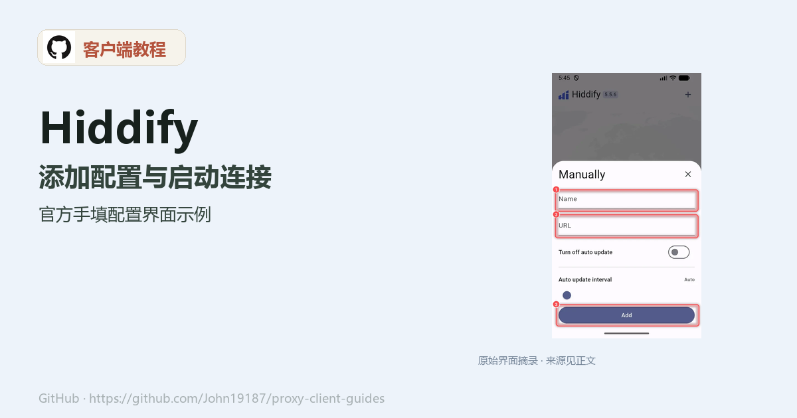
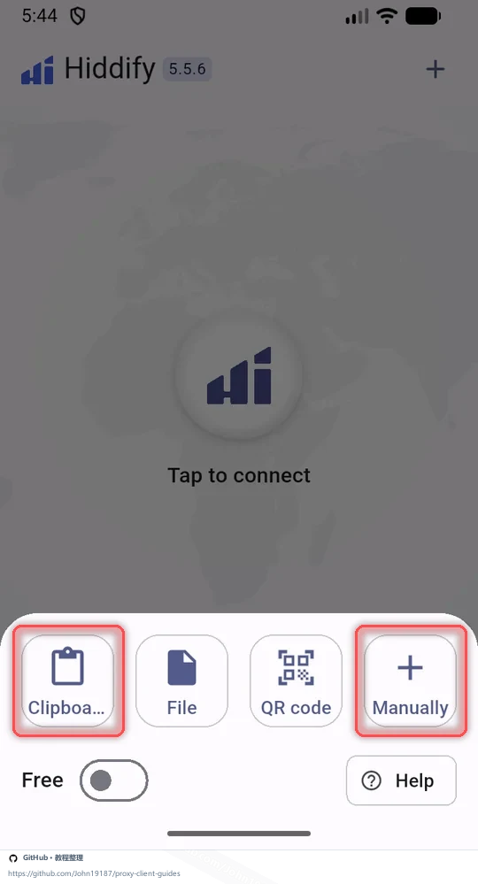
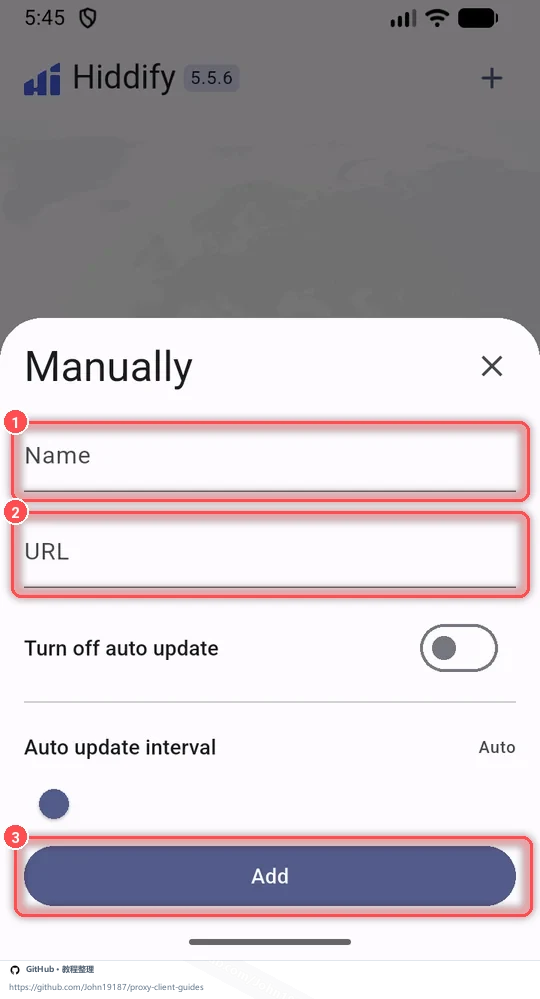

# 2026年 Hiddify下载与配置教程：添加订阅、选择节点和连接网络

安装好Hiddify后，在首页点“+”，选Clipboard导入已复制的兼容订阅链接。然后选中这份配置，点中央连接按钮。手机首次连接要允许VPN请求；电脑可以选择系统代理或VPN模式，下面分别说明。

已经装好软件，可以直接看[添加订阅](#import)。下载表提供v5.5.5安装包；操作图采用官方手册的5.5.6英文手机版，电脑布局有所不同。

## Hiddify v5.5.5下载与安装

下表保留Hiddify **v5.5.5**的正式发行文件，整理日期为2026年11月14日。iPhone／iPad从[Hiddify Proxy & VPN商店条目](https://apps.apple.com/us/app/hiddify-proxy-vpn/id6596777532?uo=4)安装；商店提供方为Holistic Resilience，系统要求为iOS 15.5或更高。

| 设备／CPU | 安装包直接下载 |
|---|---|
| Windows x64 | [EXE安装版](https://github.com/hiddify/hiddify-app/releases/download/v5.5.5/Hiddify-Windows-Setup-x64.exe) **便携版：** [Portable ZIP便携版](https://github.com/hiddify/hiddify-app/releases/download/v5.5.5/Hiddify-Windows-Portable-x64.zip) [MSIX安装包](https://github.com/hiddify/hiddify-app/releases/download/v5.5.5/Hiddify-Windows-Setup-x64.Msix) |
| Mac Intel／Apple Silicon | [DMG](https://github.com/hiddify/hiddify-app/releases/download/v5.5.5/Hiddify-MacOS.dmg) [Installer PKG](https://github.com/hiddify/hiddify-app/releases/download/v5.5.5/Hiddify-MacOS-Installer.pkg) |
| Linux x64 | [AppImage](https://github.com/hiddify/hiddify-app/releases/download/v5.5.5/Hiddify-Linux-x64-AppImage.AppImage) [Debian DEB](https://github.com/hiddify/hiddify-app/releases/download/v5.5.5/Hiddify-Debian-x64.deb) |
| Android | [ARM64 APK](https://github.com/hiddify/hiddify-app/releases/download/v5.5.5/Hiddify-Android-arm64.apk) [ARMv7 APK](https://github.com/hiddify/hiddify-app/releases/download/v5.5.5/Hiddify-Android-arm7.apk) [x86_64 APK](https://github.com/hiddify/hiddify-app/releases/download/v5.5.5/Hiddify-Android-x86_64.apk) [Universal通用APK](https://github.com/hiddify/hiddify-app/releases/download/v5.5.5/Hiddify-Android-universal.apk) |

Android按处理器架构选包；不知道架构时可选Universal。表中没有单独的Windows／Linux ARM64包，Android ARM64 APK不能作为这些电脑的安装包。使用这类ARM64电脑，可查看[Clash Verge Rev的Windows／Linux ARM64安装包](../clash-verge-rev/README.md#packages)，并从服务后台取得Rev对应的订阅。想比较其他设备方案，可查看[2026年机场通用客户端汇总与下载教程](../../README.md#choose)，确认服务支持哪款软件。

- **Windows：**第一次安装可选EXE，双击后按向导完成，再打开Hiddify。便携版须完整解压ZIP后运行，并保留解压后的整个目录；MSIX由系统应用安装程序处理。
- **Mac：**DMG和PKG均适用于Intel与Apple Silicon。打开DMG后，将Hiddify拖到“应用程序”；PKG则按安装向导完成，再从“应用程序”打开。
- **Linux：**DEB用系统软件安装器安装；AppImage保存到固定位置，在文件属性中授予执行权限后运行。
- **Android：**从下载通知或文件管理器打开APK，按提示安装。系统不允许该来源安装时，只给本次使用的浏览器或文件管理器开启安装权限，再返回安装窗口；安装完成后点“打开”。

升级已有App时保留原分发渠道；遇到签名冲突，先保存原App数据，不要直接卸载解决。安装受到系统安全提示阻止时，可对照[官方安装说明](https://hiddify.com/app/How-to-install-Hiddify-app/)，按本机系统和具体提示处理。

## 在首页添加自己的订阅

登录自己的服务账户，复制标为Hiddify或明确支持Hiddify的完整订阅链接。这里使用HTTPS地址；后台没有兼容入口时，先向客服询问，不要自己改链接前缀。订阅链接通常含个人凭据，截图时遮住地址和二维码。

1. 复制兼容订阅，打开Hiddify首页（Home），点顶部“+”。
2. 在底部“Add profile”面板点**Clipboard**，等待新配置出现在首页顶部。

   

   Clipboard会读取剪贴板里的地址。需要自己填写名称时，改用右侧的Manually。

首页顶部出现新配置后，继续[选中配置并连接](#connect)。一份配置里可以包含多个节点。

### 要自己命名时，用Manually填写

1. 在同一添加面板点**Manually**。
2. **Name**填便于辨认的名字，**URL**粘贴个人HTTPS订阅，再点**Add**。

   

   ①填一个自己能认出的名称，②填订阅地址，③保存。“Turn off auto update”用于关闭订阅自动更新，首次添加时保持默认即可。

**显示Invalid URL或Failed to add profile：**回账户重新复制完整Hiddify订阅，核对有无漏字或夹入说明文字。仍失败，把错误、设备和客户端版本交服务支持确认，保留原来可用配置，不公开个人URL。

尚未选择服务，可比较[多家VPN推荐与推广的App和设备支持](https://github.com/John19187/The-40-Best-VPNs#翻墙客户端与使用方式怎么选)及[多家机场推荐与推广的套餐、流量和客户端支持](https://github.com/John19187/ji-chang-tui-jian#airport-clients)。部分服务有自有App，并不一定提供通用订阅；已有兼容服务直接继续。

## 选中配置，在当前设备连接

点首页顶部的配置卡，在列表中选刚添加的名称。连接后，可以在Proxies页选择这份订阅里的具体节点。

### Android、iPhone和iPad

1. 断开另一款正在连接的个人VPN，再点首页中央**Tap to connect**。
2. 系统首次请求VPN权限，确认来自Hiddify再允许。Android可能先询问通知权限；iPhone／iPad按系统要求完成设备验证。
3. 中央按钮显示**Connected**后，打开实际需要的网站或应用，完成访问。

能打开需要的网站或应用，就可以继续使用。一直显示Connecting，或显示Connected后仍打不开网站，按下方的[连接失败处理](#连接失败时先查当前配置和节点)排查。

### Windows、Mac和Linux

首次点击中央连接按钮，可能出现**Send all apps through the VPN?**，按应用需要选择：

| 模式 | 用于什么 | 权限 |
|---|---|---|
| **Use VPN mode** | 需要设备VPN处理应用流量 | 需要管理员授权，先断开其他正在运行的VPN |
| **Use system proxy** | 浏览器等读取系统代理的应用 | 无需管理员权限，部分应用不会跟随 |

1. 点**Tap to connect**，出现询问时选择所需模式。
2. VPN模式按系统提示授权。Windows确认管理员请求；Mac和Linux完成本机授权。Linux AppImage每次启动后的首次连接会再申请权限。
3. 显示Connected后，用原来需要的网页或应用验证访问。

模式也可从首页底部**Quick settings**，或**Settings → Inbound → Service mode**切换。选择System proxy后浏览器能用、某个应用不走代理，先看该应用自己的代理说明，确需设备VPN时再换模式，无需重新导入订阅。

**提示Missing privilege：**VPN模式缺少系统权限。Windows可从托盘菜单Exit完整退出，再右键Hiddify选“以管理员身份运行”；Mac／Linux按[官方手册的管理员权限部分](https://hiddify.com/app/How-to-use-Hiddify-app/)及具体系统提示处理。只需浏览器系统代理，可改用Use system proxy。

**切换模式后普通网络异常：**回Service mode选回原来可用的值。需要停用时点中央Connected断开，再完整退出；仍未恢复，按[退出客户端后恢复网络](../../README.md#restore-and-report)撤回本次系统代理遗留，保留订阅。

## 从当前配置中选择节点

连接后，点中央按钮下方显示代理名称的卡片，打开**Proxies**，再点需要的服务器。**Auto**是自动选择组，不是一台服务器；选择后回到目标应用查看结果。

换服务或换整份订阅，点首页顶部配置卡；只换当前订阅里的节点，进Proxies页选择。

### 连接失败时，先查当前配置和节点

首页选错配置时，先切到刚导入的那份。配置正确但节点连不上，换同一订阅里的另一个节点，或按下一节更新节点列表。

手机没有建立VPN连接，检查首次权限请求是否已允许，并断开另一款正在运行的VPN。多个节点都失败，再看账户是否到期、流量是否用完，以及服务公告有没有故障说明。还需要区分网络问题时，保留同一配置，分别用Wi-Fi和自己的手机流量连接同一节点。

## 更新订阅里的节点，保留原来源

服务修改节点后，点首页配置卡左侧的**双箭头更新按钮**，从保存的URL下载新列表。顶部配置卡打开配置列表；某份配置左侧的三个点可管理、编辑或分享它。分享可能带出个人订阅或二维码，只传给自己控制的设备。

旧节点还能用、只是更新失败时，先保留它，再检查下载错误和服务是否限制了订阅下载时间。更新订阅会重新获取节点；升级Hiddify则从原安装渠道下载新版软件。

升级前保存个人订阅及本地改动，记下服务模式；断开、完全退出后安装同渠道版本。遇到签名冲突先保数据，不直接卸载。

换设备时安装该设备适用的Hiddify，重新添加订阅并完成本机授权。若希望使用文件或WebDAV等备份方式，可比较[Karing的备份与同步](../karing/README.md#backup-sync)，先取得服务支持的目标格式；两款软件的备份不能互换。

首页顶部选订阅，中央按钮连接与断开，下方代理卡换节点。配置已保存，下次继续选择使用即可；其他设备的软件与下载可查[2026年机场通用客户端汇总与下载教程](../../README.md#choose)。

官方资料与图片来源

- [Hiddify项目](https://github.com/hiddify/hiddify-app)与[发行记录](https://github.com/hiddify/hiddify-app/releases/latest)：固定v5.5.5安装包来源。
- [官方安装说明](https://hiddify.com/app/How-to-install-Hiddify-app/)及[完整使用手册](https://hiddify.com/app/How-to-use-Hiddify-app/)：采用2026-11-14保存的原文，订阅、连接、模式、更新与权限分别按其实际条件说明。
- 操作图来自官方手册的5.5.6英文手机画面，原界面保留，整理展示版只添加必要标注及来源；封面为本仓制作。

## 文档更新记录

展开文档更新记录

- 2026-11-16　折叠更新记录，收起许可说明，撤下不必要的维护数据与贡献提示入口。 下载区标题标明本文固定版本或独立商店渠道，保原下载文件与旧锚。

- 2026-11-16　补充文末客户端与免费节点目录、文档维护入口；整理图源与版本说明，保留原安装包和操作内容。

## 客户端与相关资源目录

按设备和配置类型进入对应教程；旧版条目用于识别与迁移。软件之间的订阅、配置和备份条件仍以各篇说明为准。

展开客户端目录（含旧版与迁移说明）

| 客户端 | 设备或范围 | 教程用途 |
|---|---|---|
| **Hiddify（本篇）** | 电脑／手机 | 跨平台导入与连接 |
| [Clash Verge Rev](../clash-verge-rev/README.md) | Windows／macOS／Linux | Clash／Mihomo配置与系统代理 |
| [FlClash](../flclash/README.md) | 电脑／Android | 跨平台下载、导入与连接 |
| [Clash Party](../clash-party/README.md) | Windows／macOS／Linux | 安装版、便携版与订阅管理 |
| [Clash Mi](../clash-mi/README.md) | 跨平台 | 按本款入口导入Clash配置 |
| [ClashX Meta](../clashx-meta/README.md) | macOS | 菜单栏客户端与Mihomo配置 |
| [v2rayN](../v2rayn/README.md) | 电脑 | 节点订阅与系统代理 |
| [Karing](../karing/README.md) | 电脑／手机 | 配置、规则与备份 |
| [Clash Meta for Android](../cmfa/README.md) | Android | Clash配置与VPN授权 |
| [v2rayNG](../v2rayng/README.md) | Android | 节点订阅与VPN连接 |
| [NekoBox for Android](../nekobox/README.md) | Android历史版本 | 1.4.2旧版订阅与迁移 |
| [Surfboard](../surfboard/README.md) | Android | 兼容配置与启动连接 |
| [sing-box](../sing-box/README.md) | 多平台 | 版本匹配的JSON配置 |
| [Shadowrocket](../shadowrocket/README.md) | iPhone／iPad | 节点、订阅与VPN连接 |
| [Stash](../stash/README.md) | Apple设备 | 按本款条件导入Clash类配置 |
| [Quantumult X](../quantumult-x/README.md) | iPhone／iPad | 节点资源与完整配置的区别 |
| [Loon](../loon/README.md) | iPhone／iPad | 订阅、策略与分流 |
| [Surge](../surge/README.md) | iOS／macOS | 按平台配置与接管流量 |
| [OpenClash](../openclash/README.md) | OpenWrt | 固件条件、配置与插件 |
| [PassWall](../passwall/README.md) | OpenWrt | 订阅节点与主开关 |
| [ShellCrash](../shellcrash/README.md) | Linux／路由器 | 安装脚本与运行条件 |
| [Nextin](../provider-app/README.md) | 按服务公开支持范围 | 服务指定Nextin时的安装与连接 |
| [Clash for Windows](../cfw/README.md) | 旧版／迁移 | 识别旧配置并迁移 |
| [Clash for Android](../cfa/README.md) | Android旧版／迁移 | 原版CFA与CMFA分开 |
| [ClashX](../clashx/README.md) | macOS旧版 | 普通ClashX身份与迁移 |
| [ClashX Pro](../clashx-pro/README.md) | macOS历史版本 | Pro托管配置与增强模式 |
| [旧Clash Verge](../old-clash-verge/README.md) | 旧版／迁移 | 与Rev区分及迁移 |
| [NekoRay](../nekoray/README.md) | 电脑旧版／迁移 | 旧资料与替代客户端 |
| [旧客户端迁移目录](../legacy/README.md) | 旧版资料 | 按原客户端寻找迁移说明 |

| 相关文档 | 内容 |
|---|---|
| [VPN推荐与使用方式](https://github.com/John19187/The-40-Best-VPNs) | 比较服务的平台、接入方式与客户端 |
| [机场推荐与套餐比较](https://github.com/John19187/ji-chang-tui-jian) | 比较月付、按量与套餐条件 |
| [2026年机场通用客户端汇总与下载教程](../../README.md#choose) | 按设备选软件并进入具体教程 |
| [机场与代理工具科普指南](https://github.com/John19187/ssr-v2ray-trojan-clash-guide) | 理解机场、协议、客户端、订阅与线路 |
| [免费节点与订阅资源](https://github.com/John19187/v2ray-SSR-Clash-Verge-Shadowrocke) | 查看公开资源与导入说明，不承诺持续可用 |

开源维护与许可

本文由John19187统一整理维护，实际修改记录见本页更新日志。原创文档采用[MIT许可](../../LICENSE)；软件、商标及第三方材料的权利与使用范围见[素材说明](../../NOTICE)。

本仓整理客户端下载与使用文档，不是客户端官方项目；软件是否开源、收费及其许可由各开发者分别决定。

