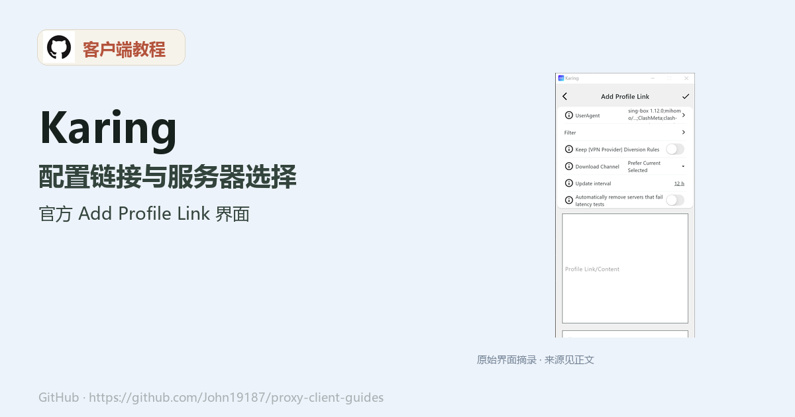
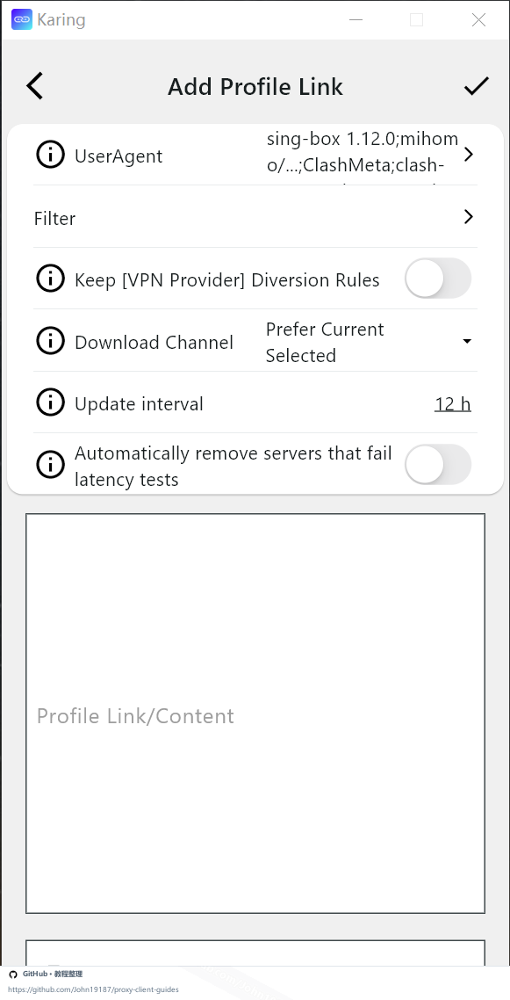
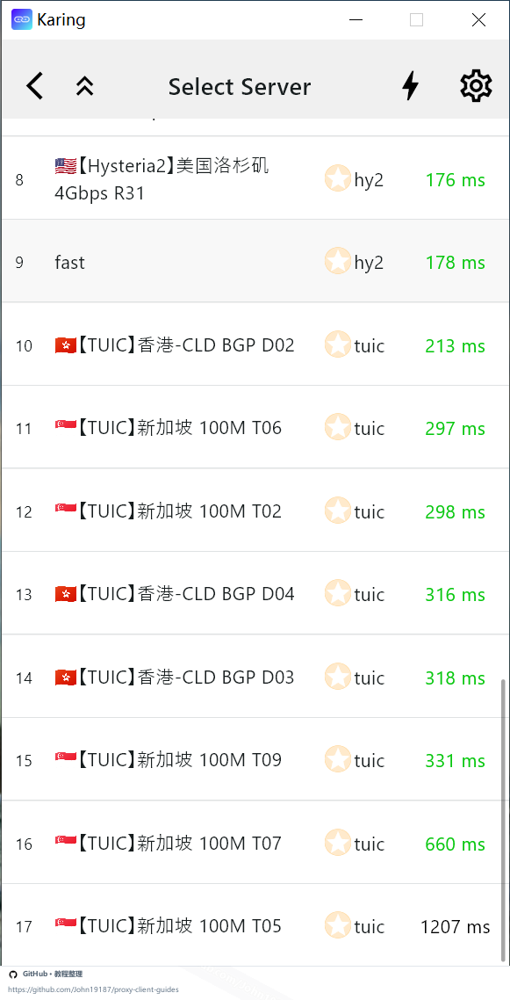

# 2026年 Karing下载与配置教程：添加订阅、连接和备份到另一台设备

Karing可在手机和电脑导入服务提供的订阅。安装后从“添加配置 → 添加配置链接”粘贴完整地址，点右上角添加按钮；回主屏选服务器、开启连接，电脑还可按需开启系统代理。

客户端免费，线路来自自己的服务；软件安装完成不会自动带来可用节点。下面给v1.2.26.2931固定包，已安装者可直接看[添加订阅](#import)。

## Karing v1.2.26.2931下载地址与安装包

官方快速教程列出的系统要求为 **Windows 10 及以上、macOS 12 及以上、Android 8 及以上、iOS 15 及以上**。下载前先确认自己的系统与处理器架构；Linux 包单独列在表中，具体适配以对应发行说明为准。

| 设备与包型 | 下载入口 | 怎样选择 |
|---|---|---|
| Windows x64 安装版 | [karing_1.2.26.2931_windows_x64.exe](https://github.com/KaringX/karing/releases/download/v1.2.26.2931/karing_1.2.26.2931_windows_x64.exe) | 普通 Windows 用户可先选安装版 |
| Windows x64 ZIP 包 | [karing_1.2.26.2931_windows_x64.zip](https://github.com/KaringX/karing/releases/download/v1.2.26.2931/karing_1.2.26.2931_windows_x64.zip) | 需要 ZIP 包时选用，解压后再运行程序 |
| macOS 通用 DMG | [karing_1.2.26.2931_macos_universal.dmg](https://github.com/KaringX/karing/releases/download/v1.2.26.2931/karing_1.2.26.2931_macos_universal.dmg) | 按磁盘映像内的安装提示操作 |
| macOS 通用 PKG | [karing_1.2.26.2931_macos_universal.pkg](https://github.com/KaringX/karing/releases/download/v1.2.26.2931/karing_1.2.26.2931_macos_universal.pkg) | 使用系统安装器逐步安装 |
| Android ARM64 | [karing_1.2.26.2931_android_arm64-v8a.apk](https://github.com/KaringX/karing/releases/download/v1.2.26.2931/karing_1.2.26.2931_android_arm64-v8a.apk) | 适用于 ARM64 架构设备 |
| Android ARMv7 | [karing_1.2.26.2931_android_armeabi-v7a.apk](https://github.com/KaringX/karing/releases/download/v1.2.26.2931/karing_1.2.26.2931_android_armeabi-v7a.apk) | 适用于相应的 32 位 ARM 设备 |
| Android ARM 包 | [karing_1.2.26.2931_android_arm.apk](https://github.com/KaringX/karing/releases/download/v1.2.26.2931/karing_1.2.26.2931_android_arm.apk) | 适配范围请看该版发行说明，不确定架构时先确认再下载 |
| iPhone / iPad | [App Store：Karing](https://apps.apple.com/us/app/karing/id6472431552?uo=4) | 官方教程注明需要非中国大陆区 App Store 账号 |
| Linux amd64 AppImage | [karing_1.2.26.2931_linux_amd64.AppImage](https://github.com/KaringX/karing/releases/download/v1.2.26.2931/karing_1.2.26.2931_linux_amd64.AppImage) | 按发行版的 AppImage 运行方式使用 |
| Linux amd64 DEB | [karing_1.2.26.2931_linux_amd64.deb](https://github.com/KaringX/karing/releases/download/v1.2.26.2931/karing_1.2.26.2931_linux_amd64.deb) | 用于采用 DEB 软件包的发行版 |
| Linux amd64 RPM | [karing_1.2.26.2931_linux_amd64.rpm](https://github.com/KaringX/karing/releases/download/v1.2.26.2931/karing_1.2.26.2931_linux_amd64.rpm) | 用于采用 RPM 软件包的发行版 |

完整版本与资产请查 [Karing 官方发行页](https://github.com/KaringX/karing/releases/latest)。以上固定链接指向同一版本，App Store 则由商店提供当前可下载版本，二者版本号不一定相同。系统要求与商店账号条件见[官方快速使用教程](https://karing.app/quickstart)。

## 安装Karing，取回自己的订阅

| 选用的包 | 安装办法 |
|---|---|
| Windows EXE | 运行安装器，按向导完成后打开Karing |
| Windows ZIP | 完整解压后运行，不在压缩包预览里启动 |
| macOS DMG／PKG | 按磁盘映像或系统安装器提示安装 |
| Android APK | 从下载通知或文件管理器打开；系统要求授权时，只允许本次使用的来源安装 |
| iPhone／iPad | 从上面的App Store入口安装 |

打开已有服务账户，复制明确供Karing使用的订阅URL。没有这个选项时，对照[官方支持的配置类型](https://karing.app/app-manual/add-profiles)向服务确认。取得服务为Karing准备的兼容格式后，普通用户有成品订阅就可以直接导入。

个人订阅通常含凭据，不公开地址、二维码或带地址的截图。后台登录页、购买页和浏览器地址栏中的账户网址，不是订阅URL。

尚无服务，可比较[多家VPN推荐与推广的App和设备支持](https://github.com/John19187/The-40-Best-VPNs#翻墙客户端与使用方式怎么选)，以及[多家机场推荐与推广的套餐、流量和订阅条件](https://github.com/John19187/ji-chang-tui-jian#airport-clients)。部分服务只有自有App；已有兼容订阅直接继续。

## 在添加配置页面粘贴订阅

1. 点App左上角设置按钮，进入“添加配置”，打开“添加配置链接”（**Add Profile Link**）；桌面工具栏也有添加配置入口。
2. 在**Profile Link/Content**粘贴完整URL，点页面右上角的添加按钮。

   

   大输入区用于链接或支持的配置内容，普通订阅用户粘贴服务给的URL即可。图中为官方Windows英文演示，原图未标版本。

3. 等待下载和处理，打开“我的配置”找到新增项，回主屏查看服务器。

**添加时报错、没有配置或节点：**先核对完整地址和格式，排除误复制后台页面；从服务订阅页重新复制一次。仍失败，保留具体错误交服务支持，不反复添加同一URL，也不先清空旧配置。

只有本地文件，用“添加配置 → 导入配置文件”。[官方文档](https://karing.app/app-manual/add-profiles)明确这种配置不能通过订阅更新；后续服务变更时，需要新文件或远程订阅。跨软件输入的区别也可查[订阅格式专题](../../subscription-formats.md#format-table)。

## 选服务器，打开主屏连接开关

Karing导入后默认选择一个服务器。需要自己选时，从主屏下方服务器名称打开列表。

1. 点主屏下方服务器名称，进入**Select Server（选择服务器）**。
2. 需要比较当前候选时，点“延时检测”，等待结果；可按官方建议使用“自动选择”。
3. 点要用的服务器，再回主屏查看当前选择。

   

   图中节点名称、176ms等延迟都是演示内容，只用于辨认列表。原图来自KaringX/karing，未标软件版本。

节点旁出现三角错误提示，点开读具体原因，再尝试同一有效订阅的其他节点。延迟异常但目标网页仍能用，保留可用配置和错误信息，不为单一检测结果清空设置。

4. 在主屏点**连接开关**。手机首次弹出VPN授权时，核对应用为Karing后允许。
5. 电脑希望浏览器读取系统代理时，另开启主屏的**系统代理开关**。这是PC端控件，与总连接开关不同；手机不用照做。
6. 用目标网页或应用完成实际访问。

默认分流可先保留。“规则”按分流规则处理，“全局”让进入软件的流量经当前选择转发；改全局不能代替选可用节点，也不能让所有应用自动读取系统代理，见[官方主屏说明](https://karing.app/app-manual/home)。

**已连接但电脑浏览器仍失败：**看当前服务器、总连接开关及PC系统代理是否符合上述选择。只有某个应用失败，核对它是否有独立代理设置。多个节点都失败，再看账户、流量和本家公告；用同一节点比较另一条自己的网络，保留具体连接错误。

## 在“我的配置”更新节点

1. 打开“我的配置”，找到需要更新的订阅。
2. 点击这份订阅的**配置更新时间**，等待更新完成，再去服务器列表选择节点。

这是[官方“我的配置”文档](https://karing.app/app-manual/my-profiles)列出的下载更新入口。主屏流量信息旁的刷新按钮只刷新用量，不重新下载配置；服务已换节点而本地列表没变，应更新配置，不只刷新流量。本地文件用户另取新文件。

升级Karing程序则走官方发行页或App Store，更新订阅不会升级软件，也不会购买或续费服务。

## 用备份与同步迁移到另一台设备

官方支持iCloud（仅iOS／macOS）、WebDAV、局域网同步和ZIP文件导入／导出。需要自己保管备份文件，可用文件方式：

1. 打开“设置 → 备份和同步 → 局域网同步 → 文件导入/导出”。
2. 导出备份，放在自己控制的位置；里面可能含个人订阅与设置。
3. 在另一台Karing从对应文件导入入口恢复，再选择需要的订阅和服务器，完成该设备的连接授权与实际访问。

局域网扫码是另一种方式：导出方点“同步给他人”生成二维码，导入方点“扫码同步”；**扫码导入仅支持iOS／Android手机端**，不能套到所有电脑。WebDAV按所用云盘配置，详见[官方备份与同步](https://karing.app/tutorial/backup-sync)。

配置、更新或连接仍有问题，反馈时给出系统、Karing版本、具体步骤和脱敏错误，可查[官方使用文档](https://karing.app/quickstart)与[项目反馈入口](https://github.com/KaringX/karing)。备份保留到新设备实际可用，不把排查网络和删除配置一起做。

## 换软件时使用目标的订阅入口

想改用另一款多平台软件，可看[Hiddify添加订阅和连接教程](../hiddify/README.md)；服务给Android用户提供v2rayNG入口时，直接看[v2rayNG下载与配置](../v2rayng/README.md)。两者按自己的格式导入，不能用Karing整份设置备份互相覆盖。

更多电脑、手机与路由器软件见[2026年机场通用客户端汇总与下载教程](../../README.md#choose)。日常使用Karing时，主屏换服务器，“我的配置”更新节点，需要停用就关闭主屏连接开关，已保存订阅留待下次使用。

官方资料与图片来源

- [Karing项目](https://github.com/KaringX/karing)与[v1.2.26.2931发行记录](https://github.com/KaringX/karing/releases/tag/v1.2.26.2931)：固定下载文件。
- [快速使用教程](https://karing.app/quickstart)、[添加配置](https://karing.app/app-manual/add-profiles)、[我的配置](https://karing.app/app-manual/my-profiles)、[主屏](https://karing.app/app-manual/home)及[备份与同步](https://karing.app/tutorial/backup-sync)：本轮补读完整官方操作说明。主屏文档的另一张示例图注明PC端1.0.29.395，不将它冒作本页固定包界面。
- 操作图来自KaringX/karing官方Windows演示：[添加配置原图](https://raw.githubusercontent.com/KaringX/karing/main/README_assets/demo/add_profile_link.png)、[选择服务器原图](https://raw.githubusercontent.com/KaringX/karing/main/README_assets/demo/select_server.png)。保留原界面及来源，未标版本；封面以同款官方图整理。

## 文档更新记录

展开文档更新记录

- 2026-11-16　折叠更新记录，收起许可说明，撤下不必要的维护数据与贡献提示入口。 下载区标题标明本文固定版本或独立商店渠道，保原下载文件与旧锚。

- 2026-11-16　补充文末客户端与免费节点目录、文档维护入口；整理图源与版本说明，保留原安装包和操作内容。

## 客户端与相关资源目录

按设备和配置类型进入对应教程；旧版条目用于识别与迁移。软件之间的订阅、配置和备份条件仍以各篇说明为准。

展开客户端目录（含旧版与迁移说明）

| 客户端 | 设备或范围 | 教程用途 |
|---|---|---|
| **Karing（本篇）** | 电脑／手机 | 配置、规则与备份 |
| [Clash Verge Rev](../clash-verge-rev/README.md) | Windows／macOS／Linux | Clash／Mihomo配置与系统代理 |
| [FlClash](../flclash/README.md) | 电脑／Android | 跨平台下载、导入与连接 |
| [Clash Party](../clash-party/README.md) | Windows／macOS／Linux | 安装版、便携版与订阅管理 |
| [Clash Mi](../clash-mi/README.md) | 跨平台 | 按本款入口导入Clash配置 |
| [ClashX Meta](../clashx-meta/README.md) | macOS | 菜单栏客户端与Mihomo配置 |
| [v2rayN](../v2rayn/README.md) | 电脑 | 节点订阅与系统代理 |
| [Hiddify](../hiddify/README.md) | 电脑／手机 | 跨平台导入与连接 |
| [Clash Meta for Android](../cmfa/README.md) | Android | Clash配置与VPN授权 |
| [v2rayNG](../v2rayng/README.md) | Android | 节点订阅与VPN连接 |
| [NekoBox for Android](../nekobox/README.md) | Android历史版本 | 1.4.2旧版订阅与迁移 |
| [Surfboard](../surfboard/README.md) | Android | 兼容配置与启动连接 |
| [sing-box](../sing-box/README.md) | 多平台 | 版本匹配的JSON配置 |
| [Shadowrocket](../shadowrocket/README.md) | iPhone／iPad | 节点、订阅与VPN连接 |
| [Stash](../stash/README.md) | Apple设备 | 按本款条件导入Clash类配置 |
| [Quantumult X](../quantumult-x/README.md) | iPhone／iPad | 节点资源与完整配置的区别 |
| [Loon](../loon/README.md) | iPhone／iPad | 订阅、策略与分流 |
| [Surge](../surge/README.md) | iOS／macOS | 按平台配置与接管流量 |
| [OpenClash](../openclash/README.md) | OpenWrt | 固件条件、配置与插件 |
| [PassWall](../passwall/README.md) | OpenWrt | 订阅节点与主开关 |
| [ShellCrash](../shellcrash/README.md) | Linux／路由器 | 安装脚本与运行条件 |
| [Nextin专用客户端](../provider-app/README.md) | 按服务公开支持范围 | 仅适用于已证实的服务条件 |
| [Clash for Windows](../cfw/README.md) | 旧版／迁移 | 识别旧配置并迁移 |
| [Clash for Android](../cfa/README.md) | Android旧版／迁移 | 原版CFA与CMFA分开 |
| [ClashX](../clashx/README.md) | macOS旧版 | 普通ClashX身份与迁移 |
| [ClashX Pro](../clashx-pro/README.md) | macOS历史版本 | Pro托管配置与增强模式 |
| [旧Clash Verge](../old-clash-verge/README.md) | 旧版／迁移 | 与Rev区分及迁移 |
| [NekoRay](../nekoray/README.md) | 电脑旧版／迁移 | 旧资料与替代客户端 |
| [旧客户端迁移目录](../legacy/README.md) | 旧版资料 | 按原客户端寻找迁移说明 |

| 相关文档 | 内容 |
|---|---|
| [VPN推荐与使用方式](https://github.com/John19187/The-40-Best-VPNs) | 比较服务的平台、接入方式与客户端 |
| [机场推荐与套餐比较](https://github.com/John19187/ji-chang-tui-jian) | 比较月付、按量与套餐条件 |
| **2026年机场通用客户端汇总与下载教程（本文档仓）** | 按设备选软件并进入具体教程 |
| [机场与代理工具科普指南](https://github.com/John19187/ssr-v2ray-trojan-clash-guide) | 理解机场、协议、客户端、订阅与线路 |
| [免费节点与订阅资源](https://github.com/John19187/v2ray-SSR-Clash-Verge-Shadowrocke) | 查看公开资源与导入说明，不承诺持续可用 |

开源维护与许可

本文由John19187统一整理维护，实际修改记录见本页更新日志。原创文档采用[MIT许可](../../LICENSE)；软件、商标及第三方材料的权利与使用范围见[素材说明](../../NOTICE)。

本仓整理客户端下载与使用文档，不是客户端官方项目；软件是否开源、收费及其许可由各开发者分别决定。

