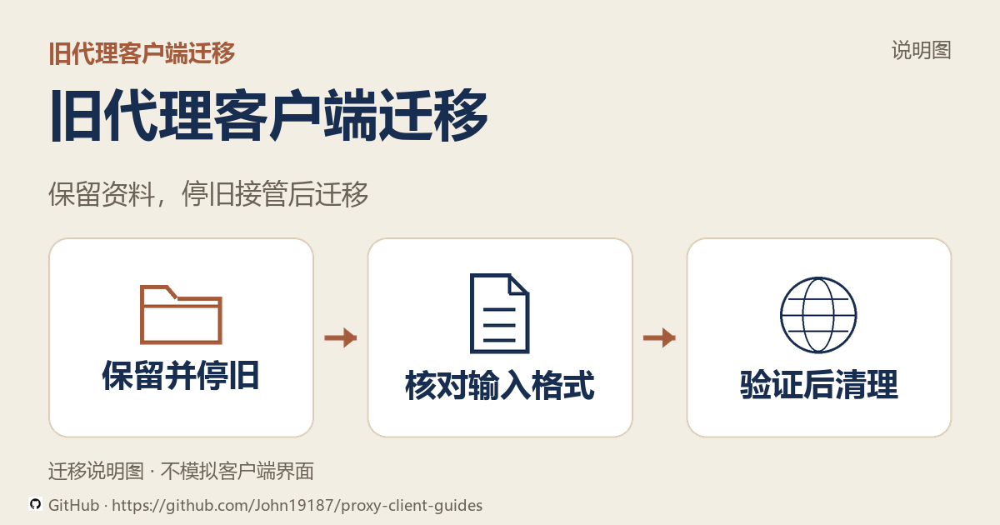

# 2026年 旧客户端迁移目录：CFW、CFA、ClashX和NekoRay该换哪款

先确认旧程序的完整名称，再从下面进入对应迁移教程。CFW可转Clash Verge Rev，Android原CFA可选CMFA或FlClash，Mac的ClashX与Pro需要按各自接管方式退出，NekoRay电脑用户则要区分订阅、单节点和个人路由。

迁移先保留旧程序及资料，停止旧连接后再让新软件接管；新软件能完成原来的访问任务，再决定是否卸载旧版。已有服务能提供目标格式，就可以继续用，不必把换软件和换服务一起做。

## 看完整名称，进入对应教程

点旧软件“关于”，记下名称、版本和设备系统。按项目完整名称区分ClashX、Pro、Meta；NekoBox For PC和Android NekoBox也不是同一个项目。

| 旧软件与设备 | 迁移教程 | 需要保留的资料 |
|---|---|---|
| 桌面Clash for Windows／CFW，左侧有Profiles | [CFW保存配置并迁到Rev](../cfw/README.md#migration) | 订阅URL、本地YAML、解析器与个人规则 |
| Android原Clash for Android／CFA | [CFA迁到CMFA或FlClash](../cfa/README.md#migration) | 订阅和旧配置、个人规则、Android旧VPN关联 |
| Mac名称为ClashX，没有Pro或Meta | [ClashX迁到Meta](../clashx/README.md#migration) | 托管URL、本地文件、登录项 |
| Mac名称明确为ClashX Pro | [Pro退出增强模式后迁移](../clashx-pro/README.md#stop-old) | 配置、增强模式与系统代理原状态 |
| zzzgydi旧Clash Verge，历史1.3.8等版本 | [旧Verge迁到Rev](../old-clash-verge/README.md#migration) | 订阅、覆写、DNS和完整旧目录 |
| 桌面NekoRay／NekoBox For PC | [NekoRay迁到v2rayN或Hiddify](../nekoray/README.md#migration) | 订阅、单节点、路由及完整便携目录 |

旧程序打不开，先保留已安装应用名称、原文件名和目录，再按现有资料辨认。不要为了看名字先卸载或装同名改包。需要按当前系统比较目标软件，进入[2026年机场通用客户端汇总与下载教程](../../README.md#choose)，按目标自己的系统要求选包。

## CFW和CFA：重新导入，不期待旧目录自动接续

CFW迁入Rev时，先保存Profiles的URL和文件，再关闭System Proxy及启用过的TUN。CFW解析器、软件设置可能不在YAML里，按[CFW迁移步骤](../cfw/README.md#migration)另存作参照，不整套覆盖Rev目录。

CFA与CMFA是不同发行项目。手机先保留旧资料，按[CFA迁移步骤](../cfa/README.md#migration)停止旧VPN，再在新App允许系统连接请求；旧“始终开启VPN”关联也按实际设置处理。

## Mac的ClashX与Pro：退出的开关不同

普通ClashX取消“设置为系统代理”、关闭旧登录项后退出。Pro启用过增强模式，还要先关闭增强模式，系统代理与增强模式分别关闭。分别见[普通ClashX迁移](../clashx/README.md#migration)和[Pro关闭增强模式与恢复网络](../clashx-pro/README.md#stop-old)。

安装来源和应用完整名称一起核对。已经是ClashX Meta，则继续用[Meta订阅更新和备份](../clashx-meta/README.md#update)，无需按旧ClashX再次迁移。

## 旧Verge和NekoRay：保留项目各自的数据

旧`zzzgydi/clash-verge`于2023年11月3日归档，Rev独立维护。按[旧Verge迁移](../old-clash-verge/README.md#import)先用兼容订阅完成访问，再迁必要覆写，不用旧目录覆盖新端。

`MatsuriDayo/nekoray`于2025年3月17日归档，原README称“NekoBox For PC”，面向Windows／Linux。它与[Android NekoBox](../nekobox/README.md#packages)独立；电脑保存订阅、单节点和路由后，再按[NekoRay迁移教程](../nekoray/README.md#import)选择新客户端，手机APK不能用于桌面迁移。

## 旧程序打不开，用手里的来源继续

| 手里的内容 | 能接续什么 |
|---|---|
| 服务账户和订阅URL | 从账户取得目标格式，在新软件重新添加并更新 |
| 本地YAML、JSON等完整配置 | 保留原文件，按目标软件支持的配置结构导入；没有远程来源就不一定能自动更新 |
| 单节点分享链接 | 迁移这台服务器的连接参数，不包含客户端另设的完整路由和DNS |
| 便携软件原目录 | 保留程序、配置与资源，便于找回未导出的个人修改 |

完整配置、订阅URL与单节点各有入口，见[订阅格式选择](../../subscription-formats.md#format-table)。改后缀不能完成转换；目标不支持某个协议或自定义核心时，保留原参数，取得适配内容再继续。

已有兼容账户直接沿用。服务只允许自有App登录，可比较[多家VPN推荐与推广中的接入方式](https://github.com/John19187/The-40-Best-VPNs#翻墙客户端与使用方式怎么选)；需要通用订阅，则看[多家机场推荐与推广的格式、流量及设备条件](https://github.com/John19187/ji-chang-tui-jian#airport-clients)。先分清账户限制和软件输入，避免为一次配置错误重复购买。

## 新软件完成访问后，再恢复个人修改

在所选新客户端导入兼容内容、选择节点并启动，完成原来需要的网页或应用访问。然后恢复必要的个人规则与DNS；某项加入后才失败，就撤回该项，保留可用默认配置。

浏览器能用但某个应用失败，按新软件教程判断它是否读取系统代理。退出后普通网页也不通，按[系统网络恢复](../../README.md#restore-and-report)撤回本次改动。新旧软件单独运行都出现多节点故障时，核对账户和你所用服务商的首页公告，再用同一节点比较另一条自己的网络。

日后节点变化就在新软件更新订阅，程序升级走新项目的正式渠道。旧程序不再自动启动，原资料留到需要的修改都已迁出，再决定是否清理。

维护状态与资料来源

状态采用2026-11-14冻结核验，原仓不可访问只表示当次公开访问结果。

- [旧Clash Verge项目](https://github.com/zzzgydi/clash-verge)：归档日期2023-11-03。
- [NekoRay项目](https://github.com/MatsuriDayo/nekoray)：归档日期2025-03-17，README保Windows／Linux及不再维护说明。
- [Android NekoBox项目](https://github.com/MatsuriDayo/NekoBoxForAndroid)：独立于NekoRay。
- 原CFW为`Fndroid/clash_for_windows_pkg`，原ClashX为`yichengchen/clashX`，当次公开地址均返回404，准确停更日期未据此推定。
- 各目标的完整操作、适用版本、原图与来源见对应教程；封面及迁移顺序图为本仓制作。

## 文档更新记录

展开文档更新记录

- 2026-11-16　折叠更新记录，收起许可说明，撤下不必要的维护数据与贡献提示入口。

- 2026-11-16　补充文末客户端与免费节点目录、文档维护入口；整理图源与版本说明，保留原安装包和操作内容。

## 客户端与相关资源目录

按设备和配置类型进入对应教程；旧版条目用于识别与迁移。软件之间的订阅、配置和备份条件仍以各篇说明为准。

展开客户端目录（含旧版与迁移说明）

| 客户端 | 设备或范围 | 教程用途 |
|---|---|---|
| **旧客户端迁移目录（本篇）** | 旧版资料 | 按原客户端寻找迁移说明 |
| [Clash Verge Rev](../clash-verge-rev/README.md) | Windows／macOS／Linux | Clash／Mihomo配置与系统代理 |
| [FlClash](../flclash/README.md) | 电脑／Android | 跨平台下载、导入与连接 |
| [Clash Party](../clash-party/README.md) | Windows／macOS／Linux | 安装版、便携版与订阅管理 |
| [Clash Mi](../clash-mi/README.md) | 跨平台 | 按本款入口导入Clash配置 |
| [ClashX Meta](../clashx-meta/README.md) | macOS | 菜单栏客户端与Mihomo配置 |
| [v2rayN](../v2rayn/README.md) | 电脑 | 节点订阅与系统代理 |
| [Hiddify](../hiddify/README.md) | 电脑／手机 | 跨平台导入与连接 |
| [Karing](../karing/README.md) | 电脑／手机 | 配置、规则与备份 |
| [Clash Meta for Android](../cmfa/README.md) | Android | Clash配置与VPN授权 |
| [v2rayNG](../v2rayng/README.md) | Android | 节点订阅与VPN连接 |
| [NekoBox for Android](../nekobox/README.md) | Android历史版本 | 1.4.2旧版订阅与迁移 |
| [Surfboard](../surfboard/README.md) | Android | 兼容配置与启动连接 |
| [sing-box](../sing-box/README.md) | 多平台 | 版本匹配的JSON配置 |
| [Shadowrocket](../shadowrocket/README.md) | iPhone／iPad | 节点、订阅与VPN连接 |
| [Stash](../stash/README.md) | Apple设备 | 按本款条件导入Clash类配置 |
| [Quantumult X](../quantumult-x/README.md) | iPhone／iPad | 节点资源与完整配置的区别 |
| [Loon](../loon/README.md) | iPhone／iPad | 订阅、策略与分流 |
| [Surge](../surge/README.md) | iOS／macOS | 按平台配置与接管流量 |
| [OpenClash](../openclash/README.md) | OpenWrt | 固件条件、配置与插件 |
| [PassWall](../passwall/README.md) | OpenWrt | 订阅节点与主开关 |
| [ShellCrash](../shellcrash/README.md) | Linux／路由器 | 安装脚本与运行条件 |
| [Nextin](../provider-app/README.md) | 按服务公开支持范围 | 服务指定Nextin时的安装与连接 |
| [Clash for Windows](../cfw/README.md) | 旧版／迁移 | 识别旧配置并迁移 |
| [Clash for Android](../cfa/README.md) | Android旧版／迁移 | 原版CFA与CMFA分开 |
| [ClashX](../clashx/README.md) | macOS旧版 | 普通ClashX身份与迁移 |
| [ClashX Pro](../clashx-pro/README.md) | macOS历史版本 | Pro托管配置与增强模式 |
| [旧Clash Verge](../old-clash-verge/README.md) | 旧版／迁移 | 与Rev区分及迁移 |
| [NekoRay](../nekoray/README.md) | 电脑旧版／迁移 | 旧资料与替代客户端 |

| 相关文档 | 内容 |
|---|---|
| [VPN推荐与使用方式](https://github.com/John19187/The-40-Best-VPNs) | 比较服务的平台、接入方式与客户端 |
| [机场推荐与套餐比较](https://github.com/John19187/ji-chang-tui-jian) | 比较月付、按量与套餐条件 |
| [2026年机场通用客户端汇总与下载教程](../../README.md#choose) | 按设备选软件并进入具体教程 |
| [机场与代理工具科普指南](https://github.com/John19187/ssr-v2ray-trojan-clash-guide) | 理解机场、协议、客户端、订阅与线路 |
| [免费节点与订阅资源](https://github.com/John19187/v2ray-SSR-Clash-Verge-Shadowrocke) | 查看公开资源与导入说明，不承诺持续可用 |

开源维护与许可

本文由John19187统一整理维护，实际修改记录见本页更新日志。原创文档采用[MIT许可](../../LICENSE)；软件、商标及第三方材料的权利与使用范围见[素材说明](../../NOTICE)。

本仓整理客户端下载与使用文档，不是客户端官方项目；软件是否开源、收费及其许可由各开发者分别决定。

