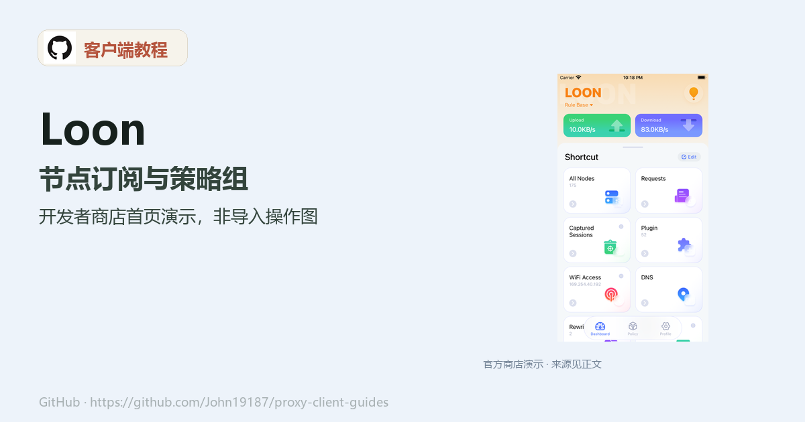
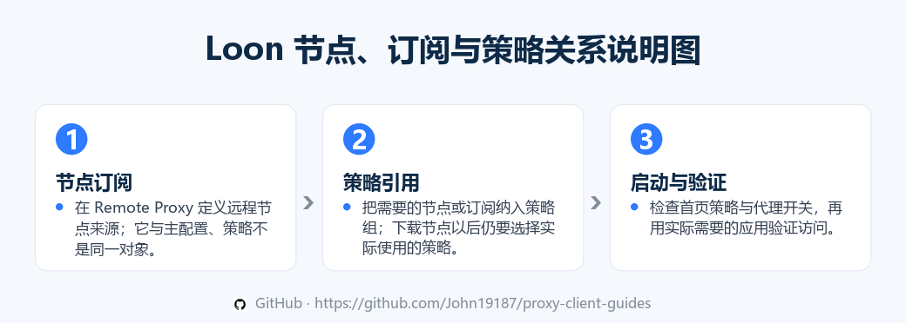
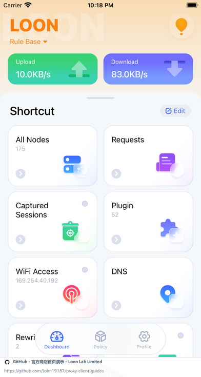

# 2026年 Loon下载与配置教程：iPhone导入订阅，设置策略并连接

Loon从App Store安装。已有兼容服务时，先添加Loon节点订阅或完整配置，再到策略页选择要使用的节点，最后开启连接。订阅里看到了节点，只说明下载完成；下面把添加、策略选择和连接分开说明。

**下载：** [Loon 官方 App Store 条目](https://apps.apple.com/us/app/loon/id1373567447) · [订阅节点怎样导入](#import) · [连接与停止](#connect) · [更新和换设备](#update)

## Loon正式App Store下载与安装准备

官方商店条目的开发者为 **Loon Lab Limited**，商店 ID 是 **1373567447**。本页核对的3.5.3版本要求iOS／iPadOS 15或更高，下载前在自己的商店查看设备兼容和地区供给。下面按iPhone和iPad说明安装与连接。

打开上方商店条目，确认名称和开发者，用自己的账户按商店提示取得并安装。Loon与Loon Lite是不同条目，不能只看名字相近就当成同一款。安装包不从第三方IPA站获取。

购买Loon软件不附送节点。已有服务时，先在账户中找明确支持Loon的订阅或配置；还没有服务，可以在[机场推荐帖](https://github.com/John19187/ji-chang-tui-jian#airport-clients)比较订阅格式、设备限制和套餐。只有专属App登录的账户，不能直接填进Loon当订阅。

## 完整配置与节点订阅，走哪条导入路线

先在服务账户查看提供的是“Loon节点订阅”还是“完整Loon配置”。节点订阅是一组服务器记录；完整配置还包含策略组和规则，告诉Loon哪些节点放在一起、哪些网站使用哪一组。已有完整配置的人，通常可以沿用里面安排好的组；只取得节点订阅时，则需要把这些节点加入可选择的策略组。

账户没有Loon入口时，先向服务方确认格式。Loon支持本款标准节点及文档列明的协议链接、Base64内容和带特定段落的订阅文件，但不能因此把完整Clash YAML或Quantumult X配置直接拿来替换。

**已有完整Loon配置：**保存当前文件，按服务提供的Loon配置入口载入并选择新配置，再到[策略与连接](#connect)继续。完整配置通常已经安排好策略组和规则，沿用它即可。

**只增加一组服务器：**保留现有主配置，按下面的“订阅节点”入口添加来源。已有手动选择组的沿用原组；从空白配置开始，需要策略组与规则一同安排，不能只加节点就期待完成分流。

### 在Profile添加节点订阅

英文`Profile`是配置区，`Policy`是策略区。开发者旧手册把首页的策略模块称为`Strategy`；看到这一名称时，处理的也是策略组选择。下面从配置区添加订阅，再回策略区选择节点。

1. 复制账户明确提供的Loon节点订阅。在Loon进入 **Profile → Subscription Node → +**，添加订阅记录。
2. 填写容易辨认的名称和完整订阅URL，提交保存并下载。等待该订阅展开出节点；若报下载或解析错误，保留原配置，按下方分支处理。
3. 回配置区查看策略组。已有配置包含手动选择组时，沿用这组；从空白配置开始，则在 **Profile → Policy Group → +** 新建手动选择组，将需要使用的本地或订阅节点加入，保存。
4. 打开 **Policy／策略**；旧版首页对应 **Strategy** 模块。进入刚配置的手动选择组，点击一个实际节点。订阅下载结果页只是查看服务器列表，不能在那一页完成策略选择。

关系图把下载节点、策略组选节点和启动分开。已经有完整可用配置的人，沿用原策略组，无需重复建组。

当前主配置中，远程节点订阅记录在`[Remote Proxy]`，单个本地节点记录在`[Proxy]`，策略组则在`[Proxy Group]`。这些段落帮助辨认导入的对象，不需要为了首次连接抄写一整套网上配置。只有单条节点分享链接时，使用软件对应的单节点、剪贴板或扫码入口，再由策略选择它；二维码本身不把单节点变成可更新的订阅。

**订阅下载成功却不能点选节点：** 回Policy／策略选择手动组中的节点。若组里为空，查看成员是否包含新订阅，以及筛选有没有排除全部节点。`DIRECT`表示直连，不是代理节点。新建一个组也不会自动让流量使用它：主配置的规则还要指向该组。第一次配置不清楚规则怎样设置时，优先取得服务提供的完整Loon配置，保留现有文件，不把空白配置加几个节点就当成已完成分流。

**下载失败或返回401／403：** 检查账户有效状态、个人URL和服务要求的下载窗口。取得的是账户首页时，重新复制订阅按钮提供的地址。**解析失败：** 回账户确认Loon格式；不把改后缀当转换，也不先删除能用的旧配置。更多区别见[订阅格式与导入错误](../../subscription-formats.md#import-errors)。

## 在Policy选好策略，再启动Loon

图中Dashboard是首页，底部Policy进入策略、Profile进入配置。选好节点后回Dashboard，右上角灯泡形图标用于控制连接；这里演示的是运行中的界面。

1. 回Dashboard，点击右上角连接控制，使Loon开始运行。当前规则应当指向已选节点或策略组；已有完整配置保留原有分流，不把所有直连项改成代理。
2. iOS首次要求添加VPN配置时，确认App是Loon，允许后在自己的设备完成系统验证。另一款个人VPN正在连接时，先在那款App停止，再启动Loon。
3. 打开Safari访问实际需要的网站，再使用目标应用。完成原来的访问任务，才说明当前配置满足这次使用需要。

普通连接不要求安装未知根证书、开启MitM或导入一套脚本插件。Loon提供这些调试功能，但它们不属于节点导入的必经步骤。

**VPN开着却不通：** 先看选中的策略是否真的使用代理节点，再看请求命中的规则和错误。请求走`DIRECT`或被`REJECT`拒绝，要处理相应策略；握手、认证或解析错误则保留具体错误，核对节点和配置。不用一次探测失败就删除所有订阅。

只有蜂窝或Wi-Fi失败时，在系统设置查看Loon是否获准使用相应网络，再用同一节点比较另一条自己的网络。多个节点同时异常，还需检查账户和本家公告，核对故障是否涉及所用地区及网络。普通停用回Loon首页关闭连接；若本次另设了自动连接，撤回该项后再看系统VPN状态。其他软件的恢复入口见[客户端网络恢复](../../README.md#restore-and-report)。

## 怎样更新节点，换手机时保留哪些资料

服务新增或更换节点时，在Profile的订阅节点列表找到此前添加的订阅，执行更新。保持原记录可以继续沿用配置中的关联；只有服务明确更换个人URL时，才修改保存的地址。新节点名称变化后，回Policy／策略查看手动组的选择，无需反复新增同名订阅。

托管的是整份配置时，远程更新可能覆盖直接写进配置文件的修改；更新前保存自己的规则与配置副本。程序升级则从自己的App Store账户完成，不能用重置订阅地址代替升级软件。

换到新iPhone，先确认服务允许新增设备，再安装Loon、导入兼容配置并处理新设备VPN授权。改用[Shadowrocket添加订阅](../shadowrocket/README.md#import)或[Stash导入完整配置](../stash/README.md#import)，从原服务重取目标格式。其他平台见[2026年机场通用客户端汇总与下载教程](../../README.md#choose)。

考虑改用账号登录App，可比较[多家VPN推荐与推广的接入方式和设备支持](https://github.com/John19187/The-40-Best-VPNs#翻墙客户端与使用方式怎么选)；需要Loon订阅，则比较[多家机场推荐与推广的客户端和套餐条件](https://github.com/John19187/ji-chang-tui-jian#airport-clients)。软件与服务分别选择，已有兼容来源直接继续。

日常使用主要是选择策略中的节点和刷新原订阅。保留已经能工作的配置，停用时关闭Loon连接，迁移前保存本地规则，之后仍能分清自己更新的是节点、配置文件还是App。

来源注释与开发者资料

资料整理至2026年11月14日。配置区添加菜单参考开发者手册；旧版Strategy与商店演示中的Policy名称分别保留，节点、策略组和规则按现行文档区分。

- [Loon官方商店](https://apps.apple.com/us/app/loon/id1373567447)
- [Loon开发者文档](https://nsloon.app/docs/intro/)
- [订阅节点与输入格式](https://nsloon.app/docs/Node/subscription/)
- [策略与流量走向](https://nsloon.app/docs/Policy/)
- [手动和自动策略组](https://nsloon.app/docs/Policy/policygroup/)
- [开发者历史手册中的添加与策略菜单](https://github.com/Loon0x00/LoonManual/blob/master/README.md)
- Dashboard图片为开发者商店演示，原图未标版本，仅说明Dashboard、Policy、Profile和连接入口；节点、策略关系图为本仓制作。

## 文档更新记录

展开文档更新记录

- 2026-11-16　折叠更新记录，收起许可说明，撤下不必要的维护数据与贡献提示入口。 下载区标题标明本文固定版本或独立商店渠道，保原下载文件与旧锚。

- 2026-11-16　补充文末客户端与免费节点目录、文档维护入口；整理图源与版本说明，保留原安装包和操作内容。

## 客户端与相关资源目录

按设备和配置类型进入对应教程；旧版条目用于识别与迁移。软件之间的订阅、配置和备份条件仍以各篇说明为准。

展开客户端目录（含旧版与迁移说明）

| 客户端 | 设备或范围 | 教程用途 |
|---|---|---|
| **Loon（本篇）** | iPhone／iPad | 订阅、策略与分流 |
| [Clash Verge Rev](../clash-verge-rev/README.md) | Windows／macOS／Linux | Clash／Mihomo配置与系统代理 |
| [FlClash](../flclash/README.md) | 电脑／Android | 跨平台下载、导入与连接 |
| [Clash Party](../clash-party/README.md) | Windows／macOS／Linux | 安装版、便携版与订阅管理 |
| [Clash Mi](../clash-mi/README.md) | 跨平台 | 按本款入口导入Clash配置 |
| [ClashX Meta](../clashx-meta/README.md) | macOS | 菜单栏客户端与Mihomo配置 |
| [v2rayN](../v2rayn/README.md) | 电脑 | 节点订阅与系统代理 |
| [Hiddify](../hiddify/README.md) | 电脑／手机 | 跨平台导入与连接 |
| [Karing](../karing/README.md) | 电脑／手机 | 配置、规则与备份 |
| [Clash Meta for Android](../cmfa/README.md) | Android | Clash配置与VPN授权 |
| [v2rayNG](../v2rayng/README.md) | Android | 节点订阅与VPN连接 |
| [NekoBox for Android](../nekobox/README.md) | Android历史版本 | 1.4.2旧版订阅与迁移 |
| [Surfboard](../surfboard/README.md) | Android | 兼容配置与启动连接 |
| [sing-box](../sing-box/README.md) | 多平台 | 版本匹配的JSON配置 |
| [Shadowrocket](../shadowrocket/README.md) | iPhone／iPad | 节点、订阅与VPN连接 |
| [Stash](../stash/README.md) | Apple设备 | 按本款条件导入Clash类配置 |
| [Quantumult X](../quantumult-x/README.md) | iPhone／iPad | 节点资源与完整配置的区别 |
| [Surge](../surge/README.md) | iOS／macOS | 按平台配置与接管流量 |
| [OpenClash](../openclash/README.md) | OpenWrt | 固件条件、配置与插件 |
| [PassWall](../passwall/README.md) | OpenWrt | 订阅节点与主开关 |
| [ShellCrash](../shellcrash/README.md) | Linux／路由器 | 安装脚本与运行条件 |
| [Nextin专用客户端](../provider-app/README.md) | 按服务公开支持范围 | 仅适用于已证实的服务条件 |
| [Clash for Windows](../cfw/README.md) | 旧版／迁移 | 识别旧配置并迁移 |
| [Clash for Android](../cfa/README.md) | Android旧版／迁移 | 原版CFA与CMFA分开 |
| [ClashX](../clashx/README.md) | macOS旧版 | 普通ClashX身份与迁移 |
| [ClashX Pro](../clashx-pro/README.md) | macOS历史版本 | Pro托管配置与增强模式 |
| [旧Clash Verge](../old-clash-verge/README.md) | 旧版／迁移 | 与Rev区分及迁移 |
| [NekoRay](../nekoray/README.md) | 电脑旧版／迁移 | 旧资料与替代客户端 |
| [旧客户端迁移目录](../legacy/README.md) | 旧版资料 | 按原客户端寻找迁移说明 |

| 相关文档 | 内容 |
|---|---|
| [VPN推荐与使用方式](https://github.com/John19187/The-40-Best-VPNs) | 比较服务的平台、接入方式与客户端 |
| [机场推荐与套餐比较](https://github.com/John19187/ji-chang-tui-jian) | 比较月付、按量与套餐条件 |
| **2026年机场通用客户端汇总与下载教程（本文档仓）** | 按设备选软件并进入具体教程 |
| [机场与代理工具科普指南](https://github.com/John19187/ssr-v2ray-trojan-clash-guide) | 理解机场、协议、客户端、订阅与线路 |
| [免费节点与订阅资源](https://github.com/John19187/v2ray-SSR-Clash-Verge-Shadowrocke) | 查看公开资源与导入说明，不承诺持续可用 |

开源维护与许可

本文由John19187统一整理维护，实际修改记录见本页更新日志。原创文档采用[MIT许可](../../LICENSE)；软件、商标及第三方材料的权利与使用范围见[素材说明](../../NOTICE)。

本仓整理客户端下载与使用文档，不是客户端官方项目；软件是否开源、收费及其许可由各开发者分别决定。

