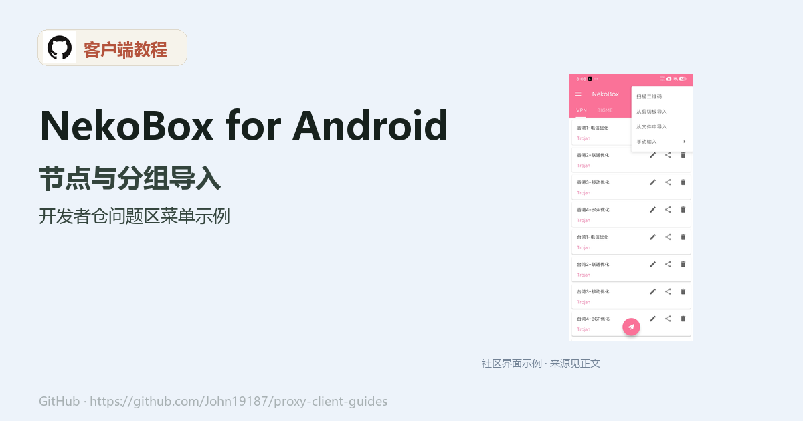
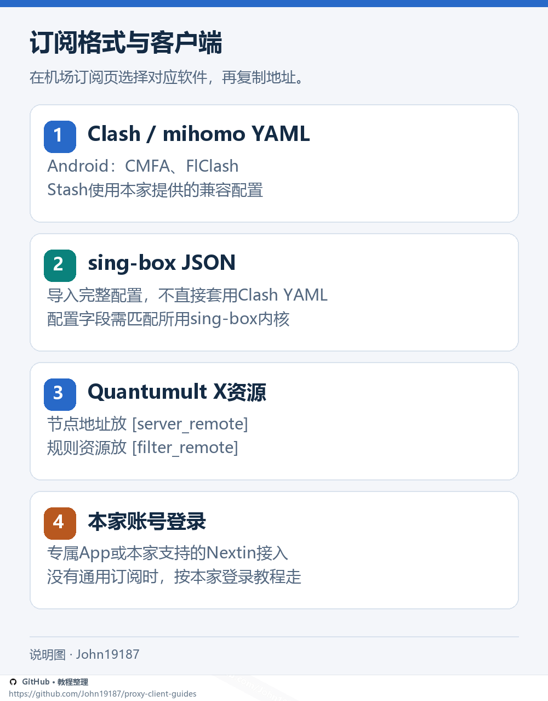
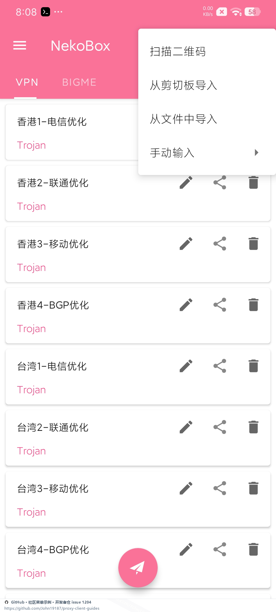

# 2026年 NekoBox for Android旧版使用与迁移：1.4.2下载、订阅分组和备份

NekoBox for Android是MatsuriDayo的手机客户端，与桌面的NekoRay分别发行。下面保留1.4.2历史APK，适合继续使用已有配置或准备迁移的人；订阅地址放进“分组”，下载节点后再选服务器连接，单节点则走“从剪切板导入”。

[下载历史APK](#packages) · [添加订阅分组](#subscription) · [导入单节点](#single-node)。其他设备软件见[2026年机场通用客户端汇总与下载教程](../../README.md#choose)。

## NekoBox for Android 1.4.2旧版APK下载

本页提供 MatsuriDayo/NekoBoxForAndroid 的 1.4.2 历史发行包，面向继续使用已有配置或准备迁移的 Android 用户。桌面 [NekoRay](../nekoray/README.md) 是另一项目，不能把两者的安装文件互用。

开发者说明 Google Play 同名版本从 2024 年 5 月起由第三方控制，因此这里沿原仓 APK 下载。ARM64 设备选 arm64-v8a，32 位 ARM 选 armeabi-v7a，x86、x86_64 用于对应架构的设备或模拟器。

| 平台／CPU | 1.4.2历史APK直链 |
|---|---|
| Android | **APK：** [NekoBox-1.4.2-arm64-v8a.apk](https://github.com/MatsuriDayo/NekoBoxForAndroid/releases/download/1.4.2/NekoBox-1.4.2-arm64-v8a.apk) **APK：** [NekoBox-1.4.2-armeabi-v7a.apk](https://github.com/MatsuriDayo/NekoBoxForAndroid/releases/download/1.4.2/NekoBox-1.4.2-armeabi-v7a.apk) **APK：** [NekoBox-1.4.2-x86.apk](https://github.com/MatsuriDayo/NekoBoxForAndroid/releases/download/1.4.2/NekoBox-1.4.2-x86.apk) **APK：** [NekoBox-1.4.2-x86_64.apk](https://github.com/MatsuriDayo/NekoBoxForAndroid/releases/download/1.4.2/NekoBox-1.4.2-x86_64.apk) |

## 安装前保存现有资料

已有 NekoBox 时，在“备份”保存“分组和配置”，另存必要路由及自定义内容。备份可能含个人订阅与服务器认证资料，放在自己控制的位置。它是 NekoBox 内部数据，不能直接拿给其他客户端恢复。

下载后打开 APK，按 Android 安装器安装；需要来源权限时只给当前下载器授权。签名冲突或系统不兼容先取消，保住旧 App 与数据，再核对来源，不为覆盖成功先卸载未备份的软件。

## 保存订阅URL，再更新这一组

订阅组保存远程下载来源，以后可更新整组节点。NekoBox 的普通订阅读取受支持的服务器资料；它与加载整份 Clash 配置不同。

已有服务时，在该服务账户取得NekoBox支持的节点订阅。需要另选服务，可比较[多家VPN推荐与推广的接入方式](https://github.com/John19187/The-40-Best-VPNs#翻墙客户端与使用方式怎么选)或[多家机场推荐与推广的格式、设备条件](https://github.com/John19187/ji-chang-tui-jian#airport-clients)。

1. 打开左上“☰ → 分组”，点“+”创建组，填写便于辨认来源的名称。
2. “分组类型”选“订阅”，进入“订阅设置”，把个人完整 URL 填入“订阅链接”，点右上对勾保存。
3. 回分组页，对这条记录执行“更新当前组订阅”。显示配置数量后，返回主页查看该组服务器。

一个订阅组保存一个链接，不把两家地址拼在同一框内。提示组类型不是订阅，就回组设置修改类型；提示没有找到服务器配置，再核对地址及支持格式，不先删除旧组。

说明图比较完整配置与节点资源。**Clash 订阅中的分流规则为什么没有迁入？** NekoBox 普通订阅解析节点，不会同时迁入那份 Clash 配置的规则。可以按 NekoBox 的方式安排路由，或使用能加载原完整配置的软件，具体区别见[配置与节点资源对照](../../subscription-formats.md#format-table)。

## 从链接或文件导入节点

只有一条受支持的分享链接时：

1. 复制完整链接，回 NekoBox 主页的服务器列表，打开添加菜单。
2. 选择“从剪切板导入”，等新服务器出现在列表，再点选它。

提示剪切板没有服务器配置，就重新复制纯链接，不带节点介绍文字。

菜单里的“从剪切板导入”接收已复制的链接；文件与二维码使用各自入口。节点名称按本人的来源辨认，不复制画面中的服务器名称作为参数。

文件使用“从文件中导入”，二维码使用扫描入口，具体类型按开发者支持范围选择。单节点没有持续更新来源；sn:// 属于内部存储格式，也不能保证跨版本兼容。

**必须装全部代理插件吗？** 不需要。只有节点所用协议明确需要外部运行组件时，才按开发者插件说明安装对应组件；已安装的插件可在“关于”页面查看。内置协议不必因此全部加装。

## 启动 VPN 与分应用设置

另一款 VPN 或占用 VPN 通道的工具仍在运行时，先停止它。然后：

1. 在主页点选一个实际服务器，点击底部圆形纸飞机连接按钮。
2. 首次 Android 请求创建 VPN 时，确认来自 NekoBox 后允许。
3. 打开目标网页，再试实际应用。

提示“请选择一个服务器配置”说明还未选节点；权限请求被拒绝则重新确认来自本 App 的系统请求。

分应用设置先决定某个 App 是否进入 NekoBox，路由再决定进入后的请求去向。只有一个 App 失败时，先检查它是否被排除，以及请求实际经过哪条规则；握手报错再核对节点的 TLS、SNI 和传输参数，不同时调整所有网络设置。

多个节点同时失败时，先看账户有效期、剩余流量和你所用服务商的首页公告，核对故障时间、地区及网络；保留同一配置，用自己的热点比较连接结果。

停止使用点同一连接按钮。停止后仍不能普通联网，查看Android是否为NekoBox开启“始终开启的VPN”或“无VPN时阻止连接”，撤回不再需要的旧关联。后台断开结合系统限制与日志判断，内核崩溃不能一概当作省电问题；具体错误按[恢复与求助](../../README.md#restore-and-report)脱敏提供。

## 更新订阅中的节点

回“☰ → 分组”更新原来源。“更新当前组订阅”只处理当前组，“更新所有订阅”范围更大，按需要选择。个人地址确实被重置后，再编辑该组 URL，普通线路变化不必重建分组。

能更新来源并完成目标应用访问后，日常可以继续维护这份分组。需要新的内核能力或准备换软件时，再进入下面的迁移路径。

## 保存备份后迁移到其他客户端

恢复 NekoBox 内部备份可能覆盖现有数据，先保存当前状态，再恢复自己保留的存档。Android 不允许降级覆盖时，也先保住资料，不靠删除未保存数据来安装旧包。

迁移图说明保留、导入与验证的先后。回退到旧端的前提是它原先仍可使用；旧端已经失效时，继续保留资料并处理配置或具体错误。

换[CMFA](../cmfa/README.md#import)需要完整Clash配置，换[sing-box](../sing-box/README.md#import)需要匹配内核的完整JSON；服务给的是v2rayNG入口，则按[v2rayNG订阅分组](../v2rayng/README.md#import)重新添加。先从本人服务取得目标格式，完成新端访问后再整理旧App，NekoBox内部存档不能用于跨软件直接恢复。

来源注释与开发者资料

- [MatsuriDayo/NekoBoxForAndroid 原仓与 Play 版本说明](https://github.com/MatsuriDayo/NekoBoxForAndroid)
- [本页 1.4.2 发行](https://github.com/MatsuriDayo/NekoBoxForAndroid/releases/tag/1.4.2)
- [开发者 Android 配置说明](https://matsuridayo.github.io/nb4a-configuration/)
- [Android 常见问题](https://matsuridayo.github.io/nb4a-faq/)
- [插件范围与来源](https://matsuridayo.github.io/nb4a-plugin/)
- [菜单截图出处：原仓 issue 1204](https://github.com/MatsuriDayo/NekoBoxForAndroid/issues/1204)

版本、商店要求和引用材料的整理日期：2026-11-14。

## 文档更新记录

展开文档更新记录

- 2026-11-16　折叠更新记录，收起许可说明，撤下不必要的维护数据与贡献提示入口。 下载区标题标明本文固定版本或独立商店渠道，保原下载文件与旧锚。

- 2026-11-16　补充文末客户端与免费节点目录、文档维护入口；整理图源与版本说明，保留原安装包和操作内容。

## 客户端与相关资源目录

按设备和配置类型进入对应教程；旧版条目用于识别与迁移。软件之间的订阅、配置和备份条件仍以各篇说明为准。

展开客户端目录（含旧版与迁移说明）

| 客户端 | 设备或范围 | 教程用途 |
|---|---|---|
| **NekoBox for Android（本篇）** | Android历史版本 | 1.4.2旧版订阅与迁移 |
| [Clash Verge Rev](../clash-verge-rev/README.md) | Windows／macOS／Linux | Clash／Mihomo配置与系统代理 |
| [FlClash](../flclash/README.md) | 电脑／Android | 跨平台下载、导入与连接 |
| [Clash Party](../clash-party/README.md) | Windows／macOS／Linux | 安装版、便携版与订阅管理 |
| [Clash Mi](../clash-mi/README.md) | 跨平台 | 按本款入口导入Clash配置 |
| [ClashX Meta](../clashx-meta/README.md) | macOS | 菜单栏客户端与Mihomo配置 |
| [v2rayN](../v2rayn/README.md) | 电脑 | 节点订阅与系统代理 |
| [Hiddify](../hiddify/README.md) | 电脑／手机 | 跨平台导入与连接 |
| [Karing](../karing/README.md) | 电脑／手机 | 配置、规则与备份 |
| [Clash Meta for Android](../cmfa/README.md) | Android | Clash配置与VPN授权 |
| [v2rayNG](../v2rayng/README.md) | Android | 节点订阅与VPN连接 |
| [Surfboard](../surfboard/README.md) | Android | 兼容配置与启动连接 |
| [sing-box](../sing-box/README.md) | 多平台 | 版本匹配的JSON配置 |
| [Shadowrocket](../shadowrocket/README.md) | iPhone／iPad | 节点、订阅与VPN连接 |
| [Stash](../stash/README.md) | Apple设备 | 按本款条件导入Clash类配置 |
| [Quantumult X](../quantumult-x/README.md) | iPhone／iPad | 节点资源与完整配置的区别 |
| [Loon](../loon/README.md) | iPhone／iPad | 订阅、策略与分流 |
| [Surge](../surge/README.md) | iOS／macOS | 按平台配置与接管流量 |
| [OpenClash](../openclash/README.md) | OpenWrt | 固件条件、配置与插件 |
| [PassWall](../passwall/README.md) | OpenWrt | 订阅节点与主开关 |
| [ShellCrash](../shellcrash/README.md) | Linux／路由器 | 安装脚本与运行条件 |
| [Nextin](../provider-app/README.md) | 按服务公开支持范围 | 服务指定Nextin时的安装与连接 |
| [Clash for Windows](../cfw/README.md) | 旧版／迁移 | 识别旧配置并迁移 |
| [Clash for Android](../cfa/README.md) | Android旧版／迁移 | 原版CFA与CMFA分开 |
| [ClashX](../clashx/README.md) | macOS旧版 | 普通ClashX身份与迁移 |
| [ClashX Pro](../clashx-pro/README.md) | macOS历史版本 | Pro托管配置与增强模式 |
| [旧Clash Verge](../old-clash-verge/README.md) | 旧版／迁移 | 与Rev区分及迁移 |
| [NekoRay](../nekoray/README.md) | 电脑旧版／迁移 | 旧资料与替代客户端 |
| [旧客户端迁移目录](../legacy/README.md) | 旧版资料 | 按原客户端寻找迁移说明 |

| 相关文档 | 内容 |
|---|---|
| [VPN推荐与使用方式](https://github.com/John19187/The-40-Best-VPNs) | 比较服务的平台、接入方式与客户端 |
| [机场推荐与套餐比较](https://github.com/John19187/ji-chang-tui-jian) | 比较月付、按量与套餐条件 |
| [2026年机场通用客户端汇总与下载教程](../../README.md#choose) | 按设备选软件并进入具体教程 |
| [机场与代理工具科普指南](https://github.com/John19187/ssr-v2ray-trojan-clash-guide) | 理解机场、协议、客户端、订阅与线路 |
| [免费节点与订阅资源](https://github.com/John19187/v2ray-SSR-Clash-Verge-Shadowrocke) | 查看公开资源与导入说明，不承诺持续可用 |

开源维护与许可

本文由John19187统一整理维护，实际修改记录见本页更新日志。原创文档采用[MIT许可](../../LICENSE)；软件、商标及第三方材料的权利与使用范围见[素材说明](../../NOTICE)。

本仓整理客户端下载与使用文档，不是客户端官方项目；软件是否开源、收费及其许可由各开发者分别决定。

