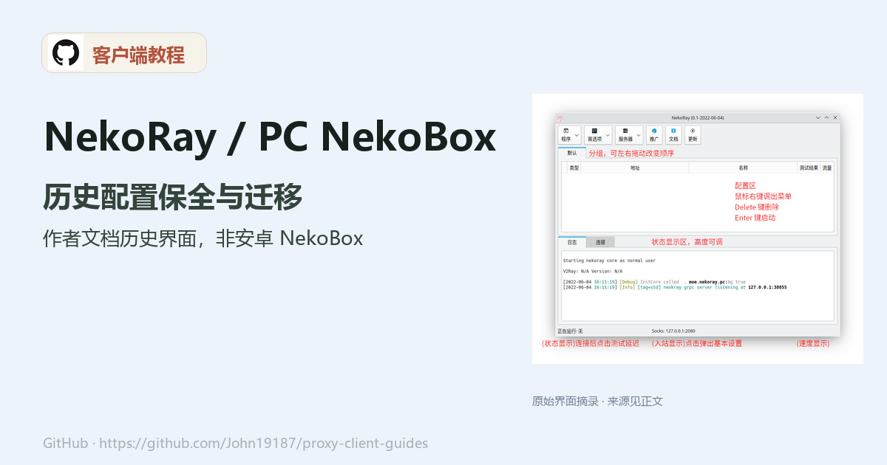

# 2026年 NekoRay迁移教程：保存订阅、单节点和路由，转用v2rayN或Hiddify

NekoRay的Windows／Linux用户，先保存订阅地址、手动节点和个人路由，再关闭旧软件的代理功能，换到当前系统适用的v2rayN或Hiddify。订阅与单节点的导入方式不同，路由和DNS通常也需要单独迁入，不能只导出一条节点链接就当作全部备份。

`MatsuriDayo/nekoray`于**2025年3月17日归档**，原仓明确表示不再维护。原README也使用“NekoBox For PC”名称，面向Windows／Linux；它与[Android NekoBox](../nekobox/README.md)是独立项目，手机APK不用于桌面迁移。

新软件安装入口：[v2rayN下载与系统选择](../v2rayn/README.md#packages) · [Hiddify下载与安装](../hiddify/README.md#packages)。需要比较更多目标，可看[2026年机场通用客户端汇总与下载教程](../../README.md#choose)。

## 保存NekoRay里的订阅、节点与个人规则

保留完整目录，再区分哪些是远程订阅、哪些是自己添加的节点和规则。

1. 退出NekoRay，把原来解压的完整程序目录复制到自己控制的备份位置。便携版旁边的配置和资源也可能需要保留，不能只复制EXE。
2. 用原程序核对当前资料，按下面的类型保存来源和个人修改；目录使用原实际位置，不必先搬到系统路径。

订阅URL让客户端以后继续取得新节点，单节点链接则只描述一台服务器；路由规则决定哪些请求直连、哪些请求走代理。这些资料分别影响后面的导入和分流，按下表保存更容易找回。

| 手里的资料 | 迁移时保留什么 | 在新客户端怎样使用 |
|---|---|---|
| 远程订阅 | 原URL及账户提供的目标客户端格式 | v2rayN订阅分组更新，或Hiddify添加配置 |
| 单节点分享链接 | 完整协议链接 | 目标客户端的剪贴板导入 |
| 手动添加的节点 | 服务器、端口、认证、协议、传输与TLS设置 | 按目标软件支持情况导入或重建 |
| 自定义路由、DNS、出站或核心 | 原配置文件与必要规则 | 先在新客户端完成基本连接，再按它的配置结构迁入 |

来源还在服务账户，优先重取目标客户端支持的订阅，不从屏幕逐个抄节点。只有旧本地节点时，保留完整参数；服务器名称相同不表示传输、TLS与认证字段相同。

**为什么导出节点以后，规则没有一起过去？** 节点链接通常保存服务器连接参数，NekoRay里另外设置的路由和DNS不在这条链接里。自定义出站或核心配置也需要目标软件支持相应结构，先在新软件恢复基本连接，再按它的配置方式迁必要规则。

## 选择接收原订阅的新客户端

需要按分组管理节点、选择活动服务器，进入[v2rayN原包与界面选择](../v2rayn/README.md#packages)。希望按订阅名称选择一组服务器，再从首页连接，可看[Hiddify下载安装](../hiddify/README.md#packages)。两款按当前系统和CPU安装，不以NekoRay曾能运行推断新版本兼容。

远程订阅、单节点和整份配置的区别见[格式选择](../../subscription-formats.md#format-table)。有完整Clash配置并希望保留它的代理组、DNS和规则时，从[客户端目录](../../README.md#choose)选择Mihomo配置客户端，不能只把YAML粘进节点分组就视为整份迁入。

原账户继续提供兼容地址时就沿用。输入格式不适合目标软件，先向原服务取得适配内容，不把列表为空直接判断成需要重新购买。

资料备份好以后，在NekoRay关闭系统代理；使用过TUN虚拟网卡时也关闭TUN，再退出程序并取消旧自启。确认旧程序已经停止，再在下面的新客户端添加资料，避免它们同时改动系统代理。

### 有订阅URL时，在新软件添加并更新

**选择v2rayN：**

1. 打开“订阅分组 → 订阅分组设置”，添加别名和目标格式的URL，确定保存。
2. 从订阅分组菜单更新该组。首次尚无可用代理，选不通过代理的下载路线。
3. 等服务器出现在组内列表，再按下节设为活动服务器，见[v2rayN分组设置图解](../v2rayn/README.md#import)。

**选择Hiddify：**

1. 在Home点“+”。已经复制兼容订阅就选Clipboard；需要手填，选Manually，填写Name与URL后点Add。
2. 回Home顶部配置列表，选刚添加的名称，再按下节连接。对应画面见[Hiddify添加配置](../hiddify/README.md#import)。

### 只有单节点链接时，从剪贴板导入

复制目标软件支持的完整协议链接，用剪贴板节点导入。它没有远程来源时，今后“更新订阅”不会更新这条本地节点；不要为此重复建立空分组。导入后对照原记录核服务器、传输与TLS等必要字段，目标不支持的协议或自定义核心不能靠改名称解决。

## 选择新端的服务器并连接

NekoRay已在安装新软件前停止，接下来只开启所选客户端：

- **v2rayN**：在主列表右键目标服务器，选“设为活动”；再从系统代理菜单选“自动配置系统代理”。详细选择位置见[v2rayN连接步骤](../v2rayn/README.md#connect)。
- **Hiddify**：点Home顶部配置区域，在列表中选刚添加的名称，再点中央连接按钮。电脑普通浏览器可先选System proxy模式，具体分支见[Hiddify电脑连接](../hiddify/README.md#connect)。

用浏览器完成原来的目标访问以后，再迁自己需要的路由规则。没有选择的另一款客户端不必同时开启。

先关NekoRay的代理功能并退出，完成新客户端访问以后再整理旧目录。

## 导入后列表为空，或节点连接失败

分组存在但列表为空，先看订阅下载与解析结果：是否更新过、是否误选依赖未启动代理的下载方式、是否取错格式。节点已出现但连接失败，再看协议、认证、传输与TLS错误。v2rayN 7.25.6移除了`allowInsecure`，证书失败应核设备时间和节点证书，不照旧教程跳过校验。

默认连接可用、迁入旧路由后才失败，撤回该路由改动继续查命中规则。普通网页在退出后也打不开，先撤回本次系统代理遗留，恢复位置见[系统网络恢复](../../README.md#restore-and-report)。这些问题不必先删除仍可用的旧目录或重置服务URL。

新旧客户端都单独试过，多个节点仍在同一时期失败时，检查账户有效期、流量和本家公告；确认迁移后的节点参数，再用同一节点比较另一条自己的网络。

## 迁移完成后，在新客户端管理订阅

服务调整服务器以后，在v2rayN更新对应分组，或在Hiddify更新已保存的配置。节点已经能用时，不必反复导入同一地址；旧NekoRay目录继续用于找回尚未迁入的规则。

更希望使用服务账号直接登录App，可比较[多家VPN推荐与推广中的自有App和设备支持](https://github.com/John19187/The-40-Best-VPNs#翻墙客户端与使用方式怎么选)；需要通用订阅，可看[多家机场推荐与推广的格式、流量和设备条件](https://github.com/John19187/ji-chang-tui-jian#airport-clients)。客户端迁移不要求同时更换服务，确认新端承担日常访问，再决定是否清理旧NekoRay目录。

软件身份、维护状态与迁移目标来源

- [NekoRay原仓](https://github.com/MatsuriDayo/nekoray)：归档日期2025-03-17，README为NekoBox For PC，说明Windows／Linux和不再维护；2026-11-14复核。
- [独立Android NekoBox原仓](https://github.com/MatsuriDayo/NekoBoxForAndroid)
- [v2rayN开发者原仓](https://github.com/2dust/v2rayN)
- [Hiddify开发者原仓](https://github.com/hiddify/hiddify-app)

## 文档更新记录

展开文档更新记录

- 2026-11-16　折叠更新记录，收起许可说明，撤下不必要的维护数据与贡献提示入口。

- 2026-11-16　补充文末客户端与免费节点目录、文档维护入口；整理图源与版本说明，保留原安装包和操作内容。

## 客户端与相关资源目录

按设备和配置类型进入对应教程；旧版条目用于识别与迁移。软件之间的订阅、配置和备份条件仍以各篇说明为准。

展开客户端目录（含旧版与迁移说明）

| 客户端 | 设备或范围 | 教程用途 |
|---|---|---|
| **NekoRay（本篇）** | 电脑旧版／迁移 | 旧资料与替代客户端 |
| [Clash Verge Rev](../clash-verge-rev/README.md) | Windows／macOS／Linux | Clash／Mihomo配置与系统代理 |
| [FlClash](../flclash/README.md) | 电脑／Android | 跨平台下载、导入与连接 |
| [Clash Party](../clash-party/README.md) | Windows／macOS／Linux | 安装版、便携版与订阅管理 |
| [Clash Mi](../clash-mi/README.md) | 跨平台 | 按本款入口导入Clash配置 |
| [ClashX Meta](../clashx-meta/README.md) | macOS | 菜单栏客户端与Mihomo配置 |
| [v2rayN](../v2rayn/README.md) | 电脑 | 节点订阅与系统代理 |
| [Hiddify](../hiddify/README.md) | 电脑／手机 | 跨平台导入与连接 |
| [Karing](../karing/README.md) | 电脑／手机 | 配置、规则与备份 |
| [Clash Meta for Android](../cmfa/README.md) | Android | Clash配置与VPN授权 |
| [v2rayNG](../v2rayng/README.md) | Android | 节点订阅与VPN连接 |
| [NekoBox for Android](../nekobox/README.md) | Android历史版本 | 1.4.2旧版订阅与迁移 |
| [Surfboard](../surfboard/README.md) | Android | 兼容配置与启动连接 |
| [sing-box](../sing-box/README.md) | 多平台 | 版本匹配的JSON配置 |
| [Shadowrocket](../shadowrocket/README.md) | iPhone／iPad | 节点、订阅与VPN连接 |
| [Stash](../stash/README.md) | Apple设备 | 按本款条件导入Clash类配置 |
| [Quantumult X](../quantumult-x/README.md) | iPhone／iPad | 节点资源与完整配置的区别 |
| [Loon](../loon/README.md) | iPhone／iPad | 订阅、策略与分流 |
| [Surge](../surge/README.md) | iOS／macOS | 按平台配置与接管流量 |
| [OpenClash](../openclash/README.md) | OpenWrt | 固件条件、配置与插件 |
| [PassWall](../passwall/README.md) | OpenWrt | 订阅节点与主开关 |
| [ShellCrash](../shellcrash/README.md) | Linux／路由器 | 安装脚本与运行条件 |
| [Nextin专用客户端](../provider-app/README.md) | 按服务公开支持范围 | 仅适用于已证实的服务条件 |
| [Clash for Windows](../cfw/README.md) | 旧版／迁移 | 识别旧配置并迁移 |
| [Clash for Android](../cfa/README.md) | Android旧版／迁移 | 原版CFA与CMFA分开 |
| [ClashX](../clashx/README.md) | macOS旧版 | 普通ClashX身份与迁移 |
| [ClashX Pro](../clashx-pro/README.md) | macOS历史版本 | Pro托管配置与增强模式 |
| [旧Clash Verge](../old-clash-verge/README.md) | 旧版／迁移 | 与Rev区分及迁移 |
| [旧客户端迁移目录](../legacy/README.md) | 旧版资料 | 按原客户端寻找迁移说明 |

| 相关文档 | 内容 |
|---|---|
| [VPN推荐与使用方式](https://github.com/John19187/The-40-Best-VPNs) | 比较服务的平台、接入方式与客户端 |
| [机场推荐与套餐比较](https://github.com/John19187/ji-chang-tui-jian) | 比较月付、按量与套餐条件 |
| **2026年机场通用客户端汇总与下载教程（本文档仓）** | 按设备选软件并进入具体教程 |
| [机场与代理工具科普指南](https://github.com/John19187/ssr-v2ray-trojan-clash-guide) | 理解机场、协议、客户端、订阅与线路 |
| [免费节点与订阅资源](https://github.com/John19187/v2ray-SSR-Clash-Verge-Shadowrocke) | 查看公开资源与导入说明，不承诺持续可用 |

开源维护与许可

本文由John19187统一整理维护，实际修改记录见本页更新日志。原创文档采用[MIT许可](../../LICENSE)；软件、商标及第三方材料的权利与使用范围见[素材说明](../../NOTICE)。

本仓整理客户端下载与使用文档，不是客户端官方项目；软件是否开源、收费及其许可由各开发者分别决定。

