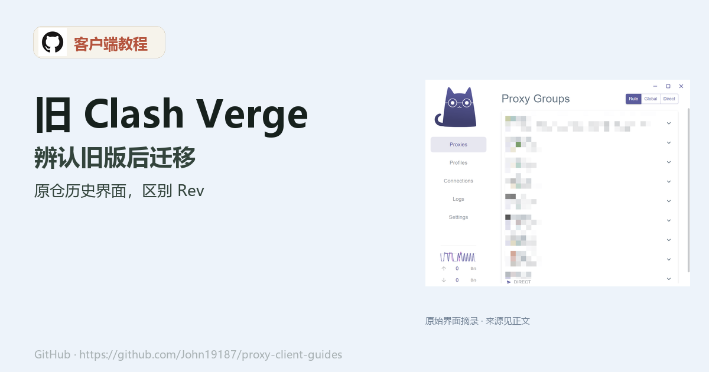

# 2026年 旧Clash Verge迁移到Rev：保留订阅、覆写与回退资料

旧Clash Verge的1.3.8等历史版本与Clash Verge Rev属于不同维护项目。迁移时保存订阅及本机修改，停止旧系统代理和TUN，再在Rev新建兼容配置。先用服务默认配置完成访问，再迁个人规则，旧目录留作备份。

新软件下载见[Clash Verge Rev安装包与系统条件](../clash-verge-rev/README.md#packages)。本篇旧项目指`zzzgydi/clash-verge`，已于**2023年11月3日归档**。不确定身份时，先看“关于”中的名称与版本；其他旧软件可从[旧客户端迁移目录](../legacy/README.md)定位。

## 备份订阅和软件里加过的设置

URL决定以后从哪里取得新配置；本地YAML保存当前内容；覆写则是在服务配置之外增加或修改的设置。比如单独加过DNS或规则，仅复制订阅URL不一定能把这些修改带走。

1. 在旧软件记下当前配置名称和所用服务器，从个人服务账户保留原订阅URL。
2. 使用本地YAML时，复制实际文件；另存DNS、规则、脚本和本机端口等修改。
3. 从旧程序的数据目录入口定位资料，复制完整目录。程序已打不开，就先保全手上原目录，再安装Rev。

文件和个人URL留在自己控制的位置。账户有效并提供Mihomo兼容订阅时，可以继续使用；地址返回登录页、401／403或解析错误，先按[下载与配置错误的区别](../../subscription-formats.md#import-errors)处理。

## 停止旧软件，按设备安装Rev

1. 在旧Verge设置中关闭“系统代理”；启用过TUN的也关闭TUN。
2. 取消开机启动，从系统托盘或菜单栏退出，保留旧程序和备份。
3. 到[Rev下载页](../clash-verge-rev/README.md#packages)按系统、CPU和包型安装Rev。

Windows的x64／ARM64是CPU选择，`fixed_webview2`用于相应界面运行环境；Mac按Intel或Apple芯片选包。当前系统达不到Rev条件，可从[2026年机场通用客户端汇总与下载教程](../../README.md#choose)选兼容目标，不按旧软件的系统门槛强装新版本。

## 在Rev导入订阅，先使用默认配置

1. 打开Rev左侧“订阅”，在“订阅文件链接”粘贴个人Mihomo兼容URL，点击“导入”。只有本地YAML时，按[Rev配置导入说明](../clash-verge-rev/README.md#import)使用文件入口。
2. 等新卡片出现，点选它，到“代理”展开策略组并选择节点。
3. 在“设置”开启“系统代理”，用浏览器打开实际需要的网站。

一键导入仍唤起旧Verge，取消唤起，在Rev手动粘贴URL即可；无需先卸载旧程序。导入后没有节点，保留错误，核对是否选中了本次配置及输入格式，不反复删除重装。

## 网页能用以后，再迁覆写和规则

默认配置已经能完成访问，就可以把自己的DNS、规则或脚本按Rev支持的方式迁入。不要把旧目录整份覆盖到新端；个别设置是否适用，取决于新项目和当前内核。

### 加入旧规则后突然不能连接

撤回最后加入的覆写或脚本，选回未作该修改的配置。默认配置能用，就从造成变化的字段继续查，不重置个人订阅地址，也不删除已经能工作的整份配置。

默认配置本身解析失败，核对Mihomo兼容格式和报错行；提示端口冲突，先看旧Verge是否还在托盘运行。浏览器能用而某个应用失败，进入[Rev系统代理与TUN专题](../../clash-verge-rev-network.md)判断该应用的接管方式。

新旧软件各自单独运行都出现多个节点故障时，先核对账户、流量和本家公告，再用同一节点换自己的热点比较；本地覆写则按其具体报错处理。

## 需要回退时，恢复相配的旧程序与资料

先关闭Rev的系统代理和TUN、完整退出，再打开旧程序及迁移前保存的相配目录。不要拿一个旧EXE覆盖新目录，留下新旧资源混用。异常退出后普通网页也不通，按[系统代理恢复](../../README.md#restore-and-report)撤回本次遗留设置。

如果更希望通过服务账号登录App，可比较[多家VPN推荐与推广的客户端方式](https://github.com/John19187/The-40-Best-VPNs#翻墙客户端与使用方式怎么选)；继续使用通用订阅的人，可比较[多家机场推荐与推广的格式、套餐与设备条件](https://github.com/John19187/ji-chang-tui-jian#airport-clients)。已有兼容服务不必因换软件再购买。

迁移成功后，服务节点变化就在Rev更新对应订阅；升级Rev程序另走它自己的发行渠道。旧目录保留个人改动和恢复依据，日常不再让旧Verge开机运行。

项目状态与操作资料

- [旧Clash Verge原仓](https://github.com/zzzgydi/clash-verge)：归档日期2023-11-03，采用2026-11-14冻结复核。
- [Clash Verge Rev项目](https://github.com/clash-verge-rev/clash-verge-rev)、[订阅管理](https://www.clashverge.dev/guide/profile.html)
- 界面与版本说明：更新于2026-10-12，本地观察于2026-11-07；用于导入、选择配置、节点与系统代理操作，当前安装包见本仓Rev教程。
- 封面与迁移顺序图为本仓制作。

## 文档更新记录

展开文档更新记录

- 2026-11-16　折叠更新记录，收起许可说明，撤下不必要的维护数据与贡献提示入口。

- 2026-11-16　补充文末客户端与免费节点目录、文档维护入口；整理图源与版本说明，保留原安装包和操作内容。

## 客户端与相关资源目录

按设备和配置类型进入对应教程；旧版条目用于识别与迁移。软件之间的订阅、配置和备份条件仍以各篇说明为准。

展开客户端目录（含旧版与迁移说明）

| 客户端 | 设备或范围 | 教程用途 |
|---|---|---|
| **旧Clash Verge（本篇）** | 旧版／迁移 | 与Rev区分及迁移 |
| [Clash Verge Rev](../clash-verge-rev/README.md) | Windows／macOS／Linux | Clash／Mihomo配置与系统代理 |
| [FlClash](../flclash/README.md) | 电脑／Android | 跨平台下载、导入与连接 |
| [Clash Party](../clash-party/README.md) | Windows／macOS／Linux | 安装版、便携版与订阅管理 |
| [Clash Mi](../clash-mi/README.md) | 跨平台 | 按本款入口导入Clash配置 |
| [ClashX Meta](../clashx-meta/README.md) | macOS | 菜单栏客户端与Mihomo配置 |
| [v2rayN](../v2rayn/README.md) | 电脑 | 节点订阅与系统代理 |
| [Hiddify](../hiddify/README.md) | 电脑／手机 | 跨平台导入与连接 |
| [Karing](../karing/README.md) | 电脑／手机 | 配置、规则与备份 |
| [Clash Meta for Android](../cmfa/README.md) | Android | Clash配置与VPN授权 |
| [v2rayNG](../v2rayng/README.md) | Android | 节点订阅与VPN连接 |
| [NekoBox for Android](../nekobox/README.md) | Android历史版本 | 1.4.2旧版订阅与迁移 |
| [Surfboard](../surfboard/README.md) | Android | 兼容配置与启动连接 |
| [sing-box](../sing-box/README.md) | 多平台 | 版本匹配的JSON配置 |
| [Shadowrocket](../shadowrocket/README.md) | iPhone／iPad | 节点、订阅与VPN连接 |
| [Stash](../stash/README.md) | Apple设备 | 按本款条件导入Clash类配置 |
| [Quantumult X](../quantumult-x/README.md) | iPhone／iPad | 节点资源与完整配置的区别 |
| [Loon](../loon/README.md) | iPhone／iPad | 订阅、策略与分流 |
| [Surge](../surge/README.md) | iOS／macOS | 按平台配置与接管流量 |
| [OpenClash](../openclash/README.md) | OpenWrt | 固件条件、配置与插件 |
| [PassWall](../passwall/README.md) | OpenWrt | 订阅节点与主开关 |
| [ShellCrash](../shellcrash/README.md) | Linux／路由器 | 安装脚本与运行条件 |
| [Nextin专用客户端](../provider-app/README.md) | 按服务公开支持范围 | 仅适用于已证实的服务条件 |
| [Clash for Windows](../cfw/README.md) | 旧版／迁移 | 识别旧配置并迁移 |
| [Clash for Android](../cfa/README.md) | Android旧版／迁移 | 原版CFA与CMFA分开 |
| [ClashX](../clashx/README.md) | macOS旧版 | 普通ClashX身份与迁移 |
| [ClashX Pro](../clashx-pro/README.md) | macOS历史版本 | Pro托管配置与增强模式 |
| [NekoRay](../nekoray/README.md) | 电脑旧版／迁移 | 旧资料与替代客户端 |
| [旧客户端迁移目录](../legacy/README.md) | 旧版资料 | 按原客户端寻找迁移说明 |

| 相关文档 | 内容 |
|---|---|
| [VPN推荐与使用方式](https://github.com/John19187/The-40-Best-VPNs) | 比较服务的平台、接入方式与客户端 |
| [机场推荐与套餐比较](https://github.com/John19187/ji-chang-tui-jian) | 比较月付、按量与套餐条件 |
| **2026年机场通用客户端汇总与下载教程（本文档仓）** | 按设备选软件并进入具体教程 |
| [机场与代理工具科普指南](https://github.com/John19187/ssr-v2ray-trojan-clash-guide) | 理解机场、协议、客户端、订阅与线路 |
| [免费节点与订阅资源](https://github.com/John19187/v2ray-SSR-Clash-Verge-Shadowrocke) | 查看公开资源与导入说明，不承诺持续可用 |

开源维护与许可

本文由John19187统一整理维护，实际修改记录见本页更新日志。原创文档采用[MIT许可](../../LICENSE)；软件、商标及第三方材料的权利与使用范围见[素材说明](../../NOTICE)。

本仓整理客户端下载与使用文档，不是客户端官方项目；软件是否开源、收费及其许可由各开发者分别决定。

