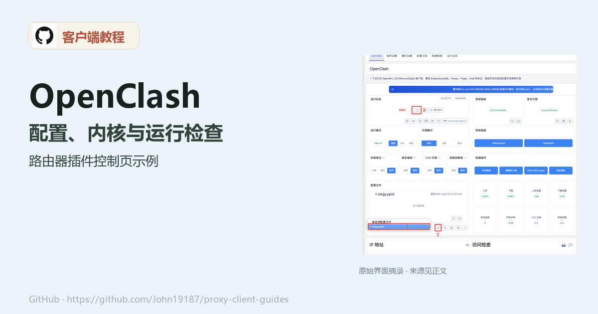
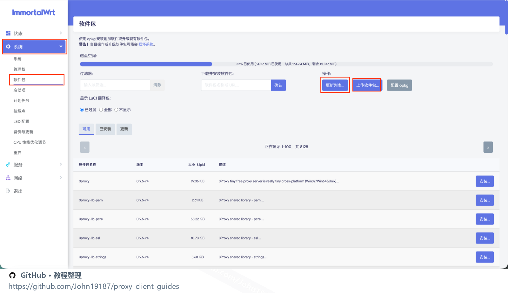
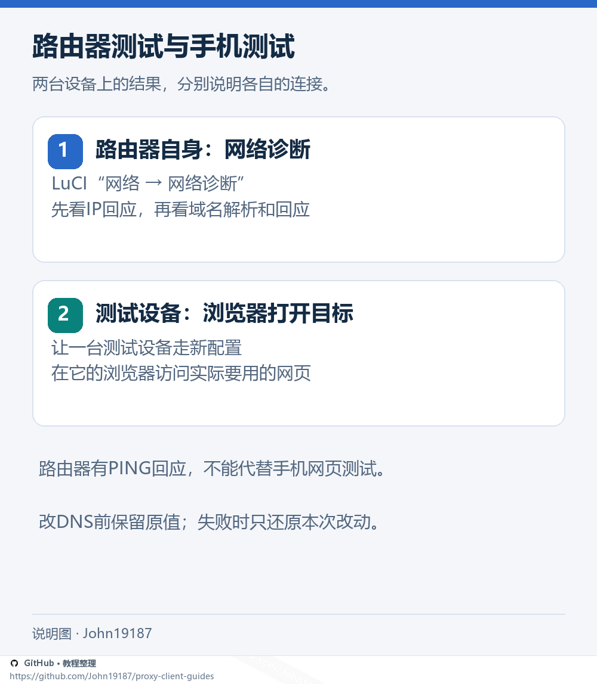

# 2026年 OpenClash下载与安装教程：OpenWrt选包、导入完整配置和启动

OpenClash在OpenWrt路由器运行Clash／Mihomo完整配置。opkg固件选IPK，apk固件选APK；插件包提供LuCI界面，运行内核仍须匹配CPU。下面给固定下载，安装前先保存现有网络设置和管理入口。

## OpenClash v0.48.002下载：选择IPK或APK插件

本页提供 v0.48.002 插件。opkg 固件选 IPK，apk 固件选 APK；不要只按固件名称猜包型，也不要改后缀互装。

| 固件／包管理器 | 官方插件原文件 |
|---|---|
| OpenWrt／兼容固件，opkg包管理 | [luci-app-openclash_0.48.002_all.ipk](https://github.com/vernesong/OpenClash/releases/download/v0.48.002/luci-app-openclash_0.48.002_all.ipk) |
| OpenWrt／兼容固件，apk包管理 | [luci-app-openclash-0.48.002.apk](https://github.com/vernesong/OpenClash/releases/download/v0.48.002/luci-app-openclash-0.48.002.apk) |

**OpenClash APK 能装到手机吗？** 这里的 APK 是 OpenWrt 的 apk 包管理器使用的软件包，不能安装到 Android。包名中的 all 或没有 CPU 后缀，只说明 LuCI 界面包的形式，运行内核仍需匹配路由器 CPU。

## 确认固件与备份管理设置

OpenClash 由 LuCI 管理插件、运行内核和系统依赖配合工作。下载前，在 LuCI 概览记下固件名称、版本、设备目标与 CPU，再确认当前使用 opkg 还是 apk，以及防火墙是 iptables 还是 Firewall4／nftables。这些信息分别决定插件包、内核与依赖的选择，定制固件还要看它自己的兼容说明。

先用电脑通过网线连接路由器，打开当前 LuCI 地址。在“系统 → 备份／升级”把配置备份下载到电脑，另存当前 DNS、网关与代理分流设置。这样即使代理配置影响了无线或外网，也能从有线管理入口停止服务、恢复本次改动。

安装前看剩余存储空间与路由器自身的下载能力。已有其他透明代理服务时，先停另一套接管；安装 OpenClash 不要求立即更换整个局域网的 DNS 和网关。

## 安装依赖与 CPU 内核

界面插件提供后台菜单，Mihomo 内核实际处理连接，系统依赖则提供脚本、下载、证书、DNS 和透明代理所需能力。项目依赖涉及 bash、curl、ca-bundle、ruby、ruby-yaml、dnsmasq-full 等，防火墙组件按当前固件选择；不能混装两套防火墙，也不能为补依赖直接删掉仍承担 DHCP／DNS 的组件。

1. 进入“系统 → 软件包”，从匹配固件的软件源准备缺少的依赖。
2. 使用“上传软件包”安装选定的插件，阅读安装结果；依赖报错先按固件分支解决。

这是使用 opkg 的 ImmortalWrt 软件包页：先看上方剩余空间，再从“上传软件包”选择电脑里下载的 IPK。使用 apk 的固件按它自己的软件包入口操作。

3. 刷新或重新登录LuCI，进入“服务 → OpenClash”，按设备CPU下载并安装对应内核。

装完没有 OpenClash 菜单，先回安装结果核对插件与依赖；提示缺内核时再看 CPU、存储与路由器下载。在路由器上检查实际下载到的文件与错误信息。

## 添加订阅并选择配置

OpenClash 需要 Clash／Mihomo 兼容的完整 YAML 配置，其中可以同时包含服务器、代理组、DNS 与规则。只有手机专属 App 的账户不能当作路由器配置。[VPN 服务的接入方式比较](https://github.com/John19187/The-40-Best-VPNs#翻墙客户端与使用方式怎么选)可帮助辨认服务自带 App 和第三方客户端的区别；确定使用 OpenClash 后，从[机场推荐帖的格式与设备条件](https://github.com/John19187/ji-chang-tui-jian#airport-clients)核对是否提供兼容配置、是否允许路由器使用。已有地址可直接继续。

1. 打开“服务 → OpenClash → 配置订阅”，添加记录，填入可辨认名称与本人完整 URL。
2. 保存记录，再执行该订阅的更新。过滤、转换和 User-Agent 仅在本人的服务明确要求时填写，不照抄其他服务参数。
3. 到“配置管理”找到刚下载的文件，切换到这份配置，再回运行状态页启动 OpenClash。
4. 在配置提供的面板或策略组选择实际服务器，保留直连及自动组的原意。

本地 YAML 可在配置管理上传并选择，但不会因此得到远程更新源；只有一条节点分享链接时，应先取得完整配置，区别见[格式对照](../../subscription-formats.md#format-table)。下载有结果却仍是旧节点，先看活动配置；解析失败则保留字段错误，核对内核与文件兼容性。

**换服务需要重装插件吗？** 新服务仍给兼容配置时，可以增加另一条订阅，选择并验证新文件，保留旧文件到新路线可用。换订阅本身不要求更换固件或重装内核。

## 用一台设备验证连接

先打开 OpenClash 的访问控制，按现有规则让一台测试终端进入接管范围；用它打开目标网页和实际应用，并确认有线管理电脑仍能访问 LuCI。终端的访问结果决定这条路线是否完成；后台显示运行、路由器有 Ping 响应都不能代替它。

说明图上半是路由器自身网络诊断，下半是测试终端的目标访问，二者处理不同设备上的问题。修改 DNS 前保留原值，有助于只撤回这次部署的设置。

服务运行而终端仍直连，先看该设备是否在接管范围、实际命中了哪条规则和策略。目标访问失败可先换当前配置的节点，再换网络比较，按[连接症状表](../../README.md#symptom-table)排查。多个节点只在同一网络失败时，继续检查该网络的认证、网关与DNS，并核对本家公告的故障范围。

## 分别更新配置、内核和插件

服务改节点，更新原订阅配置；协议或字段兼容发生变化，核对 Mihomo 内核；后台管理功能变化，再升级插件。远程文件中的本地修改先另存副本，插件升级前保存设置、停止服务，再安装匹配固件的正式包。

一台终端完成用途后，再按需要扩大接管范围。保留稳定配置及恢复入口，以后只更新发生变化的部分即可。

原来用PassWall、准备切换到OpenClash的人，先按[PassWall停止与保存设置](../passwall/README.md#troubleshooting)停旧接管，再从服务取得完整Clash／Mihomo配置；PassWall节点列表不能代替整份配置。为电脑或手机选软件，可看[2026年机场通用客户端汇总与下载教程](../../README.md#choose)。

## 停止服务与恢复网络

从有线电脑打开“服务 → OpenClash”，停止服务。撤回本次新增的接管、DNS 或分流修改；只是新配置出错，在“配置管理”选回旧文件。停止后确认普通联网与管理入口恢复，再决定是否继续处理具体错误。

停止后普通联网已恢复，可以保留插件和配置继续处理错误。需要恢复整套已保存设置时再使用备份；日常退出使用服务自己的停止入口即可。

来源注释与开发者资料

- [OpenClash 原仓、依赖与安装说明](https://github.com/vernesong/OpenClash)
- [v0.48.002 固定插件版本](https://github.com/vernesong/OpenClash/releases/tag/v0.48.002)
- [维护者订阅与配置管理手册](https://github.com/vernesong/OpenClash/blob/dev/.github/skills/openclash-user-guide/12-subscribe-config.md)
- 已接收的[OpenClash历史教程](https://bbxy.buzz/user/help/view/6/11)观察于2026-11-04，23张历史配图尚未取得，不把缺图当作当前安装界面。本文软件包入口采用固定v0.48.002发行资料，安装示例图保ImmortalWrt／opkg范围。

版本、商店要求和引用材料的整理日期：2026-11-14。

## 文档更新记录

展开文档更新记录

- 2026-11-16　折叠更新记录，收起许可说明，撤下不必要的维护数据与贡献提示入口。 下载区标题标明本文固定版本或独立商店渠道，保原下载文件与旧锚。

- 2026-11-16　补充文末客户端与免费节点目录、文档维护入口；整理图源与版本说明，保留原安装包和操作内容。

## 客户端与相关资源目录

按设备和配置类型进入对应教程；旧版条目用于识别与迁移。软件之间的订阅、配置和备份条件仍以各篇说明为准。

展开客户端目录（含旧版与迁移说明）

| 客户端 | 设备或范围 | 教程用途 |
|---|---|---|
| **OpenClash（本篇）** | OpenWrt | 固件条件、配置与插件 |
| [Clash Verge Rev](../clash-verge-rev/README.md) | Windows／macOS／Linux | Clash／Mihomo配置与系统代理 |
| [FlClash](../flclash/README.md) | 电脑／Android | 跨平台下载、导入与连接 |
| [Clash Party](../clash-party/README.md) | Windows／macOS／Linux | 安装版、便携版与订阅管理 |
| [Clash Mi](../clash-mi/README.md) | 跨平台 | 按本款入口导入Clash配置 |
| [ClashX Meta](../clashx-meta/README.md) | macOS | 菜单栏客户端与Mihomo配置 |
| [v2rayN](../v2rayn/README.md) | 电脑 | 节点订阅与系统代理 |
| [Hiddify](../hiddify/README.md) | 电脑／手机 | 跨平台导入与连接 |
| [Karing](../karing/README.md) | 电脑／手机 | 配置、规则与备份 |
| [Clash Meta for Android](../cmfa/README.md) | Android | Clash配置与VPN授权 |
| [v2rayNG](../v2rayng/README.md) | Android | 节点订阅与VPN连接 |
| [NekoBox for Android](../nekobox/README.md) | Android历史版本 | 1.4.2旧版订阅与迁移 |
| [Surfboard](../surfboard/README.md) | Android | 兼容配置与启动连接 |
| [sing-box](../sing-box/README.md) | 多平台 | 版本匹配的JSON配置 |
| [Shadowrocket](../shadowrocket/README.md) | iPhone／iPad | 节点、订阅与VPN连接 |
| [Stash](../stash/README.md) | Apple设备 | 按本款条件导入Clash类配置 |
| [Quantumult X](../quantumult-x/README.md) | iPhone／iPad | 节点资源与完整配置的区别 |
| [Loon](../loon/README.md) | iPhone／iPad | 订阅、策略与分流 |
| [Surge](../surge/README.md) | iOS／macOS | 按平台配置与接管流量 |
| [PassWall](../passwall/README.md) | OpenWrt | 订阅节点与主开关 |
| [ShellCrash](../shellcrash/README.md) | Linux／路由器 | 安装脚本与运行条件 |
| [Nextin专用客户端](../provider-app/README.md) | 按服务公开支持范围 | 仅适用于已证实的服务条件 |
| [Clash for Windows](../cfw/README.md) | 旧版／迁移 | 识别旧配置并迁移 |
| [Clash for Android](../cfa/README.md) | Android旧版／迁移 | 原版CFA与CMFA分开 |
| [ClashX](../clashx/README.md) | macOS旧版 | 普通ClashX身份与迁移 |
| [ClashX Pro](../clashx-pro/README.md) | macOS历史版本 | Pro托管配置与增强模式 |
| [旧Clash Verge](../old-clash-verge/README.md) | 旧版／迁移 | 与Rev区分及迁移 |
| [NekoRay](../nekoray/README.md) | 电脑旧版／迁移 | 旧资料与替代客户端 |
| [旧客户端迁移目录](../legacy/README.md) | 旧版资料 | 按原客户端寻找迁移说明 |

| 相关文档 | 内容 |
|---|---|
| [VPN推荐与使用方式](https://github.com/John19187/The-40-Best-VPNs) | 比较服务的平台、接入方式与客户端 |
| [机场推荐与套餐比较](https://github.com/John19187/ji-chang-tui-jian) | 比较月付、按量与套餐条件 |
| **2026年机场通用客户端汇总与下载教程（本文档仓）** | 按设备选软件并进入具体教程 |
| [机场与代理工具科普指南](https://github.com/John19187/ssr-v2ray-trojan-clash-guide) | 理解机场、协议、客户端、订阅与线路 |
| [免费节点与订阅资源](https://github.com/John19187/v2ray-SSR-Clash-Verge-Shadowrocke) | 查看公开资源与导入说明，不承诺持续可用 |

开源维护与许可

本文由John19187统一整理维护，实际修改记录见本页更新日志。原创文档采用[MIT许可](../../LICENSE)；软件、商标及第三方材料的权利与使用范围见[素材说明](../../NOTICE)。

本仓整理客户端下载与使用文档，不是客户端官方项目；软件是否开源、收费及其许可由各开发者分别决定。

