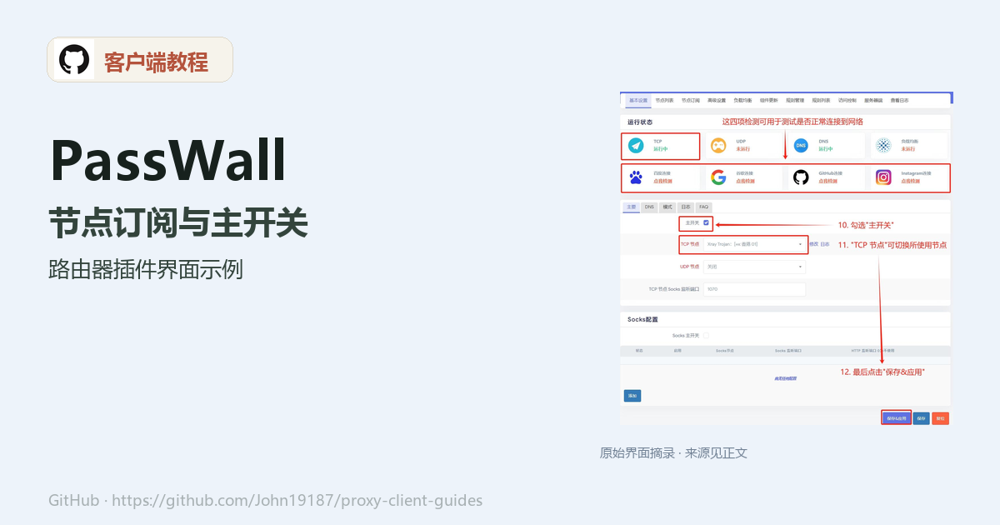
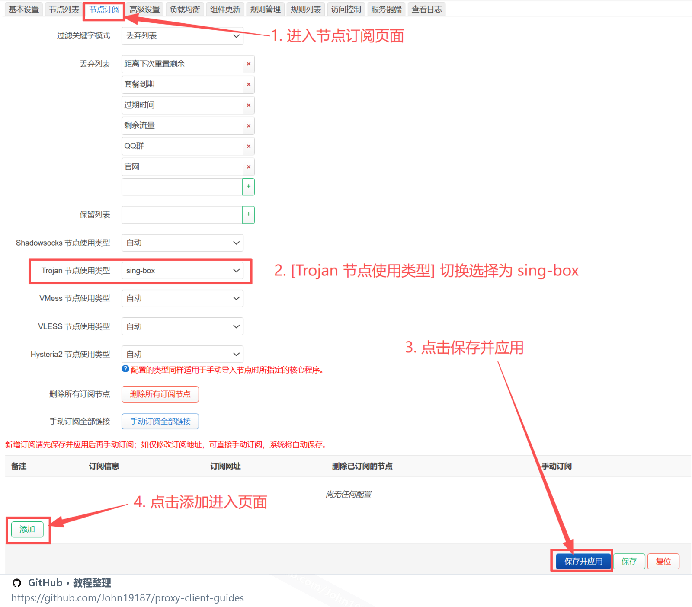
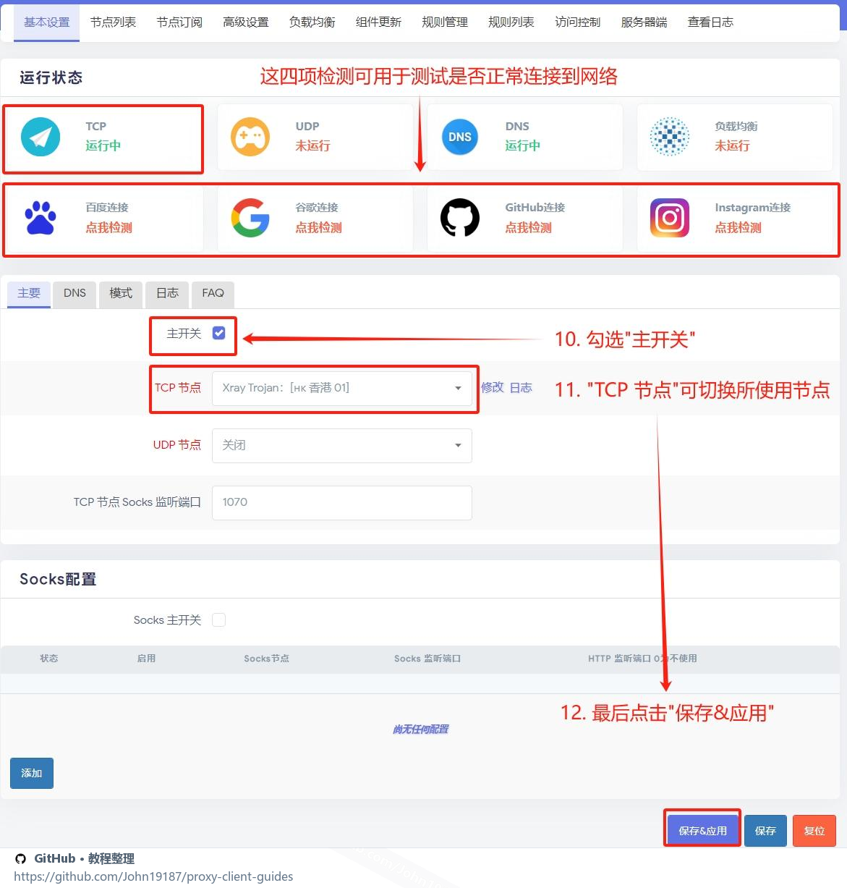

# 2026年 PassWall下载与配置教程：OpenWrt安装、节点订阅和TCP出口

PassWall在OpenWrt管理节点订阅。先选匹配固件分支的插件和语言包，装好节点协议所需组件，再添加订阅、手动更新，最后在“基本设置”选择TCP节点并启用主开关。完整Clash配置里的规则不会随节点订阅一起迁入。

## PassWall 26.11.11-1下载：分支插件与语言包

下表是 26.11.11-1 的 LuCI 插件和中文语言包。OpenWrt 22.03、23.05–24.10 与 25.12+ 分别取对应条目；定制固件以它实际采用的包管理器及兼容说明为准。

| 固件／包管理器 | 官方插件原文件 |
|---|---|
| OpenWrt 22.03，opkg | [22.03-_luci-app-passwall_26.11.11_all.ipk](https://github.com/Openwrt-Passwall/openwrt-passwall/releases/download/26.11.11-1/22.03-_luci-app-passwall_26.11.11_all.ipk) [22.03-_luci-i18n-passwall-zh-cn_26.11.11_all.ipk](https://github.com/Openwrt-Passwall/openwrt-passwall/releases/download/26.11.11-1/22.03-_luci-i18n-passwall-zh-cn_26.11.11_all.ipk) |
| OpenWrt 23.05–24.10，opkg | [23.05-24.10_luci-app-passwall_26.11.11-r1_all.ipk](https://github.com/Openwrt-Passwall/openwrt-passwall/releases/download/26.11.11-1/23.05-24.10_luci-app-passwall_26.11.11-r1_all.ipk) [23.05-24.10_luci-i18n-passwall-zh-cn_26.11.11_all.ipk](https://github.com/Openwrt-Passwall/openwrt-passwall/releases/download/26.11.11-1/23.05-24.10_luci-i18n-passwall-zh-cn_26.11.11_all.ipk) |
| OpenWrt 25.12+，apk | **APK：** [25.12+_luci-app-passwall-26.11.11-r1.apk](https://github.com/Openwrt-Passwall/openwrt-passwall/releases/download/26.11.11-1/25.12%2B_luci-app-passwall-26.11.11-r1.apk) **APK：** [25.12+_luci-i18n-passwall-zh-cn-26.11.11.apk](https://github.com/Openwrt-Passwall/openwrt-passwall/releases/download/26.11.11-1/25.12%2B_luci-i18n-passwall-zh-cn-26.11.11.apk) |

插件提供管理界面，中文包提供翻译，all 不表示 Xray、sing-box 等协议组件可以跨 CPU 使用。IPK 不能改名成 APK 安装，也不通过切换包管理器绕过依赖错误。

## 确认固件并保存恢复资料

先在 LuCI 概览记录 OpenWrt 分支、设备目标和 CPU，确认固件使用 opkg 还是 apk。界面包按固件分支选择，运行协议组件还要按 CPU 与软件源匹配；这些条件确定后再下载。

用电脑通过网线访问当前 LuCI 地址，在“系统 → 备份／升级”把备份保存到电脑，另记 DNS、网关与已有分流设置。有线入口用于安装后仍能管理路由器，备份则保留原来的配置，两者用途不同。

查看可用空间与固件软件源，已有其他透明代理时先停止另一套接管。后面先用一台终端试用 PassWall，不需要一开始就改所有设备的网络。

## 安装协议运行组件

在 LuCI“系统 → 软件包”上传匹配的插件与中文语言包，并阅读安装结果。所用节点需要的 Xray、sing-box 等组件，应从匹配固件源或发行版依赖说明安装。界面选项存在，不表示设备已经具备该协议的运行程序。

通过 SSH 安装时，先上传已经下载的真实文件，再使用固件已有包管理器安装。完成后刷新 LuCI，进入“服务 → PassWall”；菜单或组件报错先回安装日志处理分支和依赖，再添加订阅。

## 添加并更新节点订阅

PassWall 的订阅产生服务器节点，再由基本设置选择实际出口。Clash 完整配置里的策略、规则与 DNS 不会随节点一起迁入，输入范围见[节点资源与完整配置](../../subscription-formats.md#format-table)。

尚在比较接入方式时，[VPN 服务比较](https://github.com/John19187/The-40-Best-VPNs#翻墙客户端与使用方式怎么选)可用于区分服务 App 与可供第三方使用的订阅。选择 PassWall 服务前，再从[机场推荐帖的格式与设备条件](https://github.com/John19187/ji-chang-tui-jian#airport-clients)确认支持的协议以及是否允许路由器使用；已有地址无需重选服务。

1. 进入“服务 → PassWall → 节点订阅”，按节点协议和已安装组件选择使用类型，点“保存并应用”。

图中①进入“节点订阅”，②为节点协议选择运行组件，③保存并应用，④点左下角“添加”。Trojan 使用 sing-box 是图中示例，实际按自己的节点和已安装组件选择；这张图尚未进入填写订阅 URL 的表单。

2. 点击“添加”，填写备注和个人完整订阅URL，保存记录。
3. 对该记录执行“手动订阅”，等待下载解析，到节点列表查看该来源的服务器。

**保存了订阅为什么没有节点？** 保存只建立下载记录，手动订阅才取得并解析内容。先完成这个动作；仍为空时，再看下载错误、输入格式与协议类型，不以删除全部订阅节点代替查原因。

## 选择 TCP 节点与启动

订阅已经取得节点后：

1. 回到“基本设置”，在“TCP 节点”下拉框选择准备使用的实际服务器。
2. 勾选“主开关”，点击页面底部“保存并应用”，等待服务载入。
3. 让一台测试终端打开目标网页与实际应用，同时保留普通联网、LuCI 和局域网可达。

节点列表提供候选服务器，TCP 选择决定这类流量所用的出口；保存并应用才提交这次选择。

图中“主开关”决定是否运行，“TCP 节点”下拉框选择出口，底部“保存并应用”提交设置。上方四个检测项用于辅助排障，测试终端仍需完成自己的目标访问。

缺少可选 TCP 节点时先看协议组件和节点类型；已运行但连接失败时保留错误再换已有节点或网络比较。多节点表现相近时，核对账户、流量和本家公告，同时按报错检查路由规则与协议组件。

**TCP 能用，UDP 应用为什么失败？** UDP 需要服务线路、节点协议和当前设置共同支持。先确认节点能力，再看应用分流，不默认每条 TCP 线路都能承载 UDP。相关概念见[TCP／UDP 与应用判断](../../README.md#tcp-udp)。

## 更新订阅里的节点

在原订阅记录执行手动更新，再回基本设置看原 TCP 出口是否仍存在。服务删去某节点时另选有效节点，不需要因普通变动重复建立相同订阅。个人 URL 只有被服务重置后才替换。

节点可更新、TCP出口已选中且实际终端可用后，可以按需要扩大访问控制范围。保留原订阅记录和可用设置，日常维护就在这些位置完成。

原来用OpenClash，准备改由PassWall管理节点，先按[OpenClash停止服务](../openclash/README.md#troubleshooting)停旧接管，再取得PassWall支持的节点订阅。两款对配置的处理不同，不直接覆盖彼此的数据目录。其他设备的客户端见[2026年机场通用客户端汇总与下载教程](../../README.md#choose)。

## 升级插件与停止恢复

升级前保存设置，在“基本设置”取消主开关并“保存并应用”，再安装对应分支的新插件。协议组件另看兼容要求，不把更换固件、插件与全部节点合并成一次尝试。

启动后网络异常，也从有线电脑进入同一页面取消主开关并应用，撤回本次改过的 DNS、网关或访问控制。只有节点握手或认证失败，则保留协议、组件版本与脱敏错误，按[恢复与求助](../../README.md#restore-and-report)继续处理，不为撤销一次测试重置全机。

来源注释与开发者资料

- [Openwrt-Passwall 原仓](https://github.com/Openwrt-Passwall/openwrt-passwall)
- [26.11.11-1 分支软件包与安装说明](https://github.com/Openwrt-Passwall/openwrt-passwall/releases/tag/26.11.11-1)
- 界面与版本说明：观察于2026-11-07。订阅类型、手动订阅、主开关及TCP节点图保归档界面范围，不标作26.11.11-1实机图。

版本、商店要求和引用材料的整理日期：2026-11-14。

## 文档更新记录

展开文档更新记录

- 2026-11-16　折叠更新记录，收起许可说明，撤下不必要的维护数据与贡献提示入口。 下载区标题标明本文固定版本或独立商店渠道，保原下载文件与旧锚。

- 2026-11-16　补充文末客户端与免费节点目录、文档维护入口；整理图源与版本说明，保留原安装包和操作内容。

## 客户端与相关资源目录

按设备和配置类型进入对应教程；旧版条目用于识别与迁移。软件之间的订阅、配置和备份条件仍以各篇说明为准。

展开客户端目录（含旧版与迁移说明）

| 客户端 | 设备或范围 | 教程用途 |
|---|---|---|
| **PassWall（本篇）** | OpenWrt | 订阅节点与主开关 |
| [Clash Verge Rev](../clash-verge-rev/README.md) | Windows／macOS／Linux | Clash／Mihomo配置与系统代理 |
| [FlClash](../flclash/README.md) | 电脑／Android | 跨平台下载、导入与连接 |
| [Clash Party](../clash-party/README.md) | Windows／macOS／Linux | 安装版、便携版与订阅管理 |
| [Clash Mi](../clash-mi/README.md) | 跨平台 | 按本款入口导入Clash配置 |
| [ClashX Meta](../clashx-meta/README.md) | macOS | 菜单栏客户端与Mihomo配置 |
| [v2rayN](../v2rayn/README.md) | 电脑 | 节点订阅与系统代理 |
| [Hiddify](../hiddify/README.md) | 电脑／手机 | 跨平台导入与连接 |
| [Karing](../karing/README.md) | 电脑／手机 | 配置、规则与备份 |
| [Clash Meta for Android](../cmfa/README.md) | Android | Clash配置与VPN授权 |
| [v2rayNG](../v2rayng/README.md) | Android | 节点订阅与VPN连接 |
| [NekoBox for Android](../nekobox/README.md) | Android历史版本 | 1.4.2旧版订阅与迁移 |
| [Surfboard](../surfboard/README.md) | Android | 兼容配置与启动连接 |
| [sing-box](../sing-box/README.md) | 多平台 | 版本匹配的JSON配置 |
| [Shadowrocket](../shadowrocket/README.md) | iPhone／iPad | 节点、订阅与VPN连接 |
| [Stash](../stash/README.md) | Apple设备 | 按本款条件导入Clash类配置 |
| [Quantumult X](../quantumult-x/README.md) | iPhone／iPad | 节点资源与完整配置的区别 |
| [Loon](../loon/README.md) | iPhone／iPad | 订阅、策略与分流 |
| [Surge](../surge/README.md) | iOS／macOS | 按平台配置与接管流量 |
| [OpenClash](../openclash/README.md) | OpenWrt | 固件条件、配置与插件 |
| [ShellCrash](../shellcrash/README.md) | Linux／路由器 | 安装脚本与运行条件 |
| [Nextin专用客户端](../provider-app/README.md) | 按服务公开支持范围 | 仅适用于已证实的服务条件 |
| [Clash for Windows](../cfw/README.md) | 旧版／迁移 | 识别旧配置并迁移 |
| [Clash for Android](../cfa/README.md) | Android旧版／迁移 | 原版CFA与CMFA分开 |
| [ClashX](../clashx/README.md) | macOS旧版 | 普通ClashX身份与迁移 |
| [ClashX Pro](../clashx-pro/README.md) | macOS历史版本 | Pro托管配置与增强模式 |
| [旧Clash Verge](../old-clash-verge/README.md) | 旧版／迁移 | 与Rev区分及迁移 |
| [NekoRay](../nekoray/README.md) | 电脑旧版／迁移 | 旧资料与替代客户端 |
| [旧客户端迁移目录](../legacy/README.md) | 旧版资料 | 按原客户端寻找迁移说明 |

| 相关文档 | 内容 |
|---|---|
| [VPN推荐与使用方式](https://github.com/John19187/The-40-Best-VPNs) | 比较服务的平台、接入方式与客户端 |
| [机场推荐与套餐比较](https://github.com/John19187/ji-chang-tui-jian) | 比较月付、按量与套餐条件 |
| **2026年机场通用客户端汇总与下载教程（本文档仓）** | 按设备选软件并进入具体教程 |
| [机场与代理工具科普指南](https://github.com/John19187/ssr-v2ray-trojan-clash-guide) | 理解机场、协议、客户端、订阅与线路 |
| [免费节点与订阅资源](https://github.com/John19187/v2ray-SSR-Clash-Verge-Shadowrocke) | 查看公开资源与导入说明，不承诺持续可用 |

开源维护与许可

本文由John19187统一整理维护，实际修改记录见本页更新日志。原创文档采用[MIT许可](../../LICENSE)；软件、商标及第三方材料的权利与使用范围见[素材说明](../../NOTICE)。

本仓整理客户端下载与使用文档，不是客户端官方项目；软件是否开源、收费及其许可由各开发者分别决定。

