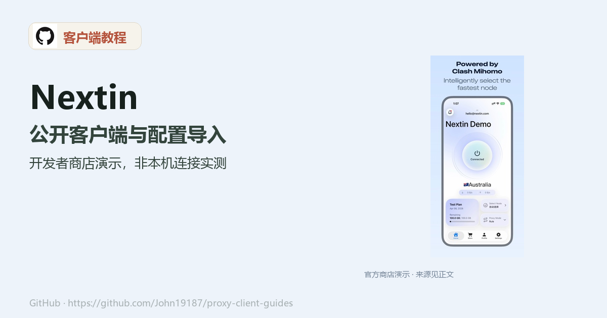
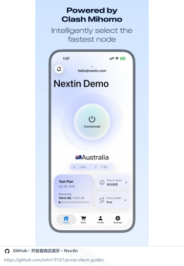

# 2026年 Nextin下载与使用：服务识别码、订阅URL和iPhone连接

Nextin 是 iPhone 和 iPad 客户端，先确认自己的服务明确支持它，再安装并按该服务指引接入。服务加载出节点后，在主页点 Select Node 选择服务器，再点中央圆形按钮连接；站点识别码、服务账号和订阅 URL 不能互相替代。

安装入口：[Nextin官方App Store](https://apps.apple.com/us/app/nextin/id6754002454?uo=4)。已安装可看[服务接入条件](#import)；其他设备的软件见[2026年机场通用客户端汇总与下载教程](../../README.md#choose)。

## Nextin正式App Store下载与安装

从 [Nextin 正式 App Store 条目](https://apps.apple.com/us/app/nextin/id6754002454?uo=4)安装，核对开发者 NEXTIN INC 和 ID 6754002454。本页对应 iOS／iPadOS 15 或更高版本；用自己的 App Store 账户按页面提示下载。

## 输入服务识别码，登录自己的账户

Nextin首次页有“输入站点识别码或订阅链接”字段。站点识别码用于找到服务的登录入口；输入后再用你在该服务注册的账户登录。下面两家各用自己的代码和账号：

| 所用服务 | 首次输入 | 下一步 |
|---|---|---|
| 大哥云 | `dgy` | 点“下一步”，用大哥云注册邮箱和网站密码登录；成功后自动取得该账号节点 |
| ByWave | `bywave`，小写 | 点“下一步”，确认显示ByWave登录页，再填ByWave邮箱和密码，点“登入” |

ByWave教程随后出现“VPN设置与隐私”页，点“继续”，允许iOS添加Nextin的VPN配置并完成本机验证。大哥云教程则在连接时请求这项授权；按你遇到的系统提示完成即可。

登录成功后应出现本人套餐和节点。显示其他服务名称时先退出，不在陌生登录页填写密码。没有节点先检查该账号套餐是否有效，不用重新购买Nextin软件。

**服务给的是订阅URL：** 同一首次输入框也接受链接，但要使用该服务明确提供给Nextin的兼容URL；上表两家使用识别码登录，无需再填订阅。不要把通用Clash地址、站点码和账户密码互相替代。

大哥云入口见[本家Nextin教程](https://dageyun.net/#/knowledge/10)，ByWave用户见[本家Nextin教程](https://u.bws.lol/kb/bywave-ios-nextin)。已有服务按其支持方式接入；需另选服务时，可比较[多家VPN推荐与推广](https://github.com/John19187/The-40-Best-VPNs#翻墙客户端与使用方式怎么选)及[多家机场推荐与推广的设备条件](https://github.com/John19187/ji-chang-tui-jian#airport-clients)。

## 从主页选择节点和连接

以下步骤从服务已经加载出节点的主页开始。已有另一款活动 VPN 时先断开：

1. 点击主页的 Select Node（选择节点），在列表里选实际服务器。
2. 返回主页，点击中央圆形连接按钮。首次系统请求添加 VPN 配置时允许，并完成本机验证。
3. 用 Safari 打开目标网页，再尝试日常应用。

中央圆形按钮控制连接，右侧 Select Node 打开节点列表。Australia、Connected 与 Test Plan 是画面中的演示内容，本人页面随服务及连接状态变化。

能辨认服务但列表为空，先看本人服务是否已激活并支持这个入口。节点已经出现但 VPN 无法建立，先停止其他活动 VPN，再确认 Nextin 的系统请求并记录提示。运行后只有目标应用失败，则保留当前入口，换已有节点比较，按[连接症状表](../../README.md#symptom-table)继续定位。

原来可用、后来多个节点同期异常，先核套餐状态和你所用服务商的首页公告，记录地区、运营商及发生时间，让服务支持核对线路。后台入口、套餐状态与连接错误按失败环节分别处理。

## 服务更换节点或登录入口时

留意所用服务商的首页公告。域名、站点入口或App使用方式改变后，按该服务的Nextin说明调整；识别码只是站点标识，不是套餐兑换码。原入口仍正常时保留它，无需为普通节点变化重新注册账号。

## 更新 Nextin App

软件版本从自己的 App Store 账户更新；升级前保留服务入口及必要资料。更换服务仍要求新服务明确支持 Nextin，添加失败先核对指引，不先删除原 App 和数据。

## 停止 Nextin 后切回原客户端

在 Nextin 主页断开连接，再启动原来使用的 VPN App。停止一个连接后再交给另一个，不需要删除服务入口来退出。

以后能否换成其他通用客户端，取决于服务提供的格式。服务支持Shadowrocket时，可接[小火箭订阅导入](../shadowrocket/README.md#import)；换Android且提供Clash／Mihomo配置，可看[CMFA下载与连接](../cmfa/README.md)。输入差别见[通用订阅与账户对照](../../subscription-formats.md#format-table)，新端可用前保留当前服务资料。

来源注释与正式商店

- [Nextin 正式 App Store 条目与应用说明](https://apps.apple.com/us/app/nextin/id6754002454)
- 开发者：NEXTIN INC。服务兼容、识别码及本人账户条件应取本人服务的 Nextin 说明，按本家提供的接入条件操作。

版本、商店要求和引用材料的整理日期：2026-11-14。

## 文档更新记录

展开文档更新记录

- 2026-11-16　折叠更新记录，收起许可说明，撤下不必要的维护数据与贡献提示入口。 下载区标题标明本文固定版本或独立商店渠道，保原下载文件与旧锚。

- 2026-11-16　补充文末客户端与免费节点目录、文档维护入口；整理图源与版本说明，保留原安装包和操作内容。

## 客户端与相关资源目录

按设备和配置类型进入对应教程；旧版条目用于识别与迁移。软件之间的订阅、配置和备份条件仍以各篇说明为准。

展开客户端目录（含旧版与迁移说明）

| 客户端 | 设备或范围 | 教程用途 |
|---|---|---|
| **Nextin专用客户端（本篇）** | 按服务公开支持范围 | 服务指定Nextin时的安装与连接 |
| [Clash Verge Rev](../clash-verge-rev/README.md) | Windows／macOS／Linux | Clash／Mihomo配置与系统代理 |
| [FlClash](../flclash/README.md) | 电脑／Android | 跨平台下载、导入与连接 |
| [Clash Party](../clash-party/README.md) | Windows／macOS／Linux | 安装版、便携版与订阅管理 |
| [Clash Mi](../clash-mi/README.md) | 跨平台 | 按本款入口导入Clash配置 |
| [ClashX Meta](../clashx-meta/README.md) | macOS | 菜单栏客户端与Mihomo配置 |
| [v2rayN](../v2rayn/README.md) | 电脑 | 节点订阅与系统代理 |
| [Hiddify](../hiddify/README.md) | 电脑／手机 | 跨平台导入与连接 |
| [Karing](../karing/README.md) | 电脑／手机 | 配置、规则与备份 |
| [Clash Meta for Android](../cmfa/README.md) | Android | Clash配置与VPN授权 |
| [v2rayNG](../v2rayng/README.md) | Android | 节点订阅与VPN连接 |
| [NekoBox for Android](../nekobox/README.md) | Android历史版本 | 1.4.2旧版订阅与迁移 |
| [Surfboard](../surfboard/README.md) | Android | 兼容配置与启动连接 |
| [sing-box](../sing-box/README.md) | 多平台 | 版本匹配的JSON配置 |
| [Shadowrocket](../shadowrocket/README.md) | iPhone／iPad | 节点、订阅与VPN连接 |
| [Stash](../stash/README.md) | Apple设备 | 按本款条件导入Clash类配置 |
| [Quantumult X](../quantumult-x/README.md) | iPhone／iPad | 节点资源与完整配置的区别 |
| [Loon](../loon/README.md) | iPhone／iPad | 订阅、策略与分流 |
| [Surge](../surge/README.md) | iOS／macOS | 按平台配置与接管流量 |
| [OpenClash](../openclash/README.md) | OpenWrt | 固件条件、配置与插件 |
| [PassWall](../passwall/README.md) | OpenWrt | 订阅节点与主开关 |
| [ShellCrash](../shellcrash/README.md) | Linux／路由器 | 安装脚本与运行条件 |
| [Clash for Windows](../cfw/README.md) | 旧版／迁移 | 识别旧配置并迁移 |
| [Clash for Android](../cfa/README.md) | Android旧版／迁移 | 原版CFA与CMFA分开 |
| [ClashX](../clashx/README.md) | macOS旧版 | 普通ClashX身份与迁移 |
| [ClashX Pro](../clashx-pro/README.md) | macOS历史版本 | Pro托管配置与增强模式 |
| [旧Clash Verge](../old-clash-verge/README.md) | 旧版／迁移 | 与Rev区分及迁移 |
| [NekoRay](../nekoray/README.md) | 电脑旧版／迁移 | 旧资料与替代客户端 |
| [旧客户端迁移目录](../legacy/README.md) | 旧版资料 | 按原客户端寻找迁移说明 |

| 相关文档 | 内容 |
|---|---|
| [VPN推荐与使用方式](https://github.com/John19187/The-40-Best-VPNs) | 比较服务的平台、接入方式与客户端 |
| [机场推荐与套餐比较](https://github.com/John19187/ji-chang-tui-jian) | 比较月付、按量与套餐条件 |
| [2026年机场通用客户端汇总与下载教程](../../README.md#choose) | 按设备选软件并进入具体教程 |
| [机场与代理工具科普指南](https://github.com/John19187/ssr-v2ray-trojan-clash-guide) | 理解机场、协议、客户端、订阅与线路 |
| [免费节点与订阅资源](https://github.com/John19187/v2ray-SSR-Clash-Verge-Shadowrocke) | 查看公开资源与导入说明，不承诺持续可用 |

开源维护与许可

本文由John19187统一整理维护，实际修改记录见本页更新日志。原创文档采用[MIT许可](../../LICENSE)；软件、商标及第三方材料的权利与使用范围见[素材说明](../../NOTICE)。

本仓整理客户端下载与使用文档，不是客户端官方项目；软件是否开源、收费及其许可由各开发者分别决定。

