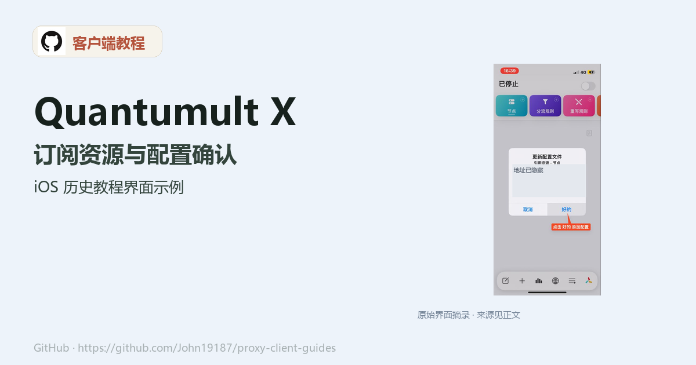
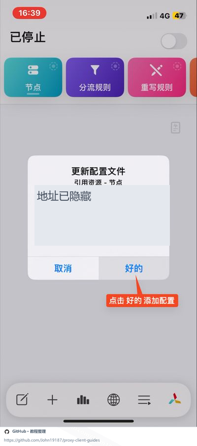

# 2026年 Quantumult X下载与配置教程：添加节点资源，保留原规则与策略

Quantumult X（QX）把节点、分流规则等内容分为不同资源。服务商的“一键导入”可能只添加节点，也可能替换完整配置；先看确认框的对象，再决定是否导入，才能保留自己已经设置的规则和策略。

安装入口：[Quantumult X官方App Store](https://apps.apple.com/us/app/quantumult-x/id1443988620?uo=4)。已安装可直接看[添加资源](#import)；跨设备选择见[2026年机场通用客户端汇总与下载教程](../../README.md#choose)。

## Quantumult X正式App Store下载与配置准备

从 [Quantumult X 正式商店条目](https://apps.apple.com/us/app/quantumult-x/id1443988620?uo=4)购买或下载，核对 Cross Utility Ltd 和 ID 1443988620。本页对应 iOS／iPadOS 15.0 及以上版本。开发者仓库里的 sample.conf 是配置示例，不是安装包，也不提供本人的服务器。

完整配置可以同时安排节点、策略、分流和重写；节点资源则只是一组服务器资料。服务给出的“一键导入”只是唤起方式，还要看它实际添加哪种内容。如果想比较服务自带 App 与这种自行管理配置的方式，可先看[VPN 服务比较](https://github.com/John19187/The-40-Best-VPNs#翻墙客户端与使用方式怎么选)。选择 QX 节点服务时，再从[机场推荐帖的客户端兼容条件](https://github.com/John19187/ji-chang-tui-jian#airport-clients)确认是否提供 QX 资源及所需配置；已有来源可直接继续。

## 使用一键入口时，读清导入确认框

已有自定义配置时，先保存当前完整文件副本，里面的策略和各远程资源地址都要一并保留。然后使用本人服务账户提供的 QX 入口：

1. 在服务账户选择 Quantumult X 一键导入，系统询问是否打开 App 时确认打开 QX。
2. 阅读实际确认框，分清“引用资源·节点”与整份配置替换。只想加节点却看到整份替换，先点“取消”。

图中大标题是“更新配置文件”，下一行的对象是“引用资源·节点”。本次确认的是节点资源；遇到其他入口时，仍要读清对象和替换范围，再选择“好的”或“取消”。

3. 确认资源正是自己需要添加的内容，点“好的”，等待下载，再到节点列表查看该来源的服务器。

开发者的一键接口中，add-resource添加资源，update-configuration更新整份配置。**入口打开后仍停在 Safari，是否要再覆盖一次？** 先确认 QX 已安装并打开过，再回 App 看资源是否实际出现。系统关联状态可能影响唤起，回App确认资源已经出现后再继续，原设置保留。

## 只有节点资源 URL 时，添加到已有配置

这条路径适用于已经有可用完整配置、只想增加一组节点的人。首次使用还没有完整配置时，先取得适配的 QX 配置；一组节点本身不会安排分流规则和策略。

1. 在首页点左下角的方框铅笔按钮，打开当前配置编辑器，先保存完整原文副本。
2. 找到 `[server_remote]` 段，在其中增加本人 QX 节点资源 URL，保留其他已有内容。规则资源属于 `[filter_remote]`，两者不要混填。
3. 保存改动，再更新新加的节点资源。节点列表应出现该来源提供的服务器。

下面只示意新增行所在的位置，示例域名不能连接：

~~~ini
[server_remote]
https://example.invalid/my-qx-nodes, tag=我的节点, enabled=true
~~~

不要用这三行替换整份配置，也不要把其他软件的完整配置 URL 填进去当作格式转换。

**只有节点资源，为什么没有原来的规则？** 资源只提供节点，不会顺便重建策略与分流。首次使用、还没有完整配置时，需要先取得适配的 QX 配置，再添加资源。不同内容怎样传递，见[完整配置与资源对照](../../subscription-formats.md#format-table)。

## 选择策略使用的节点，再开启 VPN

策略决定某类请求使用哪个出口。手动选择组可以点选服务器，自动策略则按配置执行；组名由配置作者设置，不要求都叫 PROXY。已有完整配置时：

1. 在首页找到准备用于代理的手动选择组，展开资源名称下的节点列表，点一个实际服务器；对勾表示当前选择。
2. 打开首页右上角连接开关。首次 iOS 请求添加 VPN 配置时允许，并完成本机验证。
3. 用 Safari 访问目标网站，再打开实际应用。

**下载了节点，却没有可选择的组怎么办？** 新资源不会自动改写现有策略。回提供这份完整配置的说明，确认其策略是否引用了新增资源；不要为了出现一个列表直接覆盖整份文件。已经有可用组时，直连与其他策略继续保留各自用途。

探测数值只反映探测请求，目标失败时保留配置、换已有节点或网络比较，按[连接症状](../../README.md#symptom-table)继续判断。多个节点同时失败，再核对账户和本家公告所列地区、网络及发生时间；基础连接无需开启MitM或安装第三方证书。

## 更新远程资源，不重复替换完整配置

节点调整时，刷新原来的远程节点资源即可。规则、重写各有自己的远程来源，按需要更新对应内容；服务确实重置了 URL，才替换原地址。QX 程序本身则在自己的 App Store 账户更新。

完成资源下载、策略选择和目标访问以后，保留当前完整配置及各来源。这样日常更新可以在原资源上完成，不必靠反复一键导入刷新节点。

## 导入不合适时，恢复改动前的内容

先关闭右上角连接开关。按编辑器路径只新增了一条节点资源，就再点首页左下角方框铅笔按钮，在 `[server_remote]` 删除本次新增的那一行，保留其他原有内容并保存。

如果一键入口替换了完整配置，或者已经不清楚改动范围，则恢复事前保存的完整文件。恢复的是这次操作之前的配置，不需要因为一条资源失败而清空全部设置。

准备在同一台iPhone改用Stash，可按[Stash完整配置导入](../stash/README.md#import)重取服务支持的格式；要用Loon，则按[Loon节点订阅与策略](../loon/README.md#import)安排。QX资源URL和主配置不能直接当作另两款的完整配置，原文件保留到新端能够实际使用。

来源注释与开发者资料

- [Quantumult X 正式 App Store 条目](https://apps.apple.com/us/app/quantumult-x/id1443988620)
- [crossutility/Quantumult-X 原仓](https://github.com/crossutility/Quantumult-X)
- [开发者一键导入接口](https://github.com/crossutility/Quantumult-X/blob/master/url-scheme.md)
- [sample.conf 配置字段与探测说明](https://github.com/crossutility/Quantumult-X/blob/master/sample.conf)
- 界面与版本说明：原文更新于2026-02-03，观察于2026-11-06。本文确认框展示版隐去个人地址，展示“引用资源·节点”确认框，截图未标版本。

版本、商店要求和引用材料的整理日期：2026-11-14。

## 文档更新记录

展开文档更新记录

- 2026-11-16　折叠更新记录，收起许可说明，撤下不必要的维护数据与贡献提示入口。 下载区标题标明本文固定版本或独立商店渠道，保原下载文件与旧锚。

- 2026-11-16　补充文末客户端与免费节点目录、文档维护入口；整理图源与版本说明，保留原安装包和操作内容。

## 客户端与相关资源目录

按设备和配置类型进入对应教程；旧版条目用于识别与迁移。软件之间的订阅、配置和备份条件仍以各篇说明为准。

展开客户端目录（含旧版与迁移说明）

| 客户端 | 设备或范围 | 教程用途 |
|---|---|---|
| **Quantumult X（本篇）** | iPhone／iPad | 节点资源与完整配置的区别 |
| [Clash Verge Rev](../clash-verge-rev/README.md) | Windows／macOS／Linux | Clash／Mihomo配置与系统代理 |
| [FlClash](../flclash/README.md) | 电脑／Android | 跨平台下载、导入与连接 |
| [Clash Party](../clash-party/README.md) | Windows／macOS／Linux | 安装版、便携版与订阅管理 |
| [Clash Mi](../clash-mi/README.md) | 跨平台 | 按本款入口导入Clash配置 |
| [ClashX Meta](../clashx-meta/README.md) | macOS | 菜单栏客户端与Mihomo配置 |
| [v2rayN](../v2rayn/README.md) | 电脑 | 节点订阅与系统代理 |
| [Hiddify](../hiddify/README.md) | 电脑／手机 | 跨平台导入与连接 |
| [Karing](../karing/README.md) | 电脑／手机 | 配置、规则与备份 |
| [Clash Meta for Android](../cmfa/README.md) | Android | Clash配置与VPN授权 |
| [v2rayNG](../v2rayng/README.md) | Android | 节点订阅与VPN连接 |
| [NekoBox for Android](../nekobox/README.md) | Android历史版本 | 1.4.2旧版订阅与迁移 |
| [Surfboard](../surfboard/README.md) | Android | 兼容配置与启动连接 |
| [sing-box](../sing-box/README.md) | 多平台 | 版本匹配的JSON配置 |
| [Shadowrocket](../shadowrocket/README.md) | iPhone／iPad | 节点、订阅与VPN连接 |
| [Stash](../stash/README.md) | Apple设备 | 按本款条件导入Clash类配置 |
| [Loon](../loon/README.md) | iPhone／iPad | 订阅、策略与分流 |
| [Surge](../surge/README.md) | iOS／macOS | 按平台配置与接管流量 |
| [OpenClash](../openclash/README.md) | OpenWrt | 固件条件、配置与插件 |
| [PassWall](../passwall/README.md) | OpenWrt | 订阅节点与主开关 |
| [ShellCrash](../shellcrash/README.md) | Linux／路由器 | 安装脚本与运行条件 |
| [Nextin专用客户端](../provider-app/README.md) | 按服务公开支持范围 | 仅适用于已证实的服务条件 |
| [Clash for Windows](../cfw/README.md) | 旧版／迁移 | 识别旧配置并迁移 |
| [Clash for Android](../cfa/README.md) | Android旧版／迁移 | 原版CFA与CMFA分开 |
| [ClashX](../clashx/README.md) | macOS旧版 | 普通ClashX身份与迁移 |
| [ClashX Pro](../clashx-pro/README.md) | macOS历史版本 | Pro托管配置与增强模式 |
| [旧Clash Verge](../old-clash-verge/README.md) | 旧版／迁移 | 与Rev区分及迁移 |
| [NekoRay](../nekoray/README.md) | 电脑旧版／迁移 | 旧资料与替代客户端 |
| [旧客户端迁移目录](../legacy/README.md) | 旧版资料 | 按原客户端寻找迁移说明 |

| 相关文档 | 内容 |
|---|---|
| [VPN推荐与使用方式](https://github.com/John19187/The-40-Best-VPNs) | 比较服务的平台、接入方式与客户端 |
| [机场推荐与套餐比较](https://github.com/John19187/ji-chang-tui-jian) | 比较月付、按量与套餐条件 |
| **2026年机场通用客户端汇总与下载教程（本文档仓）** | 按设备选软件并进入具体教程 |
| [机场与代理工具科普指南](https://github.com/John19187/ssr-v2ray-trojan-clash-guide) | 理解机场、协议、客户端、订阅与线路 |
| [免费节点与订阅资源](https://github.com/John19187/v2ray-SSR-Clash-Verge-Shadowrocke) | 查看公开资源与导入说明，不承诺持续可用 |

开源维护与许可

本文由John19187统一整理维护，实际修改记录见本页更新日志。原创文档采用[MIT许可](../../LICENSE)；软件、商标及第三方材料的权利与使用范围见[素材说明](../../NOTICE)。

本仓整理客户端下载与使用文档，不是客户端官方项目；软件是否开源、收费及其许可由各开发者分别决定。

