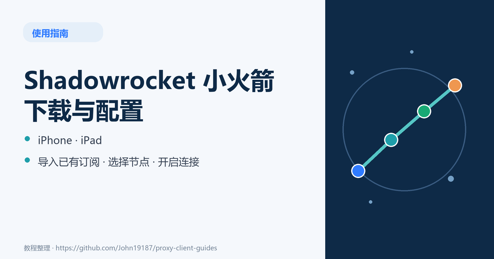
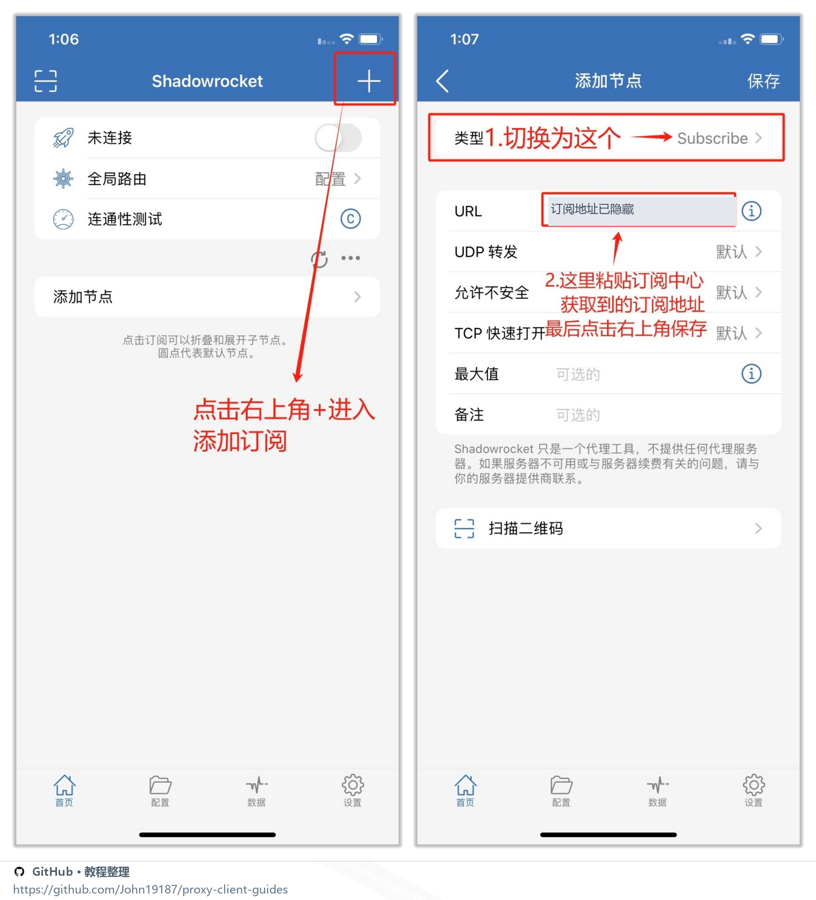
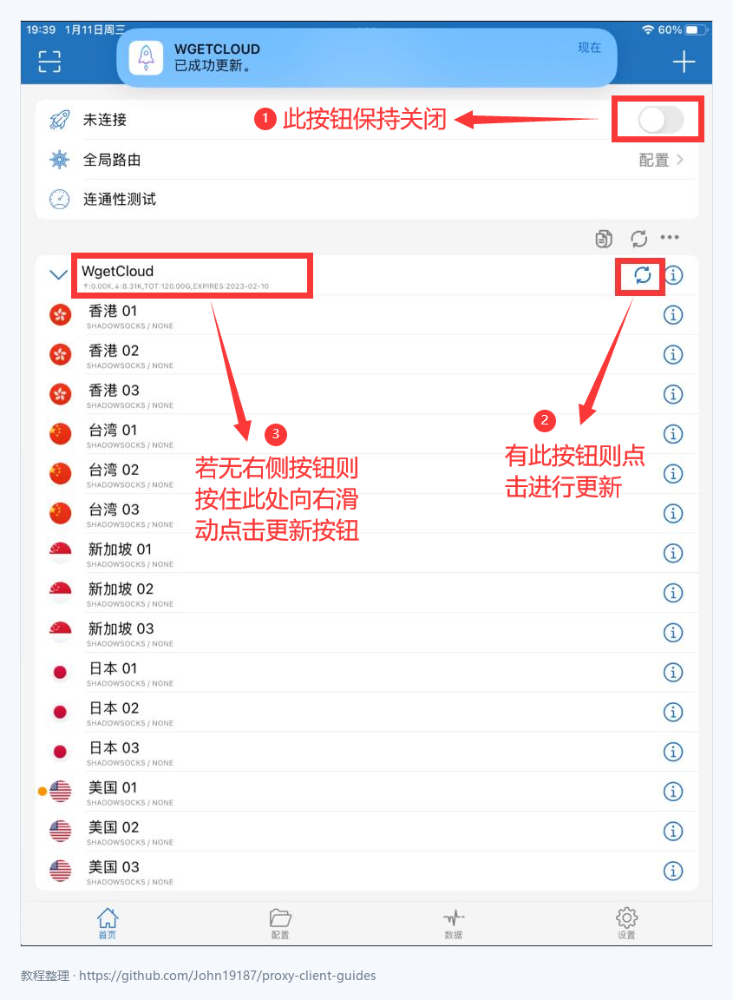

# 2026年 Shadowrocket 小火箭下载与配置教程：iPhone、iPad

Shadowrocket（小火箭）从App Store安装，使用自己已有的服务订阅连接服务器。安装后，在首页点“+”，把类型选为“Subscribe”，粘贴订阅地址并保存；下载出节点列表后，选一个服务器，再打开连接开关。购买App取得的是软件授权，软件本身不附节点或流量套餐。

## Shadowrocket正式App Store下载地址与安装

[打开Shadowrocket正式App Store条目](https://apps.apple.com/us/app/shadowrocket/id932747118?uo=4)。开发者为 **Shadow Launch Technology Limited**，商店ID为 **932747118**。本次读取的美区页面价格为 **US$2.99**，iPhone要求iOS 13.0或更高，iPad要求iPadOS 13.0或更高；其他地区按自己的商店页面购买。

1. 用自己的App Store账户打开上述条目，核对名称和开发者，按商店提示购买或下载。
2. 安装完成后打开Shadowrocket，进入首页。已经安装的人直接继续导入，无需为添加订阅重新购买App或切换商店账号。

商店无法获取时，先看账户地区、系统兼容性和具体提示。同名Android APK属于不同软件，不能装到iPhone替代这个条目。使用服务提供的共享账号下载时，它的领取资格和限制只对该服务适用；不要把共享账号登录到设备“设置”中的iCloud，也不要为导入订阅退出自己的iCloud。

## 把订阅链接导入Shadowrocket

从已有服务后台复制Shadowrocket对应的完整订阅地址。订阅用于下载一组服务器资料；账户首页网址、账号密码和另一客户端的完整配置不能直接代替它。个人URL通常带凭据，不要公开分享或放进求助截图。

1. 登录服务后台，找到Shadowrocket订阅入口，复制完整链接。服务有订阅开关或下载窗口时，先按它的说明开启，窗口时长以本家提示为准。
2. 打开Shadowrocket首页右上角“+”，进入“添加节点”。点“类型”，选择“Subscribe”。这个类型接收整份订阅，页面名称仍可能显示“添加节点”。

左图从首页右上角加号进入，右图选择Subscribe后填写URL。图中地址已隐藏，其他选项保留原值；截图未标版本号，用于辨认入口。

3. 在“URL”填入刚复制的完整地址，备注可填写便于辨认的服务名称，点右上角“保存”，等待下载。
4. 回首页点新增订阅名称展开列表。下面能看到它提供的服务器，才完成了节点列表的导入。

**保存后列表为空或下载报错**，检查类型是否为Subscribe、URL是否完整，以及服务账户和下载窗口状态。返回登录网页或其他格式时，回服务后台重新取得小火箭订阅，输入类型可对照[订阅与单节点格式说明](../../subscription-formats.md#format-table)。已有可用订阅先保留，不必先删除，也不用打开“允许不安全”来处理普通导入问题。

只有单节点分享链接或二维码时，使用对应分享、扫描入口；它与能持续更新的一组订阅不同。服务提供“一键导入”时，可在Safari中按该服务的入口唤起Shadowrocket，再检查节点是否出现。iPad若因桌面网页模式显示仅限手机操作的提示，可按该网站提示继续；一键唤起失败时，仍可用上面的手动方式。

还没有服务时，可比较[多家VPN推荐与推广中的客户端和设备支持](https://github.com/John19187/The-40-Best-VPNs#翻墙客户端与使用方式怎么选)，或[多家机场推荐与推广中的套餐、流量和Shadowrocket订阅支持](https://github.com/John19187/ji-chang-tui-jian#airport-clients)。两篇包含推广，部分服务有自己的App；选择时核对服务是否提供小火箭订阅。已有兼容地址的人直接继续即可。

## 选择服务器，打开连接开关

节点列表已经导入后，选择实际服务器，再允许Shadowrocket建立VPN连接。订阅名称、到期日期和流量提示只说明账户或列表信息，不作为连接出口。

1. 先停止另一款正在运行的VPN。在Shadowrocket首页展开订阅，点一个实际服务器，例如自己列表中的“香港01”；选中项旁会出现圆点标记。
2. 打开首页顶部的连接开关。首次出现添加VPN配置的系统请求时，确认来自Shadowrocket后允许，并在自己的设备上完成系统验证。
3. 用Safari打开实际需要的网站，再试目标应用。能够完成原来的访问任务，即可按当前配置继续使用。

首页的“全局路由”决定请求怎样处理，已有分流配置时保留原来的“配置”选项与规则。基础连接不要求开启HTTPS解密、MitM或安装额外根证书；已有自定义规则的人也不需要点击“恢复预设配置”。

**开关一直连接或刚打开就断开**，先检查是否有另一款VPN自动重接，再看系统或客户端的具体错误。**节点能测出延迟，网页仍不通**，在同一订阅中换一个实际节点，再换Wi-Fi／移动网络比较，按[连接症状与处理](../../README.md#symptom-table)继续判断，不反复清空所有VPN配置。

原来能用、后来多个节点同时失败时，先查看服务账户、流量和本家公告，核对故障时间及受影响网络，再用同一节点比较自己的Wi-Fi与蜂窝网络。

## 更新已保存的订阅

服务调整节点时，更新首页原订阅即可，不需要重新安装App或再添加相同地址。

1. 服务要求开启订阅下载窗口、暂时停止代理时，先按该服务说明处理。停止Shadowrocket连接是在首页关闭顶部开关。
2. 找到对应订阅名称，点它右侧的圆形刷新按钮；没有显示按钮时，向右滑动该订阅条目，点击“更新”。
3. 看到“已成功更新”后展开列表。原节点已被移除时，重新选择一个仍存在的实际服务器，再开启连接并访问目标网站。

图中②指向该订阅的刷新按钮，③说明没有按钮时的右滑入口。关闭连接是这份服务教程的更新条件；图中的流量、到期日期和节点名都是示例，自己的额度和有效期在本人账户查看。

更新提示只说明获取到了订阅，不能代替实际访问成功。更新失败时，先检查个人URL、账户状态和下载窗口，不关闭证书验证或删除可用配置。单节点没有远程订阅来源，不能靠刷新自动取得新参数。

只有服务真正更换了个人订阅地址，才需要替换保存的URL。后台“重置订阅”与刷新节点不同，重置后，其他设备保存的旧地址也需要更换。

## 升级App、停止连接和更换客户端

软件更新从自己的App Store账户完成。升级前保留订阅来源、必要的自定义配置和规则；服务到期要在服务账户处理，更新软件不能代替续费。

日常断开时，在首页关闭顶部连接开关，再启动原来使用的VPN。以后仍可展开已保存的订阅选节点，停止连接不需要恢复预设配置或删除订阅。

换成[Stash导入完整配置](../stash/README.md#import)或[Quantumult X添加节点资源](../quantumult-x/README.md#import)，先按[跨客户端格式判断](../../subscription-formats.md#switch-client)重新取得目标输入，保留当前可用资料。换到Android设备，可按[Clash Meta for Android下载与配置教程](../cmfa/README.md)取得服务方对应的兼容订阅后再导入，不把两款软件的文件直接互换。其他设备方案见[2026年机场通用客户端汇总与下载教程](../../README.md)。

完成首次连接后，平时在首页换节点，服务调整内容时刷新原订阅；需要停用时关闭连接开关，保留这份已经可用的配置即可。

正式商店与图片来源

- [Shadowrocket正式App Store条目](https://apps.apple.com/us/app/shadowrocket/id932747118)：开发者、US$2.99美区价格及iPhone／iPad系统要求，本次于2026年11月15日读取。
- 界面与版本说明：本项目已接收的完整教程，原始观察于2026年11月7日；共享账号资格、订阅开关及网页提示按对应服务适用。
- 界面与版本说明：小火箭刷新、右滑更新及结果提示，原始观察于2026年11月7日。
- 导入与更新图为归档界面，未显示客户端版本号，本文用于说明相应入口，不标作当前版本实机截图。第三方商标归各自权利方，原件保留在项目资产，正文使用整理展示副本；特色图为本仓库制作。

## 文档更新记录

展开文档更新记录

- 2026-11-16　折叠更新记录，收起许可说明，撤下不必要的维护数据与贡献提示入口。 下载区标题标明本文固定版本或独立商店渠道，保原下载文件与旧锚。

- 2026-11-16　补充文末客户端与免费节点目录、文档维护入口；整理图源与版本说明，保留原安装包和操作内容。

## 客户端与相关资源目录

按设备和配置类型进入对应教程；旧版条目用于识别与迁移。软件之间的订阅、配置和备份条件仍以各篇说明为准。

展开客户端目录（含旧版与迁移说明）

| 客户端 | 设备或范围 | 教程用途 |
|---|---|---|
| **Shadowrocket（本篇）** | iPhone／iPad | 节点、订阅与VPN连接 |
| [Clash Verge Rev](../clash-verge-rev/README.md) | Windows／macOS／Linux | Clash／Mihomo配置与系统代理 |
| [FlClash](../flclash/README.md) | 电脑／Android | 跨平台下载、导入与连接 |
| [Clash Party](../clash-party/README.md) | Windows／macOS／Linux | 安装版、便携版与订阅管理 |
| [Clash Mi](../clash-mi/README.md) | 跨平台 | 按本款入口导入Clash配置 |
| [ClashX Meta](../clashx-meta/README.md) | macOS | 菜单栏客户端与Mihomo配置 |
| [v2rayN](../v2rayn/README.md) | 电脑 | 节点订阅与系统代理 |
| [Hiddify](../hiddify/README.md) | 电脑／手机 | 跨平台导入与连接 |
| [Karing](../karing/README.md) | 电脑／手机 | 配置、规则与备份 |
| [Clash Meta for Android](../cmfa/README.md) | Android | Clash配置与VPN授权 |
| [v2rayNG](../v2rayng/README.md) | Android | 节点订阅与VPN连接 |
| [NekoBox for Android](../nekobox/README.md) | Android历史版本 | 1.4.2旧版订阅与迁移 |
| [Surfboard](../surfboard/README.md) | Android | 兼容配置与启动连接 |
| [sing-box](../sing-box/README.md) | 多平台 | 版本匹配的JSON配置 |
| [Stash](../stash/README.md) | Apple设备 | 按本款条件导入Clash类配置 |
| [Quantumult X](../quantumult-x/README.md) | iPhone／iPad | 节点资源与完整配置的区别 |
| [Loon](../loon/README.md) | iPhone／iPad | 订阅、策略与分流 |
| [Surge](../surge/README.md) | iOS／macOS | 按平台配置与接管流量 |
| [OpenClash](../openclash/README.md) | OpenWrt | 固件条件、配置与插件 |
| [PassWall](../passwall/README.md) | OpenWrt | 订阅节点与主开关 |
| [ShellCrash](../shellcrash/README.md) | Linux／路由器 | 安装脚本与运行条件 |
| [Nextin专用客户端](../provider-app/README.md) | 按服务公开支持范围 | 仅适用于已证实的服务条件 |
| [Clash for Windows](../cfw/README.md) | 旧版／迁移 | 识别旧配置并迁移 |
| [Clash for Android](../cfa/README.md) | Android旧版／迁移 | 原版CFA与CMFA分开 |
| [ClashX](../clashx/README.md) | macOS旧版 | 普通ClashX身份与迁移 |
| [ClashX Pro](../clashx-pro/README.md) | macOS历史版本 | Pro托管配置与增强模式 |
| [旧Clash Verge](../old-clash-verge/README.md) | 旧版／迁移 | 与Rev区分及迁移 |
| [NekoRay](../nekoray/README.md) | 电脑旧版／迁移 | 旧资料与替代客户端 |
| [旧客户端迁移目录](../legacy/README.md) | 旧版资料 | 按原客户端寻找迁移说明 |

| 相关文档 | 内容 |
|---|---|
| [VPN推荐与使用方式](https://github.com/John19187/The-40-Best-VPNs) | 比较服务的平台、接入方式与客户端 |
| [机场推荐与套餐比较](https://github.com/John19187/ji-chang-tui-jian) | 比较月付、按量与套餐条件 |
| **2026年机场通用客户端汇总与下载教程（本文档仓）** | 按设备选软件并进入具体教程 |
| [机场与代理工具科普指南](https://github.com/John19187/ssr-v2ray-trojan-clash-guide) | 理解机场、协议、客户端、订阅与线路 |
| [免费节点与订阅资源](https://github.com/John19187/v2ray-SSR-Clash-Verge-Shadowrocke) | 查看公开资源与导入说明，不承诺持续可用 |

开源维护与许可

本文由John19187统一整理维护，实际修改记录见本页更新日志。原创文档采用[MIT许可](../../LICENSE)；软件、商标及第三方材料的权利与使用范围见[素材说明](../../NOTICE)。

本仓整理客户端下载与使用文档，不是客户端官方项目；软件是否开源、收费及其许可由各开发者分别决定。

