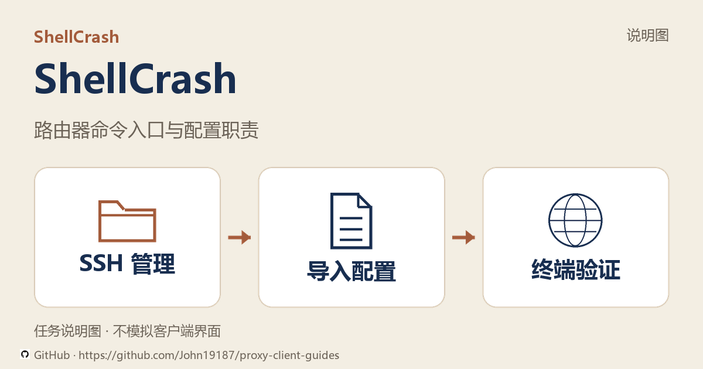

# 2026年 ShellCrash安装与配置教程：SSH菜单导入、启动和更新

ShellCrash通过Linux或兼容路由器的SSH交互菜单管理代理内核和配置。它是管理脚本，不是固件或LuCI插件。下面区分固定1.9.4归档和随master变化的在线安装器，按设备支持的路线安装后再运行crash。

## ShellCrash 1.9.4固定归档与在线安装方式

下表是1.9.4管理脚本包，下面先按该归档安装并说明对应菜单。它不是固件，也不能作为IPK／APK上传到LuCI；在线安装器另列在后，安装到的脚本随源更新。

| 支持环境 | 管理脚本归档 |
|---|---|
| 兼容Linux／OpenWrt Shell环境 | [ShellCrash.tar.gz](https://github.com/juewuy/ShellCrash/releases/download/1.9.4/ShellCrash.tar.gz) |

**归档不分 CPU，所有设备都能用吗？** 归档是管理脚本，运行内核另选 CPU。系统命令、权限、启动机制和防火墙也要兼容。

## 确认系统与恢复入口

ShellCrash 用脚本管理代理内核、配置及服务运行。设备要具备项目支持的 Linux／路由器环境、SSH 管理权限以及所需启动与防火墙能力；记录系统版本、CPU 架构和现有包管理器后，再按该设备的安装方式继续。

下载需要 curl 或 wget，透明代理还受 iptables／nftables 等条件影响。OpenWrt 的 opkg／apk 与其他 Linux 包管理器不能混为一种系统。只有电脑浏览器需要代理时，也可从[桌面客户端目录](../../README.md#desktop)选择图形 App，不必因此改路由器。

路由器先把固件配置备份下载到电脑，保存原 DNS、网关与代理分流值，保留有线管理电脑和可用 SSH 会话。普通 Linux 主机则保存当前配置，记下将改变的服务与网络设置。后续恢复靠这些具体入口，关闭终端窗口本身不会停止已经运行的服务。

## 按固定1.9.4归档安装

先通过SCP把上表的`ShellCrash.tar.gz`上传到目标设备的`/tmp`，保持文件名，不在电脑上解压。然后在设备的SSH会话执行自己环境对应的一组命令。

**路由器或非标准Linux：**

~~~sh
mkdir -p /tmp/SC_tmp
tar -zxf /tmp/ShellCrash.tar.gz -C /tmp/SC_tmp/
source /tmp/SC_tmp/init.sh
~~~

**标准Linux：** 在具备安装权限的Shell中执行：

~~~sh
mkdir -p /tmp/SC_tmp
tar -zxf /tmp/ShellCrash.tar.gz -C /tmp/SC_tmp/
bash /tmp/SC_tmp/init.sh
source /etc/profile
~~~

安装器会询问安装目录；选择本机可写、空间足够且重启后保留的目录，`/tmp`只是解包位置。安装成功后加载环境并打开菜单：

~~~sh
. /etc/profile
crash
~~~

找不到`crash`时，重连SSH后再试；仍找不到，回安装输出检查目录、权限和依赖错误。

### 选择在线安装器时

在线路线会下载源上的当前脚本，不能当成固定1.9.4。先下载开发者安装器：

~~~sh
curl -fL https://raw.githubusercontent.com/juewuy/ShellCrash/master/install.sh -o /tmp/shellcrash-install.sh
~~~

没有curl时可改用wget：

~~~sh
wget -O /tmp/shellcrash-install.sh https://raw.githubusercontent.com/juewuy/ShellCrash/master/install.sh
~~~

确认文件下载成功后，路由器用`sh /tmp/shellcrash-install.sh`，标准Linux用`bash /tmp/shellcrash-install.sh`。按实际版本显示的菜单操作；下文编号属于1.9.4归档版。

## 按内核选择配置

在1.9.4主菜单进入“9 更新与支持 → 2 切换内核文件”，核对显示的CPU架构，再选Mihomo或所需的sing-box分支；架构识别不对时用该页“9 手动指定处理器架构”。Mihomo 读取 Clash／Mihomo YAML，sing-box 读取与其版本匹配的 JSON；这些文件同时安排服务器与流量规则，单节点分享链接或服务 App 的账户不能直接替代。

若还在选择接入方式，可先比较[VPN 服务自带 App 与通用客户端](https://github.com/John19187/The-40-Best-VPNs#翻墙客户端与使用方式怎么选)。决定在路由器或 Linux 使用完整配置后，再从[机场推荐帖的兼容条件](https://github.com/John19187/ji-chang-tui-jian#airport-clients)核对 YAML／JSON 格式及路由器使用限制；已有来源直接继续。

内核准备好后再添加配置：

1. 主菜单进入“6 管理配置文件 → 2 在线获取配置文件（基于订阅提供者）”，填写完整配置URL；若本机安装了账户登录扩展，该位置会显示“登录获取订阅”。
2. 出现“确认导入配置文件？原配置文件将被备份”时，确认来源后输入`1`。下载或解析报错先处理URL、字段和内核版本，不继续启动。
3. 本地完整配置改用“6 → 4 本地上传完整配置文件”：先把`.yaml`、`.yml`或名为`config.json`的文件上传到设备`/tmp`，再按检测提示载入。不要把“在线生成配置”当作普通私密订阅的默认导入，它可能经过第三方转换服务。

## 先选接管范围，再启动

**路由器只试一台终端：**

1. 主菜单“2 功能设置 → 1 路由模式设置”，选择本机模块支持的路由模式。Redir接TCP，混合模式用Redir接TCP、TUN接UDP，Tproxy与TUN模式各有内核模块要求。
2. 在路由模式页“7 设置路由劫持范围”选择“仅局域网”。
3. 回功能设置，“3 透明路由流量过滤 → 2 过滤局域网设备”，切成白名单，按菜单添加测试终端的MAC或单个IP；列表应显示“仅列表内设备流量经过内核”。
4. 回主菜单“1 启动/重启服务”，再用这台终端打开目标网页和应用，保留有线管理入口。

**Linux只让一个本机应用使用：** 在路由劫持范围选择“4 不配置流量劫持（纯净模式）”。到“功能设置 → 6 自定义端口及秘钥”查看Http／Sock5端口，再把该应用的HTTP或SOCKS代理指向本机监听地址和这个实际端口。此模式不会自动接管所有应用。

模式或范围改动后，需要从主菜单重启服务才生效。终端不通时先看名单、规则和实际错误；多个节点只在同一网络失败，再检查认证、网关及服务商首页的故障通知。

## 脚本、内核和配置分别在何时更新

服务调整线路时刷新原配置；协议或配置字段兼容变化时处理内核；管理与安装功能变化时才更新 ShellCrash 脚本。更新前保留现有配置和设置，让旧版本与新版本之间有可恢复的资料。

## 从 crash 停止服务并恢复网络

1. 从保留的 SSH 会话运行 `crash`，选择“3 停止服务”。
2. 新配置出错时，通过“6 管理配置文件 → 8”还原已有的配置备份，按提示重启；改过 DNS、路由或分流时，只撤回本次新增的对应设置。
3. 确认普通联网和原管理入口恢复，再决定是否继续处理具体错误。

停止服务不需要先删除安装目录。关闭终端窗口也不会代替停止服务。

安装下载失败看设备网络、证书和下载工具，配置解析失败看所选内核与字段，启动后管理受影响则从保留的 SSH／有线入口停止并恢复。保留具体错误，可以继续处理对应环节，不必为了退出一次部署重置整台设备。

来源注释与开发者资料

- [ShellCrash 原仓](https://github.com/juewuy/ShellCrash)
- [官方中文安装说明、系统与依赖](https://github.com/juewuy/ShellCrash/blob/master/README_CN.md)
- [1.9.4 固定脚本归档](https://github.com/juewuy/ShellCrash/releases/tag/1.9.4)

版本、商店要求和引用材料的整理日期：2026-11-14。

## 文档更新记录

展开文档更新记录

- 2026-11-16　折叠更新记录，收起许可说明，撤下不必要的维护数据与贡献提示入口。 下载区标题标明本文固定版本或独立商店渠道，保原下载文件与旧锚。

- 2026-11-16　补充文末客户端与免费节点目录、文档维护入口；整理图源与版本说明，保留原安装包和操作内容。

## 客户端与相关资源目录

按设备和配置类型进入对应教程；旧版条目用于识别与迁移。软件之间的订阅、配置和备份条件仍以各篇说明为准。

展开客户端目录（含旧版与迁移说明）

| 客户端 | 设备或范围 | 教程用途 |
|---|---|---|
| **ShellCrash（本篇）** | Linux／路由器 | 安装脚本与运行条件 |
| [Clash Verge Rev](../clash-verge-rev/README.md) | Windows／macOS／Linux | Clash／Mihomo配置与系统代理 |
| [FlClash](../flclash/README.md) | 电脑／Android | 跨平台下载、导入与连接 |
| [Clash Party](../clash-party/README.md) | Windows／macOS／Linux | 安装版、便携版与订阅管理 |
| [Clash Mi](../clash-mi/README.md) | 跨平台 | 按本款入口导入Clash配置 |
| [ClashX Meta](../clashx-meta/README.md) | macOS | 菜单栏客户端与Mihomo配置 |
| [v2rayN](../v2rayn/README.md) | 电脑 | 节点订阅与系统代理 |
| [Hiddify](../hiddify/README.md) | 电脑／手机 | 跨平台导入与连接 |
| [Karing](../karing/README.md) | 电脑／手机 | 配置、规则与备份 |
| [Clash Meta for Android](../cmfa/README.md) | Android | Clash配置与VPN授权 |
| [v2rayNG](../v2rayng/README.md) | Android | 节点订阅与VPN连接 |
| [NekoBox for Android](../nekobox/README.md) | Android历史版本 | 1.4.2旧版订阅与迁移 |
| [Surfboard](../surfboard/README.md) | Android | 兼容配置与启动连接 |
| [sing-box](../sing-box/README.md) | 多平台 | 版本匹配的JSON配置 |
| [Shadowrocket](../shadowrocket/README.md) | iPhone／iPad | 节点、订阅与VPN连接 |
| [Stash](../stash/README.md) | Apple设备 | 按本款条件导入Clash类配置 |
| [Quantumult X](../quantumult-x/README.md) | iPhone／iPad | 节点资源与完整配置的区别 |
| [Loon](../loon/README.md) | iPhone／iPad | 订阅、策略与分流 |
| [Surge](../surge/README.md) | iOS／macOS | 按平台配置与接管流量 |
| [OpenClash](../openclash/README.md) | OpenWrt | 固件条件、配置与插件 |
| [PassWall](../passwall/README.md) | OpenWrt | 订阅节点与主开关 |
| [Nextin](../provider-app/README.md) | 按服务公开支持范围 | 服务指定Nextin时的安装与连接 |
| [Clash for Windows](../cfw/README.md) | 旧版／迁移 | 识别旧配置并迁移 |
| [Clash for Android](../cfa/README.md) | Android旧版／迁移 | 原版CFA与CMFA分开 |
| [ClashX](../clashx/README.md) | macOS旧版 | 普通ClashX身份与迁移 |
| [ClashX Pro](../clashx-pro/README.md) | macOS历史版本 | Pro托管配置与增强模式 |
| [旧Clash Verge](../old-clash-verge/README.md) | 旧版／迁移 | 与Rev区分及迁移 |
| [NekoRay](../nekoray/README.md) | 电脑旧版／迁移 | 旧资料与替代客户端 |
| [旧客户端迁移目录](../legacy/README.md) | 旧版资料 | 按原客户端寻找迁移说明 |

| 相关文档 | 内容 |
|---|---|
| [VPN推荐与使用方式](https://github.com/John19187/The-40-Best-VPNs) | 比较服务的平台、接入方式与客户端 |
| [机场推荐与套餐比较](https://github.com/John19187/ji-chang-tui-jian) | 比较月付、按量与套餐条件 |
| [2026年机场通用客户端汇总与下载教程](../../README.md#choose) | 按设备选软件并进入具体教程 |
| [机场与代理工具科普指南](https://github.com/John19187/ssr-v2ray-trojan-clash-guide) | 理解机场、协议、客户端、订阅与线路 |
| [免费节点与订阅资源](https://github.com/John19187/v2ray-SSR-Clash-Verge-Shadowrocke) | 查看公开资源与导入说明，不承诺持续可用 |

开源维护与许可

本文由John19187统一整理维护，实际修改记录见本页更新日志。原创文档采用[MIT许可](../../LICENSE)；软件、商标及第三方材料的权利与使用范围见[素材说明](../../NOTICE)。

本仓整理客户端下载与使用文档，不是客户端官方项目；软件是否开源、收费及其许可由各开发者分别决定。

