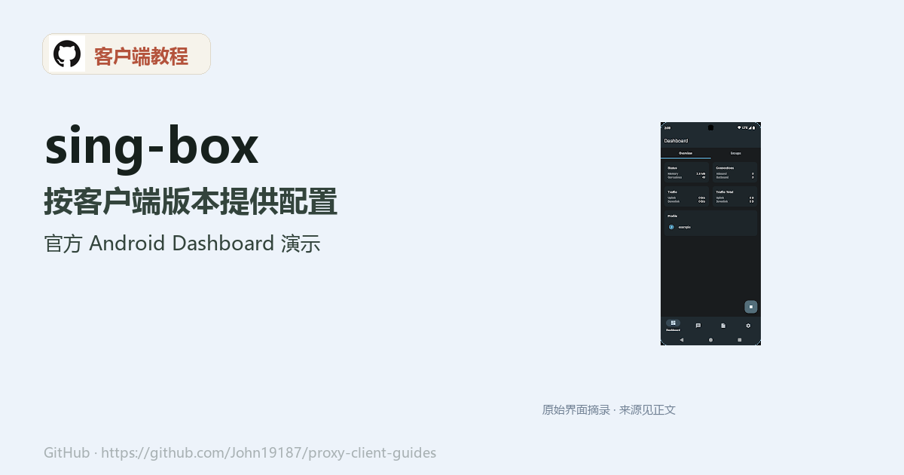
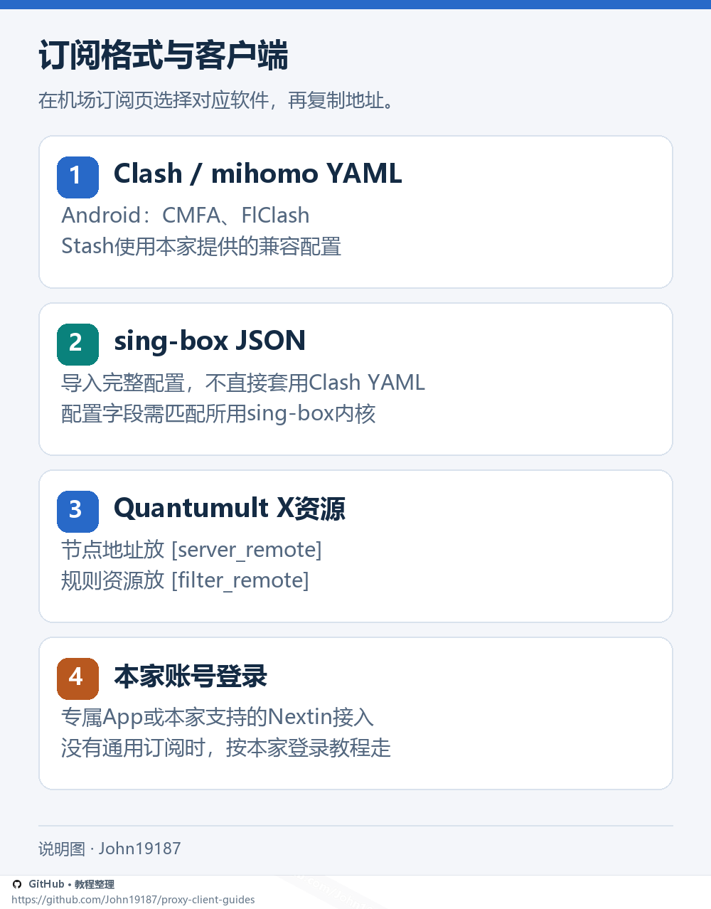

# 2026年 sing-box下载与使用教程：导入JSON配置、启动连接与更新

使用sing-box图形客户端，需要对应设备的安装包，以及服务提供的、适配内核版本的完整JSON配置。Android用SFA，Mac用SFM，Windows用SFW，Linux用SFL；iPhone／iPad使用下方官方Apple页面列出的商店入口。

本页保留1.14.4固定安装包。已有软件可直接看[配置导入](#import)，Android的具体字段按SFA 1.14.4说明。命令行内核与图形客户端的运行方式不同，想按界面操作就选下面的图形包。

### v1.14.4 图形客户端正式下载

下表是 1.14.4 的图形安装包。Android 使用 SFA，Mac 使用 SFM，Windows 和 Linux 分别使用 SFW、SFL，名称与[官方桌面说明](https://sing-box.sagernet.org/clients/desktop/)对应。

iPhone／iPad 从正式商店安装 [sing-box MT](https://apps.apple.com/us/app/sing-box-mt/id6785326793?uo=4)，开发者 Metamerism LLC，要求 iOS 15 或更高版本；它是[官方 Apple 页面](https://sing-box.sagernet.org/clients/apple/)列出的入口，与下表 Mac PKG 分开安装。

| 平台／CPU | 正式版直接下载 |
|---|---|
| Android常规SFA | **APK：** [SFA-1.14.4-arm64-v8a.apk](https://github.com/SagerNet/sing-box/releases/download/v1.14.4/SFA-1.14.4-arm64-v8a.apk) **APK：** [SFA-1.14.4-armeabi-v7a.apk](https://github.com/SagerNet/sing-box/releases/download/v1.14.4/SFA-1.14.4-armeabi-v7a.apk) **APK：** [SFA-1.14.4-x86.apk](https://github.com/SagerNet/sing-box/releases/download/v1.14.4/SFA-1.14.4-x86.apk) **APK：** [SFA-1.14.4-x86_64.apk](https://github.com/SagerNet/sing-box/releases/download/v1.14.4/SFA-1.14.4-x86_64.apk) **APK：** [SFA-1.14.4-universal.apk](https://github.com/SagerNet/sing-box/releases/download/v1.14.4/SFA-1.14.4-universal.apk) |
| Android 5兼容SFA | **APK：** [SFA-1.14.4-legacy-android-5-arm64-v8a.apk](https://github.com/SagerNet/sing-box/releases/download/v1.14.4/SFA-1.14.4-legacy-android-5-arm64-v8a.apk) **APK：** [SFA-1.14.4-legacy-android-5-armeabi-v7a.apk](https://github.com/SagerNet/sing-box/releases/download/v1.14.4/SFA-1.14.4-legacy-android-5-armeabi-v7a.apk) **APK：** [SFA-1.14.4-legacy-android-5-x86.apk](https://github.com/SagerNet/sing-box/releases/download/v1.14.4/SFA-1.14.4-legacy-android-5-x86.apk) **APK：** [SFA-1.14.4-legacy-android-5-x86_64.apk](https://github.com/SagerNet/sing-box/releases/download/v1.14.4/SFA-1.14.4-legacy-android-5-x86_64.apk) **APK：** [SFA-1.14.4-legacy-android-5-universal.apk](https://github.com/SagerNet/sing-box/releases/download/v1.14.4/SFA-1.14.4-legacy-android-5-universal.apk) |
| Mac SFM（macOS 13+） | **PKG包：** [SFM-1.14.4-Apple.pkg](https://github.com/SagerNet/sing-box/releases/download/v1.14.4/SFM-1.14.4-Apple.pkg) **PKG包：** [SFM-1.14.4-Intel.pkg](https://github.com/SagerNet/sing-box/releases/download/v1.14.4/SFM-1.14.4-Intel.pkg) **PKG包：** [SFM-1.14.4-Universal.pkg](https://github.com/SagerNet/sing-box/releases/download/v1.14.4/SFM-1.14.4-Universal.pkg) |
| Windows SFW | [SFW-1.14.4-x64.exe](https://github.com/SagerNet/sing-box/releases/download/v1.14.4/SFW-1.14.4-x64.exe) [SFW-1.14.4-arm64.exe](https://github.com/SagerNet/sing-box/releases/download/v1.14.4/SFW-1.14.4-arm64.exe) [SFW-1.14.4-x86.exe](https://github.com/SagerNet/sing-box/releases/download/v1.14.4/SFW-1.14.4-x86.exe) |
| Linux SFL x64 | **DEB包：** [SFL-1.14.4-amd64.deb](https://github.com/SagerNet/sing-box/releases/download/v1.14.4/SFL-1.14.4-amd64.deb) **RPM包：** [SFL-1.14.4-x86_64.rpm](https://github.com/SagerNet/sing-box/releases/download/v1.14.4/SFL-1.14.4-x86_64.rpm) **Arch包：** [SFL-1.14.4-x64.pkg.tar.zst](https://github.com/SagerNet/sing-box/releases/download/v1.14.4/SFL-1.14.4-x64.pkg.tar.zst) |
| Linux SFL ARM64 | **DEB包：** [SFL-1.14.4-arm64.deb](https://github.com/SagerNet/sing-box/releases/download/v1.14.4/SFL-1.14.4-arm64.deb) **RPM包：** [SFL-1.14.4-aarch64.rpm](https://github.com/SagerNet/sing-box/releases/download/v1.14.4/SFL-1.14.4-aarch64.rpm) **Arch包：** [SFL-1.14.4-aarch64.pkg.tar.zst](https://github.com/SagerNet/sing-box/releases/download/v1.14.4/SFL-1.14.4-aarch64.pkg.tar.zst) |
| Linux SFL ARMv7 | **DEB包：** [SFL-1.14.4-armv7l.deb](https://github.com/SagerNet/sing-box/releases/download/v1.14.4/SFL-1.14.4-armv7l.deb) **RPM包：** [SFL-1.14.4-armv7l.rpm](https://github.com/SagerNet/sing-box/releases/download/v1.14.4/SFL-1.14.4-armv7l.rpm) **Arch包：** [SFL-1.14.4-armv7l.pkg.tar.zst](https://github.com/SagerNet/sing-box/releases/download/v1.14.4/SFL-1.14.4-armv7l.pkg.tar.zst) |

跟随本页界面操作应选择这些图形包。发行页中以 `sing-box-…` 命名的命令行内核、OpenWrt 包，以及越狱 iOS 使用的 SFI DEB，安装和启动方式都不同。

## sing-box 1.14.4下载：图形客户端与系统软件包

| 设备 | 选择和安装 |
|---|---|
| Android | 按CPU选SFA，无法确认可选universal；Android 5用legacy-android-5分支。打开APK，在系统安装器完成安装 |
| Mac | “关于本机”看芯片，选Apple、Intel或Universal；双击PKG安装，本页SFM要求macOS 13+ |
| Windows | “设置 → 系统 → 关于”看系统类型，选相应x64、ARM64或x86的SFW EXE，运行安装器 |
| Linux | 同时匹配CPU与包型，DEB、RPM、pkg.tar.zst由对应包管理器安装 |
| iPhone／iPad | 从上方商店安装sing-box MT，开发者Metamerism LLC；不要把越狱SFI DEB当成普通商店包 |

Android要求安装来源权限，只给本次下载器或文件管理器授权。升级已有版本先保留JSON、远程URL及个人修改，再按原渠道处理；Apple 1.14涉及开发者账号和独立Mac客户端的数据位置变化，旧配置未出现时保留原数据，按[官方迁移说明](https://sing-box.sagernet.org/migration/)接续。

## 取得完整JSON，再选择本地或远程配置

完整JSON可同时包含服务器、DNS、路由和出站组。**Remote（远程）**保存URL，以后能从同一地址更新；**Local（本地）**读取已有内容，没有远程下载来源。

先从自己的服务账户取得sing-box完整配置，核对服务标明的内核适用版本。只有单节点分享或Clash YAML，不能靠改后缀变成完整JSON；见[配置与节点订阅的区别](../../subscription-formats.md#format-table)。

sing-box对应完整JSON一栏。HTTPS是地址传输方式，配置按实际返回的JSON内容识别。

### Android SFA 1.14.4：手动创建远程配置

1. 打开“仪表”（Dashboard），在“配置”卡片点加号，选择“手动创建”（Create Manually）。
2. 在“名称”（Name）填本机识别名，“类型”（Type）选择“远程”（Remote）。
3. 在URL填自己的完整JSON地址，点页面底部“创建”（Create），等待下载和配置校验。
4. 返回仪表的配置卡，点配置名称打开列表，选择刚创建的记录。所选项会有勾选标记。

“自动更新”控制以后是否重新下载这份内容，初次可保留默认。只有本地文件时，在新建页选择“本地 → 导入 → 导入文件”，选中JSON后点“创建”。这是配置来源的另一条路径，不必同时建两份。

**下载后仍解析失败：**可能返回登录页、错误页或不兼容字段。保留具体错误、服务给的版本要求与客户端内核版本，再取适配配置；系统VPN权限不能修复JSON格式错误。

### Windows／Linux图形客户端

下列路径按官方桌面客户端1.14.4源码界面说明：

1. 在Profile／配置卡右上点“+ → Create Manually／手动创建”。
2. Name填本机识别名，Type选Remote，URL填兼容的完整JSON，点Create。
3. 点配置卡中的名称打开列表，选择新记录；该行出现勾选后回仪表。
4. 点工具栏三角形“Start”启动，运行后按钮变为“Stop”，并显示运行时长。需要的流量接入方式由JSON中的inbound决定；若使用系统代理，还要开启相应系统代理项。

只有本地JSON时，在同一“+”菜单选“Import from File”，选择文件后完成导入。Windows若先进入本地服务设置页，按当前状态显示的Install或Repair处理；Linux包管理安装的服务缺失时，应修复安装包，不能照Windows点一个不存在的安装按钮。

### Mac／iPhone／iPad图形客户端

Apple版下面的控件来自当前官方界面源码，商店版本独立更新：

1. 在仪表Profile配置卡点“+ → Create Manually”，填写Name、Type=Remote和URL，再点Create。
2. 点配置名称打开列表，选用需要的配置。本地JSON改走“+ → Import from File”。
3. 点三角形Start启动。iPhone／iPad按iOS提示添加VPN；Mac系统扩展版如显示“Install System Extension”，先安装扩展，系统要求重启时完成重启，再启动连接。

Remote下载失败时保留原错误和配置，先核URL与内核兼容。各平台正式入口见[官方客户端说明](https://sing-box.sagernet.org/clients/)。

若服务只给面向普通订阅的导入入口，没有适配本版内核的完整JSON，可看[Hiddify成品订阅导入](../hiddify/README.md#import)或[Karing支持的订阅与添加方式](../karing/README.md#import)，向原服务确认目标格式；已有完整配置的人继续本页，不必另换服务。

## 选好配置，在仪表启动服务

Android先断开另一款正在运行的个人VPN，然后启动SFA。

1. 在仪表确认当前配置名称，点击运行按钮。首次出现Android VPN连接请求，确认来自SFA后允许。
2. 服务运行后，在Dashboard查看状态。配置包含Selector或URLTest出站组时，Groups会提供对应组；Selector可手动点服务器，URLTest按配置探测和自动选择。
3. 用浏览器和实际需要的应用完成访问。运行状态与目标可用性分别判断。

只有单个出站的JSON可以没有Groups选择器，不必为出现节点列表改配置。按钮位置和布局可能随客户端更新，下面的旧官方小图只作外观示意。

官方Android Dashboard历史示意图

原图只有133×296像素，图中Profile显示配置名称、方形图标表示停止服务，为未标版本的历史界面示意。

Mac首次运行按系统提示批准网络扩展；iPhone／iPad允许本机VPN配置。Windows／Linux按其客户端与系统权限处理接管，不能照点Android的VPN许可。安装或授权有具体错误时保留原文，先按[官方桌面说明](https://sing-box.sagernet.org/clients/desktop/)或[Apple说明](https://sing-box.sagernet.org/clients/apple/)定位对应平台。

目标仍打不开，先看当前配置和DNS、连接错误；有其他出站再换一个比较。多条出站在同一网络失败，可换网络作一次对照，再查账户和你所用服务商的首页公告；按[本机症状排查](../../README.md#symptom-table)区分配置解析、流量接管与目标连接。

## 更新远程配置，保留自定义内容

SFA 1.14.4仪表配置卡提供刷新按钮，更新所选Remote记录会沿原URL重新下载；自动更新按该记录的设置执行。Local没有下载源，需要取得新文件后导入，可保留旧文件作对照。

远程更新可能替换本机修改，自己的DNS与规则另存。只有服务确实更换地址，再编辑Remote URL；普通刷新不重置个人订阅。

停止使用时先停止服务再关窗口。需要另一款VPN，确认sing-box已停止后再连接，已保存配置可以留待下次使用。

## 升级内核时查看对应迁移要求

升级前保存当前JSON及程序版本，查看[官方配置迁移说明](https://sing-box.sagernet.org/migration/)。旧DNS格式、出站字段不一定被新版继续接受；报错时取得适配配置或按迁移含义调整，不逐条删字段来掩盖错误。

Mac新应用列表为空，可重新导入保存的URL，或按官方独立客户端数据迁移步骤恢复。不要先清旧数据目录，旧文件可能仍保存个人规则。

更多设备与软件可看[2026年机场通用客户端汇总与下载教程](../../README.md#choose)。要比较服务自有App和平台，可读[多家VPN推荐与推广](https://github.com/John19187/The-40-Best-VPNs#翻墙客户端与使用方式怎么选)；需要完整JSON或通用订阅，可看[多家机场推荐与推广的客户端和套餐条件](https://github.com/John19187/ji-chang-tui-jian#airport-clients)，再核对具体内核支持。已有匹配配置就继续使用，日常沿同一来源更新，软件升级时再处理版本迁移。

版本、操作与图片来源

- [sing-box v1.14.4发行记录](https://github.com/SagerNet/sing-box/releases/tag/v1.14.4)、[图形客户端通用配置说明](https://sing-box.sagernet.org/clients/general/)
- [SFA源码版本1.14.4](https://github.com/SagerNet/sing-box-for-android/blob/f87c2ebdb7e34754be751bb5e58926db2fed8f8c/version.properties)、[新建配置页面](https://github.com/SagerNet/sing-box-for-android/blob/f87c2ebdb7e34754be751bb5e58926db2fed8f8c/app/src/main/java/io/nekohasekai/sfa/compose/screen/configuration/NewProfileScreen.kt)、[仪表配置卡](https://github.com/SagerNet/sing-box-for-android/blob/f87c2ebdb7e34754be751bb5e58926db2fed8f8c/app/src/main/java/io/nekohasekai/sfa/compose/screen/dashboard/ProfilesCard.kt)及[中文控件名](https://github.com/SagerNet/sing-box-for-android/blob/f87c2ebdb7e34754be751bb5e58926db2fed8f8c/app/src/main/res/values-zh-rCN/strings.xml)：Android的添加、创建、选择及刷新入口。
- [Apple客户端项目](https://github.com/SagerNet/sing-box-for-apple)、[官方Apple商店入口](https://sing-box.sagernet.org/clients/apple/)、[官方桌面说明](https://sing-box.sagernet.org/clients/desktop/)
- [Android原演示图](https://raw.githubusercontent.com/SagerNet/sing-box-for-android/dev/app/src/other/play/listings/en-US/graphics/phone-screenshots/1.png)：SagerNet原图，未标版本。封面与配置类型图为本仓整理。
- 安装包与商店系统要求信息截至2026-11-14。

## 文档更新记录

展开文档更新记录

- 2026-11-16　折叠更新记录，收起许可说明，撤下不必要的维护数据与贡献提示入口。 下载区标题标明本文固定版本或独立商店渠道，保原下载文件与旧锚。

- 2026-11-16　补充文末客户端与免费节点目录、文档维护入口；整理图源与版本说明，保留原安装包和操作内容。

## 客户端与相关资源目录

按设备和配置类型进入对应教程；旧版条目用于识别与迁移。软件之间的订阅、配置和备份条件仍以各篇说明为准。

展开客户端目录（含旧版与迁移说明）

| 客户端 | 设备或范围 | 教程用途 |
|---|---|---|
| **sing-box（本篇）** | 多平台 | 版本匹配的JSON配置 |
| [Clash Verge Rev](../clash-verge-rev/README.md) | Windows／macOS／Linux | Clash／Mihomo配置与系统代理 |
| [FlClash](../flclash/README.md) | 电脑／Android | 跨平台下载、导入与连接 |
| [Clash Party](../clash-party/README.md) | Windows／macOS／Linux | 安装版、便携版与订阅管理 |
| [Clash Mi](../clash-mi/README.md) | 跨平台 | 按本款入口导入Clash配置 |
| [ClashX Meta](../clashx-meta/README.md) | macOS | 菜单栏客户端与Mihomo配置 |
| [v2rayN](../v2rayn/README.md) | 电脑 | 节点订阅与系统代理 |
| [Hiddify](../hiddify/README.md) | 电脑／手机 | 跨平台导入与连接 |
| [Karing](../karing/README.md) | 电脑／手机 | 配置、规则与备份 |
| [Clash Meta for Android](../cmfa/README.md) | Android | Clash配置与VPN授权 |
| [v2rayNG](../v2rayng/README.md) | Android | 节点订阅与VPN连接 |
| [NekoBox for Android](../nekobox/README.md) | Android历史版本 | 1.4.2旧版订阅与迁移 |
| [Surfboard](../surfboard/README.md) | Android | 兼容配置与启动连接 |
| [Shadowrocket](../shadowrocket/README.md) | iPhone／iPad | 节点、订阅与VPN连接 |
| [Stash](../stash/README.md) | Apple设备 | 按本款条件导入Clash类配置 |
| [Quantumult X](../quantumult-x/README.md) | iPhone／iPad | 节点资源与完整配置的区别 |
| [Loon](../loon/README.md) | iPhone／iPad | 订阅、策略与分流 |
| [Surge](../surge/README.md) | iOS／macOS | 按平台配置与接管流量 |
| [OpenClash](../openclash/README.md) | OpenWrt | 固件条件、配置与插件 |
| [PassWall](../passwall/README.md) | OpenWrt | 订阅节点与主开关 |
| [ShellCrash](../shellcrash/README.md) | Linux／路由器 | 安装脚本与运行条件 |
| [Nextin](../provider-app/README.md) | 按服务公开支持范围 | 服务指定Nextin时的安装与连接 |
| [Clash for Windows](../cfw/README.md) | 旧版／迁移 | 识别旧配置并迁移 |
| [Clash for Android](../cfa/README.md) | Android旧版／迁移 | 原版CFA与CMFA分开 |
| [ClashX](../clashx/README.md) | macOS旧版 | 普通ClashX身份与迁移 |
| [ClashX Pro](../clashx-pro/README.md) | macOS历史版本 | Pro托管配置与增强模式 |
| [旧Clash Verge](../old-clash-verge/README.md) | 旧版／迁移 | 与Rev区分及迁移 |
| [NekoRay](../nekoray/README.md) | 电脑旧版／迁移 | 旧资料与替代客户端 |
| [旧客户端迁移目录](../legacy/README.md) | 旧版资料 | 按原客户端寻找迁移说明 |

| 相关文档 | 内容 |
|---|---|
| [VPN推荐与使用方式](https://github.com/John19187/The-40-Best-VPNs) | 比较服务的平台、接入方式与客户端 |
| [机场推荐与套餐比较](https://github.com/John19187/ji-chang-tui-jian) | 比较月付、按量与套餐条件 |
| [2026年机场通用客户端汇总与下载教程](../../README.md#choose) | 按设备选软件并进入具体教程 |
| [机场与代理工具科普指南](https://github.com/John19187/ssr-v2ray-trojan-clash-guide) | 理解机场、协议、客户端、订阅与线路 |
| [免费节点与订阅资源](https://github.com/John19187/v2ray-SSR-Clash-Verge-Shadowrocke) | 查看公开资源与导入说明，不承诺持续可用 |

开源维护与许可

本文由John19187统一整理维护，实际修改记录见本页更新日志。原创文档采用[MIT许可](../../LICENSE)；软件、商标及第三方材料的权利与使用范围见[素材说明](../../NOTICE)。

本仓整理客户端下载与使用文档，不是客户端官方项目；软件是否开源、收费及其许可由各开发者分别决定。

