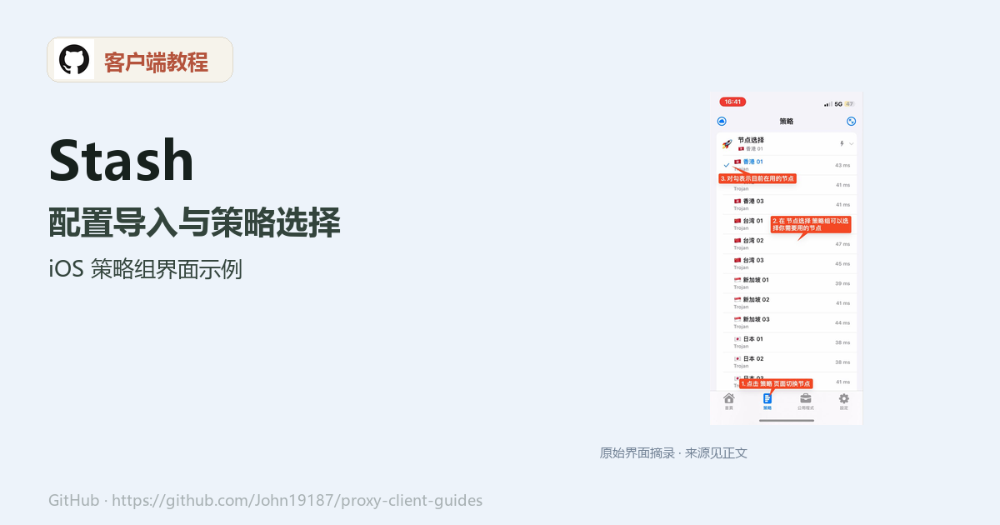
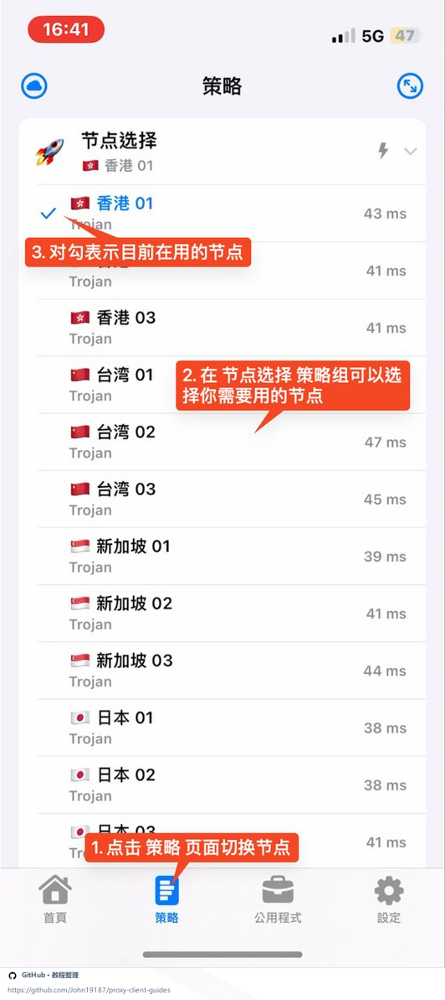

# 2026年 Stash下载与配置教程：iPhone导入订阅，选中配置和节点

Stash在iPhone、iPad通过完整配置取得节点、策略组和分流规则。从URL下载后，还要点选这份文件，再启动VPN、到“策略”选服务器。只下载不选中，可能仍在使用原来的Default配置。

**下载：**[Stash官方App Store](https://apps.apple.com/us/app/stash-rule-based-proxy/id1596063349?uo=4)；已安装可直接看[导入与选择配置](#import)。本页是iPhone／iPad教程，电脑和其他手机软件见[2026年机场通用客户端汇总与下载教程](../../README.md#choose)。

## Stash正式App Store下载与安装

商店开发者为**Stash Networks Limited**，ID **1596063349**，本页资料对应iOS／iPadOS 16.0及以上。打开上方条目，核对设备兼容与地区供给，用自己的账户按商店提示购买或下载；Mac安装器不能装到手机。

软件购买与节点服务分别处理。Stash需要兼容的完整配置，只有App登录账号或一条节点地址，不一定能完成本页操作。

## 远程地址：下载以后再点选配置

从自己的服务取得Stash兼容配置URL。远程地址让软件下载内容，也保留以后更新的来源，不用账户首页或登录页代替。

1. 在Stash打开“设置 → 配置文件”，选择“从URL下载”。
2. 粘贴完整个人地址，点“下载”，等待文件出现在列表。
3. 点选新增文件，让当前配置从Default或原文件切换到它，再回首页。

列表出现文件只说明下载完成。**仍是Default、没有预期节点：**先看当前选中项；已经选对文件却仍为空，再核对内容是否有实际代理。下载报错则保留错误，向服务确认返回的是本款兼容配置，见[完整配置与节点资源的区别](../../subscription-formats.md#format-table)。

个人URL和含它的配置可能带凭据，不公开分享。已有可用文件继续保留，导入新来源无需先删除旧配置。

### 本地文件：从“文件”App打开

配置在“文件”App、iCloud或OneDrive，选中它，通过分享／打开方式选择Stash。导入后同样回“设置 → 配置文件”点选该文件，再继续启动。

本地文件没有远程URL，节点变化后需另取新文件。可以把新文件作为另一份配置导入，原文件留作恢复依据，不必先复制一个虚构下载地址。

还没选择服务，可比较[多家VPN推荐与推广中的App和设备支持](https://github.com/John19187/The-40-Best-VPNs#翻墙客户端与使用方式怎么选)，以及[多家机场推荐与推广的完整配置、流量和设备条件](https://github.com/John19187/ji-chang-tui-jian#airport-clients)。部分服务有自有App，按真实方式接入；已有兼容配置的人直接继续。

## 启动VPN，在“策略”选择实际服务器

1. 停止另一款正在连接的VPN，再在Stash首页点“启动”。首次iOS请求添加VPN配置时允许，并完成本机验证。
2. 打开底部“策略”，进入配置提供的手动选择组，点选实际服务器。

   

   ①进入底部“策略”，②点组内服务器，③对勾表示当前选择。图中“节点选择”、香港01和43ms是示例，自己的组名及数值取决于配置。

3. 在Safari打开目标网站，再试日常应用，完成原来的访问任务。

手动组可选服务器，自动选择、故障转移、直连各有用途，不必把所有组改成同一节点。组名和成员按当前服务配置选择；图中的“全球直连=DIRECT”“漏网之鱼=节点选择”为该配置示例。

**刚启动就停止：**核对是否有其他VPN或占用VPN通道的工具重新接管。**保持运行却不能访问：**换当前配置的其他节点或网络比较，保留错误；修改DNS或覆写后才失败，就先撤回这项修改，不清空仍能工作的配置。

多个节点同期异常，再查服务账户、剩余流量与本家公告，核对故障地区和时间，并用同一节点比较另一条自己的网络。具体症状可看[本机连接排查](../../README.md#symptom-table)。

## 在原来源更新配置，App从商店升级

服务调整节点和规则，在配置列表更新原远程文件，再到“策略”选择仍有效的节点。远程内容可能替换文件中的本地改动，自己的规则另存副本；个人URL只有真正被重置后才更换，换出口无需添加相同订阅。

本地文件用户取得新文件再导入。升级Stash程序则使用自己的App Store账户，保存个人URL和自定义内容；套餐续期仍在服务账户完成，更新App不会续期服务。

## 新配置不适合时，选回原文件

在首页停止连接，再到“设置 → 配置文件”点选原可用文件，重新启动。恢复的是这次改动前的配置，无需重置整个App。需要另一款VPN时，同样先停止Stash再连接。

准备改用[Shadowrocket订阅](../shadowrocket/README.md#import)或[Quantumult X节点资源](../quantumult-x/README.md#import)，从服务取得目标格式，保留当前Stash配置到新软件能用。它们的订阅、节点资源和整份配置作用不同，不能只凭同一个账户就互换文件。

日常在“配置文件”维护来源，在“策略”换出口；不使用时停止首页连接，已保存的配置留待下次继续。

官方资料与图片范围

- [Stash官方App Store](https://apps.apple.com/us/app/stash-rule-based-proxy/id1596063349)、[官方快速上手](https://stash.wiki/get-started)：安装、远程和本地配置。
- 界面与版本说明：观察于2026-11-07，原文日期写作11/10/2026。原图展示首页启动和策略选节点，未标版本；本文使用隐去个人信息的展示副本。
- 特色图为本仓制作。安装与商店要求采用2026-11-14资料，第三方商标与原图权利保原来源。

## 文档更新记录

展开文档更新记录

- 2026-11-16　折叠更新记录，收起许可说明，撤下不必要的维护数据与贡献提示入口。 下载区标题标明本文固定版本或独立商店渠道，保原下载文件与旧锚。

- 2026-11-16　补充文末客户端与免费节点目录、文档维护入口；整理图源与版本说明，保留原安装包和操作内容。

## 客户端与相关资源目录

按设备和配置类型进入对应教程；旧版条目用于识别与迁移。软件之间的订阅、配置和备份条件仍以各篇说明为准。

展开客户端目录（含旧版与迁移说明）

| 客户端 | 设备或范围 | 教程用途 |
|---|---|---|
| **Stash（本篇）** | Apple设备 | 按本款条件导入Clash类配置 |
| [Clash Verge Rev](../clash-verge-rev/README.md) | Windows／macOS／Linux | Clash／Mihomo配置与系统代理 |
| [FlClash](../flclash/README.md) | 电脑／Android | 跨平台下载、导入与连接 |
| [Clash Party](../clash-party/README.md) | Windows／macOS／Linux | 安装版、便携版与订阅管理 |
| [Clash Mi](../clash-mi/README.md) | 跨平台 | 按本款入口导入Clash配置 |
| [ClashX Meta](../clashx-meta/README.md) | macOS | 菜单栏客户端与Mihomo配置 |
| [v2rayN](../v2rayn/README.md) | 电脑 | 节点订阅与系统代理 |
| [Hiddify](../hiddify/README.md) | 电脑／手机 | 跨平台导入与连接 |
| [Karing](../karing/README.md) | 电脑／手机 | 配置、规则与备份 |
| [Clash Meta for Android](../cmfa/README.md) | Android | Clash配置与VPN授权 |
| [v2rayNG](../v2rayng/README.md) | Android | 节点订阅与VPN连接 |
| [NekoBox for Android](../nekobox/README.md) | Android历史版本 | 1.4.2旧版订阅与迁移 |
| [Surfboard](../surfboard/README.md) | Android | 兼容配置与启动连接 |
| [sing-box](../sing-box/README.md) | 多平台 | 版本匹配的JSON配置 |
| [Shadowrocket](../shadowrocket/README.md) | iPhone／iPad | 节点、订阅与VPN连接 |
| [Quantumult X](../quantumult-x/README.md) | iPhone／iPad | 节点资源与完整配置的区别 |
| [Loon](../loon/README.md) | iPhone／iPad | 订阅、策略与分流 |
| [Surge](../surge/README.md) | iOS／macOS | 按平台配置与接管流量 |
| [OpenClash](../openclash/README.md) | OpenWrt | 固件条件、配置与插件 |
| [PassWall](../passwall/README.md) | OpenWrt | 订阅节点与主开关 |
| [ShellCrash](../shellcrash/README.md) | Linux／路由器 | 安装脚本与运行条件 |
| [Nextin专用客户端](../provider-app/README.md) | 按服务公开支持范围 | 仅适用于已证实的服务条件 |
| [Clash for Windows](../cfw/README.md) | 旧版／迁移 | 识别旧配置并迁移 |
| [Clash for Android](../cfa/README.md) | Android旧版／迁移 | 原版CFA与CMFA分开 |
| [ClashX](../clashx/README.md) | macOS旧版 | 普通ClashX身份与迁移 |
| [ClashX Pro](../clashx-pro/README.md) | macOS历史版本 | Pro托管配置与增强模式 |
| [旧Clash Verge](../old-clash-verge/README.md) | 旧版／迁移 | 与Rev区分及迁移 |
| [NekoRay](../nekoray/README.md) | 电脑旧版／迁移 | 旧资料与替代客户端 |
| [旧客户端迁移目录](../legacy/README.md) | 旧版资料 | 按原客户端寻找迁移说明 |

| 相关文档 | 内容 |
|---|---|
| [VPN推荐与使用方式](https://github.com/John19187/The-40-Best-VPNs) | 比较服务的平台、接入方式与客户端 |
| [机场推荐与套餐比较](https://github.com/John19187/ji-chang-tui-jian) | 比较月付、按量与套餐条件 |
| **2026年机场通用客户端汇总与下载教程（本文档仓）** | 按设备选软件并进入具体教程 |
| [机场与代理工具科普指南](https://github.com/John19187/ssr-v2ray-trojan-clash-guide) | 理解机场、协议、客户端、订阅与线路 |
| [免费节点与订阅资源](https://github.com/John19187/v2ray-SSR-Clash-Verge-Shadowrocke) | 查看公开资源与导入说明，不承诺持续可用 |

开源维护与许可

本文由John19187统一整理维护，实际修改记录见本页更新日志。原创文档采用[MIT许可](../../LICENSE)；软件、商标及第三方材料的权利与使用范围见[素材说明](../../NOTICE)。

本仓整理客户端下载与使用文档，不是客户端官方项目；软件是否开源、收费及其许可由各开发者分别决定。

