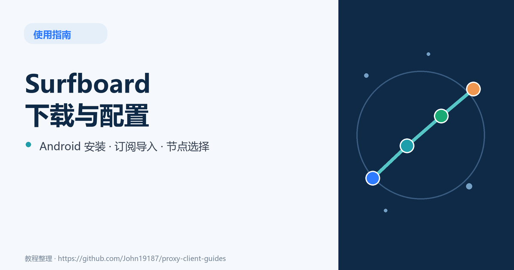
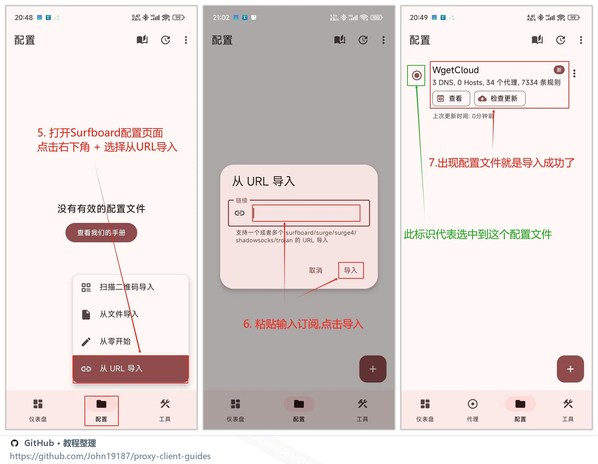
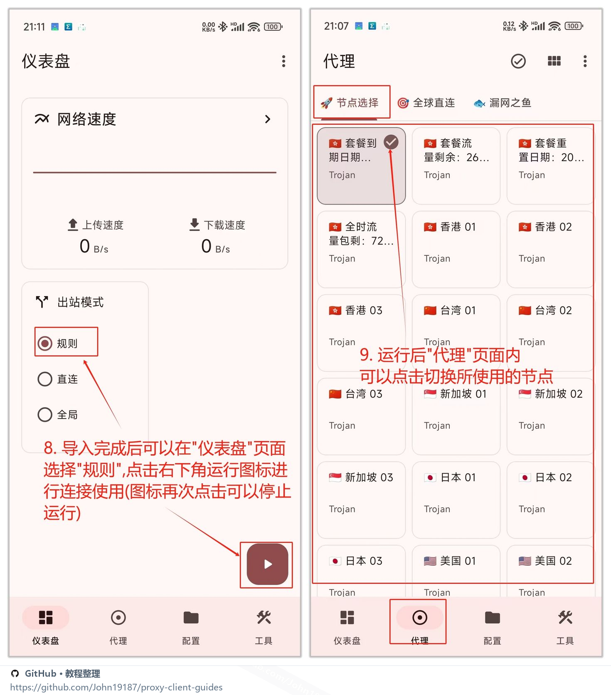
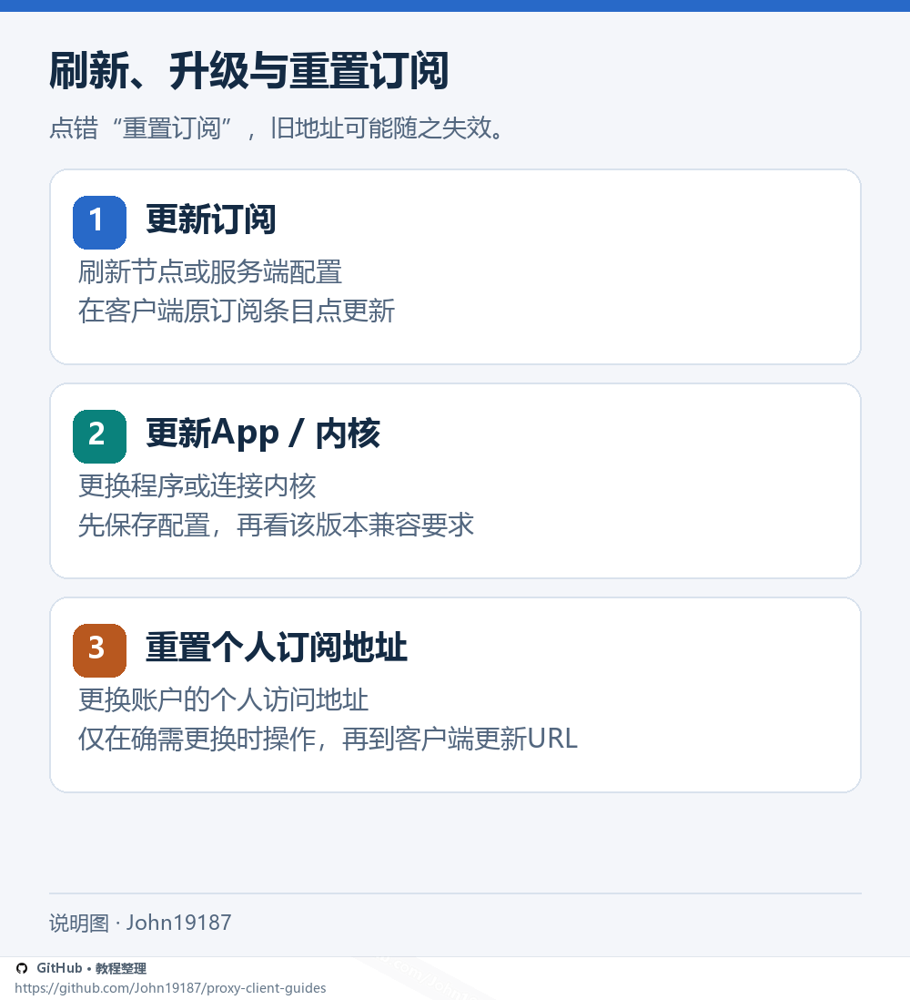

# 2026年 Surfboard下载与配置教程：安卓安装、订阅导入和节点选择

Surfboard是Android代理客户端。安装后，把服务商提供的**Surfboard／兼容Surge格式订阅**导入“配置”，选中下载好的文件，再到“仪表盘”启动VPN、在“代理”中选择节点。软件本身不附节点，已有兼容订阅可以继续使用，不需要因为换客户端重新购买服务。

普通64位Android手机选`arm64-v8a`，不清楚架构时可选体积较大的`universal`通用包。下面提供 **mobile-2.35.2** 的官方APK直链，资料整理于2026年11月14日。

## Surfboard mobile-2.35.2下载地址与安装

| Android设备架构 | 官方APK直接下载 |
|---|---|
| ARM64，常见64位手机 | [mobile-arm64-v8a-release.apk](https://github.com/getsurfboard/surfboard/releases/download/mobile-2.35.2/mobile-arm64-v8a-release.apk) |
| 32位ARM | [mobile-armeabi-v7a-release.apk](https://github.com/getsurfboard/surfboard/releases/download/mobile-2.35.2/mobile-armeabi-v7a-release.apk) |
| x86设备或对应模拟器 | [mobile-x86-release.apk](https://github.com/getsurfboard/surfboard/releases/download/mobile-2.35.2/mobile-x86-release.apk) |
| x86_64设备或对应模拟器 | [mobile-x86_64-release.apk](https://github.com/getsurfboard/surfboard/releases/download/mobile-2.35.2/mobile-x86_64-release.apk) |
| 不确定架构，或需要通用包 | [mobile-universal-release.apk](https://github.com/getsurfboard/surfboard/releases/download/mobile-2.35.2/mobile-universal-release.apk) |

下载完成后，在浏览器下载列表或文件管理器中打开APK，按Android安装器提示安装。系统要求允许“安装未知应用”时，只给本次使用的浏览器或文件管理器授权，安装后可收回。

已经安装Surfboard的，从原分发渠道覆盖更新。出现签名冲突时先取消安装，保留旧App与配置，再核对两个安装包的来源；不要先卸载旧版丢失资料。

## 把服务商订阅导入Surfboard

订阅链接让Surfboard下载包含节点、代理组和分流规则的配置。到已有机场或服务后台，复制Surfboard对应的订阅地址；服务明确标为兼容Surfboard的Surge格式也可使用。账户首页网址、账号密码和Clash YAML不能直接代替这份配置，修改文件后缀也不会改变格式。

1. 登录服务后台，找到Surfboard订阅入口，复制完整地址。服务有订阅下载开关或限时窗口时，先按后台提示开启；个人URL通常带凭据，不要发到公开截图或求助帖。
2. Surfboard正在运行时，先回“仪表盘”点右下角运行按钮停止。打开底部“配置”，点右下角“+”，选择“从 URL 导入”。
3. 在“链接”输入框粘贴完整地址，点击“导入”，等待配置出现在列表中。

左图是“配置”页的导入菜单，中图填写链接并提交，右图显示下载好的配置和左侧选择圆点。截图未显示版本号，用于辨认这些入口。

4. 点目标配置左侧的圆点，让它成为当前使用的文件。列表出现文件只表示下载完成，选中后才会使用其中的节点与规则；保存多份配置时，也在这里切换。

**下载失败、返回401／403**，回服务后台检查账户状态、订阅窗口是否仍开启，以及个人URL是否完整。**提示配置解析错误**，确认取得的是Surfboard兼容格式，URL返回的不是登录页或错误网页，保留错误原文交服务方核对。配置的格式与错误区别可查[订阅内容对照](../../subscription-formats.md#format-table)；已有可用配置先保留。

还没有服务时，可比较[多家VPN推荐与推广中的客户端和设备支持](https://github.com/John19187/The-40-Best-VPNs#翻墙客户端与使用方式怎么选)，或[多家机场推荐与推广中的套餐、流量和订阅支持](https://github.com/John19187/ji-chang-tui-jian#airport-clients)。这两篇包含推广，部分服务有自有App；选择时核对服务是否提供Surfboard兼容订阅，已有地址的人直接继续即可。

## 在仪表盘启动VPN，选择要使用的节点

选中配置后，启动Surfboard的VPN服务，再从该配置的代理组中选择出口。“规则”模式按服务配置决定哪些连接直连、哪些交给代理，首次使用保留它即可。

1. 先断开正在运行的其他VPN。回Surfboard“仪表盘”，在“出站模式”选择“规则”。
2. 点右下角三角形播放按钮。首次出现Android的VPN连接请求时，点系统对应的允许按钮。

左图标出“规则”与播放按钮，右图是启动后“代理”页的节点选择组。套餐到期和流量从账户查看；截图里的勾选示例落在信息条目上，实际操作应选“香港01”等服务器。

3. 打开底部“代理”，进入可以手动选择的组，点一个实际服务器。组名可能叫“节点选择”或“Proxy”，以自己的配置为准；所选卡片会显示勾选标记。
4. 用浏览器打开你实际需要的网站，再试需要使用的应用。能够完成原来的访问任务，就可以按当前配置继续使用。

代理组用于组织节点，组名与规则由服务商提供。图中“全球直连”使用`DIRECT`、“漏网之鱼”指向“节点选择”是这份配置的安排，使用同样配置的人保留服务默认值；其他配置不必照搬组名。

Surfboard通过Android VPN接管流量，实际转发仍受配置规则和应用排除设置影响。“VPN HTTP Proxy”是独立功能，首次连接不必额外打开。运行按钮状态或延迟数字各反映自己的环节，实际网页和应用可用才是本次目标。

**启动后立即停止**，先查看是否有另一款VPN自动重接，以及系统是否限制后台运行。**节点有延迟、网页仍超时**，先在当前手动组换一个实际节点，再切换Wi-Fi／移动网络比较，按[连接症状与处理](../../README.md#symptom-table)继续判断，不同时更改DNS和代理方式。只有某个应用失败时，再查看“工具”中的绕过配置是否排除了它；保留原选项，只恢复本次误排除的应用。

原来可用、后来多个节点同时失败时，先查看账户、流量与本家公告，核对故障时间及所用网络，再用同一节点比较Wi-Fi与自己的移动网络。

**系统显示 Surfboard 流量很高，会重复扣套餐吗？** Android 可能把经过 VPN 的各应用流量归到 Surfboard，单看系统统计不能判断套餐扣量，服务用量仍看本人账户。

## 服务调整节点后，更新原订阅

更新订阅会从保存的地址重新取得节点和规则，不会安装新版App，也不必每次重新导入相同URL。

1. 服务要求开启订阅下载窗口时，先在后台开启；这类窗口的有效时长按自己的服务说明执行。
2. 打开Surfboard“配置”，找到当前使用的文件，点卡片中的“检查更新”。按钮位置可对照上面的导入图右侧。
3. 等待下载完成，继续选用这份配置，到“代理”查看更新后的节点。

下载失败时，先确认后台窗口未关闭；服务要求停止代理再更新的，在“仪表盘”停止后重试。配置带有托管更新地址时，Surfboard也支持自动更新；限时下载窗口关闭期间，自动更新仍可能失败。

更新可能用远程内容替换本地修改，自定义过规则的人先另存必要内容。只有个人订阅URL真正变化时，才替换保存的地址；后台“重置订阅”与刷新节点不同，重置后，其他设备保存的旧URL也需要更换。

更新订阅取得配置，升级客户端改变软件版本，重置地址则更换个人下载凭据。按发生变化的对象选择操作即可。

## 升级、换设备和日常使用

升级Surfboard前，保存订阅URL、必要配置及自定义内容，在“仪表盘”停止连接，再从原渠道下载匹配架构的正式APK覆盖安装。日常断开也在“仪表盘”点同一个运行按钮，确认停止后再启动另一款VPN。

服务商只提供Clash／Mihomo订阅、没有Surfboard兼容格式时，可以按[Clash Meta for Android下载与配置教程](../cmfa/README.md)使用对应的成品订阅；不要把两种配置文件互换。要给Windows、Mac或Linux电脑使用同一服务，可看[Clash Verge Rev下载与配置教程](../clash-verge-rev/README.md)，从后台另取目标软件的兼容格式，同时使用条件仍按服务的设备与并发限制执行。

需要为其他设备选软件，查看[2026年机场通用客户端汇总与下载教程](../../README.md#choose)，其中按平台提供独立教程入口。

第一次把配置下载、选中并完成目标访问后，以后主要是在配置页维护来源、在代理页更换节点。保留这份可用配置，就不必在每次线路变化时重新安装软件。

来源注释与开发者资料

- [Surfboard 开发者原仓](https://github.com/getsurfboard/surfboard)
- [mobile-2.35.2 发行记录](https://github.com/getsurfboard/surfboard/releases/tag/mobile-2.35.2)
- [官方配置格式说明](https://getsurfboard.com/docs/profile-format/overview/)
- [维护者 FAQ：托管配置与流量统计](https://getsurfboard.com/docs/faq/)
- 界面与版本说明：URL导入、配置圆点、运行按钮和节点选择原图，原始观察时间为2026年11月7日。原教程下载包为mobile-2.30.0，截图未显示版本号；订阅开关及策略组安排按对应服务适用。
- 截图中的第三方商标归各自权利方，原图保留在项目素材记录，正文复用教程整理展示副本。封面为本仓库制作；更新、升级与重置关系图是通用说明图。

版本、商店要求和引用材料的整理日期：2026-11-14。

## 文档更新记录

展开文档更新记录

- 2026-11-16　折叠更新记录，收起许可说明，撤下不必要的维护数据与贡献提示入口。 下载区标题标明本文固定版本或独立商店渠道，保原下载文件与旧锚。

- 2026-11-16　补充文末客户端与免费节点目录、文档维护入口；整理图源与版本说明，保留原安装包和操作内容。

## 客户端与相关资源目录

按设备和配置类型进入对应教程；旧版条目用于识别与迁移。软件之间的订阅、配置和备份条件仍以各篇说明为准。

展开客户端目录（含旧版与迁移说明）

| 客户端 | 设备或范围 | 教程用途 |
|---|---|---|
| **Surfboard（本篇）** | Android | 兼容配置与启动连接 |
| [Clash Verge Rev](../clash-verge-rev/README.md) | Windows／macOS／Linux | Clash／Mihomo配置与系统代理 |
| [FlClash](../flclash/README.md) | 电脑／Android | 跨平台下载、导入与连接 |
| [Clash Party](../clash-party/README.md) | Windows／macOS／Linux | 安装版、便携版与订阅管理 |
| [Clash Mi](../clash-mi/README.md) | 跨平台 | 按本款入口导入Clash配置 |
| [ClashX Meta](../clashx-meta/README.md) | macOS | 菜单栏客户端与Mihomo配置 |
| [v2rayN](../v2rayn/README.md) | 电脑 | 节点订阅与系统代理 |
| [Hiddify](../hiddify/README.md) | 电脑／手机 | 跨平台导入与连接 |
| [Karing](../karing/README.md) | 电脑／手机 | 配置、规则与备份 |
| [Clash Meta for Android](../cmfa/README.md) | Android | Clash配置与VPN授权 |
| [v2rayNG](../v2rayng/README.md) | Android | 节点订阅与VPN连接 |
| [NekoBox for Android](../nekobox/README.md) | Android历史版本 | 1.4.2旧版订阅与迁移 |
| [sing-box](../sing-box/README.md) | 多平台 | 版本匹配的JSON配置 |
| [Shadowrocket](../shadowrocket/README.md) | iPhone／iPad | 节点、订阅与VPN连接 |
| [Stash](../stash/README.md) | Apple设备 | 按本款条件导入Clash类配置 |
| [Quantumult X](../quantumult-x/README.md) | iPhone／iPad | 节点资源与完整配置的区别 |
| [Loon](../loon/README.md) | iPhone／iPad | 订阅、策略与分流 |
| [Surge](../surge/README.md) | iOS／macOS | 按平台配置与接管流量 |
| [OpenClash](../openclash/README.md) | OpenWrt | 固件条件、配置与插件 |
| [PassWall](../passwall/README.md) | OpenWrt | 订阅节点与主开关 |
| [ShellCrash](../shellcrash/README.md) | Linux／路由器 | 安装脚本与运行条件 |
| [Nextin专用客户端](../provider-app/README.md) | 按服务公开支持范围 | 仅适用于已证实的服务条件 |
| [Clash for Windows](../cfw/README.md) | 旧版／迁移 | 识别旧配置并迁移 |
| [Clash for Android](../cfa/README.md) | Android旧版／迁移 | 原版CFA与CMFA分开 |
| [ClashX](../clashx/README.md) | macOS旧版 | 普通ClashX身份与迁移 |
| [ClashX Pro](../clashx-pro/README.md) | macOS历史版本 | Pro托管配置与增强模式 |
| [旧Clash Verge](../old-clash-verge/README.md) | 旧版／迁移 | 与Rev区分及迁移 |
| [NekoRay](../nekoray/README.md) | 电脑旧版／迁移 | 旧资料与替代客户端 |
| [旧客户端迁移目录](../legacy/README.md) | 旧版资料 | 按原客户端寻找迁移说明 |

| 相关文档 | 内容 |
|---|---|
| [VPN推荐与使用方式](https://github.com/John19187/The-40-Best-VPNs) | 比较服务的平台、接入方式与客户端 |
| [机场推荐与套餐比较](https://github.com/John19187/ji-chang-tui-jian) | 比较月付、按量与套餐条件 |
| **2026年机场通用客户端汇总与下载教程（本文档仓）** | 按设备选软件并进入具体教程 |
| [机场与代理工具科普指南](https://github.com/John19187/ssr-v2ray-trojan-clash-guide) | 理解机场、协议、客户端、订阅与线路 |
| [免费节点与订阅资源](https://github.com/John19187/v2ray-SSR-Clash-Verge-Shadowrocke) | 查看公开资源与导入说明，不承诺持续可用 |

开源维护与许可

本文由John19187统一整理维护，实际修改记录见本页更新日志。原创文档采用[MIT许可](../../LICENSE)；软件、商标及第三方材料的权利与使用范围见[素材说明](../../NOTICE)。

本仓整理客户端下载与使用文档，不是客户端官方项目；软件是否开源、收费及其许可由各开发者分别决定。

