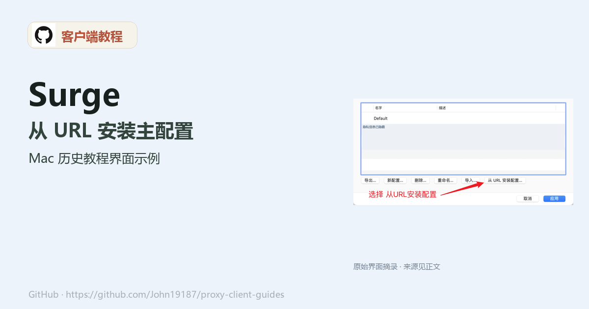
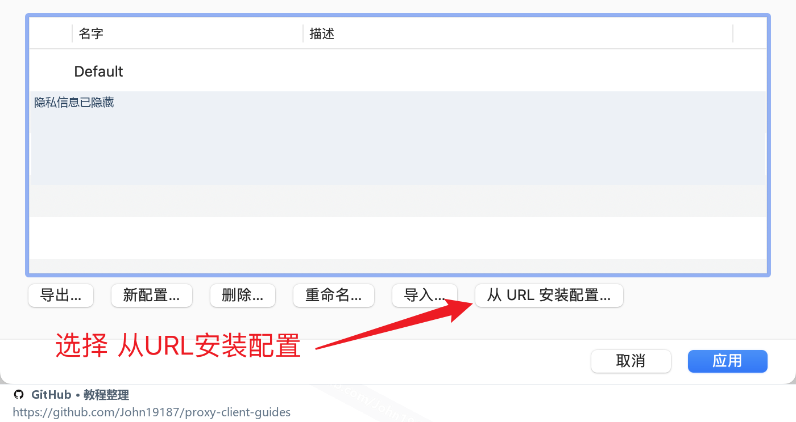
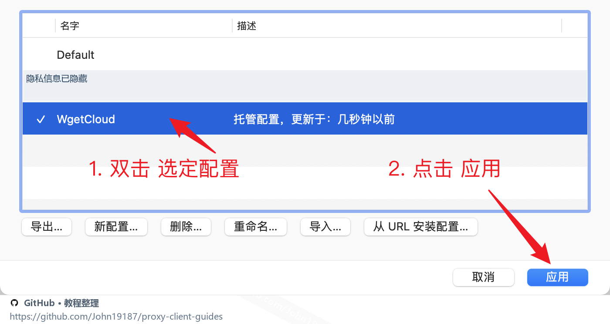

# 2026年 Surge下载与配置教程：Mac和iPhone导入托管配置，选节点并连接

Surge 的 Mac 版从官网下载 ZIP，iPhone 和 iPad 从 App Store 安装 Surge 5。软件还需要一份 Surge 兼容配置才能取得节点；由远程地址下载、后续还能更新的文件，在界面中称为托管配置。

Mac直接取[Surge v6官网ZIP](https://dl.nssurge.com/mac/v6/Surge-latest.zip)，iPhone／iPad取[Surge 5商店版](https://apps.apple.com/us/app/surge-5/id1442620678?uo=4)。其他平台软件见[2026年机场通用客户端汇总与下载教程](../../README.md#choose)。

## Surge下载：Mac与iPhone／iPad独立渠道

Mac使用[Surge v6官网ZIP](https://dl.nssurge.com/mac/v6/Surge-latest.zip)，要求macOS 12或更高。解压后把Surge放入“应用程序”再打开；可[试用7天](https://kb.nssurge.com/surge-knowledge-base/release-notes/surge-mac-6#trial)，全部功能开放，无需信用卡。正式Mac授权从[官网购买](https://nssurge.com/buy_now)，与iOS授权分开。Surge-latest.zip 是滚动地址，以后下载的内容可能变化；需要回退的人应自己保存原安装文件和配置。

iPhone／iPad 使用 [Surge 5 正式商店条目](https://apps.apple.com/us/app/surge-5/id1442620678?uo=4)，开发者 Surge Networks Inc.，ID 1442620678，本页适用要求为 iOS／iPadOS 17 或更高版本。Mac ZIP 不能用于手机，软件授权也应按各平台的实际条件确认。

## Mac：从 URL 安装托管配置

托管配置保留了远程下载来源，可以在服务更新后重新获取。节点服务与 Surge 软件授权分开；已有 Surge 配置 URL 可以直接导入。尚在选择接入方式时，可先比较[VPN 服务自带 App 与第三方客户端](https://github.com/John19187/The-40-Best-VPNs#翻墙客户端与使用方式怎么选)，再通过[机场推荐帖的 Surge 兼容条件](https://github.com/John19187/ji-chang-tui-jian#airport-clients)确认服务能否提供所需配置。

1. 从本人服务账户复制完整Surge配置URL。在Mac主窗口进入“更多（More）→ 配置（Profile）”，点击列表底部“从URL安装配置（Install from URL）”。
2. 粘贴地址，点击“完成”，等待托管文件出现在列表。URL 是个人凭据，不用官网或登录页替代。

窗口下方的“从 URL 安装配置”用于添加远程文件，不是导入电脑上已经保存的本地文件。

3. 双击需要运行的托管配置，看到左侧选择标记后，点击右下角“应用”。

图中①双击目标文件，左侧出现选择标记；②点右下角“应用”。文件名称按本人的配置辨认。

遇到托管类型选择时，完整托管让整份内容跟随远端，本地不能直接编辑；分段托管则只有引用部分由远端维护。只是使用服务提供的整份配置，与保留本地自定义片段是两种需求，不要把“全部勾选”当成统一做法。

**下载了新文件，为什么仍是旧节点？** 列表出现文件只说明保存成功，还要选中并应用它。**软件已授权，为什么没有节点？** 授权让客户端可用，节点来自兼容配置，这两个问题分别处理，不能靠反复下载软件解决。

## 在 Mac 开启系统代理

配置已经应用以后：

1. 打开左侧“策略”，在配置提供的手动节点选择组中点实际服务器。
2. 打开左侧“活动”，在窗口下方点击“系统代理”，选择“设置为系统代理”。
3. 用浏览器打开目标网站，再试日常应用。

系统代理让跟随这项设置的应用把请求交给 Surge。只有某个应用不跟随时，再查看该应用所需的接管方式；首次连接不必同时改增强模式、DNS 和规则。

停止使用时，回“活动”下方的“系统代理”菜单，取消“设置为系统代理”，再退出 App。退出后普通网页打不开，就在系统网络设置中查看代理是否残留，恢复本次操作前的值。目标访问与客户端运行不同，具体分支见[连接症状表](../../README.md#symptom-table)。

## iPhone／iPad：下载配置并启动 VPN

手机端从自己的 App Store 账户安装 Surge 5。已有其他 VPN 正在连接时先停止，再打开 Surge：

1. 点击左上角当前配置名称，进入配置列表，选择“从 URL 下载配置／Download from URL”。
2. 填入本人 Surge 配置地址并保存，选中需要使用的文件。服务提供一键入口时，也应阅读实际导入对象。
3. 回首页点“启动／Start”，允许系统添加 VPN 配置并完成本机验证。
4. 在底部选择“规则模式（Rule）”，到首页下方“策略组（Proxy）”选择实际服务器，再用Safari和目标应用完成访问。组名与直连策略按自己的配置，不统一套用其他服务的值。

手机上停止代理使用首页开关，再切回原来的 VPN。无论 Mac 还是手机，运行后目标失败都先保留规则，换已有节点或网络比较；基础代理不要求启用抓包、MitM 或脚本。

多个节点在同一时期失败，先查账户有效期、流量和你所用服务商的首页公告，记录地区、网络及发生时间，再用同一节点比较另一条自己的网络。

## 更新托管配置

服务调整节点时，在原托管配置上发起更新：

- **iPhone／iPad：** 点首页左上角配置名，长按需要更新的托管配置，选“现在更新”。完成后点右上角“完成”或✓，保持该配置被选中。
- **Mac：** 打开“更多 → 配置”，右键目标托管配置，选“立刻检查更新”，再确认它已选中和应用；需要重新载入时，从菜单栏Surge图标选“重载配置”。

服务要求先开放订阅下载窗口时，先在该服务后台开启。完整托管会跟随整份远端内容，自定义修改先另存；分段托管只更新被托管的部分，本地文件则要另取新版。

解析失败先看是否取得完整 Surge 配置，而非单节点资源或其他软件的文件。个人 URL 只有重置后才需要替换，普通刷新不改变凭据。

## 更新 Surge 软件

Mac 从官网或 App 内的正式更新入口升级，iOS 从自己的 App Store 账户更新。升级前保存现有配置与个人来源，软件版本变化与服务续费分别处理。

首次连接完成后，日常更换出口在策略中进行，服务修改内容则更新原托管文件。Mac与手机各自保留可用配置和来源即可。

iPhone准备改用[Stash导入配置](../stash/README.md#import)，或Android设备需要[Surfboard兼容配置](../surfboard/README.md#import)，先让原服务提供目标客户端适用的内容。名字中同为Surge格式不能保证所有字段相同，两款软件的授权和本机设置也分别处理。

来源注释与开发者资料

- [Surge 官网与 Mac 下载](https://nssurge.com/)
- [Surge 5 正式商店条目](https://apps.apple.com/us/app/surge-5/id1442620678)
- [Surge 官方手册](https://manual.nssurge.com/)
- [配置格式与托管方式](https://manual.nssurge.com/profile/format.html)
- Mac操作图未标客户端版本，图片中的个人信息已遮盖。

版本、商店要求和引用材料的整理日期：2026-11-14。

## 文档更新记录

展开文档更新记录

- 2026-11-16　折叠更新记录，收起许可说明，撤下不必要的维护数据与贡献提示入口。 下载区标题标明本文固定版本或独立商店渠道，保原下载文件与旧锚。

- 2026-11-16　补充文末客户端与免费节点目录、文档维护入口；整理图源与版本说明，保留原安装包和操作内容。

## 客户端与相关资源目录

按设备和配置类型进入对应教程；旧版条目用于识别与迁移。软件之间的订阅、配置和备份条件仍以各篇说明为准。

展开客户端目录（含旧版与迁移说明）

| 客户端 | 设备或范围 | 教程用途 |
|---|---|---|
| **Surge（本篇）** | iOS／macOS | 按平台配置与接管流量 |
| [Clash Verge Rev](../clash-verge-rev/README.md) | Windows／macOS／Linux | Clash／Mihomo配置与系统代理 |
| [FlClash](../flclash/README.md) | 电脑／Android | 跨平台下载、导入与连接 |
| [Clash Party](../clash-party/README.md) | Windows／macOS／Linux | 安装版、便携版与订阅管理 |
| [Clash Mi](../clash-mi/README.md) | 跨平台 | 按本款入口导入Clash配置 |
| [ClashX Meta](../clashx-meta/README.md) | macOS | 菜单栏客户端与Mihomo配置 |
| [v2rayN](../v2rayn/README.md) | 电脑 | 节点订阅与系统代理 |
| [Hiddify](../hiddify/README.md) | 电脑／手机 | 跨平台导入与连接 |
| [Karing](../karing/README.md) | 电脑／手机 | 配置、规则与备份 |
| [Clash Meta for Android](../cmfa/README.md) | Android | Clash配置与VPN授权 |
| [v2rayNG](../v2rayng/README.md) | Android | 节点订阅与VPN连接 |
| [NekoBox for Android](../nekobox/README.md) | Android历史版本 | 1.4.2旧版订阅与迁移 |
| [Surfboard](../surfboard/README.md) | Android | 兼容配置与启动连接 |
| [sing-box](../sing-box/README.md) | 多平台 | 版本匹配的JSON配置 |
| [Shadowrocket](../shadowrocket/README.md) | iPhone／iPad | 节点、订阅与VPN连接 |
| [Stash](../stash/README.md) | Apple设备 | 按本款条件导入Clash类配置 |
| [Quantumult X](../quantumult-x/README.md) | iPhone／iPad | 节点资源与完整配置的区别 |
| [Loon](../loon/README.md) | iPhone／iPad | 订阅、策略与分流 |
| [OpenClash](../openclash/README.md) | OpenWrt | 固件条件、配置与插件 |
| [PassWall](../passwall/README.md) | OpenWrt | 订阅节点与主开关 |
| [ShellCrash](../shellcrash/README.md) | Linux／路由器 | 安装脚本与运行条件 |
| [Nextin](../provider-app/README.md) | 按服务公开支持范围 | 服务指定Nextin时的安装与连接 |
| [Clash for Windows](../cfw/README.md) | 旧版／迁移 | 识别旧配置并迁移 |
| [Clash for Android](../cfa/README.md) | Android旧版／迁移 | 原版CFA与CMFA分开 |
| [ClashX](../clashx/README.md) | macOS旧版 | 普通ClashX身份与迁移 |
| [ClashX Pro](../clashx-pro/README.md) | macOS历史版本 | Pro托管配置与增强模式 |
| [旧Clash Verge](../old-clash-verge/README.md) | 旧版／迁移 | 与Rev区分及迁移 |
| [NekoRay](../nekoray/README.md) | 电脑旧版／迁移 | 旧资料与替代客户端 |
| [旧客户端迁移目录](../legacy/README.md) | 旧版资料 | 按原客户端寻找迁移说明 |

| 相关文档 | 内容 |
|---|---|
| [VPN推荐与使用方式](https://github.com/John19187/The-40-Best-VPNs) | 比较服务的平台、接入方式与客户端 |
| [机场推荐与套餐比较](https://github.com/John19187/ji-chang-tui-jian) | 比较月付、按量与套餐条件 |
| [2026年机场通用客户端汇总与下载教程](../../README.md#choose) | 按设备选软件并进入具体教程 |
| [机场与代理工具科普指南](https://github.com/John19187/ssr-v2ray-trojan-clash-guide) | 理解机场、协议、客户端、订阅与线路 |
| [免费节点与订阅资源](https://github.com/John19187/v2ray-SSR-Clash-Verge-Shadowrocke) | 查看公开资源与导入说明，不承诺持续可用 |

开源维护与许可

本文由John19187统一整理维护，实际修改记录见本页更新日志。原创文档采用[MIT许可](../../LICENSE)；软件、商标及第三方材料的权利与使用范围见[素材说明](../../NOTICE)。

本仓整理客户端下载与使用文档，不是客户端官方项目；软件是否开源、收费及其许可由各开发者分别决定。

