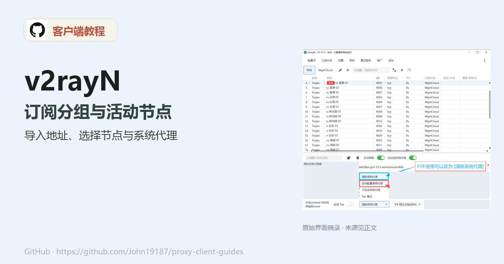
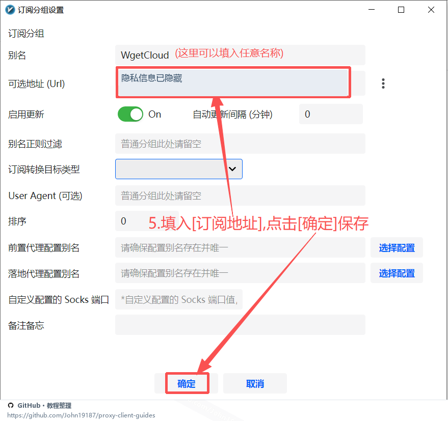
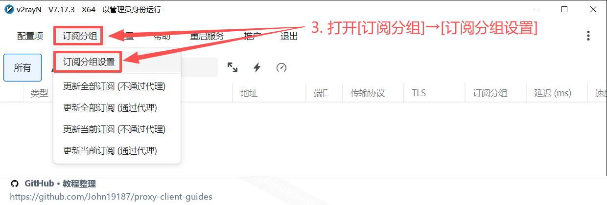
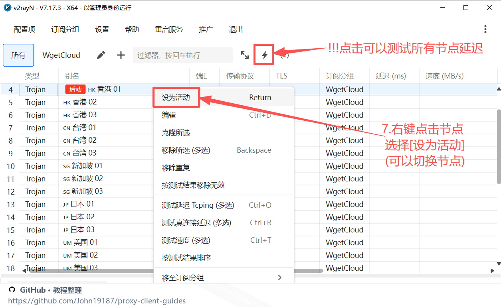
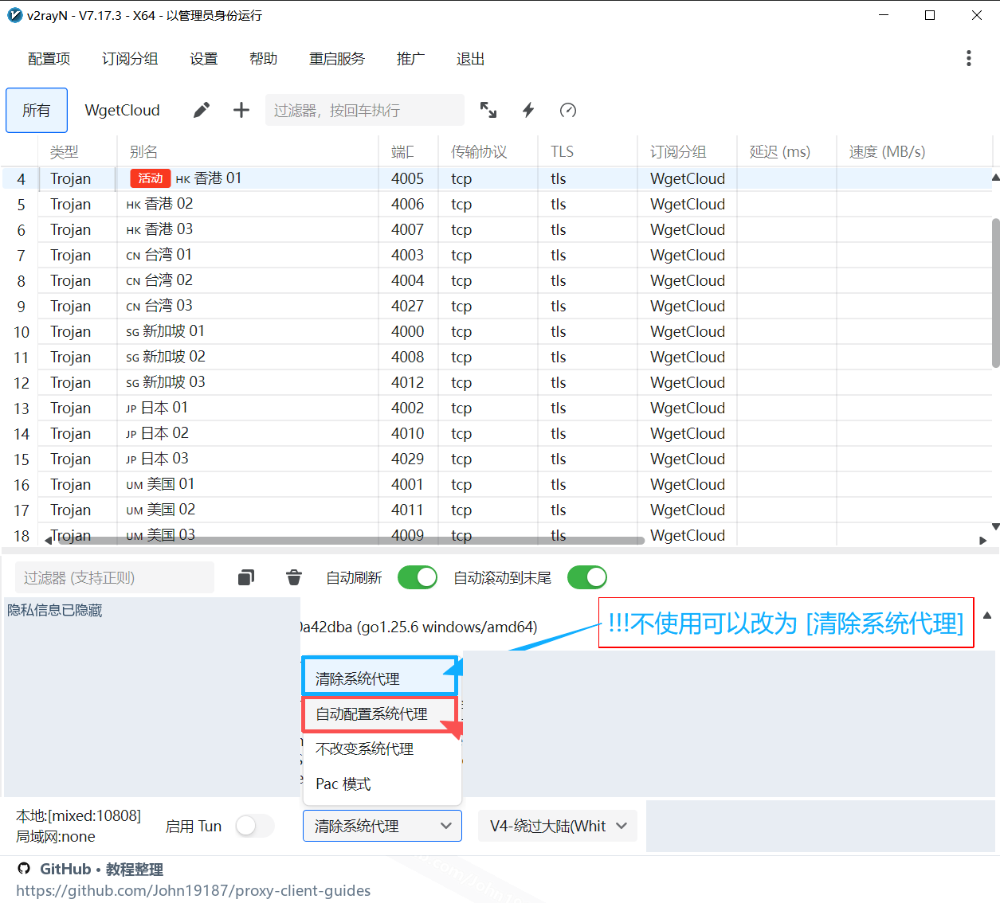

# 2026年 v2rayN下载与配置教程：添加订阅分组，选择活动节点和系统代理

Windows电脑先下载对应CPU的v2rayN ZIP，完整解压后运行。订阅地址先保存到“订阅分组”，更新后才会出现节点；随后选节点“设为活动”，并自动配置系统代理。只有一条VMess、VLESS或Trojan分享链接时，使用单节点导入分支。

[下载与解压](#packages) · [订阅和单节点](#import) · [设为活动并连接](#connect) · [更新与备份](#update)。其他设备可看[2026年机场通用客户端汇总与下载教程](../../README.md#choose)。

## v2rayN 7.25.6下载与解压安装

下面保留7.25.6固定安装包，整理于2026年11月14日。Windows要求10+，Mac要求13.6+；维护者文件说明列出Linux的Debian 12+、Ubuntu 22.04+、Fedora 36+、Redhat 9+。普通Windows ZIP使用WPF界面，带`desktop`的使用Avalonia，按CPU选包后完整解压。

| 平台／CPU | 正式版直接下载 |
|---|---|
| Windows x64 | [v2rayN-windows-64.zip](https://github.com/2dust/v2rayN/releases/download/7.25.6/v2rayN-windows-64.zip) [v2rayN-windows-64-desktop.zip](https://github.com/2dust/v2rayN/releases/download/7.25.6/v2rayN-windows-64-desktop.zip) |
| Windows ARM64 | [v2rayN-windows-arm64.zip](https://github.com/2dust/v2rayN/releases/download/7.25.6/v2rayN-windows-arm64.zip) [v2rayN-windows-arm64-desktop.zip](https://github.com/2dust/v2rayN/releases/download/7.25.6/v2rayN-windows-arm64-desktop.zip) |
| Windows x86／32位 | [v2rayN-windows-86.zip](https://github.com/2dust/v2rayN/releases/download/7.25.6/v2rayN-windows-86.zip) [v2rayN-windows-86-desktop.zip](https://github.com/2dust/v2rayN/releases/download/7.25.6/v2rayN-windows-86-desktop.zip) |
| Mac Intel | **DMG包：** [v2rayN-macos-64.dmg](https://github.com/2dust/v2rayN/releases/download/7.25.6/v2rayN-macos-64.dmg) [v2rayN-macos-64.zip](https://github.com/2dust/v2rayN/releases/download/7.25.6/v2rayN-macos-64.zip) |
| Mac Apple Silicon | **DMG包：** [v2rayN-macos-arm64.dmg](https://github.com/2dust/v2rayN/releases/download/7.25.6/v2rayN-macos-arm64.dmg) [v2rayN-macos-arm64.zip](https://github.com/2dust/v2rayN/releases/download/7.25.6/v2rayN-macos-arm64.zip) |
| Linux x64 | **DEB包：** [v2rayN-linux-64.deb](https://github.com/2dust/v2rayN/releases/download/7.25.6/v2rayN-linux-64.deb) **RPM包：** [v2rayN-linux-rhel-64.rpm](https://github.com/2dust/v2rayN/releases/download/7.25.6/v2rayN-linux-rhel-64.rpm) [v2rayN-linux-64.zip](https://github.com/2dust/v2rayN/releases/download/7.25.6/v2rayN-linux-64.zip) |
| Linux ARM64 | **DEB包：** [v2rayN-linux-arm64.deb](https://github.com/2dust/v2rayN/releases/download/7.25.6/v2rayN-linux-arm64.deb) **RPM包：** [v2rayN-linux-rhel-arm64.rpm](https://github.com/2dust/v2rayN/releases/download/7.25.6/v2rayN-linux-rhel-arm64.rpm) [v2rayN-linux-arm64.zip](https://github.com/2dust/v2rayN/releases/download/7.25.6/v2rayN-linux-arm64.zip) |
| Linux loong64 | **DEB包：** [v2rayN-linux-loong64.deb](https://github.com/2dust/v2rayN/releases/download/7.25.6/v2rayN-linux-loong64.deb) **RPM包：** [v2rayN-linux-rhel-loong64.rpm](https://github.com/2dust/v2rayN/releases/download/7.25.6/v2rayN-linux-rhel-loong64.rpm) |
| Linux riscv64 | **DEB包：** [v2rayN-linux-riscv64.deb](https://github.com/2dust/v2rayN/releases/download/7.25.6/v2rayN-linux-riscv64.deb) **RPM包：** [v2rayN-linux-rhel-riscv64.rpm](https://github.com/2dust/v2rayN/releases/download/7.25.6/v2rayN-linux-rhel-riscv64.rpm) |

Windows先在“设置 → 系统 → 关于”查看x64、ARM64或32位，再选相应普通或desktop包。下载ZIP后完整解压到固定目录，运行主程序，不在压缩预览里直接启动。Mac按Intel或Apple Silicon取DMG／ZIP；Linux按架构与包管理器选DEB、RPM或ZIP。

Mac打开DMG，把App移入“应用程序”后启动；使用ZIP时先解压。Linux用对应系统的软件安装器安装DEB／RPM；ZIP则完整解压后运行主程序，系统要求可执行权限时，再为该程序文件授予权限。

首次在Windows使用，没有界面偏好可以从对应CPU的普通ZIP开始；`desktop`不是另一种CPU。包内已有部分Core，其他Core按[维护者文件说明](https://github.com/2dust/v2rayN/wiki/Release-files-introduction)处理，不能只保留主程序、删掉旁边的资源。

先打开“设置 → 打开存储所在的位置”，找到当前实际数据目录。升级前退出v2rayN，保存该目录及对应程序目录；资料可能位于程序旁，也可能在系统用户目录。不要下载别人已经填入个人订阅的程序目录。

## 添加订阅分组，再下载节点列表

订阅地址是服务商提供的个人链接，v2rayN通过它取得服务器参数。“订阅分组”负责保存这个地址，并把同一来源的节点放在一起；保存分组以后，还要更新一次，节点才会出现在主列表。

登录自己的服务账户，复制供v2rayN使用的订阅URL，不用账户网页代替。个人地址可能含认证信息，不公开分享。下图来自7.17.3的Avalonia界面，用于辨认对应操作，外观不等同7.25.6的所有平台和界面版本。

1. 打开“订阅分组 → 订阅分组设置”，点击“添加”。
2. 别名填写本机分组名，URL填个人订阅，点击“确定”。过滤或转换按实际要求，普通导入保持默认。

   

   别名只用来辨认分组，URL决定服务器来源。

3. 回主窗口选中刚保存的分组，打开“订阅分组”菜单。首次尚无可用代理，选“更新当前订阅（不通过代理）”；已有可用代理且下载确实需要它时，再选“通过代理”。

   

4. 等更新完成，查看主列表中该来源的节点。分组保存与节点下载是两步，只保存URL不会立刻换服务器。

分组已经保存而节点没出现，先从菜单更新当前订阅，再看错误属于被拒绝、超时还是格式不支持。没有可用代理却选择“通过代理”下载时，改用“不通过代理”重新更新；不必反复添加相同URL。

真正用于连接的是下一节设为“活动”的服务器。更新订阅可能增删节点，更新完成后仍按需要选择当前出口。

### 只有一条分享链接

`vless://`、`vmess://`、`trojan://`等受支持链接描述单台服务器。复制完整内容，打开主菜单“配置项 → 从剪贴板导入分享链接”；看到成功导入数量及列表中的新记录后，再选择活动节点。它没有订阅URL时，只保存当时的参数，以后更新分组不会替它取得新服务器。

手上若是带规则和DNS的整份Clash YAML，先看[配置和节点订阅的区别](../../subscription-formats.md)，需要保留整份配置时可选择[FlClash](../flclash/README.md)等对应客户端。所需规则和DNS按目标客户端格式另行保留。

## 选择活动节点并开启系统代理

“活动”标记表示v2rayN当前使用哪台服务器。系统代理则让读取系统设置的应用把请求交给v2rayN，两项都完成后，再检查实际访问。

1. 在节点列表双击所需节点，或选中后按回车；右键菜单也可选“设为活动”。

   

   测试延迟不会替代“设为活动”。

2. 右键系统托盘图标，在“系统代理”选择“自动配置系统代理”；有对应底部选择框的界面也可从这里选择。

   

3. 选择需要的路由方案，例如国内请求直连可查看“绕过大陆”，再打开目标网页完成访问。路由决定请求走向，不改变当前服务账户。

“不改变”不会清除原来已经开启的代理。需要停用本次v2rayN连接时，用“清除系统代理”；工作电脑原有代理或PAC脚本则按原值恢复。PAC是决定请求走哪条路线的自动配置脚本，与服务节点本身不同。

### 节点有延迟数值，为什么网页仍然打不开

目标网页访问失败时，先看当前活动节点、系统代理和请求采用的路由，再根据握手或认证错误处理。遇到`x509`或TLS证书错误，核对系统时间、节点域名和证书，不用跳过校验掩盖原因。

浏览器正常但特定应用没有流量，查看该应用是否跟随系统代理；需要TUN虚拟网卡时，按实际内核与权限设置，见[系统代理和TUN的区别](../../README.md#proxy-tun)。若不同节点都突然失败，再查账户、流量和你所用服务商的首页公告，用同一节点换自己的热点比较。

## 服务调整节点以后，怎样更新订阅

进入“订阅分组”菜单，更新对应来源即可取得新节点。列表变化后，重新选择要用的服务器并设为活动。这个动作更新服务内容，不会安装v2rayN新版本，也不会使到期账户恢复有效。

## 升级v2rayN以前保存程序和设置

7.25.6发行说明移除了`allowInsecure`参数。升级后出现证书错误，核对设备时间、节点证书与服务说明，不套用旧教程继续跳过校验。

升级前先在“系统代理”清除本次代理，使用过TUN时也关闭它，再从托盘退出。退出前先用“设置 → 打开存储所在的位置”找到数据，退出后备份这个完整数据目录。便携版还保存对应程序目录，新包解压到另一目录。回退时匹配旧程序和升级前资料，单独替换一个EXE可能留下新旧资源混用。

给Android手机使用同一服务，可按[v2rayNG订阅分组教程](../v2rayng/README.md#import)取得适配手机的入口。v2rayN与v2rayNG是不同软件，不互相复制程序或整套数据目录。

希望用服务自带App，可比较[多家VPN推荐与推广的接入方式](https://github.com/John19187/The-40-Best-VPNs#翻墙客户端与使用方式怎么选)；需要节点订阅，可比较[多家机场推荐与推广的格式、流量和设备条件](https://github.com/John19187/ji-chang-tui-jian#airport-clients)。导入v2rayN需要本家兼容的节点订阅，已有兼容订阅就继续使用。

日常在分组菜单更新节点，在主列表选择活动节点；停止使用时，清除本次系统代理再从托盘退出。程序已经崩溃而普通网页不通，按[当前系统的代理恢复步骤](../../README.md#restore-and-report)撤回本次修改，保留原公司代理，随后再处理程序故障。

来源注释与开发者资料

- [维护者文件说明](https://github.com/2dust/v2rayN/wiki/Release-files-introduction)
- [2dust/v2rayN](https://github.com/2dust/v2rayN)
- [2dust/v2rayN 正式发行记录](https://github.com/2dust/v2rayN/releases/latest)
- [v2rayN订阅协议](https://github.com/2dust/v2rayN/wiki/Description-of-subscription)
- [v2rayN 7.25.6发行说明](https://github.com/2dust/v2rayN/releases/tag/7.25.6)
- 操作截图来自V7.17.3，下载文件固定为7.25.6；资料整理于2026-11-14。
- v2rayN 7.25.6已移除`allowInsecure`。遇到证书错误时保留校验，按该版本的证书与发行说明处理。

## 文档更新记录

展开文档更新记录

- 2026-11-16　折叠更新记录，收起许可说明，撤下不必要的维护数据与贡献提示入口。 下载区标题标明本文固定版本或独立商店渠道，保原下载文件与旧锚。

- 2026-11-16　补充文末客户端与免费节点目录、文档维护入口；整理图源与版本说明，保留原安装包和操作内容。

## 客户端与相关资源目录

按设备和配置类型进入对应教程；旧版条目用于识别与迁移。软件之间的订阅、配置和备份条件仍以各篇说明为准。

展开客户端目录（含旧版与迁移说明）

| 客户端 | 设备或范围 | 教程用途 |
|---|---|---|
| **v2rayN（本篇）** | 电脑 | 节点订阅与系统代理 |
| [Clash Verge Rev](../clash-verge-rev/README.md) | Windows／macOS／Linux | Clash／Mihomo配置与系统代理 |
| [FlClash](../flclash/README.md) | 电脑／Android | 跨平台下载、导入与连接 |
| [Clash Party](../clash-party/README.md) | Windows／macOS／Linux | 安装版、便携版与订阅管理 |
| [Clash Mi](../clash-mi/README.md) | 跨平台 | 按本款入口导入Clash配置 |
| [ClashX Meta](../clashx-meta/README.md) | macOS | 菜单栏客户端与Mihomo配置 |
| [Hiddify](../hiddify/README.md) | 电脑／手机 | 跨平台导入与连接 |
| [Karing](../karing/README.md) | 电脑／手机 | 配置、规则与备份 |
| [Clash Meta for Android](../cmfa/README.md) | Android | Clash配置与VPN授权 |
| [v2rayNG](../v2rayng/README.md) | Android | 节点订阅与VPN连接 |
| [NekoBox for Android](../nekobox/README.md) | Android历史版本 | 1.4.2旧版订阅与迁移 |
| [Surfboard](../surfboard/README.md) | Android | 兼容配置与启动连接 |
| [sing-box](../sing-box/README.md) | 多平台 | 版本匹配的JSON配置 |
| [Shadowrocket](../shadowrocket/README.md) | iPhone／iPad | 节点、订阅与VPN连接 |
| [Stash](../stash/README.md) | Apple设备 | 按本款条件导入Clash类配置 |
| [Quantumult X](../quantumult-x/README.md) | iPhone／iPad | 节点资源与完整配置的区别 |
| [Loon](../loon/README.md) | iPhone／iPad | 订阅、策略与分流 |
| [Surge](../surge/README.md) | iOS／macOS | 按平台配置与接管流量 |
| [OpenClash](../openclash/README.md) | OpenWrt | 固件条件、配置与插件 |
| [PassWall](../passwall/README.md) | OpenWrt | 订阅节点与主开关 |
| [ShellCrash](../shellcrash/README.md) | Linux／路由器 | 安装脚本与运行条件 |
| [Nextin](../provider-app/README.md) | 按服务公开支持范围 | 服务指定Nextin时的安装与连接 |
| [Clash for Windows](../cfw/README.md) | 旧版／迁移 | 识别旧配置并迁移 |
| [Clash for Android](../cfa/README.md) | Android旧版／迁移 | 原版CFA与CMFA分开 |
| [ClashX](../clashx/README.md) | macOS旧版 | 普通ClashX身份与迁移 |
| [ClashX Pro](../clashx-pro/README.md) | macOS历史版本 | Pro托管配置与增强模式 |
| [旧Clash Verge](../old-clash-verge/README.md) | 旧版／迁移 | 与Rev区分及迁移 |
| [NekoRay](../nekoray/README.md) | 电脑旧版／迁移 | 旧资料与替代客户端 |
| [旧客户端迁移目录](../legacy/README.md) | 旧版资料 | 按原客户端寻找迁移说明 |

| 相关文档 | 内容 |
|---|---|
| [VPN推荐与使用方式](https://github.com/John19187/The-40-Best-VPNs) | 比较服务的平台、接入方式与客户端 |
| [机场推荐与套餐比较](https://github.com/John19187/ji-chang-tui-jian) | 比较月付、按量与套餐条件 |
| [2026年机场通用客户端汇总与下载教程](../../README.md#choose) | 按设备选软件并进入具体教程 |
| [机场与代理工具科普指南](https://github.com/John19187/ssr-v2ray-trojan-clash-guide) | 理解机场、协议、客户端、订阅与线路 |
| [免费节点与订阅资源](https://github.com/John19187/v2ray-SSR-Clash-Verge-Shadowrocke) | 查看公开资源与导入说明，不承诺持续可用 |

开源维护与许可

本文由John19187统一整理维护，实际修改记录见本页更新日志。原创文档采用[MIT许可](../../LICENSE)；软件、商标及第三方材料的权利与使用范围见[素材说明](../../NOTICE)。

本仓整理客户端下载与使用文档，不是客户端官方项目；软件是否开源、收费及其许可由各开发者分别决定。

