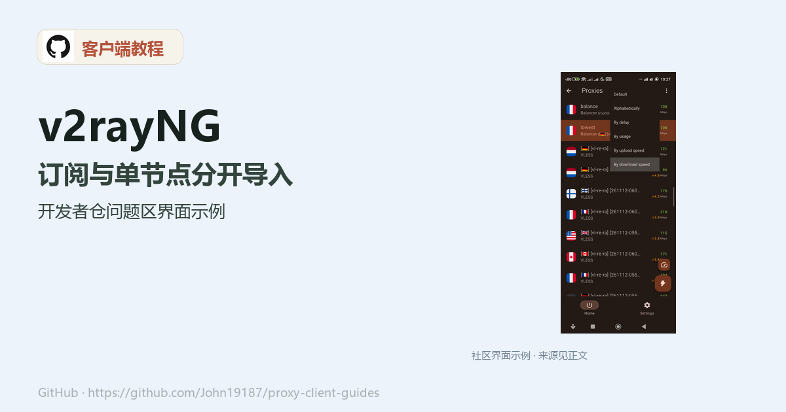
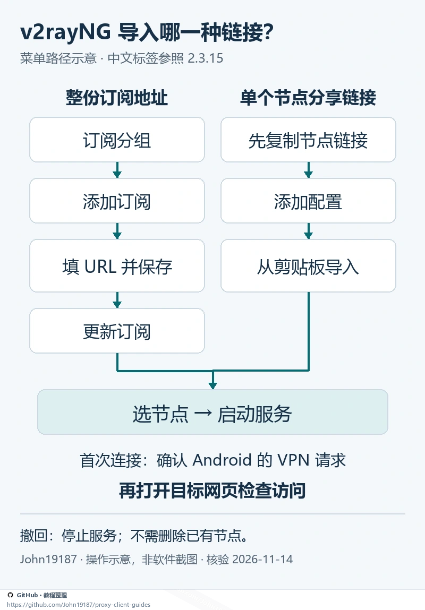

# 2026年 v2rayNG下载与配置教程：Android订阅分组、节点导入和连接

v2rayNG在Android手机上使用服务提供的节点。复制自己的兼容订阅，在“订阅分组”保存URL并执行“更新订阅”，取得节点后选中其中一项、启动服务，允许Android VPN请求，再用目标网页或应用确认访问。

下面保留**2.3.15、Android 7.0及以上**的十个官方APK。软件本身不提供服务账号；已有安装可直接看[订阅导入](#import)，已有兼容订阅也无需重新购买。

封面底图来自开发者仓issue #6433的社区贡献，用作社区界面示意。

## v2rayNG 2.3.15下载与安卓安装

### 选择设备架构和安装渠道

APK 文件名中的架构需要与设备支持的 ABI 对应。ABI 决定手机能运行哪一类原生程序；只知道处理器品牌，未必能判断系统支持的 ABI。可以查看设备厂商资料或已有设备信息中的 ABI，再按下表下载。

| 设备支持的 ABI | 选择的文件后缀 | 适用说明 |
| --- | --- | --- |
| `arm64-v8a` | `arm64-v8a.apk` | 支持 64 位 ARM 应用的 Android 设备 |
| `armeabi-v7a` | `armeabi-v7a.apk` | 支持 32 位 ARM 应用的设备 |
| `x86` | `x86.apk` | 支持 32 位 x86 应用的设备或模拟器 |
| `x86_64` | `x86_64.apk` | 支持 64 位 x86 应用的设备或模拟器 |
| 暂时无法确认 | `universal.apk` | 包含多种架构，文件较大，可用它减少选错架构的麻烦 |

同一架构还有普通版与文件名带 `fdroid` 的版本。首次安装可选下列普通版；已经使用 F-Droid 渠道或 `fdroid` 包的用户，继续沿原渠道安装。升级时保持渠道和签名一致，避免 Android 拒绝覆盖。`universal` 解决的是架构选择，不能解决渠道签名冲突。

### v2rayNG 2.3.15 官方 APK

以下链接均指向 [2.3.15 官方发行页](https://github.com/2dust/v2rayNG/releases/tag/2.3.15)中的原文件。

| 架构 | 普通版完整文件名与下载 | fdroid 版完整文件名与下载 |
| --- | --- | --- |
| ARM 64 位 | [v2rayNG_2.3.15_arm64-v8a.apk](https://github.com/2dust/v2rayNG/releases/download/2.3.15/v2rayNG_2.3.15_arm64-v8a.apk) | [v2rayNG_2.3.15-fdroid_arm64-v8a.apk](https://github.com/2dust/v2rayNG/releases/download/2.3.15/v2rayNG_2.3.15-fdroid_arm64-v8a.apk) |
| ARM 32 位 | [v2rayNG_2.3.15_armeabi-v7a.apk](https://github.com/2dust/v2rayNG/releases/download/2.3.15/v2rayNG_2.3.15_armeabi-v7a.apk) | [v2rayNG_2.3.15-fdroid_armeabi-v7a.apk](https://github.com/2dust/v2rayNG/releases/download/2.3.15/v2rayNG_2.3.15-fdroid_armeabi-v7a.apk) |
| x86 32 位 | [v2rayNG_2.3.15_x86.apk](https://github.com/2dust/v2rayNG/releases/download/2.3.15/v2rayNG_2.3.15_x86.apk) | [v2rayNG_2.3.15-fdroid_x86.apk](https://github.com/2dust/v2rayNG/releases/download/2.3.15/v2rayNG_2.3.15-fdroid_x86.apk) |
| x86 64 位 | [v2rayNG_2.3.15_x86_64.apk](https://github.com/2dust/v2rayNG/releases/download/2.3.15/v2rayNG_2.3.15_x86_64.apk) | [v2rayNG_2.3.15-fdroid_x86_64.apk](https://github.com/2dust/v2rayNG/releases/download/2.3.15/v2rayNG_2.3.15-fdroid_x86_64.apk) |
| 多架构 | [v2rayNG_2.3.15_universal.apk](https://github.com/2dust/v2rayNG/releases/download/2.3.15/v2rayNG_2.3.15_universal.apk) | [v2rayNG_2.3.15-fdroid_universal.apk](https://github.com/2dust/v2rayNG/releases/download/2.3.15/v2rayNG_2.3.15-fdroid_universal.apk) |

### 从下载文件完成安装

1. 在手机浏览器下载所选 APK，下载完成后点开文件；也可以在文件管理器的下载目录中找到它，进入 Android 安装器。
2. 如果系统要求允许安装此来源的应用，只给本次打开 APK 所用的浏览器或文件管理器授权。不同手机可能显示为「允许来自此来源的应用」或类似名称，按提示返回安装器继续。
3. 在安装器中确认安装。完成后打开 v2rayNG，进入节点列表；首次使用列表为空是正常状态，下一步需要导入订阅。

若显示安装包不兼容，先核对 Android 版本与 ABI；下载未完成则重新取得完整文件。若提示与已安装应用签名冲突，保留现有应用和配置，回原渠道找可覆盖的安装包。不要为了继续安装先卸载，卸载可能使本地配置丢失。

## 用订阅地址建立分组，再取得节点

登录自己的服务账户，复制适用于v2rayNG／V2Ray的完整订阅。个人HTTPS链接可能含账号参数，不公开URL、二维码和含它们的截图；后台登录页或购买页不能用来下载节点。

1. 打开侧边导航的“订阅分组”，点“添加订阅”。
2. “备注”填便于辨认的名字，例如“手机日常”；“URL（可选）”粘贴完整订阅，保持“启用更新”，点保存。虽然字段标为可选，在线订阅这条路径仍需要URL。
3. 回节点主列表，打开菜单执行“更新订阅”。等待下载结果，再查看对应分组里的节点。

备注只区分本机资料，不改变套餐。保存分组只记住来源，执行更新才下载服务器；后续更新继续用这份分组，不每天新建同名项。

**分组有了却没有节点：**先看是否执行更新、当前查看的分组是否正确、该组是否启用更新。更新报错再核对完整URL和账户状态；“解码失败”“不正确的协议”应保留错误原文和客户端版本，让服务方确认返回格式，不把整份订阅反复塞进单节点入口。

### 只有一条分享链接或二维码

服务给的是`vmess://`、`vless://`、`trojan://`、`ss://`等受支持的单节点链接，复制完整内容，在“添加配置”选“从剪贴板导入”。二维码则从“添加配置 → 扫描二维码”进入，允许本次相机访问后扫描。

这是参照2.3.15中文菜单整理的路径说明图，不是按钮位置截图。单节点没有远程订阅来源时，更新分组不会替它取得新参数；二维码也只是一种内容载体。还分不清整份配置和节点链接，可看[订阅格式对照](../../subscription-formats.md#format-table)。

## 选节点，启动Android VPN服务

1. 在主列表打开所需分组，点选要使用的节点。分组决定看哪份来源，选中的服务器决定本次连接对象。
2. 点主界面的服务启动按钮。首次出现Android VPN请求，确认来自v2rayNG后允许；普通使用保持VPN模式，无需开启Root模式。
3. 返回应用看到服务运行后，用实际需要的网页或应用完成加载、登录等目标操作。

Android同一用户或工作资料只能有一个活动VPN服务；另一款VPN启动可能让当前服务停止。切换前明确本次使用的App，停止旧连接后再启动v2rayNG，见[Android VPN说明](https://developer.android.com/develop/connectivity/vpn)。

### 启动后立即失败，或一直无法访问

没有取得VPN权限，重新查看系统请求和当前VPN应用，再从v2rayNG启动，保留仍出现的错误。服务保持运行而单个节点失败，换同一订阅另一节点，再试相同目标，同时看账户流量与有效期。

多节点都失败，确认手机直连网页能用，再在Wi-Fi和自己的移动网络间作一次对照；核对账户、流量与本家公告，保存发生时间、网络及脱敏日志，让服务支持核对线路。

### 回到桌面或熄屏后断开

返回应用发现服务已停止，先看另一款VPN是否启动；与后台运行有关，再查看手机对v2rayNG的电池、后台限制，只调整该App后重试。

应用仍显示服务运行而网页打不开，先重试同一目标、换节点对照，记录时间、网络与错误，不直接判断成后台清理。只有一个应用失败，且以前启用过“分应用代理”，核对它按当前模式是被包含还是绕行；未启用就无需为排错新增这套设置。

### 延迟有数字，网页仍打不开

TCPing主要反映服务器端口的TCP连通，后面的协议握手、认证和实际目标仍可能失败。“真连接延迟”也只测试指定目标。网页正常而检测异常，保留可用配置与错误，不按测试结果批量删除节点。

用完回v2rayNG停止服务即可，订阅和节点会保留。提交错误或日志前去掉令牌、节点身份参数和个人账号，不需要从清空配置开始排查。

## 节点更新用原分组，软件升级走原渠道

服务调整服务器后，在原订阅分组执行“更新订阅”。节点可能增删或改名，更新完成再选本次使用的节点。只有服务换地址、旧URL失效或主动重置订阅时，再编辑分组URL并更新；其他设备使用同一旧地址，也要同步修改。

更新失败而旧节点仍能用，先保留它们，核对该组更新开关、完整URL和账户状态，仍失败就交具体错误。重建同一分组不会修复来源问题。

### 升级APK以前保存配置

1. 保存订阅URL；手动节点、路由及自定义内容，通过“备份 & 还原 → 备份配置”保存到自己控制的位置。
2. 到[官方发行入口](https://github.com/2dust/v2rayNG/releases)取与原安装同渠道、同ABI的包。上表保留2.3.15固定原包，新版本另从官方发行入口获取。
3. 在Android安装器覆盖安装。签名冲突就停止覆盖、核对渠道，保留旧App和备份。
4. 打开升级后的应用，确认所需资料仍在，选节点、启动并完成实际访问；需要服务的新列表，再单独更新订阅。

## 为电脑或另一款软件接续服务

同一服务要在电脑使用，可看[v2rayN订阅分组与系统代理教程](../v2rayn/README.md#import)，取得电脑端适配入口。v2rayN与v2rayNG是不同客户端，迁移时分别保存配置，并下载目标客户端对应平台的安装包。

服务要求改用别款，可直达[Karing添加订阅](../karing/README.md#import)或[Hiddify连接设置](../hiddify/README.md#connect)，按目标自己的格式导入。需要按Android、iOS、电脑整体选择，则看[2026年机场通用客户端汇总与下载教程](../../README.md#choose)。

尚未选服务，可比较[多家VPN推荐与推广中的App和平台支持](https://github.com/John19187/The-40-Best-VPNs#翻墙客户端与使用方式怎么选)及[多家机场推荐与推广中的流量、设备和订阅条件](https://github.com/John19187/ji-chang-tui-jian#airport-clients)。部分服务有自有App，按其实际接入路径选择。已有兼容服务的人，日常在原分组更新节点、选中一项连接即可。

## 资料与图片来源

- [v2rayNG 原项目](https://github.com/2dust/v2rayNG)与 [2.3.15 发行页](https://github.com/2dust/v2rayNG/releases/tag/2.3.15)：项目身份及本文固定版本安装包。
- [2.3.15 简体中文菜单资源](https://github.com/2dust/v2rayNG/blob/2.3.15/V2rayNG/app/src/main/res/values-zh-rCN/strings.xml)：订阅分组、导入、测试与配置备份等名称。
- [Android Developers：VPN](https://developer.android.com/develop/connectivity/vpn)：首次连接授权及 Android VPN 服务行为。
- [封面底图原出处：issue #6433](https://github.com/2dust/v2rayNG/issues/6433)、[原图片](https://github.com/user-attachments/assets/a7a95d35-0522-459c-8702-db08ccfb448c)：原作者以该帖署名为准，原帖版本信息未列明。

本文整理日期为 2026-11-14，使用已有版本资料与中文菜单说明，不包含本次重新安装或联网测速的亲测结论。路径说明图由 John19187 整理，教程仓库为 [proxy-client-guides](https://github.com/John19187/proxy-client-guides)。

## 文档更新记录

展开文档更新记录

- 2026-11-16　折叠更新记录，收起许可说明，撤下不必要的维护数据与贡献提示入口。 下载区标题标明本文固定版本或独立商店渠道，保原下载文件与旧锚。

- 2026-11-16　补充文末客户端与免费节点目录、文档维护入口；整理图源与版本说明，保留原安装包和操作内容。

## 客户端与相关资源目录

按设备和配置类型进入对应教程；旧版条目用于识别与迁移。软件之间的订阅、配置和备份条件仍以各篇说明为准。

展开客户端目录（含旧版与迁移说明）

| 客户端 | 设备或范围 | 教程用途 |
|---|---|---|
| **v2rayNG（本篇）** | Android | 节点订阅与VPN连接 |
| [Clash Verge Rev](../clash-verge-rev/README.md) | Windows／macOS／Linux | Clash／Mihomo配置与系统代理 |
| [FlClash](../flclash/README.md) | 电脑／Android | 跨平台下载、导入与连接 |
| [Clash Party](../clash-party/README.md) | Windows／macOS／Linux | 安装版、便携版与订阅管理 |
| [Clash Mi](../clash-mi/README.md) | 跨平台 | 按本款入口导入Clash配置 |
| [ClashX Meta](../clashx-meta/README.md) | macOS | 菜单栏客户端与Mihomo配置 |
| [v2rayN](../v2rayn/README.md) | 电脑 | 节点订阅与系统代理 |
| [Hiddify](../hiddify/README.md) | 电脑／手机 | 跨平台导入与连接 |
| [Karing](../karing/README.md) | 电脑／手机 | 配置、规则与备份 |
| [Clash Meta for Android](../cmfa/README.md) | Android | Clash配置与VPN授权 |
| [NekoBox for Android](../nekobox/README.md) | Android历史版本 | 1.4.2旧版订阅与迁移 |
| [Surfboard](../surfboard/README.md) | Android | 兼容配置与启动连接 |
| [sing-box](../sing-box/README.md) | 多平台 | 版本匹配的JSON配置 |
| [Shadowrocket](../shadowrocket/README.md) | iPhone／iPad | 节点、订阅与VPN连接 |
| [Stash](../stash/README.md) | Apple设备 | 按本款条件导入Clash类配置 |
| [Quantumult X](../quantumult-x/README.md) | iPhone／iPad | 节点资源与完整配置的区别 |
| [Loon](../loon/README.md) | iPhone／iPad | 订阅、策略与分流 |
| [Surge](../surge/README.md) | iOS／macOS | 按平台配置与接管流量 |
| [OpenClash](../openclash/README.md) | OpenWrt | 固件条件、配置与插件 |
| [PassWall](../passwall/README.md) | OpenWrt | 订阅节点与主开关 |
| [ShellCrash](../shellcrash/README.md) | Linux／路由器 | 安装脚本与运行条件 |
| [Nextin专用客户端](../provider-app/README.md) | 按服务公开支持范围 | 仅适用于已证实的服务条件 |
| [Clash for Windows](../cfw/README.md) | 旧版／迁移 | 识别旧配置并迁移 |
| [Clash for Android](../cfa/README.md) | Android旧版／迁移 | 原版CFA与CMFA分开 |
| [ClashX](../clashx/README.md) | macOS旧版 | 普通ClashX身份与迁移 |
| [ClashX Pro](../clashx-pro/README.md) | macOS历史版本 | Pro托管配置与增强模式 |
| [旧Clash Verge](../old-clash-verge/README.md) | 旧版／迁移 | 与Rev区分及迁移 |
| [NekoRay](../nekoray/README.md) | 电脑旧版／迁移 | 旧资料与替代客户端 |
| [旧客户端迁移目录](../legacy/README.md) | 旧版资料 | 按原客户端寻找迁移说明 |

| 相关文档 | 内容 |
|---|---|
| [VPN推荐与使用方式](https://github.com/John19187/The-40-Best-VPNs) | 比较服务的平台、接入方式与客户端 |
| [机场推荐与套餐比较](https://github.com/John19187/ji-chang-tui-jian) | 比较月付、按量与套餐条件 |
| **2026年机场通用客户端汇总与下载教程（本文档仓）** | 按设备选软件并进入具体教程 |
| [机场与代理工具科普指南](https://github.com/John19187/ssr-v2ray-trojan-clash-guide) | 理解机场、协议、客户端、订阅与线路 |
| [免费节点与订阅资源](https://github.com/John19187/v2ray-SSR-Clash-Verge-Shadowrocke) | 查看公开资源与导入说明，不承诺持续可用 |

开源维护与许可

本文由John19187统一整理维护，实际修改记录见本页更新日志。原创文档采用[MIT许可](../../LICENSE)；软件、商标及第三方材料的权利与使用范围见[素材说明](../../NOTICE)。

本仓整理客户端下载与使用文档，不是客户端官方项目；软件是否开源、收费及其许可由各开发者分别决定。

