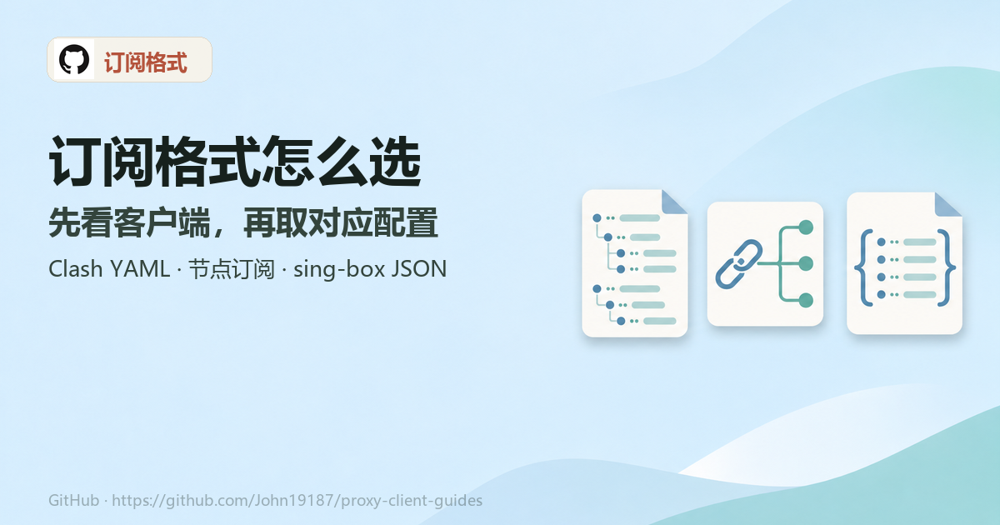
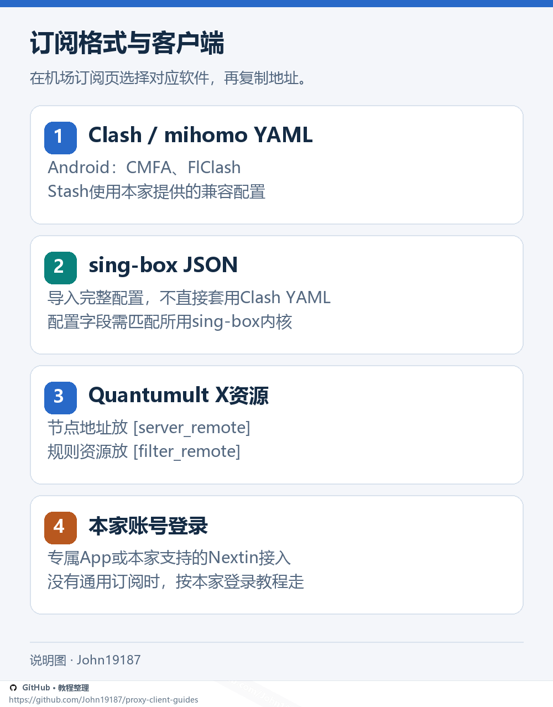
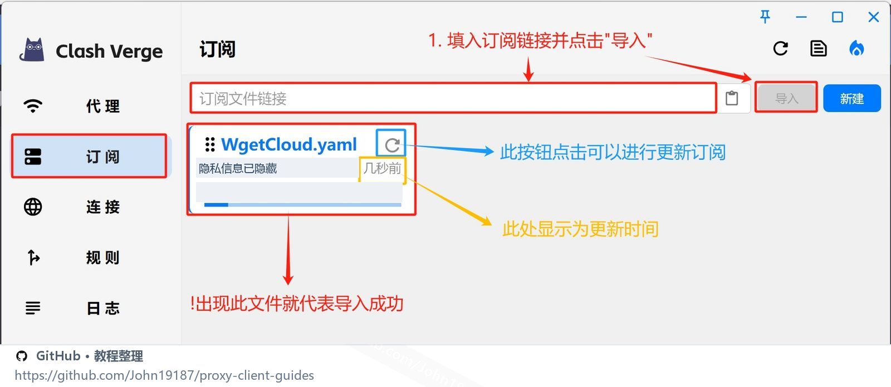
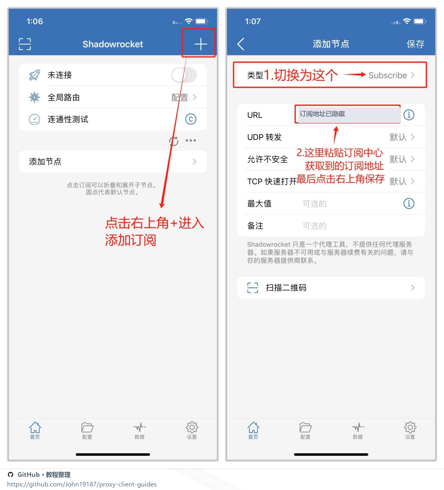
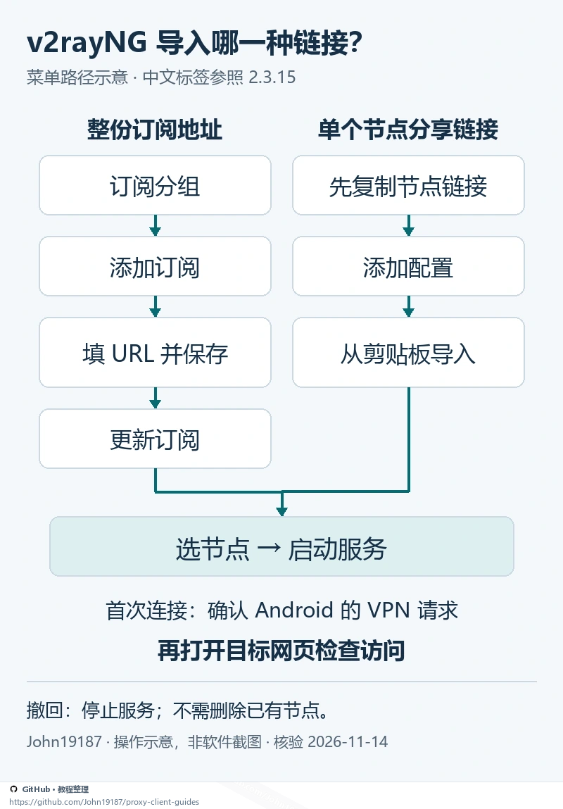
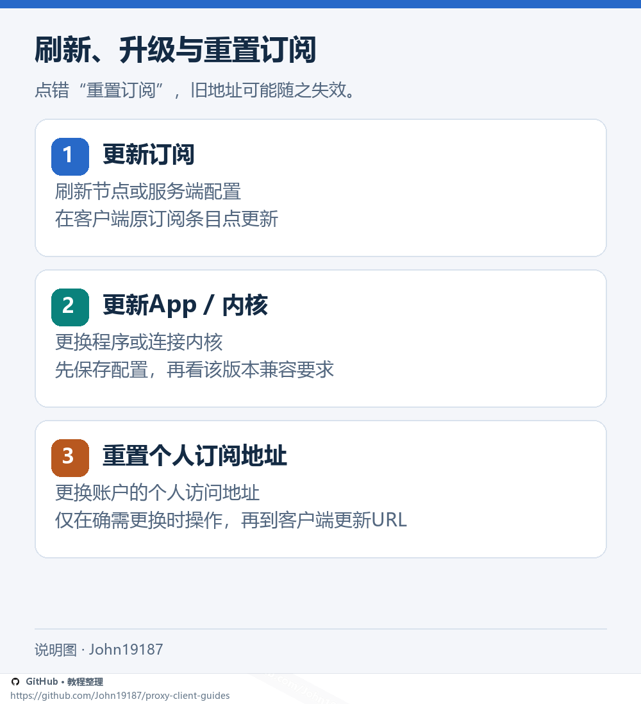

# 2026年 机场订阅链接怎么导入：Clash、v2rayN、sing-box与iOS格式对照

从服务账户复制与目标客户端对应的订阅。Clash／Mihomo通常载入完整配置，v2rayN、v2rayNG先在分组保存地址再更新节点；只有一条`vless://`等分享链接，就用支持该协议的单节点入口。下表可以直接按手里的内容找到导入位置。

节点描述怎样连接服务器，完整配置还可能安排策略组、规则和DNS。订阅按目标客户端支持的内容格式选择，专属App使用自己的账户登录。已有服务按它提供的目标格式继续即可。

[按客户端选格式](#format-table) · [换电脑或手机](#switch-client) · [导入报错](#import-errors) · [更新与重置地址](#subscription-update)

## 账户里有多个订阅按钮，应该复制哪一个

打开服务账户的“订阅”“我的订阅”或使用教程，找到与软件对应的复制按钮。浏览器地址栏里的账户首页、购买页和教程页，通常只会下载一张网页，不能交给客户端当配置。

同一套餐可以提供多个订阅入口，它们使用同一服务，却按不同软件组织内容。客户端支持的协议、规则语法和字段不同，电脑能导入的内容，手机不一定能直接读取。因此先确定要用的App，再复制它对应的地址；不确定时，把软件全名和版本告诉客服。

准备选新套餐，把“是否提供目标客户端的格式”列入条件。[多家机场推荐与推广](https://github.com/John19187/ji-chang-tui-jian#airport-clients)可比较流量、设备和客户端支持；已有地址按下表继续。

| 账户提供的内容 | 对应客户端入口 | 导入后得到什么 |
|---|---|---|
| Clash／Mihomo 完整配置 | Rev 的“订阅”；FlClash、CMFA、Clash Mi 的远程配置 | 节点、策略组，以及配置中实际包含的规则、DNS 等设置 |
| v2rayN／v2rayNG 节点订阅 | “订阅分组”或对应分组设置，保存后更新 | 一组可识别的节点；客户端自己的路由规则另行管理 |
| 单条 `vless://`、`vmess://`、`trojan://`、`ss://` 等链接 | 支持该协议的“从剪贴板导入”、扫码或添加服务器 | 一条节点记录；支持范围仍看客户端版本 |
| sing-box 完整 JSON | 新增配置时选 Remote／远程或 Local／本地 | 与内核版本匹配的整份配置，不一定有可手选的节点组 |
| Stash、Surge、Surfboard 的专用配置 | 对应软件的配置下载或导入入口 | 本款软件支持的节点、策略和规则，按目标软件要求的格式导入 |
| Quantumult X 节点资源 | 现有配置的 `[server_remote]` | 节点资源；完整配置和规则资源是另外的对象 |
| Loon 节点订阅 | 配置区的订阅节点；主配置记录在 `[Remote Proxy]` | 节点下载后由策略组使用，整份主配置另行管理 |
| 专属 App 账户、站点识别码 | 服务指定 App 的登录或添加服务页面 | 该服务提供的套餐与线路，不是通用客户端配置 |

说明图按内容区分格式。选择 Stash、Surge 或 QX 时，优先取账户明确标注该软件的入口，不把一种配置的规则直接贴进另一种配置。

**二维码和一键导入为什么也会选错？** 它们只是传递内容的方式。二维码可以装单节点，也可以装整份订阅地址；一键导入会唤起已经注册该链接类型的 App。唤起了旧软件就取消，复制目标软件的订阅地址，改在新 App 中手动添加。

个人订阅地址、二维码和导出的完整配置可能包含访问凭据。只放进自己的客户端；请求帮助时保留错误文字，遮住完整 URL、账户信息和二维码，不上传到来源不明的在线转换站。

## 换客户端时，按格式导入订阅

### Clash 客户端：导入整份配置，再选中它

下面用Windows的Clash Verge Rev说明；先从服务账户取得Clash／Mihomo格式地址。

1. 打开Rev“订阅”，把地址粘贴到“订阅文件链接”，点击“导入”。
2. 下载完成后，点击新配置的名称或卡片区域，选中这份配置。
3. 打开“代理”，展开配置中的策略组并选择节点。需要浏览器使用时，到“设置”开启系统代理，再访问目标网页。

图上方是地址输入与“导入”按钮，配置卡片右上角的圆形箭头用于以后刷新。完整安装和连接流程见[Rev图文教程](downloads/clash-verge-rev/README.md#import)；FlClash对应的是[配置页的URL导入](downloads/flclash/README.md#import)。

换到 iPhone 的 Stash 时，回账户取 Stash 兼容配置，在“设置 → 配置文件 → 从 URL 下载”添加并选中它。电脑上的本地覆写、DNS 和自定义规则不会因为使用同一套餐自动同步到手机；需要的设置按 Stash 的格式单独保留。

### Shadowrocket：添加节点窗口里，类型选 Subscribe

小火箭接收订阅和添加单节点共用一个新增窗口，关键在“类型”字段。

1. 打开 Shadowrocket 首页，点右上角“+”。
2. 将类型改为 **Subscribe**，在 URL 栏粘贴自己的 Shadowrocket 兼容订阅；备注填写容易辨认的名称。
3. 点右上角“保存”，回首页展开这条订阅。节点出现后，选择其中一个并开启顶部连接开关，按 iOS 提示允许 VPN 配置。

右侧窗口虽然叫“添加节点”，类型为Subscribe时添加的是远程订阅。只有一条节点分享链接，则使用受支持的剪贴板或扫码入口；它不会因此成为可刷新的整份套餐。更多操作见[小火箭独立教程](downloads/shadowrocket/README.md#import)。

### 电脑v2rayN与Android v2rayNG：分别保存分组，再更新

两款都分“保存来源”和“下载节点”两步，按当前设备选一条路线：

- **电脑v2rayN：**打开“订阅分组 → 订阅分组设置”新增分组，填别名与URL并确定，再从分组菜单更新；首次无可用代理，选不通过代理的下载方式。完整操作直达[v2rayN订阅分组教程](downloads/v2rayn/README.md#import)。
- **Android v2rayNG：**在“订阅分组”添加记录，填备注与URL并保存，再执行“更新订阅”，见[v2rayNG导入与启动](downloads/v2rayng/README.md#import)。

节点出现后再设为当前节点、启动相应接管。只填好地址，列表还可能没有变化。

这张是菜单路径说明图，不是软件截图。左侧订阅路线以后可继续刷新，右侧单节点路线只添加复制的那条记录。具体界面和运行步骤分别见[v2rayN 订阅分组](downloads/v2rayn/README.md#import)与[v2rayNG 两种导入方式](downloads/v2rayng/README.md#import)。

### sing-box、QX和Loon：按各自的配置与资源入口添加

sing-box 图形客户端中的 Remote 用于远程 JSON，Local 用于本地文件。导入前确认配置适配所用内核；旧 JSON 出现已废弃字段时，按照配置迁移说明处理，不能把 Clash YAML 改个 `.json` 扩展名使用。[sing-box 配置教程](downloads/sing-box/README.md#import)保留了下载与配置分支。

Quantumult X的节点资源放在`[server_remote]`，规则资源对应`[filter_remote]`，完整配置则通过整份配置导入。只有节点资源URL时，不能用它覆盖整个主配置。遇到一键导入确认框，先看对象行：添加“引用资源·节点”和替换整份配置影响不同；后者会改变原策略、规则和DNS，先保存原文件。具体入口见[QX节点资源与配置](downloads/quantumult-x/README.md#import)。

Loon同样要区分节点订阅与完整配置：下载出节点以后，由手动策略组选择当前节点，不能只在订阅结果页找选择开关。主配置的`[Remote Proxy]`关联远程节点，策略组与规则继续由主配置安排，具体见[Loon订阅与策略选择](downloads/loon/README.md#import)。

## 导入失败时，从报错发生的位置处理

### 无法下载，或返回 401／403

回服务账户查看套餐有效状态、下载开关和订阅是否已经重置。部分服务只在开启下载窗口后允许拉取；订阅下载按账户当前开放的下载窗口操作。开启账户要求的开关后，在原配置或分组执行更新。

链接已换成新地址时，先在新配置中测试新地址，保留仍可使用的旧配置。不要为排查下载失败清空整个客户端。账户状态正常仍拒绝下载，可向服务方提供客户端名称、请求时间和错误码，地址中的凭据不随截图发送。

### 下载到了内容，却提示 YAML／JSON 解析错误

重新复制目标软件对应的订阅入口。拿账户首页导入，下载到 HTML 网页时也可能表现为解析失败；地址外观正常不能排除这种情况。

若明确取得了兼容配置，错误却指出某个过期字段，再查客户端与内核版本。sing-box 尤其需要配置和内核版本相配。保留报错字段和原文件，在副本或服务方新配置上处理，不连续删除不认识的字段来尝试启动。

### 配置名称出现了，节点仍为空

Clash 类软件先点选新配置，再打开代理页。v2rayN、v2rayNG 检查分组是否参加更新，以及本次更新有没有成功。QX 检查添加的是节点资源还是只有规则资源。本地配置文件不会因为同一账户另有远程订阅，就自动下载出新节点。

节点与策略组已经出现、目标网页仍打不开时，继续在当前软件选择节点、开启连接，并查看请求记录；具体步骤见[通用连接排障](README.md#symptom-table)，不再反复添加同名订阅。多个节点在同一时间失败时，核对账户、流量和本家公告，再用同一配置比较另一条自己的网络；配置已解析与节点可连接是两个环节。

不确定账户该选哪个按钮，可以向客服说明“Android 的 v2rayNG 在更新分组时提示配置格式无效”，并附软件版本与错误原文。这个描述能定位目标入口，不需要交出个人链接。

## 换设备以后，订阅和本地修改怎样保留

**更新订阅**是在原地址重新取远程内容，通常用于服务换线路。**升级客户端**更换软件程序。**重置订阅地址**则更换个人访问凭据。三件事各有用途，不能用重置链接代替普通刷新。

说明图区分更新对象。远程配置刷新可能覆盖直接改在下载文件里的内容；需要保留的自定义规则，用客户端支持的独立覆写方式，或先另存副本。单节点记录和本地文件只有当前内容，没有远程来源时不会自动跟随服务更新。

换手机或电脑时，服务仍有效且允许新增设备，就在新设备的客户端重新导入它支持的格式。设备数与同时在线限制看套餐条件。重置过地址后，原来各设备保存的旧地址也要替换；否则旧节点暂时能用，下一次更新仍可能失败。

从通用客户端换到服务商App，账户登录可能代替订阅导入，原规则和配置不会自动迁入。可在[多家VPN推荐与推广的客户端及设备比较](https://github.com/John19187/The-40-Best-VPNs#翻墙客户端与使用方式怎么选)确认接入方式；服务明确支持Nextin时，另见[Nextin识别码与订阅URL](downloads/provider-app/README.md#import)。

同一套餐跨设备接续，取决于服务格式与设备限制。配置、规则和本地改动分别保留，节点变化更新原来源即可；要比较软件，再到[2026年机场通用客户端汇总与下载教程](README.md#choose)按平台选择，具体动作进入上面的独立教程。

来源注释与开发者资料

资料整理至 2026 年 11 月 14 日；菜单与格式以对应客户端版本为准。

- [Clash Verge Rev：订阅管理](https://www.clashverge.dev/guide/profile.html)
- [v2rayN：订阅协议说明](https://github.com/2dust/v2rayN/wiki/Description-of-subscription)
- [v2rayNG 原仓与界面资源](https://github.com/2dust/v2rayNG)
- [Stash：开始使用](https://stash.wiki/get-started)
- [sing-box：客户端配置类型](https://sing-box.sagernet.org/clients/general/)
- [sing-box：配置迁移](https://sing-box.sagernet.org/migration/)
- [Quantumult X：开发者配置示例](https://github.com/crossutility/Quantumult-X/blob/master/sample.conf)

## 文档更新记录

展开文档更新记录

- 2026-11-16　折叠更新记录，收起许可说明，撤下不必要的维护数据与贡献提示入口。

- 2026-11-16　补充客户端与免费节点目录、文档维护入口，保留专题的独立问题与操作说明。

## 客户端与相关资源目录

按设备和配置类型进入对应教程；旧版条目用于识别与迁移。软件之间的订阅、配置和备份条件仍以各篇说明为准。

展开客户端目录（含旧版与迁移说明）

| 客户端 | 设备或范围 | 教程用途 |
|---|---|---|
| [Clash Verge Rev](downloads/clash-verge-rev/README.md) | Windows／macOS／Linux | Clash／Mihomo配置与系统代理 |
| [FlClash](downloads/flclash/README.md) | 电脑／Android | 跨平台下载、导入与连接 |
| [Clash Party](downloads/clash-party/README.md) | Windows／macOS／Linux | 安装版、便携版与订阅管理 |
| [Clash Mi](downloads/clash-mi/README.md) | 跨平台 | 按本款入口导入Clash配置 |
| [ClashX Meta](downloads/clashx-meta/README.md) | macOS | 菜单栏客户端与Mihomo配置 |
| [v2rayN](downloads/v2rayn/README.md) | 电脑 | 节点订阅与系统代理 |
| [Hiddify](downloads/hiddify/README.md) | 电脑／手机 | 跨平台导入与连接 |
| [Karing](downloads/karing/README.md) | 电脑／手机 | 配置、规则与备份 |
| [Clash Meta for Android](downloads/cmfa/README.md) | Android | Clash配置与VPN授权 |
| [v2rayNG](downloads/v2rayng/README.md) | Android | 节点订阅与VPN连接 |
| [NekoBox for Android](downloads/nekobox/README.md) | Android历史版本 | 1.4.2旧版订阅与迁移 |
| [Surfboard](downloads/surfboard/README.md) | Android | 兼容配置与启动连接 |
| [sing-box](downloads/sing-box/README.md) | 多平台 | 版本匹配的JSON配置 |
| [Shadowrocket](downloads/shadowrocket/README.md) | iPhone／iPad | 节点、订阅与VPN连接 |
| [Stash](downloads/stash/README.md) | Apple设备 | 按本款条件导入Clash类配置 |
| [Quantumult X](downloads/quantumult-x/README.md) | iPhone／iPad | 节点资源与完整配置的区别 |
| [Loon](downloads/loon/README.md) | iPhone／iPad | 订阅、策略与分流 |
| [Surge](downloads/surge/README.md) | iOS／macOS | 按平台配置与接管流量 |
| [OpenClash](downloads/openclash/README.md) | OpenWrt | 固件条件、配置与插件 |
| [PassWall](downloads/passwall/README.md) | OpenWrt | 订阅节点与主开关 |
| [ShellCrash](downloads/shellcrash/README.md) | Linux／路由器 | 安装脚本与运行条件 |
| [Nextin专用客户端](downloads/provider-app/README.md) | 按服务公开支持范围 | 仅适用于已证实的服务条件 |
| [Clash for Windows](downloads/cfw/README.md) | 旧版／迁移 | 识别旧配置并迁移 |
| [Clash for Android](downloads/cfa/README.md) | Android旧版／迁移 | 原版CFA与CMFA分开 |
| [ClashX](downloads/clashx/README.md) | macOS旧版 | 普通ClashX身份与迁移 |
| [ClashX Pro](downloads/clashx-pro/README.md) | macOS历史版本 | Pro托管配置与增强模式 |
| [旧Clash Verge](downloads/old-clash-verge/README.md) | 旧版／迁移 | 与Rev区分及迁移 |
| [NekoRay](downloads/nekoray/README.md) | 电脑旧版／迁移 | 旧资料与替代客户端 |
| [旧客户端迁移目录](downloads/legacy/README.md) | 旧版资料 | 按原客户端寻找迁移说明 |

| 相关文档 | 内容 |
|---|---|
| [VPN推荐与使用方式](https://github.com/John19187/The-40-Best-VPNs) | 比较服务的平台、接入方式与客户端 |
| [机场推荐与套餐比较](https://github.com/John19187/ji-chang-tui-jian) | 比较月付、按量与套餐条件 |
| **2026年机场通用客户端汇总与下载教程（本文档仓）** | 按设备选软件并进入具体教程 |
| [机场与代理工具科普指南](https://github.com/John19187/ssr-v2ray-trojan-clash-guide) | 理解机场、协议、客户端、订阅与线路 |
| [免费节点与订阅资源](https://github.com/John19187/v2ray-SSR-Clash-Verge-Shadowrocke) | 查看公开资源与导入说明，不承诺持续可用 |

开源维护与许可

本文由John19187统一整理维护，实际修改记录见本页更新日志。原创文档采用[MIT许可](./LICENSE)；软件、商标及第三方材料的权利与使用范围见[素材说明](./NOTICE)。

本仓整理客户端下载与使用文档，不是客户端官方项目；软件是否开源、收费及其许可由各开发者分别决定。

